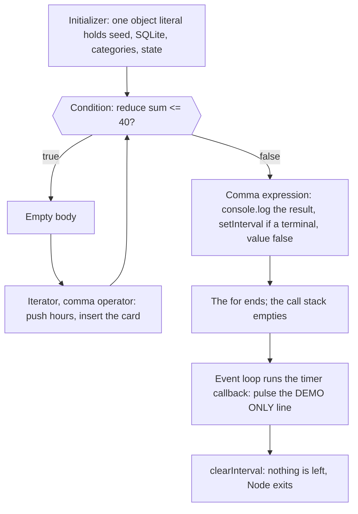
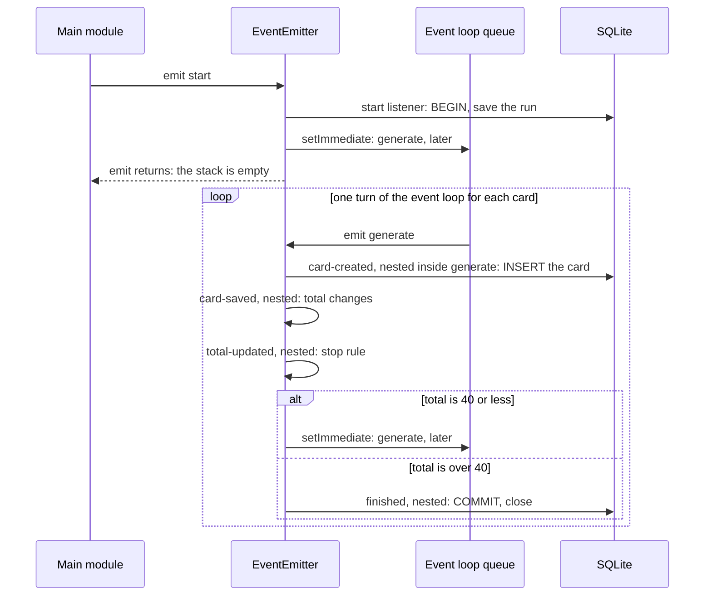
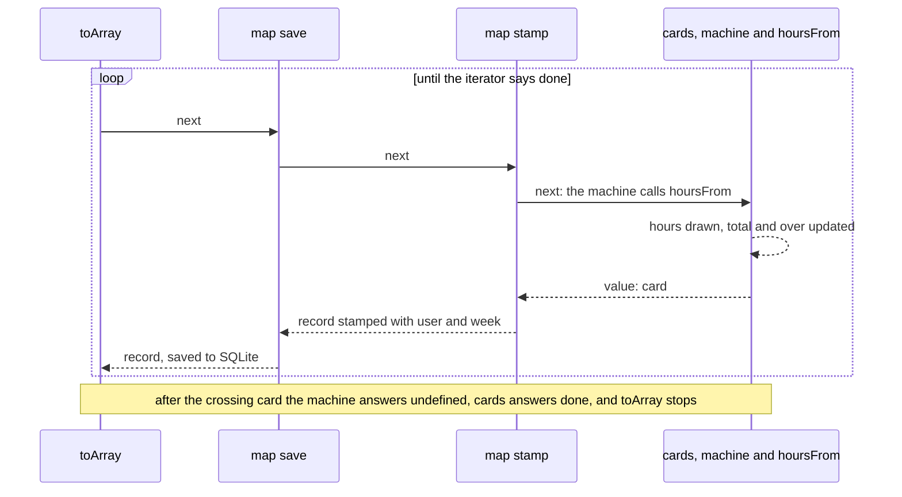

# JavaScript

Entries: [`src/javascript`](../../src/javascript/README.md) (the original's bodiless `for`, in Node.js), [`src/javascript-weird`](../../src/javascript-weird/README.md) (closures and a lazy iterator, with no loop statement) and [`src/javascript-events`](../../src/javascript-events/README.md) (ten listeners on an `EventEmitter`, with no loop statement and no pipeline). JavaScript is the language of the browser, and with Node.js it is also a general-purpose scripting language on the server. Its `for` statement is the C `for`: three clauses and a body. Here the body is empty and the three clauses are the whole program.

## What makes JavaScript special

| Feature | What it teaches |
| --- | --- |
| `for (init; test; update) body` | A loop is three expressions and a statement. The order is fixed: init once, then test, body, update, test, body, update, until the test is false. |
| The comma operator `(a, b)` | Evaluate both, give the second. It lets one expression do several things in order, which is how the iterator clause adds a card *and* saves it. |
| Truthiness and `&&`, `?:` | A test can be any value, and `a ? b : c` is an expression, not a statement. So the stop rule can be a value, and a side effect can sit in the false branch. |
| `let` in a `for` header | The loop variable is copied for each iteration. A closure made in the body sees its own copy. A copy of an *object reference* is a reference to the same object, so the state is shared. |
| Arrow functions and closures | A function carries the variables around it. The seeded random generator is a closure over one number. |
| Iterators and the iteration protocol | An object with `[Symbol.iterator]()` and a `next()` method can be consumed by `for...of`, by spread, by `Iterator.from(...).map(...)`. The *consumer* decides how many values to ask for. |
| Node.js: the event loop | JavaScript runs on one thread. Timers fire only when the current code is done. The pulse works because the loop is finished first. |

## The bodiless for in Node

### 1. Behold the monstrosity

```bash
sandbox/container/run-image.sh src/javascript
```

One statement, about 80 lines long. The body is empty. No function is declared in the file.

### 2. How the hell does that work?

- **The initializer builds the state.** One `let i = ...` holds a list of hours, the database, the clock and a seeded random generator. A `for` allows one declaration, so the state is one object.
- **The condition is the stop rule, and the report.** `total <= 40 ? true : (print, false)`. While it says `true` the loop goes on. When it says `false` it has already printed the result.
- **The iterator is the work.** It draws the hours and saves the card. It runs *before* each test, so the card that crosses 40 is saved before the test sees it. That is why the crossing card is included.
- **A timer is the animation.** On a terminal, `setInterval` pulses the DEMO ONLY line. It starts only after the loop, so it cannot slow the cards down.

The [README](../../src/javascript/README.md#how-the-stunt-works) has the table of what the C# did and what this does, and a measured comparison with the original.

### 3. What did we just learn?

- **Evaluation order is the program.** Init, test, body, update: the order is the control flow, and you can put side effects in any clause.
- **A conditional is a value.** `?:` and `&&` choose between expressions, so they can choose between *effects*.
- **State has to live somewhere that survives an iteration.** A `let` number would be copied. An object is shared.
- **The event loop is a second loop.** The `for` runs to the end first. The timer runs after. They do not interleave.
- **The comma has two meanings.** In a declaration it separates declarators. In an expression it is an operator. C# lets you mix the two in an initializer. JavaScript does not.

Tags: the `for` semantics, `?:`, `&&`, the comma operator and closures are **guaranteed** by the ECMAScript specification. `node:sqlite` is a Node.js API, outside the language standard (**implementation-permitted**).

### 4. Do this in production and you're fired

- **A `for` with an empty body hides the program in its header.** Nobody can find the loop body, because there is none.
- **Side effects in a condition are a bug waiting.** If the test runs twice, the result prints twice.
- **The state object is a global in disguise.** Anything can reach into it.

Legitimate uses: `for (;;)` with a `break`, and a comma in an update clause for two counters.

### 5. Now break it yourself

See [exercise B20](../exercises.md#b20-javascript-read-the-clauses-move-the-limit-and-fail-the-structure-check-verified).

## Closures all the way down

### 1. Behold the monstrosity

```bash
sandbox/container/run-image.sh src/javascript-weird
```

No `for`, no `while`, no `this`. The algorithm is three closures of one line each. The program is one pipeline: `Iterator.from(...).map(...).map(...).toArray()`.

### 2. How the hell does that work?

- **A closure is a state machine.** `machine(nextHours)` returns a function. It remembers a count, a total and a stop flag in variables that only it can reach. Each call makes the next card.
- **The iteration protocol is the loop.** An object with a `next()` method that says `{ done: true }` when it is finished. `toArray()` keeps asking until it hears that.
- **The stop rule is a variable.** `over = total > 40`, set in the same call that makes the crossing card. After that the machine answers `undefined`, and the stream ends.
- **Demand decides.** Nothing is drawn until something asks. `take(1)` draws one card. `toArray()` draws all of them.
- **`reduce` is the fold that cannot stop.** It runs for every element. So it adds up the finished list, and the stop is done somewhere else.

The [README](../../src/javascript-weird/README.md#how-the-stunt-works) has the closure diagram, a table of five ways to stop, and a comparison of the C# original, the bodiless `for` and this one.

### 3. What did we just learn?

- **A closure is a function plus its environment.** Lambda syntax alone is not a closure that matters. A function that changes a variable that lives past the call is.
- **Closures capture variables, not values.** Two closures over one variable share it. Every call to a factory makes new variables.
- **`this` is not a captured variable.** Detach a method and it loses its `this`. A closure keeps what it captured.
- **A closure is not a continuation.** It can be called again. It cannot resume in the middle of something, or go back.
- **Lazy and eager give different orders of effects.** `Iterator.from(xs).map(a).map(b)` runs `a1 b1 a2 b2`. `xs.map(a).map(b)` runs `a1 a2 b1 b2`. For pure functions nobody can tell. With effects you can, and that is why the "map preserves composition" law needs pure functions.
- **Only some operations can stop early.** `some`, `find`, `take` and a source that says `done` can. `reduce` cannot. A `throw` can, and it is the wrong tool.

Tags: closures, arrow functions and the iteration protocol are in the ECMAScript specification, and so are the iterator helpers since ECMAScript 2025 (**guaranteed**). `node:sqlite`, `WeakRef`'s timing and `--expose-gc` are engine and Node details, used only in the check.

### 4. Do this in production and you're fired

- **Effects inside `map` surprise people.** A reader expects `map` to be pure. This one saves rows.
- **Hidden state is hard to inspect.** A debugger shows captured variables, and `console.log` of the function does not.
- **An iterator that is spent is a trap.** A second pass over it gives nothing, with no error.

Legitimate uses: closures for private state, factories for configured functions, lazy pipelines for streams that are too big to hold, and `some`/`find` for "stop at the first".

### 5. Now break it yourself

See [exercise B21](../exercises.md#b21-javascript-weirder-move-the-stop-rule-in-a-closure-and-watch-the-demand-verified).

## Listeners all the way down

### 1. Behold the monstrosity

```bash
sandbox/container/run-image.sh src/javascript-events
```

No `for`, no `while`, no pipeline, no closure factory. The visible start-up is one line, `program(realWorld()).emit('start')`. Everything else is a listener: a small function that Node calls when an event arrives.

### 2. How the hell does that work?

- **A listener does one thing and emits the next event.** `generate` draws a card and emits `card-created`. `card-created` saves it and emits `card-saved`. `card-saved` updates the total and emits `total-updated`. `total-updated` is the stop rule.
- **`emit()` is a call.** It runs every listener of the event, in order, before it returns. The listener sits on top of the caller on the call stack.
- **`setImmediate()` is a request.** `total-updated` does not emit `generate` again. It asks the event loop for it. Node runs it on a later turn, when the stack is empty. Without that, every card would add frames to the stack, and a long run would end with a `RangeError`.
- **The save comes first.** `node:sqlite` is synchronous, so the row is written when `run()` returns. The running total changes only after that.
- **A failure is one event.** Every listener catches its own throw and emits `failed`. `failed` rolls back, closes the database, prints one line and removes every listener.

The [README](../../src/javascript-events/README.md#how-the-stunt-works) has the table of events, the trace, and the comparison with the other two Node entries.

### 3. What did we just learn?

- **Control flow can be a set of registrations.** The order of the program is in the event names, and in what each listener emits.
- **Synchronous `emit()` is not the event loop.** An emitter is a table of listeners and a function that calls them. The queue and the loop belong to Node.
- **A turn is the unit of scheduling.** Everything on one turn runs to its end before anything else starts. A callback that runs long stalls the rest.
- **Errors travel up the call stack.** A listener's `throw` goes to whoever called `emit`. If that is a scheduled callback, nobody catches it, so each listener needs its own `try`.
- **The name `error` is special.** `emit('error', e)` with no listener throws `e`.
- **Cleanup is part of the design.** A listener, timer or immediate that stays behind keeps a process alive or leaks.

Tags: `EventEmitter`'s synchronous call and its order, and `setImmediate()` running after the current operation, are documented Node behavior (**guaranteed**). See the Node.js [`events` documentation](https://nodejs.org/api/events.html). The order of `setImmediate` against `setTimeout(fn, 0)` is not promised everywhere, so the program does not depend on it.

### 4. Do this in production and you're fired

- **One listener per event is a function call with extra steps.** If only one party can ever care, call it.
- **The order is hard to see.** A reader must find every `emit` to know what follows what.
- **There is no backpressure.** An emitter keeps emitting. This program is safe only because each card waits for the one before it.
- **Listeners that change the listeners during an `emit`** make the order hard to predict. This program removes its listeners only at the very end.

Legitimate uses: many parties may care about one thing (a server's `request`, a UI's `click`), the sender must not know the receivers, and the work is I/O that should not block the thread.

### 5. Now break it yourself

See [exercise B22](../exercises.md#b22-javascript-event-driven-predict-the-trace-then-remove-the-boundary-verified), and the chapter [Events, callbacks and reactive control flow](../cs/10-events-callbacks-and-reactive-control-flow.md).

<!-- BEGIN GENERATED program-flow:languages/javascript.md -->
## How each program runs

Each picture below is the `## Program Flow` section of an entry's README, copied here by the build. It shows how that program makes the work happen: what the language, runtime or tool really does. [The introduction](../intro.md#what-the-challenge-does) has the one picture of what the challenge asks for, which is the same for every entry.

### Program flow of `javascript`

From [`javascript`](../../src/javascript/README.md) ([source section](../../src/javascript/README.md#program-flow)).



**What this shows:** the three clauses of a `for`, where the condition is a conditional expression that does the final work when it is false. The only asynchronous part is the pulse. Until the `for` is over, everything runs synchronously on one call stack.

**Why this mechanism matters:** the program has a loop, a stop and a second phase, and the second phase exists only because a timer keeps the event loop alive. Without a terminal there is no timer, and Node exits as soon as the `for` ends. The other two Node entries make this scheduling the point: [`javascript-weird`](../../src/javascript-weird/README.md) (closures) and [`javascript-events`](../../src/javascript-events/README.md) (listeners).

### Program flow of `javascript-events`

From [`javascript-events`](../../src/javascript-events/README.md) ([source section](../../src/javascript-events/README.md#program-flow)).



**What this shows:** two kinds of arrow. An `emit` is a call: the listener runs *inside* it, on top of the caller, and `emit` returns only when the listener has. The `setImmediate` arrows are requests: the next `generate` waits in the event loop's queue until the stack is empty. Each card is one turn of the loop, and four emits nest inside that turn. A throw in any listener emits `failed`, which rolls back, reports once and removes every listener.

**Why this mechanism matters:** the program has no loop statement and no recursion. The cycle is "total-updated asks the event loop for another generate". Without that boundary the same events would nest one level deeper for every card. The database write finishes inside `card-created`, before the total changes in `card-saved`.

### Program flow of `javascript-weird`

From [`javascript-weird`](../../src/javascript-weird/README.md) ([source section](../../src/javascript-weird/README.md#program-flow)).



**What this shows:** demand flows *up* the pipeline and cards flow *down* it. Nothing is drawn until `toArray()` asks, and each ask pulls one card all the way through: drawn, stamped, saved. The loop is the consumer asking again. The three closures (`cards`, `machine`, `hoursFrom`) are one column here, because each is called by the one before it.

**Why this mechanism matters:** the state lives in closures: the generator's number, and the machine's count, total and stop flag. Nothing else can reach it. The stop rule is a captured variable, `over`, set in the same call that makes the crossing card. Compare [`javascript`](../../src/javascript/README.md), where a `for` statement drives the same work, and [`javascript-events`](../../src/javascript-events/README.md), where listeners do.
<!-- END GENERATED program-flow:languages/javascript.md -->

## Computer science behind this page

<!-- BEGIN GENERATED concepts:languages/javascript.md -->
The computer-science ideas behind this page: [Transition systems and state machines](../cs/02-what-counts-as-a-machine.md#transition-systems-and-state-machines), [Invariants](../cs/02-what-counts-as-a-machine.md#invariants), [Observability](../cs/02-what-counts-as-a-machine.md#observability), [Operational semantics](../cs/02-what-counts-as-a-machine.md#operational-semantics), [Computation versus orchestration](../cs/02-what-counts-as-a-machine.md#computation-versus-orchestration), [Control flow](../cs/03-control-flow-and-continuations.md#control-flow), [Eager evaluation](../cs/04-evaluation-and-demand.md#eager-evaluation), [Lazy evaluation](../cs/04-evaluation-and-demand.md#lazy-evaluation), [Short-circuit evaluation](../cs/04-evaluation-and-demand.md#short-circuit-evaluation), [Deferred execution](../cs/04-evaluation-and-demand.md#deferred-execution), [Iterators and generators](../cs/04-evaluation-and-demand.md#iterators-and-generators), [Referential transparency](../cs/04-evaluation-and-demand.md#referential-transparency), [First-class and higher-order functions](../cs/04-evaluation-and-demand.md#first-class-and-higher-order-functions), [Functors and mapping](../cs/04-evaluation-and-demand.md#functors-and-mapping), [Monoids and folds](../cs/04-evaluation-and-demand.md#monoids-and-folds), [Dataflow programming](../cs/04-evaluation-and-demand.md#dataflow-programming), [State](../cs/06-state-beyond-variables.md#state), [The call stack](../cs/06-state-beyond-variables.md#the-call-stack), [Scope and binding](../cs/06-state-beyond-variables.md#scope-and-binding), [Closures and lexical environments](../cs/06-state-beyond-variables.md#closures-and-lexical-environments), [Side effects](../cs/07-effects-errors-and-commitment.md#side-effects), [Exception handling](../cs/07-effects-errors-and-commitment.md#exception-handling), [Integrity constraints](../cs/07-effects-errors-and-commitment.md#integrity-constraints), [Reproducibility and deterministic builds](../cs/08-abstraction-leaks-and-implementation-dependence.md#reproducibility-and-deterministic-builds), [Event-driven programming](../cs/10-events-callbacks-and-reactive-control-flow.md#event-driven-programming), [Callbacks](../cs/10-events-callbacks-and-reactive-control-flow.md#callbacks), [Publish and subscribe](../cs/10-events-callbacks-and-reactive-control-flow.md#publish-and-subscribe), [The event loop and scheduling turns](../cs/10-events-callbacks-and-reactive-control-flow.md#the-event-loop-and-scheduling-turns).
<!-- END GENERATED concepts:languages/javascript.md -->
