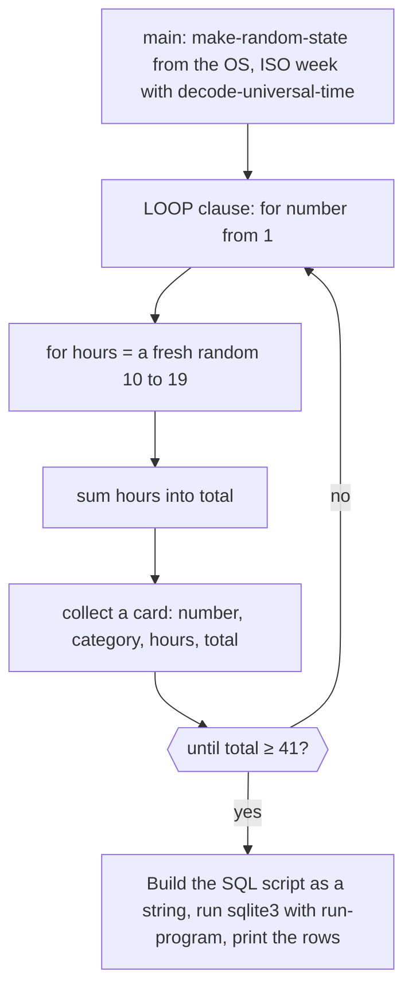
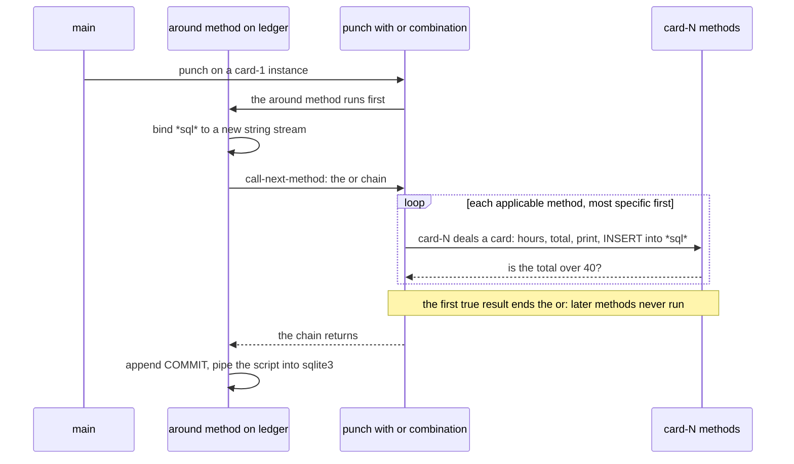

# Common Lisp

Entries: [`src/lisp`](../../src/lisp/README.md) (one `LOOP` form) and [`src/lisp-weird`](../../src/lisp-weird/README.md) (no loop, no `if`: a class hierarchy and a method combination do the work).

For an advanced reading path with traces and experiments, see the [Common Lisp study guide](../study-guides/languages/common-lisp.md).

## What makes Common Lisp special

Common Lisp is the language where almost every mechanism the language *uses* is also a mechanism you can *reach*: the reader that turns text into data, the macro expander, the object system's dispatch, the condition system. The idiomatic entry uses very little of that. The weird one uses the object system as a control-flow construct.

| Feature | Where | What it teaches |
| --- | --- | --- |
| `LOOP` is a small language of its own | [`lisp/timecards.lisp` L42-46](../../src/lisp/timecards.lisp#L42-L46): `for number from 1`, `for hours = ...`, `sum hours into total`, `collect ...`, `until (> total +limit+)` | The order of clauses is the order of execution. `until` comes *after* `collect`, which is why the card that crosses 40 is kept. |
| Structures are typed records with generated accessors | [L28](../../src/lisp/timecards.lisp#L28): `(defstruct (card (:constructor make-card ...)))` | `defstruct` writes the constructor, the accessors and the predicate for you. |
| Hand-written calendar arithmetic | [L64](../../src/lisp/timecards.lisp#L64) `iso-week` | SBCL has no ISO week function, so it is computed, then checked against `date(1)`. A week-numbering rule is an algorithm, not a lookup. |
| Talking to another process | [L133](../../src/lisp/timecards.lisp#L133): `sb-ext:run-program "sqlite3"` | Lisp builds the whole SQL script as text and pipes it in. The database is not a library here, it is a tool at the other end of a pipe. |

## Method combination as control flow

### Behold the monstrosity

```bash
sandbox/container/run-image.sh src/lisp-weird
```

The last line of the output tells you what to look for:

```text
# PUNCH had 5 OR methods and 3 ran: the class precedence list is the loop, and OR is the stop rule
```

Five methods exist. Three or four of them run. Nothing in the program says "stop". Below the `RUN TIME` marker in [`timecards.lisp`](../../src/lisp-weird/timecards.lisp) there is no `loop`, no `if`, no `cond`, no recursion.

### How the hell does that work?

**Method combination.** When a generic function is called and several methods apply, CLOS sorts them most-specific-first and *combines* them. The default combination calls the most specific one, which may call `call-next-method`. But the standard also ships others (`and`, `or`, `progn`, `append`, `list`, `max`, `min`, `+`, `nconc`) that call all the applicable methods for you:

```lisp
(defgeneric punch (ledger)
  (:method-combination or))            ; L60-61
(defmethod punch or ((ledger card-3)) ...)   ; "or" is the method's qualifier
```

`punch` is now `(or (method-for-card-1 ...) (method-for-card-2 ...) ...)` in specificity order. It has the same short-circuit as the ordinary `or`: the first true result ends it.

**The class hierarchy is the counter.** [`defcard`](../../src/lisp-weird/timecards.lisp#L34-L39) is a macro: `(defcard 3 card-4)` expands to a class `card-3` that inherits from `card-4`, and a `punch or` method specialized on it. [Five of them](../../src/lisp-weird/timecards.lisp#L87-L91) chain `card-1 → card-2 → ... → card-5 → ledger`. A `card-1` instance has class precedence list `(card-1 card-2 card-3 card-4 card-5 ledger ...)`, so `punch` runs card 1's method, then card 2's and so on. The classes have no slots: the *class itself* is the message "this is card number N".

**The stop rule is a return value.** Each method deals a card and ends with [`(> (total ledger) 40)`](../../src/lisp-weird/timecards.lisp#L84). When that is true, `or` returns and the remaining methods are never called. Why five? Cards are at least 10 hours, so four cards total at least 40, and 40 is not *over* 40. A fifth card always crosses.

**Dynamic binding as an implicit argument.** An [`:around` method](../../src/lisp-weird/timecards.lisp#L93) binds the special variable `*sql*` to a string stream, calls `call-next-method` (the whole `or` chain), then pipes the finished script to `sqlite3`. Every `format *sql*` deeper in the call stack writes into that stream, with no stream passed down.

**The reader builds a ring.** [`*week*`](../../src/lisp-weird/timecards.lisp#L44-L46) is `'#1=("Meetings" "Coding" "Debugging" "Learning" . #1#)`: `#1=` labels the list and `#1#` points back at it. The categories repeat with no `mod`.

**The program audits itself.** The closing note is computed with the metaobject protocol: `sb-mop:compute-applicable-methods` asks the system which methods apply to this ledger, and the program counts how many ran.

### What did we just learn?

- **Control flow can live in a type hierarchy.** Dispatch is the iteration, specificity order is the sequence and a return value is the `break`. Compare [COBOL's mutable jump](cobol.md#alter) and [Forth's parse position](forth.md): all three put the "where am I?" somewhere a loop counter normally is not.
- **A language can ship control-flow *policies* as data.** `or`, `and` and `progn` are not special to `defgeneric`; `define-method-combination` lets you write your own.
- **Classes are computed, not just declared.** The class precedence list is an algorithm's output (`sb-mop:compute-class-precedence-list`) that you can ask for.
- **Compile-time code runs *before* the program.** `defcard` builds names with `intern` and `format` while compiling, inside `eval-when`. None of that is a loop over cards at run time.

Tags: `or` method combination, `:around`, `#n=` syntax, `defmacro` and `eval-when` are **guaranteed** by ANSI Common Lisp. `sb-mop:compute-applicable-methods` is the MOP, which is **implementation-permitted** (SBCL, CCL and others provide it; it is not in the ANSI standard). `sb-ext:run-program` is specific to SBCL (**implementation-permitted**).

### Do this in production and you're fired

- **The control flow is invisible.** Nothing near `punch` says "this loops". A maintainer has to know that class-definition order decides execution order; splicing a class into the chain changes behavior without touching a method.
- **The limit is baked into the design.** Five classes handle "10 to 19 hours, stop over 40". Different rules need a longer or shorter chain; the straight version has no such limit. (Try it in [B10](../exercises.md#b10-lisp-swap-the-method-combination-verified).)
- **Debuggers and tracers show a stack of generic-function calls**, not a loop, and a profiler attributes the time to methods nobody wrote by hand.
- **SBCL only** as shipped: the `sb-` functions are SBCL's, while the CLOS parts are standard.

Legitimate uses: **`or`/`and` combinations are real tools** for "first handler that says yes wins" (validation chains, plug-in hooks, event handling). The stunt is using the *class hierarchy itself* as the sequence.

### Now break it yourself

See [exercises](../exercises.md#b10-lisp-swap-the-method-combination-verified).

## Quirks

- **`LOOP` clause order matters.** Move `until` above `collect` and the crossing card is dropped. This is the same trap as Haskell's `takeWhile` ([why `span`](haskell.md)).
- **Definitions must run in order.** A class must exist before another can inherit from it, so `defcard` goes tail first. Implementations differ on whether a forward reference is a warning.
- **`sql-quote` does not escape.** Every value is a number or one of four fixed words; do not reuse it for anything else.
- **No formatter exists** for Common Lisp; layout follows Emacs `lisp-mode` indentation by hand.

## Weird next to boring

[`lisp`](../../src/lisp/README.md) is one `LOOP` that sums, collects and stops: what a Lisp programmer writes. [`lisp-weird`](../../src/lisp-weird/README.md) moves the loop out of any form and into the *type system*. The first is idiomatic; the second is what the object system *permits*. Compare how [`haskell`](haskell.md) and [`apl`](apl.md) also pair a one-expression answer with one that rebuilds control flow from the language's own metaprogramming.

## Under what circumstances would this terrible idea become reasonable?

When the "loop" is really *a set of independently registered participants* (plug-ins, validators, listeners) and the language gives you a combination rule for them. Using five empty classes to count to five is a stunt; using `or` to find the first listener that accepts an event is the intended design.

<!-- BEGIN GENERATED program-flow:languages/lisp.md -->
## How each program runs

Each picture below is the `## Program Flow` section of an entry's README, copied here by the build. It shows how that program makes the work happen: what the language, runtime or tool really does. [The introduction](../intro.md#what-the-challenge-does) shows what the challenge asks for and where entries differ.

### Program flow of `lisp`

From [`lisp`](../../src/lisp/README.md) ([source section](../../src/lisp/README.md#program-flow)).



**What this shows:** `LOOP` is a small language. Its clauses run in the order written, on every pass. `for hours =` is re-evaluated each time, `sum ... into total` keeps the total in a variable the loop owns, and `until` ends the loop.

**Why this mechanism matters:** the position of `until` is the stop rule's position. Written after `collect`, it keeps the crossing card. Written before it, the last card is dropped without any error. The weird sibling [`lisp-weird`](../../src/lisp-weird/README.md) has no `LOOP`.

### Program flow of `lisp-weird`

From [`lisp-weird`](../../src/lisp-weird/README.md) ([source section](../../src/lisp-weird/README.md#program-flow)).



**What this shows:** the loop is a class hierarchy. `card-1` inherits from `card-2`, and so on, and the generic function `punch` calls the method of each class in turn. The class is the whole message "this is card number N". The method combination `or` is what stops it: it calls methods until one returns true.

**Why this mechanism matters:** CLOS decides what runs and in what order. The program has no statement that says "stop", and the unused methods are simply never called. The `:around` method wraps the whole chain and uses dynamic binding to send every `format` to one stream.
<!-- END GENERATED program-flow:languages/lisp.md -->

## Computer science behind this page

<!-- BEGIN GENERATED concepts:languages/lisp.md -->
The computer-science ideas behind this page: [Control flow](../cs/03-control-flow-and-continuations.md#control-flow), [Short-circuit evaluation](../cs/04-evaluation-and-demand.md#short-circuit-evaluation), [Macros and text expansion](../cs/05-formal-languages-as-computational-substrates.md#macros-and-text-expansion), [Domain-specific languages](../cs/05-formal-languages-as-computational-substrates.md#domain-specific-languages), [State](../cs/06-state-beyond-variables.md#state), [Scope and binding](../cs/06-state-beyond-variables.md#scope-and-binding), [Homoiconicity: code as data](../cs/06-state-beyond-variables.md#homoiconicity-code-as-data), [Reflection and metaprogramming](../cs/06-state-beyond-variables.md#reflection-and-metaprogramming).
<!-- END GENERATED concepts:languages/lisp.md -->
