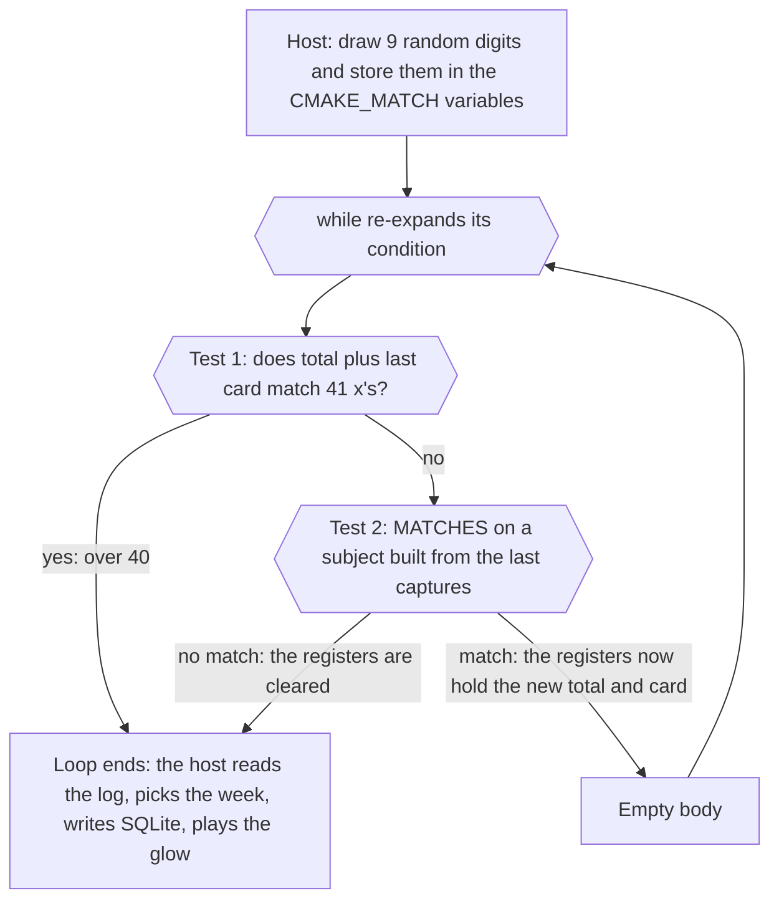
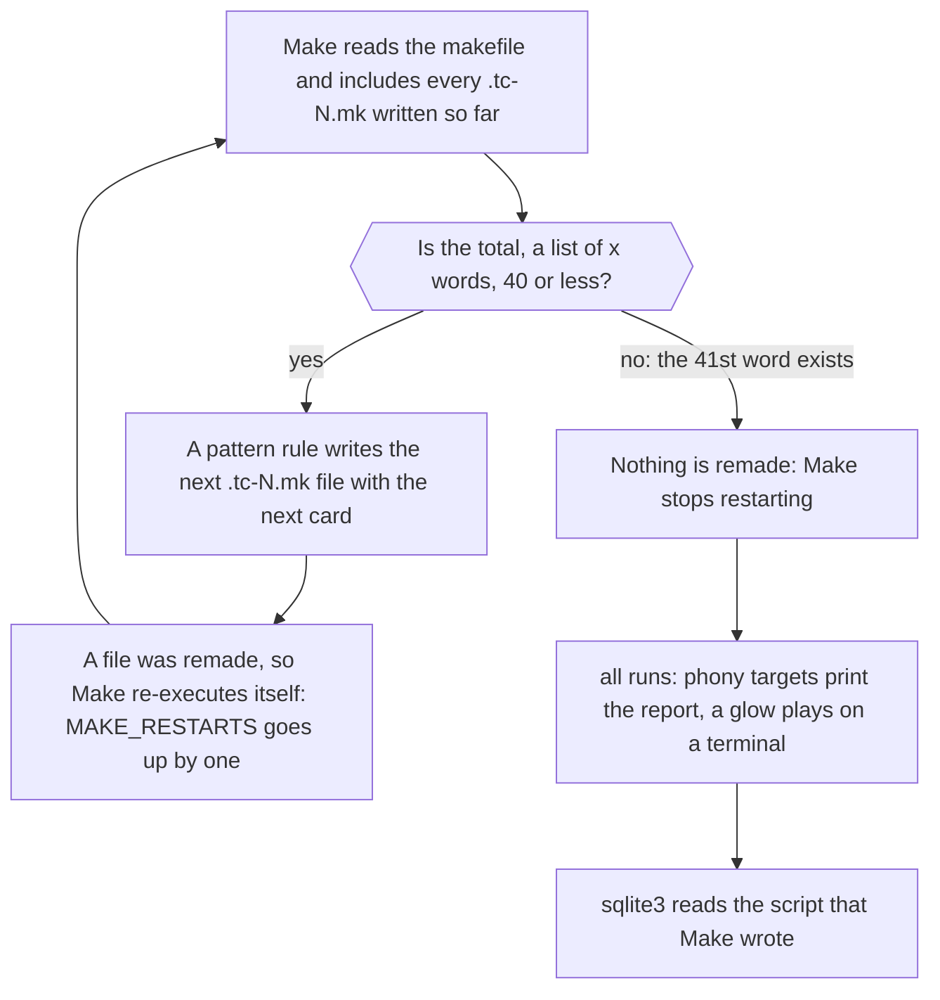

# GNU Make and CMake

Entries: [`src/make-gnu`](../../src/make-gnu/README.md) and [`src/cmake`](../../src/cmake/README.md). Both are build tools asked to behave like programming languages, in different ways.

## GNU Make

### 1. Behold the monstrosity

```bash
sandbox/container/run-image.sh src/make-gnu
```

A Makefile with **no `$(shell)`, no `!=`, no Guile and no `load`** (`check.sh` greps for all of them). It draws random hours, does arithmetic (including a full ISO-week calculation from the clock), loops, writes a database and glows on a terminal.

### 2. How the hell does that work?

- **Numbers are lists of `x`.** A 60,000-word "ruler" of `x`s, and `$(words $(wordlist 1,a,$(U)) $(wordlist 1,b,$(U)))` adds; `$(wordlist b+1,a,...)` subtracts. The stop rule `total > 40` is "the 41st word exists": `$(word 41,...)`.
- **Entropy and the clock without a shell.** `$(file </proc/sys/kernel/random/uuid)` reads a file; nested `$(subst)` strips letters, leaving a decimal digit. Time is `btime` from `/proc/stat` plus `/proc/uptime`, added digit by digit with a carry.
- **The loop is Make re-executing itself.** [`Makefile` L95-101](../../src/make-gnu/Makefile#L95-L101):

  ```make
  K := $(or $(MAKE_RESTARTS),0)
  ...
  include $(if $(runs),$(wildcard .tc-*.mk))
  -include $(if $(runs),.tc-$(K).mk)
  ```

  Make treats an included makefile it *can remake* as a target. A pattern rule ([L110-111](../../src/make-gnu/Makefile#L110-L111)) writes the next card file `.tc-N.mk` while the running total is 40 or less. A makefile that was just remade means "restart", so Make re-executes itself, now including one more file. `$(MAKE_RESTARTS)` is the loop counter. When the rule declines to write, nothing is remade and `all` runs.
- **The trailing `@:` matters.** A recipe that *expands to nothing* does not count as remaking the file. The card file is written while the recipe is *expanded* (`$(file >$@,...)`), but Make only notices a restart if a command actually ran, so each card ends with the shell's no-op `@:`.
- **The report is a chain of phony targets** (`init`, `rows`, `footer`, frame targets), because Make expands every line of a recipe before running any.

### 3. What did we just learn?

- **Make is a dependency engine that can restart itself.** "Remake the thing that describes the build" is a loop in disguise.
- **State can be the existence of files.** Make state here is which `.tc-N.mk` files exist.
- **Expansion time and execution time are different phases** ([Make's two phases](#quirks-and-walls)), and the program lives in the gap.

Tags: includes-and-restart is **documented** GNU Make behavior but its use as a loop is **accidentally exploited**. `$(file <...)` needs GNU Make 4.2+. `/proc` reads are **platform-specific** (Linux).

### 4. Do this in production and you're fired

- **A crashed run leaves `.tc-*.mk` behind**; the next `make` refuses to start (it would treat them as real cards) until `make clean`.
- **Timestamp granularity.** The first design rewrote one `.state.mk` and restarted once, then stopped: WSL's file timestamps were coarse enough that the rewrite looked unchanged. "Missing to present" is unambiguous; "modified" is not.
- **UTC only**, because `/etc/localtime` is binary and Make cannot read it.
- **Debugging** means reasoning about expansion phases, restarts and file state at once.

Legitimate uses: generating includes (`-include $(DEPS)`) that cause a restart when regenerated is the *intended*, standard idiom for auto-dependencies. The weird version is that idiom run to a conclusion.

### 5. Now break it yourself

See [exercises](../exercises.md#b4-make-remove-the-no-op-and-override-the-clock-verified).

## CMake

### 1. Behold the monstrosity

```bash
sandbox/container/run-image.sh src/cmake
```

One `while()` with an empty body. Everything that decides anything is in its condition.

### 2. How the hell does that work?

[`timecards.cmake` L41-54](../../src/cmake/timecards.cmake#L41-L54):

```cmake
while(NOT "${CMAKE_MATCH_1}${CMAKE_MATCH_5}" MATCHES "^xxxxxxxxxxxxxxxxxxxxxxxxxxxxxxxxxxxxxxxxx"
      AND "${CMAKE_MATCH_1}${CMAKE_MATCH_5}|${CMAKE_MATCH_3}|..." MATCHES "^(x*)\\|([0-9])...${CMAKE_MATCH_2}:(x*)\\|")
endwhile()
```

CMake's `if()`/`while()` `MATCHES` stores its capture groups in ordinary variables `CMAKE_MATCH_1`..`n`, and a `while()` **re-expands its condition on every pass**. So the condition builds its subject and its pattern from the previous pass's captures. That is a register machine, and the match is the program.

- **State** ([L28-32](../../src/cmake/timecards.cmake#L28-L32)): numbers are runs of `x`; `CMAKE_MATCH_1` is the total, `_2` the digit peeked last pass, `_3` the rest of the digit tape, `_4` the log of finished cards, `_5` the last card's hours.
- **Hours 10-19** come from a table *inside the subject* (`0:xxxxxxxxxx|1:xxxxxxxxxxx|...`) and a pattern that splices the previous pass's digit in (`${CMAKE_MATCH_2}:`).
- **The stop rule** is the first test: `NOT` (total + last card matches a literal of 41 `x`s). Exactly 40 continues.
- **Order matters**: a failed `MATCHES` clears every register, a successful one rewrites them, so the stop test goes first so that the *main* match's captures are the ones that survive.

### 3. What did we just learn?

- **Scope and evaluation order are program state.** Variables you did not declare (`CMAKE_MATCH_n`) are written as a side effect of a condition.
- **A condition can be a statement.** Here evaluating the test *is* the instruction.
- **Compare**: [Perl and PCRE2](regex.md) put the loop inside one regex match; CMake uses a regex *per pass* but lets the loop re-expand it. Same idea, different place.

Tags: `CMAKE_MATCH_n` being set by `MATCHES` is **documented**; re-expansion of the `while()` condition each pass is **documented** behavior; clearing all registers on a failed match is **observed**, so treat it as **implementation-permitted**.

### 4. Do this in production and you're fired

- **CMake's regex has no counted repetition** (`x{41}` is unsupported, hence the literal 41-character test), **no lookahead and no backreferences**. A tempting `(x?x?...)` x 40 for "at most 40" would backtrack exponentially on failure.
- **The host still reports.** Output cannot happen from inside a condition, so printing, the SQLite writes and the glow are ordinary CMake after the loop.
- **ISO year by hand.** `string(TIMESTAMP)` knows `%V` but not `%G`.
- **`message()` goes to stderr**, hence `/dev/stdout` writes.

### 5. Now break it yourself

See [exercises](../exercises.md#b5-cmake-mutate-the-literal-verified): the repo's own `check.sh` mutates the 41-character literal to prove it controls the loop.

## Quirks and walls

- **Make expands every line of a recipe before it runs any**, so `$(info)` output would come out before SQLite's header.
- **`#` starts a comment even inside a SQL string in a variable**; the header's `'# DEMO ONLY'` is written `\#`.
- **Make escape codes need a literal ESC byte** (`define ESC` holds one `0x1b`).
- **No pure-Make way to create a directory or a SQLite file**, hence `mkdir -p` and `sqlite3`.
- **`wt.exe` treats `;` as its own subcommand separator**, so command lines passed to it contain none. In CMake, lists are `;`-separated too, so this needs care.
- **Four 10-hour cards total exactly 40, which continues**, so the fifth card reuses Meetings (both entries).
- **Detecting a terminal without a shell**: Make uses `$(realpath /proc/self/fd/1)` matching `/dev/pts/%`.
- **Make cannot tell time in a portable way**; this entry calculates the date from `/proc` and walks the calendar from 1970.

## Weird next to boring

The "boring" CMake version was the first draft: `while()`, `math(EXPR)`, `list(GET)`. The README records throwing it away because it was `RunEverything()` in CMake's accent. The comparison is instructive: the ordinary script is clearer, and the weird one is the one that taught what `MATCHES` actually does.

## Under what circumstances would this terrible idea become reasonable?

Never as a loop. But "a build system that regenerates its own inputs and restarts" is exactly what auto-dependency generation relies on, and CMake's regex captures are a legitimate way to parse versions and paths. The stunt is those features used for everything.

<!-- BEGIN GENERATED program-flow:languages/make-cmake.md -->
## How each program runs

Each picture below is the `## Program Flow` section of an entry's README, copied here by the build. It shows how that program makes the work happen: what the language, runtime or tool really does. [The introduction](../intro.md#what-the-challenge-does) has the one picture of what the challenge asks for, which is the same for every entry.

### Program flow of `cmake`

From [`cmake`](../../src/cmake/README.md) ([source section](../../src/cmake/README.md#program-flow)).



**What this shows:** `while()` re-expands its condition on every pass, and `MATCHES` stores its captures in ordinary variables. So the condition can build its next subject out of its last captures, and the *match* is the program. Numbers are runs of `x`, and the stop rule is a 41-character literal.

**Why this mechanism matters:** the loop has an empty body and a register machine for a condition. Test 1 must run first, because a failed match clears the registers and a successful one rewrites them, so the main match has to run last for its captures to survive.

### Program flow of `make-gnu`

From [`make-gnu`](../../src/make-gnu/README.md) ([source section](../../src/make-gnu/README.md#program-flow)).



**What this shows:** the loop is the build tool re-running itself. Each pass includes the `.tc-N.mk` files that exist, and a file that gets written forces a restart. The state is *which files exist*. The stop rule is that the rule declines to write a new file.

**Why this mechanism matters:** Make's dependency engine decides what to do next from the state of the file system. There is no loop statement and no `$(shell)`: arithmetic is list surgery on `x` words. The report is a chain of phony targets so that its output stays in order.
<!-- END GENERATED program-flow:languages/make-cmake.md -->

## Computer science behind this page

<!-- BEGIN GENERATED concepts:languages/make-cmake.md -->
The computer-science ideas behind this page: [Register machines and counter machines](../cs/02-what-counts-as-a-machine.md#register-machines-and-counter-machines), [Turing completeness](../cs/02-what-counts-as-a-machine.md#turing-completeness), [Control flow](../cs/03-control-flow-and-continuations.md#control-flow), [Fixed-point iteration](../cs/03-control-flow-and-continuations.md#fixed-point-iteration), [Regular expressions](../cs/05-formal-languages-as-computational-substrates.md#regular-expressions), [Declarative programming](../cs/05-formal-languages-as-computational-substrates.md#declarative-programming), [Domain-specific languages](../cs/05-formal-languages-as-computational-substrates.md#domain-specific-languages), [Build automation](../cs/05-formal-languages-as-computational-substrates.md#build-automation), [State](../cs/06-state-beyond-variables.md#state), [Dependency graphs](../cs/06-state-beyond-variables.md#dependency-graphs), [Hyrum's law](../cs/08-abstraction-leaks-and-implementation-dependence.md#hyrums-law).
<!-- END GENERATED concepts:languages/make-cmake.md -->
