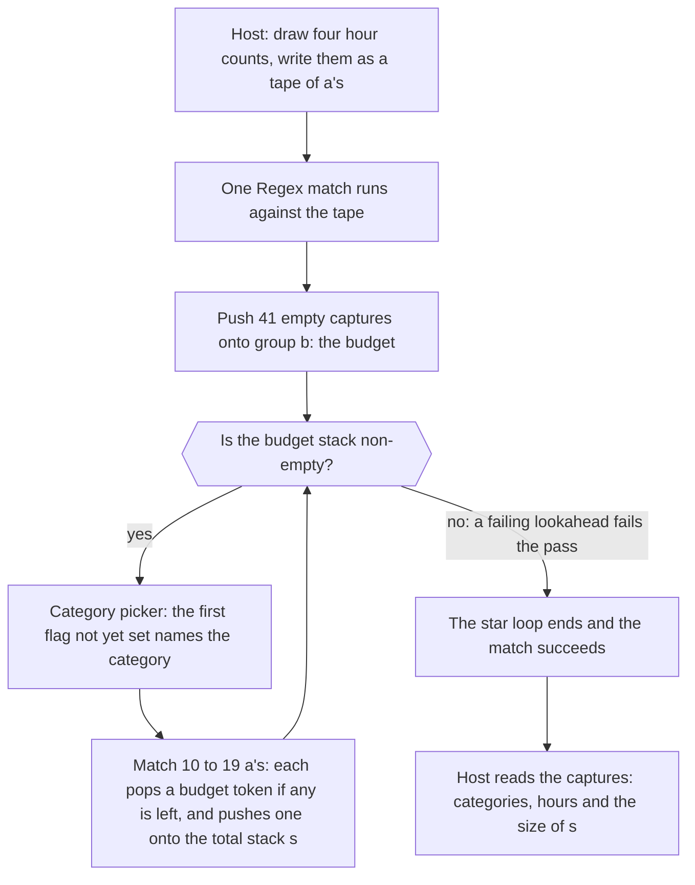
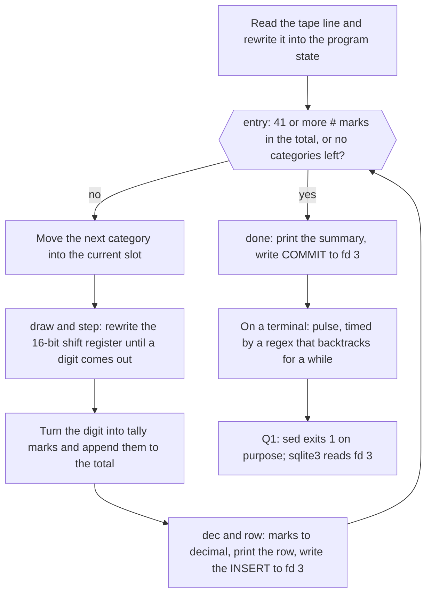
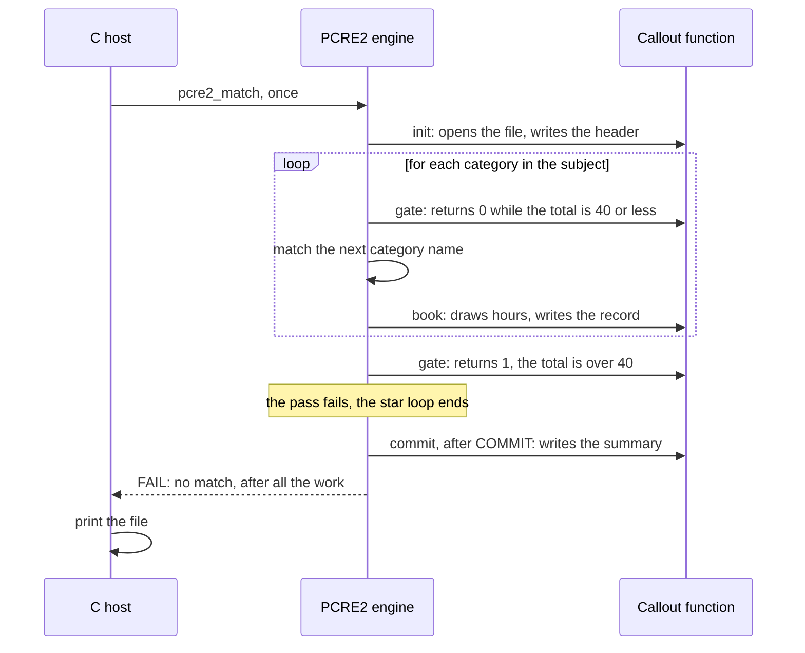
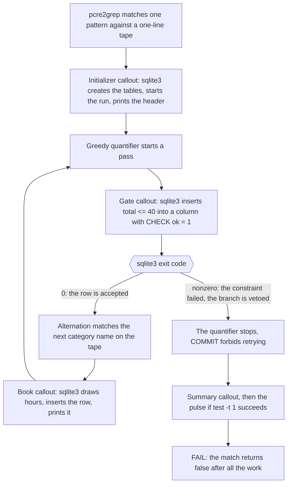
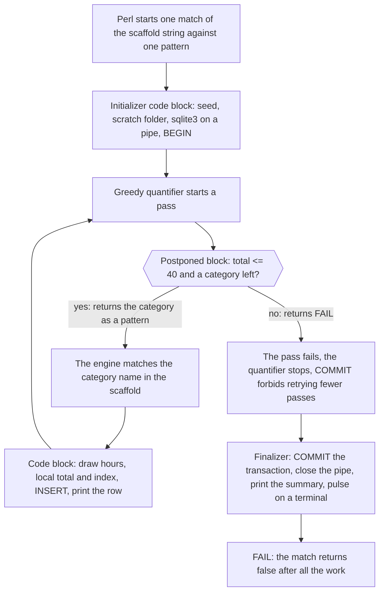

# Regular expressions: five engines, five personalities

Entries: [`regex-perl`](../../src/regex-perl/README.md), [`regex-pcre2`](../../src/regex-pcre2/README.md), [`regex-pcre2grep`](../../src/regex-pcre2grep/README.md), [`regex-dotnet`](../../src/regex-dotnet/README.md), [`regex-sed`](../../src/regex-sed/README.md).

For an advanced reading path with traces and experiments, see the [regex engines and sed study guide](../study-guides/languages/regex-engines-and-sed.md).

A regular expression looks like a pattern. These entries treat it as a **program**: the match is the computation, backtracking is the search, and the side effects are what you *wanted*. The recurring signature move is to do all the work and then **return "no match" on purpose**.

## What makes each engine special

| Engine | Program is... | The special thing | Where |
| --- | --- | --- | --- |
| **Perl** | one `=~` match | Code blocks `(?{ })` run during the match; `(??{ })` returns a *pattern*, and `local` unwinds on backtracking | [`timecards.pl` L7](../../src/regex-perl/timecards.pl#L7) |
| **PCRE2** | one `pcre2_match` call | Callout strings `(?C"book")` are opcodes for a bodiless C dispatcher | [`timecards.c` L24-26](../../src/regex-pcre2/timecards.c#L24-L26) |
| **pcre2grep** | one command line, no custom code | Callout scripts name programs to run, and their **exit codes steer the match** | [`timecards.sh` L14-20](../../src/regex-pcre2grep/timecards.sh#L14-L20) |
| **.NET** | a pattern of balancing groups only | Capture *stacks* make a counter | [`Program.cs` L13](../../src/regex-dotnet/Program.cs#L13) |
| **GNU sed** | one line of text, rewritten | A [Markov algorithm](../../src/regex-sed/README.md#markov-algorithms-computing-by-find-and-replace): find-and-replace as a computer | [`timecards.sed`](../../src/regex-sed/timecards.sed) |

## Perl: code inside the match

### Behold the monstrosity

```bash
sandbox/container/run-image.sh src/regex-perl
```

The file's only statement is a single `=~`. Seeding, the random draws, the SQLite transaction, the pulse and all the printing happen *inside the match*, and then the match returns false.

### How the hell does that work?

| Piece | Job |
| --- | --- |
| `^(?{ ... })` | initializer: seeds state, starts `sqlite3` on a pipe, opens a transaction |
| `(?: ... )*` | the loop: greedy quantifier is the iteration; the scaffold string gives each pass something to eat |
| `(??{ $::t<=40 ? $::c[$::n] // '(*FAIL)' : '(*FAIL)' })` | stop rule **and** category chooser: it returns the next category *as a pattern*, or `(*FAIL)` |
| `(?{ local $::t = ...; print ... })` | one card |
| `(*COMMIT)` | once the loop ends, stop backtracking from retrying shorter loops |
| `(*COMMIT)(?{ settle })(*FAIL)` | the signature move: give up after doing all the work |

`local` is the interesting part: Perl unwinds `local` assignments when the engine backtracks, so the running total is backtrack-aware, but the `INSERT`s and `print`s are *not* undone. The engine abandons the branch and the side effects stay written. The SQLite transaction is real and commits; **the match is what lies**.

### Learn and break

- Backtracking is a search procedure, and a failing branch is information. State that unwinds (`local`) and state that does not (I/O) behave differently, and that difference is the whole trick. See [patterns](../patterns.md#backtracking-side-effects-and-error-handling).
- **Production**: code in patterns is hard to test or debug, and in Perl, regex code blocks run with the file's `strict` rules and can only `local` package variables.
- **Tags**: `(?{ })`, `(??{ })` and `local` unwinding are **documented Perl features**.

## PCRE2: callouts as an instruction set

The whole pattern ([`timecards.c` L24-26](../../src/regex-pcre2/timecards.c#L24-L26)):

```text
^(?C"init")(?:(?C"gate")(Meetings|Coding|Debugging|Learning)(?C"book"))*(*COMMIT)(?C"commit")(*FAIL)
```

(Plus a pulse tail.) The C host compiles it, registers one dispatcher, calls `pcre2_match` once, and prints the file. The callout string is an opcode: `init`, `gate` (returns 1 once the total is over 40 to fail the branch and end the loop), `book`, `commit`. **PCRE2 supplies the iteration, the category walk and the backtracking.**

- **The optimizer caveat is the lesson.** Callouts only mean something if the engine visits them. The program compiles with `PCRE2_NO_AUTO_POSSESS | PCRE2_NO_START_OPTIMIZE | PCRE2_NO_DOTSTAR_ANCHOR` ([L84-86](../../src/regex-pcre2/timecards.c#L84-L86)) and avoids the JIT, which does not support callouts. This is **implementation-permitted**, and the README did not test what the optimizer would elide with the flags removed.
- **State in a C struct does not rewind on backtracking**, unlike Perl's `local`. That suits this program: nothing is ever undone.
- **A negative callout return aborts the match** with the callout's code, deliberately not `-1`, which means "no match" and would be mistaken for the expected result.

## pcre2grep: exit codes as control flow

The "host" is a stock `pcre2grep` and one command line. Callout strings name programs; **their exit codes steer the match**. The stop rule is an `INSERT INTO stop_rule SELECT (...)<=40` into a table with `CHECK(ok=1)`, so SQLite's constraint violation is the loop terminator.

- **Callouts need absolute paths.** `pcre2grep` uses `fork` and `execv`, which do not search `PATH`. A bare `true` or `sleep` is silently a failed callout, indistinguishable from a vetoed branch.
- **No state in the pattern.** The running total lives in SQLite and each callout re-reads it.
- **No transaction.** Each helper is its own process, so each statement commits immediately; "abandoned branch, side effects stay" is literal.
- **Ubuntu's own `pcre2grep` is built without callout scripts.** It needs an upstream build (the sandbox image pins 10.49). A textbook **implementation-permitted** case.
- **Security**: callouts that run programs are a command-execution feature. `check.sh` allows only `/usr/bin/sqlite3`, `/usr/bin/test` and `/bin/sleep`.

## .NET: balancing groups

[`Program.cs` L13](../../src/regex-dotnet/Program.cs#L13) uses a budget of 41 empty captures and **balancing groups** that pop one per hour: `(?<-b>)`. The "counter" is a capture stack.

This entry is the repo's best **honest failure**, and it is the one that most clearly marks where regex alone stops. See [blocking problems](../blocking-problems.md#regexdotnet):

- A regex cannot draw random numbers, so the host seeds four unary strings.
- A regex cannot write anything.
- **The signature move is impossible**: append `(?!)` and the match fails, and a failed .NET `Match` exposes no captures, so everything accumulated is gone. This track *must* return true.

## GNU sed

The entire program state is **one line of text**; every step is a substitution. There are no variables or numbers.

- **The loop** is `b`/`t` jumps behind regex addresses: [`/ tot:#{41}/b done`](../../src/regex-sed/timecards.sed#L14) is the stop rule, with the total as tally marks `#`.
- **Randomness** is a 16-bit shift register of `0`s and `1`s ([L17-29](../../src/regex-sed/timecards.sed#L17-L29)); XOR is done by deleting zeros and testing for odd counts. The taps (16, 14, 13, 11) give a maximal period of 65,535. It is a toy generator, and the same seed gives the same cards.
- **A draw is rejected** with `/ rng:1(01|1)/b draw` when the nibble is 10-15, and a bits-to-digit table plus tally-mark expansion turns the nibble into hours.
- **The pulse is timed by a catastrophic-backtracking regex**: the clock is a pattern that takes about 50 ms per frame to fail. (Machine-dependent, which is why pipes and `check.sh` skip it.)
- **Exit 1 on purpose.** sed has no match result spanning a whole program, so "returns false" is the process exit status (the wrapper maps 1 to 0).
- **GNU only**: `T`, `Q`, `--debug`, `\x1b`, `\t` and `-E` intervals are GNU extensions.
- **sed has a goto** (`b`, `t`), which Perl and PCRE do not, so this entry's loop structure is "a rewriting machine with a program counter, not a single match".

The README has an eleven-step trace of one iteration, and `TRACE=1 ./timecards.sh` dumps the state line at each step. This is the best place in the repo to *watch* a computation happen.

## What did we just learn?

- **A regex engine is a general search machine** with state (captures), control (alternation, quantifiers, `(*COMMIT)`) and optional I/O hooks.
- **Failure is information**, and different engines keep or discard it differently (Perl unwinds `local`, PCRE2's C state persists, .NET discards captures, pcre2grep's side effects are real database writes).
- **String-rewriting systems are universal.** sed with no numbers does arithmetic, which is what a Markov algorithm is.

## Under what circumstances would this terrible idea become reasonable?

Never as an application design. But callouts and code blocks are legitimate in *tools*: tokenizers, lexers, instrumented matchers, pattern debuggers and teaching aids. And understanding backtracking performance cliffs, the thing sed's pulse exploits for a clock, is the practical skill that protects production systems from ReDoS.

## Quirks, collected

- Perl regex code blocks need package variables; `strict` and `local` interact.
- Perl's `no warnings 'regexp'` is needed to silence the "null iteration" warning on a dynamic loop body.
- PCRE2 JIT does not support callouts; flags can change whether callouts fire.
- pcre2grep callouts fail silently if the program path is not absolute.
- .NET `Match` on failure exposes no captures.
- CMake's regex is the weakest of all of them (no counted repetition, lookahead or backreferences); see [Make and CMake](make-cmake.md#cmake).
- sed: GNU-only features; the `w` command and `e` modifier can run or write anything, and `check.sh` rejects them (a grep, not a sandbox).
- All entries build SQL by pasting text into strings. It is safe here only because every value is computed or one of four fixed words. **Do not copy the habit.**

<!-- BEGIN GENERATED program-flow:languages/regex.md -->
## How each program runs

Each picture below is the `## Program Flow` section of an entry's README, copied here by the build. It shows how that program makes the work happen: what the language, runtime or tool really does. [The introduction](../intro.md#what-the-challenge-does) has the one picture of what the challenge asks for, which is the same for every entry.

### Program flow of `regex-dotnet`

From [`regex-dotnet`](../../src/regex-dotnet/README.md) ([source section](../../src/regex-dotnet/README.md#program-flow)).



**What this shows:** the regex engine is a machine with stacks. A balancing group pops one stack and pushes another in the same step, so a single `a` can spend one unit of budget and add one hour to the total. The budget stack is the stop rule: when it is empty, the next pass cannot start.

**Why this mechanism matters:** the state is stack *depth*. Nothing counts and nothing adds. The match succeeds, and the program's answer is what the engine captured. An entry may push the total over 40 mid-way, because the budget runs dry partway through its hours and the extra `a`s pop nothing.

### Program flow of `regex-sed`

From [`regex-sed`](../../src/regex-sed/README.md) ([source section](../../src/regex-sed/README.md#program-flow)).



**What this shows:** the only memory is one line of text, and every step is a substitution on it. The jumps (`b` and `t`) with address tests make a program counter. The loop is the jump from `row` back to `entry`, and the stop rule is a regex that matches 41 tally marks.

**Why this mechanism matters:** this is a rewriting system, the Markov-algorithm model: there are no variables and no numbers. The other regex entries make one match do the work. This one makes many substitutions do it, and uses a slow match only as a clock.

### Program flow of `regex-pcre2`

From [`regex-pcre2`](../../src/regex-pcre2/README.md) ([source section](../../src/regex-pcre2/README.md#program-flow)).



**What this shows:** the C host has no loop. It calls `pcre2_match` once and the engine calls back into the host at every callout. The callout name is an opcode. The return value is the decision: `0` means continue and `1` means fail this branch.

**Why this mechanism matters:** the stop rule is a callout that returns `1`, so the `*` quantifier ends by backtracking. `(*COMMIT)` makes `commit` run exactly once, and `(*FAIL)` makes the whole match lose. The callouts are synchronous calls from the engine, not queued events.

### Program flow of `regex-pcre2grep`

From [`regex-pcre2grep`](../../src/regex-pcre2grep/README.md) ([source section](../../src/regex-pcre2grep/README.md#program-flow)).



**What this shows:** a callout string that starts with a path runs a program. Exit status 0 lets the match go on, and any other status fails that branch. So every decision in the program is an exit code from `sqlite3`. A constraint violation (the total is over 40) is the stop rule.

**Why this mechanism matters:** `pcre2grep` is not a language runtime, but it has a process boundary inside the matcher. The engine asks an external program a question and backtracks on the answer. Compare [`regex-pcre2`](../../src/regex-pcre2/README.md), where the question is a function call in the same process.

### Program flow of `regex-perl`

From [`regex-perl`](../../src/regex-perl/README.md) ([source section](../../src/regex-perl/README.md#program-flow)).



**What this shows:** one regex match is the whole program. The quantifier is the loop, and a code block that returns a *pattern* is the stop rule: it returns the next category's name, or `(*FAIL)` to make the pass fail. Code blocks are the only places where work happens.

**Why this mechanism matters:** backtracking can undo `local` variables but not side effects. The engine abandons a branch, while the `INSERT` and the `print` stay done. That is why the match can end by failing and the data is still saved. The SQL transaction is real. Only the *match* lies.
<!-- END GENERATED program-flow:languages/regex.md -->

## Computer science behind this page

<!-- BEGIN GENERATED concepts:languages/regex.md -->
The computer-science ideas behind this page: [Threat model](../cs/01-reading-an-adversarial-program.md#threat-model), [Arbitrary code execution](../cs/01-reading-an-adversarial-program.md#arbitrary-code-execution), [Representing state](../cs/02-what-counts-as-a-machine.md#representing-state), [Register machines and counter machines](../cs/02-what-counts-as-a-machine.md#register-machines-and-counter-machines), [Markov algorithms](../cs/02-what-counts-as-a-machine.md#markov-algorithms), [Turing completeness](../cs/02-what-counts-as-a-machine.md#turing-completeness), [Computation versus orchestration](../cs/02-what-counts-as-a-machine.md#computation-versus-orchestration), [Fixed-point iteration](../cs/03-control-flow-and-continuations.md#fixed-point-iteration), [The Chomsky hierarchy](../cs/05-formal-languages-as-computational-substrates.md#the-chomsky-hierarchy), [Regular expressions](../cs/05-formal-languages-as-computational-substrates.md#regular-expressions), [Parsing](../cs/05-formal-languages-as-computational-substrates.md#parsing), [Term and string rewriting](../cs/05-formal-languages-as-computational-substrates.md#term-and-string-rewriting), [Domain-specific languages](../cs/05-formal-languages-as-computational-substrates.md#domain-specific-languages), [Interpreters and virtual machines](../cs/05-formal-languages-as-computational-substrates.md#interpreters-and-virtual-machines), [State](../cs/06-state-beyond-variables.md#state), [The stack as a data structure](../cs/06-state-beyond-variables.md#the-stack-as-a-data-structure), [Side effects](../cs/07-effects-errors-and-commitment.md#side-effects), [Exit status](../cs/07-effects-errors-and-commitment.md#exit-status), [Integrity constraints](../cs/07-effects-errors-and-commitment.md#integrity-constraints), [Backtracking](../cs/07-effects-errors-and-commitment.md#backtracking), [The cut: committing to a choice](../cs/07-effects-errors-and-commitment.md#the-cut-committing-to-a-choice), [Transactions](../cs/07-effects-errors-and-commitment.md#transactions), [Portability](../cs/08-abstraction-leaks-and-implementation-dependence.md#portability), [Optimizers](../cs/08-abstraction-leaks-and-implementation-dependence.md#optimizers), [Performance cliffs and time complexity](../cs/08-abstraction-leaks-and-implementation-dependence.md#performance-cliffs-and-time-complexity), [Regular-expression denial of service](../cs/08-abstraction-leaks-and-implementation-dependence.md#regular-expression-denial-of-service), [Callbacks](../cs/10-events-callbacks-and-reactive-control-flow.md#callbacks).
<!-- END GENERATED concepts:languages/regex.md -->
