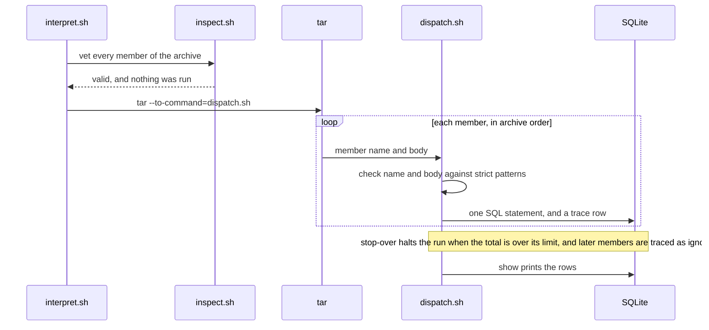
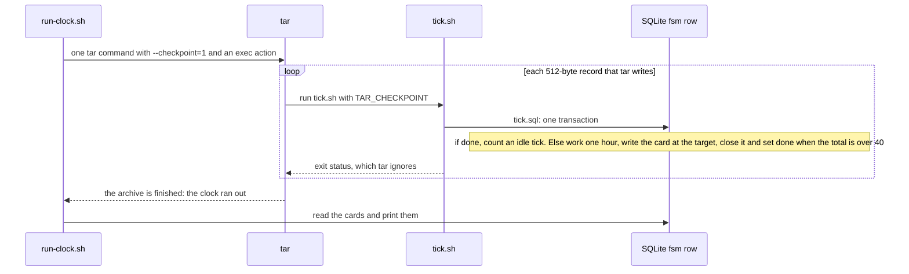

# tar

Entries: [`src/tar-gnu`](../../src/tar-gnu/README.md) (the archive is a program) and [`src/tar-gnu-weird`](../../src/tar-gnu-weird/README.md) (the archive is a clock). `tar` ("tape archive") packs many files into one stream of bytes. It was made for magnetic tape, where you cannot jump around, so an archive is a *sequence*: a header, the file's bytes, the next header, and so on. That one fact is why a tar archive can be a program. Order is already part of the format.

For an advanced reading path with traces and experiments, see the [tar study guide](../study-guides/languages/tar.md).

## What makes tar special

| Feature | What it teaches |
| --- | --- |
| An archive is a sequence of 512-byte blocks: a header block, then the data blocks, then the next header | There is no index and no directory. To find a member you read from the start. That is a stream, and a stream is a natural tape for an interpreter. |
| `tar -xf` writes the members as files | Extraction is passive. An archive cannot make tar run anything. |
| GNU `--to-command=CMD` starts `CMD` for each regular member and pipes the member to it | The *operator* attaches an interpreter. The command line carries the power, and the archive does not. |
| `TAR_FILENAME`, `TAR_SIZE` and more are set for each command | The member's metadata becomes the command's input, next to its bytes. |
| tar keeps going when the command fails | There is no built-in "stop". A control rule must be the interpreter's own. |
| `--checkpoint=N --checkpoint-action=exec=CMD` runs `CMD` every N records | A progress report is an event source. It can be a clock. |
| `-b N` sets the *record* size to N blocks of 512 bytes | The unit of time is a record, and the archive's size, not its content, decides how many there are. |

## A program that is an archive

### 1. Behold the monstrosity

```bash
sandbox/container/run-image.sh src/tar-gnu
```

A tar archive of twelve tiny files. A dispatcher of about 80 lines. No loop in the dispatcher, no random numbers, no number 40.

### 2. How the hell does that work?

- **The members are the instructions.** `010.card` is "add a card". Its body is `category=Meetings` and `hours=13`. The name carries the order, and the body carries the operands.
- **tar is the loop.** It reads the next member and starts the dispatcher, until the archive ends.
- **The dice are rolled when the program is written.** A builder draws the five hours from a seeded generator and stores the seed in the first member. The same seed gives the same bytes.
- **The stop rule is data.** Each card is followed by a `011.stop-over` member that holds `limit=40`. The dispatcher only knows what `stop-over` *means*: halt if the total is over the limit.
- **Reading is not running.** `inspect.sh` lists and decodes every member with `tar -t` and `tar -xO`. `interpret.sh --execute` is the only place where `--to-command` appears.

The [README](../../src/tar-gnu/README.md#its-just-a-tar-file-serialization-deserialization-and-execution) has the full table of who does what.

### 3. What did we just learn?

- **Serialization, deserialization and execution are three acts.** You can write a program down, parse it, and run it. Most formats let you do the first two without the third. Python's `pickle` does not.
- **The trust boundary is the command line.** A plain extraction runs nothing. Adding `--to-command` is a decision, and it is the operator's decision.
- **Fail closed.** The dispatcher refuses an unknown record, and then it refuses every record after it, because tar will not stop on its own.
- **Four kinds of "the same".** Same bytes, same structure, same behavior and same live process are four different claims. This entry makes the first three and says plainly that it does not make the fourth.
- **A format is a contract.** `tarprog/1` is not part of tar. Two programs agree on it.

Tags: `--to-command` and `--occurrence` are **GNU extensions** (**implementation-permitted**). The `ustar` format and the order of members are in POSIX. That tar keeps going after a failed command is what GNU tar 1.35 does today, and the manual does not promise it: it is **accidentally exploited**, and the entry does not depend on it, because it writes its own halt.

### 4. Do this in production and you're fired

- **An archive that runs is a program that arrived as data.** If the operator runs `--to-command` on an archive from a stranger, the stranger's records decide what happens. Here the dispatcher is strict. A careless one is a remote command runner.
- **Your own format has no tooling.** Nothing but a test keeps the builder and the dispatcher in step.
- **tar was not built for this.** Real tar jobs are backup, packaging and transport.

Legitimate uses: `--to-command` as a filter, such as checksumming each member while you extract. A tar archive as a *container* for a program's data, with a manifest.

### 5. Now break it yourself

See [exercise B16](../exercises.md#b16-tar-read-the-program-then-run-it-verified).

## The archive is the clock

### 1. Behold the monstrosity

```bash
sandbox/container/run-image.sh src/tar-gnu-weird
```

A tar archive whose payload is all zeros, and a state machine that moves one step each time tar says "I wrote a record". The program has no loop. tar is the loop.

### 2. How the hell does that work?

- **One checkpoint is one hour.** `tar -b 1 --checkpoint=1 --checkpoint-action=exec=...` runs a command for every 512 bytes it writes. The command is a single SQL transaction.
- **The state is one row.** It holds the hours worked on the open card, the length of the card, the running total, the generator's seed and a `done` flag.
- **The layout is the schedule.** The number of ticks is `floor(ceil(blocks / b) / K)`. Make the archive shorter and the clock stops in the middle of a card. Make it longer and the extra ticks only count as idle.
- **The stop rule is a flag, because tar will not stop.** After the crossing card the archive is still being written, and the command still runs. It does nothing but count.
- **`check.sh` predicts, not just observes.** A second machine, written in awk, says which cards must exist for any seed and any layout. The entry must agree for 65 combinations.

The [README](../../src/tar-gnu-weird/README.md#how-the-stunt-works) has the register table and the full list of what we measured.

### 3. What did we just learn?

- **A progress indicator is an event source.** Once something calls your code at a steady beat, you have a clock. Event-driven programs work like this.
- **A logical clock counts events, not seconds.** Ticks here are records written. Nothing in the run depends on how long a second takes.
- **Control flow can be inverted.** The program does not call tar. tar calls the program.
- **A layout can set the pace as well as the meaning.** The payload of this archive is all zeros, and its size still decides when everything happens.
- **Say what a count counts.** A checkpoint counts records. A record is a number of blocks. The same archive gives 21 ticks when created, 10 when listed and 21 when extracted.

Tags: `--checkpoint`, `--checkpoint-action=exec` and `TAR_CHECKPOINT` are **GNU extensions** (**implementation-permitted**), tested on GNU tar 1.34 and 1.35. The exact tick count in list mode is **accidentally exploited** knowledge, and the entry does not use it.

### 4. Do this in production and you're fired

- **It is a progress meter.** If someone changes the blocking factor, your schedule changes with it.
- **Every tick starts a process.** Do not use a checkpoint as a scheduler. Use a scheduler.
- **A failing callback is silent to tar.** Look for your own errors. The entry sends them to standard error and exits 3.

Legitimate uses: progress bars for long backups, and `--checkpoint-action=wait` to pause a job for a cooperating process, as the manual shows.

### 5. Now break it yourself

See [exercise B17](../exercises.md#b17-tar-weirder-predict-the-clock-verified).

<!-- BEGIN GENERATED program-flow:languages/tar.md -->
## How each program runs

Each picture below is the `## Program Flow` section of an entry's README, copied here by the build. It shows how that program makes the work happen: what the language, runtime or tool really does. [The introduction](../intro.md#what-the-challenge-does) has the one picture of what the challenge asks for, which is the same for every entry.

### Program flow of `tar-gnu`

From [`tar-gnu`](../../src/tar-gnu/README.md) ([source section](../../src/tar-gnu/README.md#program-flow)).



**What this shows:** tar is the loop and the archive is the program. For every member, tar hands the bytes to the dispatcher, and the dispatcher decides what the name means. The order of the members is the order of execution.

**Why this mechanism matters:** reading and running are two separate steps. The inspector parses and checks everything and runs nothing. The dispatcher runs one SQL statement per member and passes no part of a member to a shell. That is the difference between data that is *serialized* and data that is *executed*.

### Program flow of `tar-gnu-weird`

From [`tar-gnu-weird`](../../src/tar-gnu-weird/README.md) ([source section](../../src/tar-gnu-weird/README.md#program-flow)).



**What this shows:** the program is a state machine in one SQLite row, and tar's checkpoint is its clock. One tick is one transaction. tar does not stop when the machine is done. It keeps ticking, and the extra ticks only count as idle.

**Why this mechanism matters:** this is an event source made from a file's layout. The number of ticks is set by the archive size, so a layout that is too short stalls the machine in the middle of a card. The ticks are callbacks that tar runs for the program. They are not events that the program waits for.
<!-- END GENERATED program-flow:languages/tar.md -->

## Computer science behind this page

<!-- BEGIN GENERATED concepts:languages/tar.md -->
The computer-science ideas behind this page: [Threat model](../cs/01-reading-an-adversarial-program.md#threat-model), [Arbitrary code execution](../cs/01-reading-an-adversarial-program.md#arbitrary-code-execution), [Principle of least privilege](../cs/01-reading-an-adversarial-program.md#principle-of-least-privilege), [Capability and authority](../cs/01-reading-an-adversarial-program.md#capability-and-authority), [Transition systems and state machines](../cs/02-what-counts-as-a-machine.md#transition-systems-and-state-machines), [Representing state](../cs/02-what-counts-as-a-machine.md#representing-state), [Invariants](../cs/02-what-counts-as-a-machine.md#invariants), [Observability](../cs/02-what-counts-as-a-machine.md#observability), [Operational semantics](../cs/02-what-counts-as-a-machine.md#operational-semantics), [Computation versus orchestration](../cs/02-what-counts-as-a-machine.md#computation-versus-orchestration), [Logical clocks and event ordering](../cs/03-control-flow-and-continuations.md#logical-clocks-and-event-ordering), [Parsing](../cs/05-formal-languages-as-computational-substrates.md#parsing), [Domain-specific languages](../cs/05-formal-languages-as-computational-substrates.md#domain-specific-languages), [Language-theoretic security](../cs/05-formal-languages-as-computational-substrates.md#language-theoretic-security), [Interpreters and virtual machines](../cs/05-formal-languages-as-computational-substrates.md#interpreters-and-virtual-machines), [State](../cs/06-state-beyond-variables.md#state), [Serialization, deserialization and object pickling](../cs/06-state-beyond-variables.md#serialization-deserialization-and-object-pickling), [Side effects](../cs/07-effects-errors-and-commitment.md#side-effects), [Exit status](../cs/07-effects-errors-and-commitment.md#exit-status), [Integrity constraints](../cs/07-effects-errors-and-commitment.md#integrity-constraints), [Idempotence](../cs/07-effects-errors-and-commitment.md#idempotence), [Leaky abstractions](../cs/08-abstraction-leaks-and-implementation-dependence.md#leaky-abstractions), [Portability](../cs/08-abstraction-leaks-and-implementation-dependence.md#portability), [Hyrum's law](../cs/08-abstraction-leaks-and-implementation-dependence.md#hyrums-law), [Reproducibility and deterministic builds](../cs/08-abstraction-leaks-and-implementation-dependence.md#reproducibility-and-deterministic-builds), [Event-driven programming](../cs/10-events-callbacks-and-reactive-control-flow.md#event-driven-programming), [Callbacks](../cs/10-events-callbacks-and-reactive-control-flow.md#callbacks).
<!-- END GENERATED concepts:languages/tar.md -->
