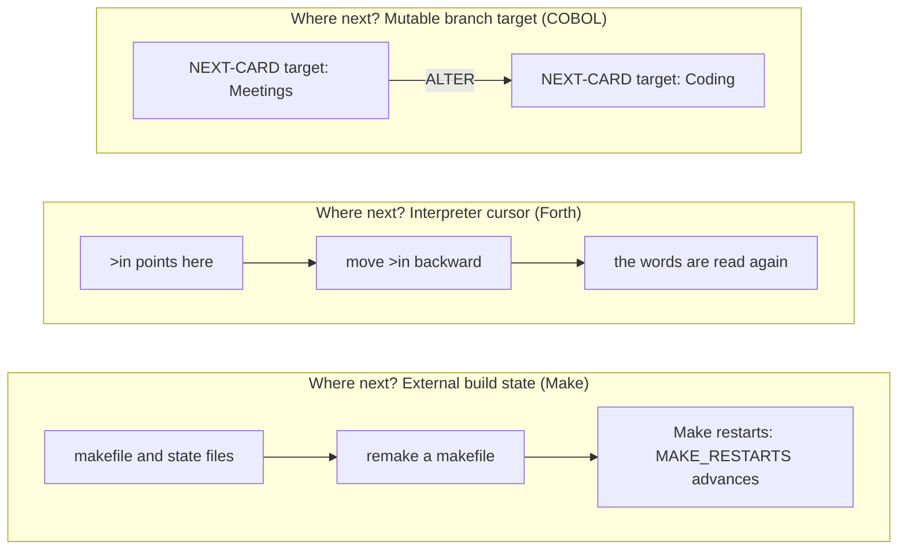
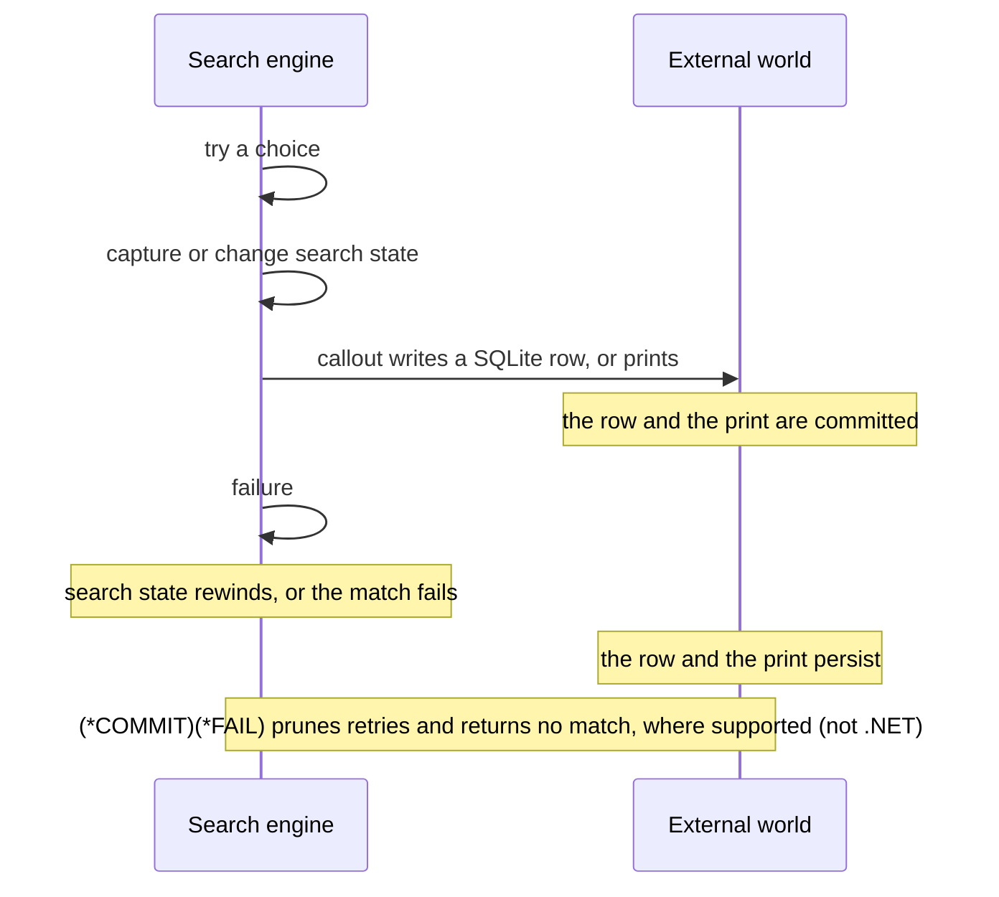
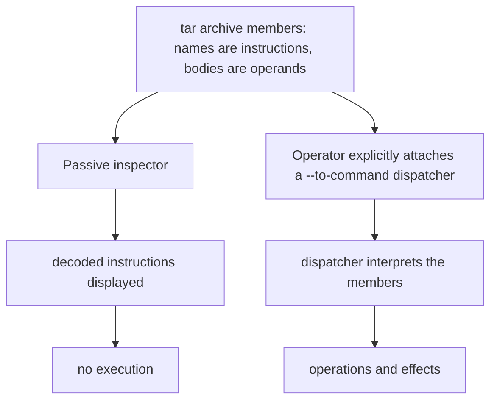

# By solution patterns

The same ideas show up in different languages. This page organizes the entries by *mechanism*, for readers who want to explore an unfamiliar way of computing rather than deepen one language.

## Formal languages

A formal language is a notation with strict rules that a machine can process. The recurring surprise: a notation built for one job turns out to be a computer.

| Formal language | What it was for | What it becomes | Entry |
| --- | --- | --- | --- |
| **RegEx** | Matching text | A search machine with state and I/O hooks ([Perl](languages/regex.md#perl-code-inside-the-match), [PCRE2](languages/regex.md#pcre2-callouts-as-an-instruction-set)), a counter ([.NET](languages/regex.md#net-balancing-groups)), a rewriting system ([sed](languages/regex.md#gnu-sed)) | `regex-*` |
| **Make** | Ordering builds | A dependency engine that restarts itself, giving a loop | [`make-gnu`](../src/make-gnu/README.md) |
| **CMake** | Configuring builds | A register machine in a `while()` condition | [`cmake`](../src/cmake/README.md) |
| **XAML** | Describing a UI tree | An interpreter that runs methods as it parses | [`xaml`](../src/xaml/README.md) |
| **LINQ query expressions** | Querying collections | An execution pipeline with lazy and eager stages and provider boundaries | [`LinqChallenge2`](../src/LinqChallenge2/README.md) |
| **m4** | Expanding text templates | A loop: a macro whose replacement text contains itself is read again | [`m4`](../src/m4/README.md) |
| **SQL triggers** | Reacting to a change in a table | A recursive loop whose stop rule is a `WHERE` that selects nothing, and a host for another language's code | [`tcl-weird`](../src/tcl-weird/README.md) |
| **CLOS method combination** | Combining the methods that apply to a call | A loop over a class hierarchy, stopped by `or` | [`lisp-weird`](../src/lisp-weird/README.md) |
| **AWK pattern-action rules** | Filtering and reshaping records | A program whose only loop is the input, and whose conditionals are the pattern column | [`awk-weird`](../src/awk-weird/README.md) |

What to take away:

- **Declarative does not mean inert.** Any notation that lets you name a function and its arguments is one step from being a program (`ObjectDataProvider`, callouts, `include`).
- **The cheapest way to find what a notation can really do is to give it a job it was not designed for**, then document where it fails: the [blocking problems](blocking-problems.md).
- **Performance cliffs are semantics.** sed's pulse *uses* catastrophic backtracking as a clock; in production the same property is a denial-of-service bug.

## Map/reduce and other transformations

Several entries replace "loop with an accumulator" with a transformation of a whole sequence.

| Idea | Where | In plain words |
| --- | --- | --- |
| **Running sum, then split** | [Haskell](../src/haskell/timecards.hs#L56-L59) `span ((<= 40) . runningTotal)` over `scanl1 (+)` | Build every possible answer lazily; choose where to stop reading |
| **Running sum, then count the prefix** | [APL](../src/apl/timecards.apl#L35) `Drawn↑⍨1++/40≥+\Drawn` | Draw more than enough up front, compute the prefix that fits |
| **Fold** | [LINQ `Aggregate`](../src/LinqChallenge1/Program.cs#L45) | A reduce that carries state through the pipeline |
| **Iterator/closure chain** | [Rust `successors`](../src/RustChallenge1/src/main.rs#L19) | A generator whose "next" is the whole program |
| **Sequence generator** | Kotlin `generateSequence` | The sequence ends when the generator yields null |
| **Rewrite to a fixed point** | [sed](languages/regex.md#gnu-sed) | Apply substitutions until none applies; the final text is the answer |
| **Reshape and recycle** | [APL](../src/apl/timecards.apl#L39) `(≢Hours)⍴Categories` | A modulo you get for free |
| **Accumulate and stop in one clause list** | [Lisp `LOOP`](../src/lisp/timecards.lisp#L42-L46) `sum ... into`, `collect`, `until` | The clause order is the order of execution, so `until` after `collect` keeps the crossing card |
| **A circular list** | [Lisp reader `#1=`](../src/lisp-weird/timecards.lisp#L44-L46) | The categories repeat forever with no `mod` |
| **A pipeline that pulls one value at a time** | [JavaScript weird](../src/javascript-weird/timecards.mjs) `Iterator.from(cards(...)).map(...).map(...).toArray()` | Each value goes through every stage before the next is asked for. A `reduce` adds up the finished list, because `reduce` cannot stop early |
| **A closure that is the state machine** | [JavaScript weird](../src/javascript-weird/core.mjs) `machine` | A function with captured variables: each call makes the next card, and a flag says when it is over |
| **A chain of listeners** | [JavaScript events](../src/javascript-events/timecards.mjs) `on('card-created', ...)` | Each listener does one step and emits the event that the next one waits for. `emit()` is a call on the current stack, and `setImmediate()` gives the event loop a turn between cards |
| **Stream of records, one rule per step** | [AWK `{ t += h = 10 + RT }` ... `t > 40 { exit }`](../src/awk-weird/timecards.awk#L56-L69) | The input supplies the iterations; each rule is one step of the pipeline |

```mermaid
flowchart TB
    accTitle: Folding everything and demanding only a sufficient prefix are different controls over work
    accDescr: Two parallel tracks over the same timecards of 19, 19 and 19 hours with running totals 19, 38 and 57. In the unrestricted fold, an ordinary reduce processes every available card and returns the final accumulator, and it has no built-in early stop. In the demand-limited stream, the consumer computes the next total, checks the stop boundary, includes the crossing card whose total is 57, and then never makes a fourth request.
    subgraph DEMAND["Demand-limited stream"]
        D1["card 19: total 19"] --> D2["card 19: total 38"] --> D3["card 19: total 57, over 40: the crossing card is included"] --> D4["stop asking"] -.-> D5["request for card 4: never made"]
    end
    subgraph FOLD["Unrestricted fold: reduce"]
        F1["card 19: total 19"] --> F2["card 19: total 38"] --> F3["card 19: total 57"] --> F4["every remaining card"] --> F5["final accumulator: no built-in early stop"]
    end
    classDef never stroke-dasharray: 5 3
    class D5 never
```

Both tracks see the same first three cards. `reduce` has no built-in early stop: it processes everything it is given (code can write a custom fold, or throw, to abort, but that is not short-circuiting). A demand-driven stream stops *asking*, so the fourth card is never made. Haskell's `span` leaves the crossing card out of its accepted prefix, so the complete algorithm takes that card separately.

The common shape: *describe the full answer, then say how much of it you want.* (The JavaScript entry reverses it: it describes how to make *one* answer, and lets the consumer ask for as many as it wants.) The differences are about **when** the work happens (eager `Aggregate` and APL arrays vs. lazy Haskell lists and LINQ `Select`) and **where** state lives. Compare how LINQ and Haskell answer "when does it run?" in [C#](languages/csharp-linq-xaml.md#deferred-execution-and-the-void-to-value-trick) and [Haskell](languages/haskell.md#lazy-io-as-control-flow).

## Control state outside variables

Where does "where am I in the program?" live when you have no loop counter?

Each track stores "what happens next" somewhere that is not a loop counter: in the target of a jump, in the position of a parser, or in files that a restarted tool reads. The figure compares *where* the state lives, and the generated table below lists the many other places. The language pages show each program in full.

<!-- BEGIN GENERATED control-state -->
| Place | Entry |
| --- | --- |
| Balancing-group capture stacks | [regex](languages/regex.md#net-balancing-groups): [`regex-dotnet`](../src/regex-dotnet/README.md) |
| Arrays, and the source text of functions | [apl](languages/apl.md#2-self-modifying-functions-apl-weird): [`apl-weird`](../src/apl-weird/README.md) |
| The input stream and the record separator `RS` | [awk](languages/awk.md#2-records-from-a-random-byte-stream-awk-weird): [`awk-weird`](../src/awk-weird/README.md) |
| Fields of one anonymous object | [csharp-linq-xaml](languages/csharp-linq-xaml.md#the-original-modernchallenge1): [`ModernChallenge1`](../src/ModernChallenge1/README.md) |
| `CMAKE_MATCH_1`..`5`, rebuilt every pass | [make-cmake](languages/make-cmake.md#cmake): [`cmake`](../src/cmake/README.md) |
| The target of one `GO TO` | [cobol](languages/cobol.md#alter): [`cobol-weird`](../src/cobol-weird/README.md) |
| The class precedence list, and each method's return value | [lisp](languages/lisp.md#method-combination-as-control-flow): [`lisp-weird`](../src/lisp-weird/README.md) |
| The editor buffer: one line per card, and marks (x) that are added by joining lines | [editors](languages/editors.md#the-buffer-is-the-machine): [`ed-weird`](../src/ed-weird/README.md) |
| The marks (where we are on a tape of numbered lines), the first line of the buffer (the next card), and registers a, d and n | [editors](languages/editors.md#a-program-you-can-edit): [`ex-weird`](../src/ex-weird/README.md) |
| The data stack and the parse position `>in` | [forth](languages/forth.md): [`forth-weird`](../src/forth-weird/README.md) |
| The path from the start directory to the directory being visited; its depth is the running total | [find](languages/find.md): [`find-gnu`](../src/find-gnu/README.md) |
| Which `.tc-N.mk` files exist, and `MAKE_RESTARTS` | [make-cmake](languages/make-cmake.md#gnu-make): [`make-gnu`](../src/make-gnu/README.md) |
| One line of text, rewritten until no rule applies | [regex](languages/regex.md#gnu-sed): [`regex-sed`](../src/regex-sed/README.md) |
| The archive's members, which are the program, plus one SQLite row that says whether the run has halted or faulted | [tar](languages/tar.md#a-program-that-is-an-archive): [`tar-gnu`](../src/tar-gnu/README.md) |
| One SQLite row (the machine's registers) and the number of records tar has written | [tar](languages/tar.md#the-archive-is-the-clock): [`tar-gnu-weird`](../src/tar-gnu-weird/README.md) |
| Thunks: which parts of a list have been demanded | [haskell](languages/haskell.md#lazy-io-as-control-flow): [`haskell-weird`](../src/haskell-weird/README.md) |
| Properties of one object literal | [javascript](languages/javascript.md#the-bodiless-for-in-node): [`javascript`](../src/javascript/README.md) |
| The running total and the card count, held in one object that only the listeners touch | [javascript](languages/javascript.md#listeners-all-the-way-down): [`javascript-events`](../src/javascript-events/README.md) |
| Variables captured by closures: the generator's number, and the machine's card count, total and stop flag | [javascript](languages/javascript.md#closures-all-the-way-down): [`javascript-weird`](../src/javascript-weird/README.md) |
| The input stream: whatever macro text has not been read yet | [m4](languages/m4.md#a-loop-made-of-rescanning): [`m4`](../src/m4/README.md) |
| A C struct that never rewinds | [regex](languages/regex.md#pcre2-callouts-as-an-instruction-set): [`regex-pcre2`](../src/regex-pcre2/README.md) |
| SQLite rows, and the exit code of each callout | [regex](languages/regex.md#pcre2grep-exit-codes-as-control-flow): [`regex-pcre2grep`](../src/regex-pcre2grep/README.md) |
| `local` variables that unwind (effects do not) | [regex](languages/regex.md#perl-code-inside-the-match): [`regex-perl`](../src/regex-perl/README.md) |
| The path from the start directory to the directory being visited | [find](languages/find.md): [`find-posix`](../src/find-posix/README.md) |
| A TEMP table of proc source, and the depth of trigger recursion | [tcl](languages/tcl.md#sqlite-as-the-program): [`tcl-weird`](../src/tcl-weird/README.md) |
| Document order, plus "carrier" arrays | [csharp-linq-xaml](languages/csharp-linq-xaml.md#xaml): [`xaml`](../src/xaml/README.md) |
<!-- END GENERATED control-state -->

A reader who arrives for one meets the rest. That is the point.

## Backtracking, side effects and error handling

### Backtracking as a program

A backtracking engine tries a choice, and if later steps fail it goes back and tries another. The entries turn that around: *do the work in side effects, then fail on purpose.*

- **Perl, PCRE2 and pcre2grep** run the whole demo inside one match and end with `(*COMMIT)(*FAIL)`, so the match returns false after every row is written.
- **What survives a failed branch is the whole lesson.** Perl's `local` variables unwind; its `INSERT`s and `print`s do not. PCRE2's C struct does not rewind at all. `pcre2grep`'s statements have already committed. **.NET** cannot do it: a failed `Match` discards captures, so that entry *must* return true.
- **`(*COMMIT)`** stops the engine retrying shorter loops, which would run the finalizer more than once.

The engine can abandon a branch and rewind its own state. A row that a callout already committed, or a line that it already printed, stays. How much *engine* state rewinds depends on the engine: Perl's `local` variables unwind, PCRE2's external C struct does not, and .NET discards a failed `Match`'s captures. The `(*COMMIT)(*FAIL)` pair exists only in the engines that support it.

### Side effects in pipelines

LINQ, Haskell and XAML each put an effect inside something that looks like a pure description. The rule that falls out: **if an effect lives in a lazy structure, whoever reads the structure decides whether and when the effect happens.** Haskell's `evaluate (length cards)` and LINQ's final `Aggregate` are both "force it now".

### Errors as control flow

| Technique | Entry |
| --- | --- |
| A constraint violation *is* the stop rule: `CHECK(ok=1)` fires and the named error is announced | [Make](../src/make-gnu/README.md), [CMake](../src/cmake/README.md), [pcre2grep](../src/regex-pcre2grep/README.md) |
| Arithmetic overflow *is* the stop rule: `ON SIZE ERROR` | [COBOL](languages/cobol.md#alter) |
| A program's exit code steers the match | [pcre2grep](languages/regex.md#pcre2grep-exit-codes-as-control-flow) |
| A process exits 1 on purpose, and the wrapper maps it back to 0 | [sed](languages/regex.md#gnu-sed) |
| A runaway program is caught by a timeout, not an error | [APL weird](languages/apl.md#2-self-modifying-functions-apl-weird), and [m4](languages/m4.md) when a quote is missing |
| A return value short-circuits a chain of methods (`or`) | [Lisp weird](languages/lisp.md#method-combination-as-control-flow) |
| A pattern stops matching and an `exit` ends the loop | [AWK weird](languages/awk.md#2-records-from-a-random-byte-stream-awk-weird) |
| An `INSERT ... SELECT ... WHERE` that selects nothing ends a recursive trigger | [Tcl weird](languages/tcl.md#sqlite-as-the-program) |
| A missing guard does not fail: it counts a phantom card (empty `RT`) or no cards at all (mawk) | [AWK weird](languages/awk.md#do-this-in-production-and-youre-fired) |
| An unexpected failure code is deliberately *not* "no match" (`PCRE2_ERROR_CALLOUT`, not `-1`) | [PCRE2](languages/regex.md#pcre2-callouts-as-an-instruction-set) |

Notice that **`CHECK(demo_only=1)` appears in nearly every entry**: a table that makes a non-demo row unrepresentable, which each `check.sh` tries to violate. That is error handling used as a *guarantee* rather than a control flow, and a pattern worth keeping.

## Programs stored as data

Four entries keep their program somewhere that is not a source file. Each is a different answer to "what is written down, and what reads it?" See the [comparative chapter](cs/09-comparative-case-studies.md#writing-a-program-down-reading-it-back-running-it) for the round-trip promise each one makes.

The same bytes can be read without running anything, and ordinary `tar -xf` only writes files. The archive cannot attach its own execution hook. The operator does. The other rows of the table differ: Tcl's `unknown` can fetch source and evaluate it, Ex can run text from a register, and APL's `⎕CR` and `⎕FX` can rewrite a function and define the copy.

| Where the program is written down | What reads it, and gives it meaning | Entry |
| --- | --- | --- |
| The members of a tar archive: names are instructions, bodies are operands | GNU tar walks them, and a dispatcher that the *operator* attached gives them meaning (a passive inspector reads the same bytes and runs nothing) | [`tar-gnu`](../src/tar-gnu/README.md), [tar](languages/tar.md#a-program-that-is-an-archive) |
| The layout of an archive: how many records tar writes | Tar's checkpoints are a clock, and a state machine takes one step per tick | [`tar-gnu-weird`](../src/tar-gnu-weird/README.md), [tar](languages/tar.md#the-archive-is-the-clock) |
| Rows in a SQLite table | An overridden `unknown` fetches Tcl source and evaluates it | [`tcl-weird`](../src/tcl-weird/README.md), [Tcl](languages/tcl.md#sqlite-as-the-program) |
| A line of text in an editor buffer, copied into a register | Ex runs the register, and the program reads its next instruction from a tape of lines | [`ex-weird`](../src/ex-weird/README.md), [editors](languages/editors.md#a-program-you-can-edit) |
| The source text of a function | `⎕CR` writes it out, the function rewrites it, and `⎕FX` defines the copy | [`apl-weird`](../src/apl-weird/README.md), [APL](languages/apl.md#2-self-modifying-functions-apl-weird) |

The question that separates them: *can you read the program without running it?* In `tar-gnu` you can, with the inspector, because tar extraction alone runs nothing. In `tcl-weird` and `ex-weird` the reading and the running are the same act, so there is no safe way to look except to read the text yourself.

## Read next

[Problems overcome](problems-overcome.md), [blocking problems](blocking-problems.md), [exercises](exercises.md).
