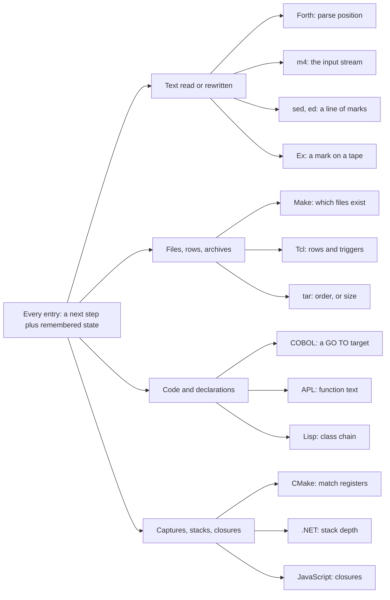

# Comparative machine design study guide

## What this guide is for

A loop with no body, a regex search, a Makefile that rereads itself, a list whose elements write to a database, an editor buffer and an archive all take on the time-card task. Some searches finish by failing after their side effects; the .NET search succeeds so the host can read its captures. This guide puts them side by side with one worksheet. The core question is: **what plays loop, state, clock, decision and commit in each, and what evidence proves it?**

When you finish, you should be able to:

1. Fill in the seven-question worksheet for any entry: where is the program, where is the state, what repeats, what advances the next step, what makes a decision, what commits effects and what evidence proves the claim.
2. Say what *role* each piece plays even when it does not look like the usual one: a flag, a file, a capture, a method, a tick.
3. Group the entries by the answer to "where does the program live?" and say what each group can and cannot do.
4. Explain why the fixed LINQ work week ends at 40 and why XAML can run out of passes there.
5. Choose, for a given need (testability, observability, portability), which design suits it, and say what it costs.
6. Label claims as guaranteed, implementation-permitted or accidentally exploited.

**Scope limits.** The guide compares; it does not re-teach each entry. It uses facts checked in the language guides and the concept guides. Its sources are [Comparative case studies](../../cs/09-comparative-case-studies.md) and [Solution patterns](../../patterns.md).

## Before you begin

**Safety model.** The cards are fictional **DEMO ONLY** data. Programs can write to local scratch files or databases and can start processes. Read the source first and run it in the sandbox first. Work on copies ([Running things safely](../../exercises.md#running-things-safely)). Comparing entries means running several: run them one at a time, and use a scratch data folder.

**Prediction rule.** For each entry you compare, fill in the worksheet *before* reading the README's answer. Then check the evidence. A worksheet cell you cannot support with a run or a line of source is a guess.

**The worksheet.**

```text
Where is the program?
Where is the state?
What repeats?
What advances the next step?
What makes a decision?
What commits effects?
What evidence proves the claim?
```

**Vocabulary.**

| Term | Meaning here |
| --- | --- |
| Role | A job every solution must do: loop, state, clock, decision, commit. |
| Machine | The thing that plays a role in one entry: a flag, a file, a capture, a method. |
| Ceiling | A limit set by a finite supply (four names, five dice), not by the rule. |

## The shared challenge

The [challenge specification](../../intro.md#what-the-challenge-does) calls for cards with a category and 10 to 19 whole hours. Categories cycle through Meetings, Coding, Debugging and Learning. Add each card's hours to the running total. Stop when the total passes 40. Keep the **first card that takes the total over 40**. A total of exactly 40 continues. Four 10-hour cards need a fifth card, in the Meetings category. Conforming runs finish with 3 to 5 cards and a total of 41 to 59 hours.

The book records [where entries differ](../../intro.md#where-entries-differ). The LINQ demos use five fixed 8-hour days, and XAML can run out of passes at 40. The regex entries still follow the numeric rule: the C and .NET examples use TSV, while pcre2grep saves cards in separate SQLite calls. A summary can appear in a terminal or a window. Ask which result the entry demonstrates before comparing the mechanism.

## The machine to identify

Compare in two cuts. Start by identifying the roles, then test the decisions and effects against the trace.

**Where is the program?** The entries store their programs in different places.

- The idiomatic entries and the ports use source statements.
- `cobol-weird` uses a jump target.
- `forth-weird` reads one source line repeatedly.
- GNU Make rewrites its own input.
- The regex entries use a pattern.
- `tcl-weird` uses table rows.
- `tar-gnu` uses archive members. `tar-gnu-weird` uses the archive size.
- `ex-weird` uses an editor register.
- `lisp-weird` uses a class chain.
- `apl-weird` writes function text at run time.
- `xaml` uses a document.

**Where state lives.** See the diagram below: it groups the entries by what holds the next step and the remembered state.

**What repeats.** The thing that happens again: a performed paragraph, a rewound line, a restarted build, a quantifier, an event, a method, a tick, a trigger firing.

**What advances the next step.** Often the *environment*: the text interpreter, `find`'s walk, tar's checkpoints, SQLite's trigger machinery, the event loop. In other entries, the program itself.

**What stops it.** A flag, an absence (no file, no input left), a literal's length, a comment, an empty compression, a failed match. The stop rule is a value or a structure, rarely a visible `if`.

**What commits.** Some entries commit all cards together, while others save at each step. PCRE2 callouts write the TSV during the match; the .NET host writes its TSV from the returned captures. pcre2grep uses separate SQLite processes. The regex verb `(*COMMIT)` rules out backtracking retries. SQLite transactions belong to the helper.

<!-- diagram-new: cross-language-state - groups every entry by what holds its next step and its remembered state, a relationship no single entry's diagram shows -->



## Trace one run

The worksheet, filled in for representative entries. The usual witness uses 15, 19, 12. The sed row names its alternate seed trace. Every "evidence" cell is a run or a source line verified in the language guides.

| Entry | Where is the program | Where is the state | What repeats |
| --- | --- | --- | --- |
| `cobol-weird` | paragraphs and one rewritten `GO TO` | `WS-TOTAL`, `WS-HEADROOM`, the jump target | the circuit `NEXT-CARD` to a category to `RECORD-CARD` |
| `forth-weird` | one line of source | the data stack `( n total anchor )` | the text interpreter, rewound by `>in` |
| `make-gnu` | a Makefile that restarts | `.tc-N.mk` files, `MAKE_RESTARTS` | the whole Make process |
| `cmake` | one bodiless `while()` | `CMAKE_MATCH_1`..`5` | the condition, re-expanded |
| `haskell-weird` | a lazy list of effectful cells | each card's total, read off the previous card | demand from `span` |
| `javascript-weird` | three closures | variables captured by them | `next()` calls |
| `javascript-events` | listeners on an emitter | object `s` and the registrations | events, one turn per card |
| `lisp-weird` | five classes, one method each | the `ledger` object, the class chain | methods run by `or` |
| `tcl-weird` | rows of Tcl text, one trigger | table rows | the trigger firing itself |
| `apl-weird` | functions written at run time | source "gene" lines | calls down a chain |
| `tar-gnu` | archive members | SQLite `runs` row | tar's walk over members |
| `tar-gnu-weird` | `tick.sql` | one `fsm` row | tar's checkpoints |
| `regex-pcre2` | one pattern with callouts | a C struct | the quantifier |
| `regex-dotnet` | one pattern of balancing groups | two capture stacks | the quantifier |
| `regex-sed` | a script of substitutions | one line of text | jumps back to `:entry` |
| `ed-weird` | a script of ed commands | `x` marks on lines | one global command |
| `ex-weird` | a register that runs itself | mark `t` on a tape | `@n` |
| `m4` | one self-naming macro | state macros | rescanning |

| Entry | What advances the next step | What makes a decision | What commits | Evidence proving the claim |
| --- | --- | --- | --- | --- |
| `cobol-weird` | `ALTER` | `ON SIZE ERROR` | `sqlite3` on a script | scratch run printing `WS-HEADROOM` (74, 93, then overflow stays 93) |
| `forth-weird` | `>in` moved back | a flag masks the distance | `sqlite3` pipe, `COMMIT` | scratch run printing `>in` (10, 15, 23) and stack |
| `make-gnu` | a file written, so a restart | the rule declines when a 41st word exists | `sqlite3` on `.rows.sql` | scratch run printing files and totals per pass |
| `cmake` | the next `while()` evaluation | a match of 41 `x` | `sqlite3` | scratch run printing the registers |
| `haskell-weird` | forcing a cell | `span`'s predicate | `COMMIT` then `hClose` | scratch run with an error-tail hours list |
| `javascript-weird` | the consumer's ask | `over` assignment | `save` per ask | scratch script counting asks (4 for 3 cards) |
| `javascript-events` | `emit` and `setImmediate` | `total > limit` in a listener | `COMMIT` in `finished` | scratch script logging every emit and turn |
| `lisp-weird` | the next applicable method | `or` stops at true | `:around` method, one `sqlite3` | scratch run printing each method's return |
| `tcl-weird` | the end of the trigger's insert | `WHERE NEW.running_total <= 40` | one `db transaction` | scratch run logging `hours` and `born` |
| `apl-weird` | `⎕FX` and `⍎` | `Alive/` compress | `COMMIT` after the chain | `⎕CR` of `Card2` showing genes `T←46` |
| `tar-gnu` | tar's walk | a `stop-over` member | the dispatcher's SQL | the inspector's decoded members, and the run |
| `tar-gnu-weird` | a checkpoint | `done = total > 40` | per-tick transaction | closing line: last tick 64, 18 idle |
| `regex-pcre2` | the engine's next pass | `gate` returns 1 | callouts write | callout log (gate 0, 0, 0, then 1) |
| `regex-dotnet` | the engine | `(?(b)...\|(?!))` vetoes the next pass, the match succeeds | host appends TSV from captures | draws `15 19 12 17 11`: three rows, the last two unused |
| `regex-sed` | `b` jumps | `/ tot:#{41}/` | `fd 3` into `sqlite3` | alternate witness: the documented seed gives `TRACE=1` totals of 15, 29, 43 marks |
| `ed-weird` | the global command | which `s` matches | the launcher | buffer printed after each stage |
| `ex-weird` | `@n` | the tape line: `@a` or `"` | the launcher | `'tp` printing tape lines 15, 34, 46 |
| `m4` | rescanning | `ifelse(eval(...))` | `syscmd` | `-t tc_card` trace and `-L` limit |

**Which role is played by what.** The *decision* column shows how each entry performs the same role.

**Exactly 40, and the ceiling.** Here the comparison found something the individual entries did not say. The specification says exactly 40 continues, so a fifth card must be possible. Entries whose supply of categories or cards was a finite list of *four* could not draw it. That was found while writing these guides, and all but one entry is now fixed.

| Group | Entries | Supply | Evidence |
| --- | --- | --- | --- |
| Was four names, now five | `regex-perl`, `regex-pcre2`, `regex-pcre2grep`, `regex-dotnet`, `regex-sed` | a subject, scaffold, tape or `cats:` list, now with `Meetings` repeated | **run**: before the fix, four 10-hour draws gave `total=40 entries=4` (PCRE2 and .NET, and the shared checker said `FAIL: final total 40 does not pass 40`). Each `check.sh` now forces all-10 cards and requires five rows ending at 50, and each new check fails on the old code |
| Was four names, now five | `ModernChallenge1` and the Java, Go, Kotlin, Python and Rust ports | a one-pass category iterator or list, now with `Meetings` repeated | **run for the C# header** (a reduction): `stop: total 50 after 5 cards`. Rust's unit tests assert it. Go, Java and Kotlin compile. Python's list change was checked with a reduction of its condition |
| Fixed work week | `LinqChallenge1`, `LinqChallenge2` | five 8-hour days | source read: 40.0 hours across five rows, outside the random challenge |
| Still four passes | `xaml` | four copied passes in markup | read from the README, not run (Windows only). With the shipped seed it always deals four cards totalling 53, so the case never arises |
| Five slots | `tar-gnu`, `ed-weird`, `ex-weird`, `lisp-weird`, `apl` | exactly the worst case (five cards of at least 10 hours reach 50) | the five slots cover the worst case, read from the source. **Run** for `ed-weird` (B18: all-10 dice give five cards, totals 10 to 50) |
| Cycling | `cobol`, `cobol-weird`, `haskell`, `forth`, `make-gnu`, `cmake`, `javascript` family, `m4`, `tcl` | the category is computed from a count | **run** for `cobol-weird` (a scratch run with all-10 hours), `m4` (seed 4020, now also in its `check.sh`) and `tcl-weird` (B12 step 2). Read from the source for the rest |

The probability was one run in 10,000, so none of this was visible in ordinary testing. The entries' own checks had accepted "four entries" as a legitimate stop, so they passed. Only the shared checker caught the case. The lesson stands after the fix: a specification and its checks must agree *at the edge*, and the way to make them agree is a test that *forces* the edge. That is what each new `check.sh` does.

## Compare the ordinary and weird designs

| Dimension | Ordinary designs | Weird designs | What the comparison adds |
| --- | --- | --- | --- |
| **Representation** | Variables, loops, functions | A jump, a position, files, captures, rows, text | Same machine, different substance |
| **Observability** | Print variables | Print the *control* state (`>in`, the jump target, the files) | Choose the design for how you must observe it |
| **Tests** | Unit tests | Drive with a controlled input (`DICE`, `SEED`, `--hours`, `NOW`) and compare | Record the input and label source-only evidence when a runtime is unavailable |
| **Debugging** | Standard tools | Instrument without disturbing (CMake's registers, ed's buffer) | The act of looking can change the machine |
| **Portability** | Broad | Narrow, with a stated label | See the label column below |
| **Cost** | Normal | Reviewability, reentrancy, a finite supply | The ceiling is a cost nobody advertised |

**Choosing.** If you need to *test the rule alone*, use an idiomatic design. If you need to *watch the whole machine*, prefer a design with printable state: sed (`TRACE=1`), ed (`,p`), Ex (`'tp`). If you need *the weakest input language*, prefer the one with no side effects: .NET's regex can only capture. If you need a *stop that cannot be forgotten*, prefer a structural stop (a literal, a tape, a constraint) over a flag a later edit might skip.

## What the exercises demonstrate

| Exercise | Predict first | What the evidence shows |
| --- | --- | --- |
| [C1. Weird next to boring](../../exercises.md#c1-weird-next-to-boring-verified) | For one pair, what would you unit-test, and what would a debugger show? | The same output contract with different visible state. |
| [C2. Make the constraint real](../../exercises.md#c2-make-the-constraint-real-verified) | Write a check that bans loop words in Forth. | It must strip comments and strings, then fail on each mutation. |
| [C3. A loop whose state is not a variable](../../exercises.md#c3-a-loop-whose-state-is-not-a-variable-verified) | In awk with no loop keyword, where can the state live? | In the input. |
| [A1. Read the rows](../../exercises.md#a1-read-the-rows-verified) | Run three entries from different languages and a fourth. | The shared invariant is visible in every one, and a fourth predicted card count tests understanding. |
| [D. Port the challenge](../../exercises.md#d-port-the-challenge-verified-reference-answer-in-awk) | Port it to a language of your choice. | A port must decide its stop rule and its category supply. The ceiling is a design decision you now make. |
| [F. Prove a README claim](../../exercises.md#f-prove-a-readme-claim-verified) | Which claim in a comparison table could you test? | Any row of the worksheet with a verifiable cell. |

## Failure modes, costs and boundaries

The README `assurance` key summarizes the weakest dependency the mechanism needs. The table counts those declarations: **17** guaranteed, **16** implementation-permitted, **7** accidentally exploited (`tcl-weird` moved from the last group to the middle one when its evaluation-order dependence was removed).

| Claim | Label | Why |
| --- | --- | --- |
| In `tcl-weird`, a total of 40 admits a next insert | **guaranteed** by the integer comparison in the trigger | The trigger tests `NEW.running_total <= 40`. The trigger chain and its transaction have their own prerequisites. |
| Three entries share the stop-rule label "accidentally exploited" because of a specific observed behavior (Make's remake, CMake's `AND`, ed's silent `s`) | **accidentally exploited** | Each is observed, not promised. |
| The number of names or slots bounds the number of cards | **guaranteed** by construction, tested | A bound of five is exactly the worst case. With four names (before the fix, and still in `xaml`) it contradicted the shared challenge at exactly 40. |
| .NET balancing groups subtract captures from a named group | **guaranteed** within the documented .NET regex engine | The successful match is the return channel. An engine that lacks balancing groups cannot run this pattern. |

**Costs to state.**

- **A comparison table hides the edge.** Every row looks the same until you ask about exactly 40.
- **Different mechanisms are not different problems.** The risk in reading eighteen decision mechanisms is to think each is new. Each answers "when do we stop, and how do we know?"
- **Evidence differs in strength.** A run, a source line and a README claim are not equal. This guide marks which is which.
- **Where this is legitimate.** Comparing designs by role is how engineers choose between frameworks. The stunt is the range of substances.

## Connections across the repository

- **Every language guide** is one row of the worksheet: [COBOL](../languages/cobol.md), [Haskell](../languages/haskell.md), [Forth](../languages/forth.md), [Make and CMake](../languages/make-and-cmake.md), [Regex engines and sed](../languages/regex-engines-and-sed.md), [APL](../languages/apl.md), [JavaScript](../languages/javascript.md), [Common Lisp](../languages/common-lisp.md), [m4](../languages/m4.md), [Tcl](../languages/tcl.md), [ed and Ex](../languages/ed-and-ex.md), [tar](../languages/tar.md) and [C#, LINQ, XAML and ports](../languages/csharp-linq-xaml-and-ports.md).
- **Where the next step is stored.** [State and control beyond variables](state-and-control-beyond-variables.md) develops the first diagram.
- **Who demands work.** [Evaluation, demand and laziness](evaluation-demand-and-laziness.md) develops the "advances the next step" column.
- **What commits.** [Effects, errors and commitment](effects-errors-and-commitment.md) develops the last columns.
- **What is promised.** [Portability, abstraction and cost](portability-abstraction-and-cost.md) develops the labels.
- **In the book.** [Comparative case studies](../../cs/09-comparative-case-studies.md), including the table of every entry at a glance, and [Solution patterns](../../patterns.md), in particular [Control state outside variables](../../patterns.md#control-state-outside-variables) and [Programs stored as data](../../patterns.md#programs-stored-as-data).

## Self-check

Answer each question in your own words before you read the italic text. Say what evidence would support each answer.

1. **Trace.** Fill in the worksheet for `lisp-weird`: where is the program, the state, what repeats, what decides. *(The program is five classes with one `or` method each. The state is the `ledger` object plus the position in the class precedence list. What repeats is the next applicable method, run by the `or` combination. The decision is a method returning true.)*
2. **Explain.** Why is a total of exactly 40 a test of an entry's *supply* and not only of its stop rule? *(The stop rule says to continue at 40, so a fifth card must be possible. An entry with only four category names has no fifth, so it stops at 40 whatever its rule says. That was true of the regex entries and the `for`-header entries before they were fixed, and is still true of `xaml`.)*
3. **Transfer.** Pick a program you maintain. Fill in the worksheet for its main loop. Which cell is hardest to answer? *(Often "what makes a decision" is spread over several places, and "what evidence proves the claim" is missing. The hardest cell tells you where your program is hardest to review.)*
4. **Evidence.** A colleague says, "Every entry that cycles categories continues at 40." Design a test that could fail. *(Run each with a forced all-10 input (`DICE`, `SEED`, `--hours`, a fixed list), then check for five rows and totals 10, 20, 30, 40, 50. The negative control is a four-name entry, which stops at 40.)*

## Further reading

- [Comparative case studies](../../cs/09-comparative-case-studies.md) (this book): the role tables and the table of every entry at a glance.
- [Solution patterns](../../patterns.md) (this book): mechanisms grouped across languages.
- [Turing completeness](https://en.wikipedia.org/wiki/Turing_completeness) (Wikipedia): what "can express any computation" means, and why many odd systems qualify.
- [Transition system](https://en.wikipedia.org/wiki/Transition_system) (Wikipedia): the formal reading of "state plus allowed step".
