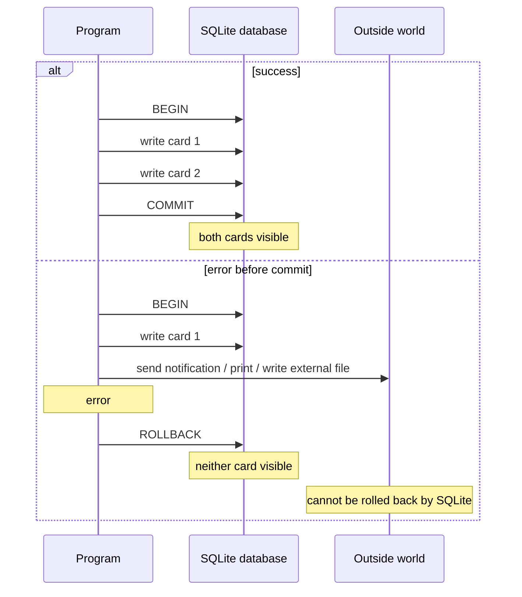

# Effects, errors and commitment study guide

## What this guide is for

A program that does nothing outside itself is an expensive heater. Useful programs print, write files and insert rows, and then something goes wrong. This guide asks: **which effects survive a failure, and what truly commits?** The book's entries make the question concrete, because several of them end by *failing on purpose*: a regex match returns "no match" after saving a transaction, a constraint violation is the stop rule, an exit status of 1 means success.

When you finish, you should be able to:

1. Distinguish an effect that is *rolled back* (a database transaction), one that is *unwound* (Perl's `local`) and one that *stays done* (a printed row, a file write, a process already run).
2. Explain what a commit is and why it is the point of no return, and identify the commit in each of several entries.
3. Explain why lazy effects and a closed resource break a commit, using the Haskell and PCRE2 examples.
4. Explain how an error can be a *signal*: a size error, a constraint violation, an exit status.
5. Say what a failed callback, a failed match and a failed process each look like from outside.
6. Label claims as guaranteed, implementation-permitted or accidentally exploited.

**Scope limits.** The guide uses facts checked in the language guides and the exercises. It does not teach database internals or exception hierarchies. Its source chapter is [Effects, errors and commitment](../../cs/07-effects-errors-and-commitment.md).

## Before you begin

**Safety model.** The cards are fictional **DEMO ONLY** data. Programs can write to local scratch files or databases and can start processes. Read the source first and run it in the sandbox first, for example `sandbox/container/run-image.sh src/regex-perl`. Work on copies ([Running things safely](../../exercises.md#running-things-safely)). Failure experiments may leave half-written scratch files, so use a copy and a scratch data folder.

**Prediction rule.** Before each failure experiment, write down three lists: what will be *undone*, what will *stay* and what you will *see on the terminal*. They are usually different.

**Vocabulary.**

| Term | Meaning here |
| --- | --- |
| Side effect | A change beyond returning a value: printing, writing a row, starting a process. |
| Transaction | A group of operations that all happen or none happen. |
| Commit | The point at which a change becomes final. |
| Rollback | Undoing the uncommitted changes of a transaction. It does not undo effects outside it. |
| Integrity constraint | A rule the database enforces on every write, such as `CHECK(demo_only=1)`. |
| Exit status | A number a process returns to say how it ended. |

## The shared challenge

The [challenge specification](../../intro.md#what-the-challenge-does) calls for cards with a category and 10 to 19 whole hours. Categories cycle through Meetings, Coding, Debugging and Learning. Add each card's hours to the running total. Stop when the total passes 40. Keep the **first card that takes the total over 40**. A total of exactly 40 continues. Four 10-hour cards need a fifth card, in the Meetings category. Conforming runs finish with 3 to 5 cards and a total of 41 to 59 hours.

Check the *rows shown*, the *rows saved* and the *summary* separately. A SQLite table can enforce `CHECK(demo_only=1)`. A TSV writer applies its own rules. Some demos save in one transaction. pcre2grep saves in separate calls. .NET reports `captured` for the regex result. The summary is a claim about the run. This guide tests it against the effects.

## The machine to identify

Here the five questions are about *effects*.

**What repeats.** The effect-producing step: a card is made, printed and saved. In most entries it repeats until the stop rule fires. In `haskell-weird`, the effect is inside each lazy cell, so it repeats as cells are forced.

**Where state lives.** Effects live in three places that fail differently. *Inside the transaction*: the saved rows. *Outside it*: printed rows, files, process output. *In the engine*: the backtracking state that unwinds (Perl's `local`), against the state that does not (a PCRE2 C struct).

**What advances the next step.** In effectful code the order of effects follows the order of *evaluation*, which in lazy or callback-driven programs is not the order of the source text. A tar callback ignores the exit status of the command it runs, so a failed tick advances nothing.

**What stops it.** An effect can stop a run by *failing*: a constraint violation (`stop rule fired: total exceeds 40`), a size error that is handled, a vetoed callout branch, a halted flag, an exit status. Stopping by failure only works if the failure is *distinguishable* from a real error.

**What commits.** Some entries issue one SQLite `COMMIT` after the loop. In pcre2grep, separate SQLite connections autocommit as the helper statements finish. CMake and Make issue their final stop-rule probe after the card writes. The .NET host appends a TSV report after the match. The PCRE2 C host writes and closes a TSV in callouts before the final failure. For ed and Ex, SQLite receives the rows from the launcher after the editor finishes.

<!-- diagram-source: lessons/cs-source/concepts/transaction.md#block-1 -->

The book's picture: the database rolls back its transaction, not every effect the program caused. A notification sent before the error stays sent.

## Trace one run

The decisive trace here is of a *failure*. For each entry the table gives the failure that a verified exercise or scratch run produced, and the three lists.

| Entry and failure | Undone | Stays | Seen from outside |
| --- | --- | --- | --- |
| `haskell-weird`, count made lazy (B2) | nothing: no commit | the first card printed | `handle is closed`, and the summary line printed garbage before the crash |
| `regex-dotnet`, append `(?!)` (B8) | every capture | the host still appends an empty-run report | `match returned: false`, `total=0 entries=0`, exit 1 |
| `regex-pcre2grep`, relative callout path (B8) | nothing happened | nothing | **no output, exit 0**: a callout that cannot start looks like a vetoed branch |
| `regex-perl` normal run | `local` total and index | printed rows, the `INSERT`s, the transaction | the match returns *false*, and the data is saved |
| `regex-pcre2` normal run | nothing is rewound | the file, the rows, the summary | `pcre2_match returned -1`, and the data is saved |
| `make-gnu`, delete `@:` (B4) | no card file written to be remade | nothing | `entries=0`, `re-executed 0 times` |
| `tcl-weird`, recursion off (B12) | the second trigger firing never happens | card 2 was inserted and counted | one row printed, `entries=2` |
| `tar-gnu-weird`, clock too short (B17) | the third card is never closed | two cards | `the clock ran out`, exit 3 |
| `cobol-weird`, size error | the overflowing add leaves the field | the card is recorded first | the handler rewires `NEXT-CARD`: an *error as the stop rule* |
| `javascript-events`, a listener throws | an uncommitted insert: `ROLLBACK` once | rows already printed | `timecards: <message>` and exit 1 |

**Reading the table.** The SQLite inserts and prints in Perl and the file writes in the C callouts survive final match failure. In .NET the engine returns only match state. A failed match leaves the host no card captures, though the host still writes its report header and summary. In the pcre2grep relative-path experiment the initial helper fails to start, so there are no rows or output.

**The three kinds of "error as a signal".** In `cobol-weird`, `ON SIZE ERROR` is local arithmetic error control: the field is too small, the clause runs and the program takes it as the stop rule. In `make-gnu` and `cmake`, the last statement inserts `total <= 40` into a `CHECK(ok=1)` column: SQLite refuses, prints a named constraint error on stderr and the run goes on to print its summary. The entry's check requires that error to appear *exactly once*. The pcre2grep wrapper maps the engine's no-match status 1 to success. The sed program deliberately exits 1 too; its wrapper also requires SQLite to exit 0.

**Exactly 40.** The boundary shows what the commit can claim. Before the five-name fix, a regex or `for`-header run that stopped at four cards with a total of exactly 40 still committed and printed `# committed total=40 entries=4`, and the shared checker rejected it. The entry's own claim of success and the shared check disagree: "committed" says the *data was saved*, and the checker asks whether the *rule* was obeyed. Commit is not correctness.

## Compare the ordinary and weird designs

| Dimension | Ordinary: do the work, then save | Effects inside the machinery |
| --- | --- | --- |
| **Representation** | Compute a list, then write it | A write per step, as the engine runs |
| **Observability** | Inspect the list before saving | The terminal and the database may disagree mid-run |
| **Tests** | Compare the final list with the database | Compare printed rows, database rows and the summary: the checkers do all three |
| **Debugging** | A failure means nothing was saved | A failure leaves *some* effects: you must know which |
| **Portability** | Standard I/O | Depends on whether the failure semantics are specified (a callout's exit status, a checkpoint's) |
| **Cost** | A buffer of cards | Partial effects, and the risk of reporting success for a partial run |

The ordinary `haskell` entry builds the whole SQL script as a pure string, runs `sqlite3` and only then prints the rows. The weird entry prints as it goes. Both commit once, but only the first guarantees that *what is printed is what was saved*.

## What the exercises demonstrate

| Exercise | Predict first | What the evidence shows |
| --- | --- | --- |
| [B2. Haskell: break the laziness](../../exercises.md#b2-haskell-break-the-laziness-verified) | Make `entries` lazy. | `handle is closed`. Forcing after the resource closed. |
| [B8. Regex: what survives a failed match](../../exercises.md#b8-regex-what-survives-a-failed-match-verified) | `(?!)` on .NET; a relative path in pcre2grep. | The failed .NET match supplies no card captures, and the host writes a zero-row report. In pcre2grep the helper failure is silent. |
| [B12. Tcl: edit the program in the database](../../exercises.md#b12-tcl-edit-the-program-in-the-database-verified) | Turn recursive triggers off. | One row printed, `entries=2`. |
| [B17. tar, weirder: predict the clock](../../exercises.md#b17-tar-weirder-predict-the-clock-verified) | Run with a layout one tick short. | `the clock ran out`, exit 3, two cards. A short clock stalls instead of erroring. |
| [A1. Read the rows](../../exercises.md#a1-read-the-rows-verified) | Which card crossed 40? | The output alone proves "total before the last card is at most 40". |
| [F. Prove a README claim](../../exercises.md#f-prove-a-readme-claim-verified) | Can your test fail? | A claim needs a negative control. |

## Failure modes, costs and boundaries

| Behavior | Label | Why |
| --- | --- | --- |
| A transaction's uncommitted changes are undone by rollback, but not effects outside it | **guaranteed** | Database semantics. |
| A size error leaves the receiving field unchanged | **guaranteed** | Specified COBOL semantics. |
| Perl unwinds `local` on backtracking, not prints | **guaranteed** | Documented Perl. |
| A failed .NET `Match` supplies no card captures | **guaranteed** within the .NET regex API | B8 exercises this property. The host can still write its empty-run report. |
| A normal insert of 0 into `demo_only INTEGER NOT NULL CHECK(demo_only=1)` fails | **guaranteed** with SQLite constraint checks enabled | SQLite enforces the declared column constraints. The TSV entries use no such constraint. |
| `SYSTEM` returns a raw wait status (exit 3 appears as 768) | **implementation-permitted** | A host detail of the tested COBOL runtime. |
| tar ignores the checkpoint command's exit status | **accidentally exploited** | Observed on the tested releases. The entry makes the machine safe against it. |
| `pcre2grep` cannot tell a callout that failed to start from a vetoed branch | **implementation-permitted** | Its own design, and the cause of B8's silent result. |
| SQLite refuses an insert that violates a `CHECK`, and prints a named error | **guaranteed** | Database semantics. The entries *choose* to let that message be the stop rule's announcement, and require it exactly once. |

**Costs to state.**

- **Reporting success for partial work.** The summary line says `committed` whatever happened. The checkers compare it with the rows.
- **Silent failure.** A callout that does not start, a failed `s`, a clock that is too short, a recipe that expands to nothing: all stop quietly.
- **Effects outside the transaction.** Anything printed, sent or written elsewhere is not rolled back.
- **Idempotence.** Rerunning an entry adds *another* run to the database. The tables keep every run's history. A retry is not harmless.
- **Where this is legitimate.** An error used as a normal signal is standard in shell scripts (`grep` exits 1 for "no match") and in constraint-based design. The stunt is ending a program that way.

## Connections across the repository

- **Language guides.** [Haskell](../languages/haskell.md), [Regex engines and sed](../languages/regex-engines-and-sed.md), [Make and CMake](../languages/make-and-cmake.md), [COBOL](../languages/cobol.md), [Tcl](../languages/tcl.md), [tar](../languages/tar.md), [JavaScript](../languages/javascript.md) and [ed and Ex](../languages/ed-and-ex.md) each have a failure case above.
- **Demand.** [Evaluation, demand and laziness](evaluation-demand-and-laziness.md) is why lazy effects commit late.
- **Authority.** [Reading adversarial programs](reading-adversarial-programs.md): the database's `CHECK` is data-level authority.
- **Portability.** [Portability, abstraction and cost](portability-abstraction-and-cost.md) covers which failure semantics are promised.
- **In the book.** [Side effects](../../cs/07-effects-errors-and-commitment.md#side-effects), [Exception handling](../../cs/07-effects-errors-and-commitment.md#exception-handling), [Exit status](../../cs/07-effects-errors-and-commitment.md#exit-status), [Integrity constraints](../../cs/07-effects-errors-and-commitment.md#integrity-constraints), [Backtracking](../../cs/07-effects-errors-and-commitment.md#backtracking), [The cut](../../cs/07-effects-errors-and-commitment.md#the-cut-committing-to-a-choice), [Transactions](../../cs/07-effects-errors-and-commitment.md#transactions) and [Idempotence](../../cs/07-effects-errors-and-commitment.md#idempotence).

## Self-check

Answer each question in your own words before you read the italic text. Say what evidence would support each answer.

1. **Trace.** In `regex-perl`, the match ends by returning false after three cards. Which of these survive: the `INSERT`s, the printed rows, the `local` total, the transaction? *(The `INSERT`s, the printed rows and the committed transaction survive. The `local` total is restored when the engine backtracks.)*
2. **Explain.** Why does the CMake run print `CHECK constraint failed: stop rule fired` and still report `committed`? *(The failing insert is the stop rule's witness, and it is the last statement. The card rows were already saved, with no outer transaction, so the error announces the stop and nothing is lost. The entry's check requires the error exactly once.)*
3. **Transfer.** In a service you know, name one effect outside the database transaction that a rollback would not undo. *(For example an email sent, a message published or a file written. Make it happen after commit, or make it idempotent.)*
4. **Evidence.** A reviewer says, "The `javascript-events` program rolls back exactly once on failure." Design a test that could fail. *(Inject a world whose `open` or `rng` throws, count `ROLLBACK` calls and error lines and check one of each. The negative control removes the `removeAllListeners` in `failed`, which should allow a second failure to report again.)*

## Further reading

- [Database transaction](https://en.wikipedia.org/wiki/Database_transaction) (Wikipedia): atomicity and commit.
- [ACID](https://en.wikipedia.org/wiki/ACID) (Wikipedia): the four promises a transaction makes.
- [Exit status](https://en.wikipedia.org/wiki/Exit_status) (Wikipedia): a process's way of saying how it ended.
- [Integrity constraint](https://en.wikipedia.org/wiki/Integrity_constraint) (Wikipedia): rules the database enforces.
- [Idempotence](https://en.wikipedia.org/wiki/Idempotence) (Wikipedia): why a retry may or may not be safe.
