# Evaluation, demand, and laziness study guide

## What this guide is for

This guide asks one question of every entry: **who demands work, and when?** The same three cards can be produced by computing everything and trimming, by computing exactly what is asked for, by describing a query that runs again each time, or by a consumer that pulls one card at a time. The effects differ. When the work has side effects, "when" decides which rows exist.

When you finish, you should be able to:

1. Define eager, lazy by need, deferred, and pull evaluation, and say which entries use which.
2. For a given entry, say how many values it *draws* to produce three cards, and which of them were never used.
3. Explain why a lazy evaluator remembers a value and a deferred pipeline recomputes it, and give the evidence.
4. Explain how short-circuit evaluation can serve as a stop rule, and why it is not the same in every language.
5. Predict what changes when a forcing point moves relative to a resource's lifetime.
6. Label claims as guaranteed, implementation-permitted, or accidentally exploited.

Scope limits. The guide compares entries using facts verified in the language guides. It does not teach monads, category theory or the type systems involved. Its source chapter is [Evaluation and demand](../../cs/04-evaluation-and-demand.md). For events, a push-style cousin, see [Events, callbacks, and reactive control](events-callbacks-and-reactive-control.md).

## Before you begin

**Safety model.** Every entry writes fictional **DEMO ONLY** data to a local scratch file or database, and the programs start processes. Read the source first and run it in the sandbox first (`sandbox/container/run-image.sh src/haskell-weird`). Work on copies ([Running things safely](../../exercises.md#running-things-safely)).

**Prediction rule.** Before each run, write how many hours values will be *drawn*, and what will have *happened* at each moment. In this topic the order of effects is part of the answer.

**Vocabulary.**

| Term | Meaning here |
| --- | --- |
| Eager | Compute when written: all values, now. |
| Lazy (by need) | Compute when first demanded, then remember the result. |
| Deferred | Describe now, run when something enumerates, and run again each time. |
| Pull | A consumer asks for the next value. |
| Forcing | Evaluating a suspended computation, as far as the demand needs. |

## The shared challenge

A *card* is a category and a whole number of hours from 10 to 19; categories cycle through Meetings, Coding, Debugging and Learning; the running total rises until it passes 40; the run **retains the first card that takes the total above 40**; a total of exactly 40 does *not* stop it, and four 10-hour cards need a fifth. Final totals are 41 to 59, with 3 to 5 cards.

The demand view of the challenge is: *the consumer wants cards until the total passes 40, and the crossing card must exist*. The crossing card is the awkward one, because you only know a card crosses by building it. Every strategy has to answer "how many values did I produce to find out?" That count is the clearest measure of what each strategy costs.

## The machine to identify

**What repeats.** In an eager program, a loop or an array primitive. In a lazy program, *demand*: each request for the next element runs one step. In a deferred program, each enumeration reruns the pipeline.

**Where state lives.** Eager: in variables or arrays. Lazy: in suspended computations that remember their value (Haskell). Deferred: nowhere, apart from the pipeline description, which is why enumerating twice repeats the effects. Pull: in the iterator's closure (`javascript-weird`).

**What advances the next step.** The consumer. In `haskell`, `span`. In `javascript-weird`, `toArray`. In LINQ, the final `Aggregate` or `ToList`. In an eager program, the program counter.

**What stops it.** The consumer *stops asking*, or an end marker answers (the machine says `undefined`). For Lisp's `or`, the first true result stops further methods from running.

**What commits.** The point at which an effect becomes permanent. When effects live inside lazy values (`haskell-weird`), the commit depends on *when the values are forced*.

```mermaid
flowchart TB
    accTitle: The same requested prefix can entail different work
    accDescr: Three lanes show a consumer that asks for only the first two elements of a sequence of five. In the eager lane, all five values 1 to 5 are computed first, the consumer takes 1 and 2, and 3 to 5 were computed but unused. In the lazy by-need lane, thunks are built, 1 is demanded, evaluated and cached, 2 is demanded, evaluated and cached, and 3 to 5 are never evaluated. In the deferred pipeline lane, the pipeline is defined and no work happens, then enumerating computes and yields 1 and 2, and enumerating again may repeat the work because deferred is not automatically memoized.
    subgraph DEFER["Deferred, like LINQ"]
        D1["define: no work yet"] --> D2["enumerate: 1, 2"] --> D3["enumerate again: may redo"]
    end
    subgraph LAZY["Lazy, by need"]
        L1["build thunks"] --> L2["demand 1: cache"] --> L3["demand 2: cache"] --> L4["3 to 5: never run"]
    end
    subgraph EAGER["Eager, like an array"]
        E1["construct"] --> E2["compute 1 to 5"] --> E3["consumer takes 1, 2"] --> E4["3 to 5: unused"]
    end
    classDef unused stroke-dasharray: 5 3
    class E4,L4,D3 unused
```

<!-- diagram-source: lessons/cs-source/chapters/04-evaluation-and-demand.md#block-1 -->

The book's picture: the same requested prefix, three lanes. The eager lane computes all and trims, the lazy lane computes only what is demanded, and the deferred lane may redo the work when enumerated again.

## Trace one run

For hours 15, 19, 12 the question is "how many values were drawn to produce three cards?" Each number below was observed in a run, or is stated as read from the code.

| Entry | Strategy | Values drawn for 3 kept cards | Evidence |
| --- | --- | ---: | --- |
| `apl` | eager, whole array | **5** drawn, 2 discarded | the program draws five up front (`?5⍴10`), and the scan and take trim them |
| `haskell` and `haskell-weird` | lazy by need | **3** | a scratch run with `[15, 19, 12] ++ error "a 4th card was demanded"` finished normally in both |
| LINQ generator with `TakeWhile` keeping the crossing card | deferred, pull | **4** | a scratch console run printed four `drew` lines: the test must see the card after the crossing card fail |
| `javascript-weird` | pull | **3** draws, **4** asks | the machine answered four times; the fourth said `undefined` |
| `lisp-weird` | method chain, `or` | **3** | three methods ran, two did not |
| `cmake` | regex pass, no short-circuit | **4** lookups | the final registers held a fourth lookup (10 hours) that was never logged |
| `tar-gnu`, `ed-weird`, `ex-weird` | up-front draws | **5** drawn, 3 count | the builder or launcher draws five values first |
| `m4` | rescanning | **3** | three expansions of `tc_card` |

Read the column by strategy. **Lazy** programs draw exactly what the stop rule needs. **Eager and up-front** programs draw the worst-case bound (five cards of at least 10 hours reach 50) and trim. **Deferred pipelines** can overshoot by one because a test needs to see a value before it can refuse it. **CMake** overshoots by one for a different reason: both operands of its `AND` ran.

**The Haskell timing, in order.** In `haskell-weird`, `sheet` returns at once and nothing has run. Then `evaluate (length cards)` forces cell 1 (effect: print and insert), cell 2, cell 3, and `span` stops without forcing cell 4. Only after that does `COMMIT` and `hClose` run. If the count were lazy, the cells would be forced after `hClose`, and the first insert would fail with `handle is closed`. The *same* cells, forced at a different moment, give a different program.

**Remembered against rerun.** In the B7 experiment, `q.Sum()` then `q.ToList()` printed the effects six times (0, 3, 6, 3 lines for the four steps). A Haskell cell is forced at most once, so the same pair of demands would run its effects once.

**Exactly 40.** All the eager and lazy entries that cycle categories continue at 40. The entries with a four-name list cannot (see [Comparative machine design](comparative-machine-design.md)). The boundary shows a hidden dependency: the stop rule depends on a *supply* (names, dice) as well as a test.

## Compare the ordinary and weird designs

| Dimension | Eager and ordinary | Lazy, deferred or pull |
| --- | --- | --- |
| **Representation** | Values and loops | Descriptions: lists, queries, closures |
| **Observability** | Print a value, and it is there | Printing may force it, and forcing may fire effects |
| **Tests** | Call and compare | Control the consumer, or inject the effect (`sheet` takes `onBirth`) |
| **Debugging** | Step through | Which consumer demanded this, and when? |
| **Portability** | Standard | Iterator helpers (Node 22+), LINQ providers, GHC's `unsafeInterleaveIO` |
| **Cost** | Computes extras | Defers cost, but can overshoot by one, rerun, or hold a resource open |

The three non-eager strategies fail differently. A lazy value *remembers*, so a late force still gives the same answer, but may run at a bad moment. A deferred pipeline *forgets*, so an extra enumeration repeats work and effects. A pull iterator *depends on the consumer*, so a changed consumer changes how many cards exist (`take(1)` against `take(2)` in exercise B21).

## What the exercises demonstrate

| Exercise | Predict first | What the evidence shows |
| --- | --- | --- |
| [B2. Haskell: break the laziness](../../exercises.md#b2-haskell-break-the-laziness-verified) | Make `entries` a lazy `let`. | `handle is closed`: the cards were demanded after the pipe closed. |
| [B7. LINQ: enumerate twice](../../exercises.md#b7-linq-enumerate-twice-verified) | How many `effect` lines for (a) to (d)? | 0, 3, 6, 3. |
| [B21. JavaScript, weirder](../../exercises.md#b21-javascript-weirder-move-the-stop-rule-in-a-closure-and-watch-the-demand-verified) | `take(1)` against `take(2)`: how many `drawn` lines? | One and two. The consumer decides how many cards exist. |
| [B11. m4: quote the recursion](../../exercises.md#b11-m4-quote-the-recursion-verified) | Remove the brackets around `tc_card()`. | An endless run (timeout) or `recursion limit exceeded`. m4 expands arguments before the call. |
| [B10. Lisp: swap the method combination](../../exercises.md#b10-lisp-swap-the-method-combination-verified) | Replace `or` with `progn`. | Five cards on every run: no short-circuit, no stop. |

## Failure modes, costs, and boundaries

| Behavior | Label | Why |
| --- | --- | --- |
| `span` and `take` read only as much of a list as they must | **Guaranteed** | Haskell's non-strict semantics. |
| A lazy value is forced at most once | **Guaranteed** (sharing) | The usual call-by-need semantics; GHC implements it, and the language report leaves some freedom. |
| `unsafeInterleaveIO` defers its action until the result is demanded | **Guaranteed** | Documented, and "unsafe" because of what it does not promise. |
| Where that effect lands relative to unrelated effects | **Implementation-permitted** | The program is correct because of data dependence. |
| A LINQ query reruns on every enumeration | **Guaranteed** | Documented deferred execution. |
| `reduce` cannot stop early | **Guaranteed** | It visits every element. |
| `emit()` is synchronous and `setImmediate` is a later turn | **Guaranteed** | Documented Node.js behavior. |
| Lisp's `or` stops at the first true method | **Guaranteed** | Standard method combination. |
| CMake's `AND` evaluates both operands | **Accidentally exploited** | Observed; not promised in the documentation as far as the guide could find, and the program needs it. |
| m4 expands arguments before the call | **Guaranteed** | Documented. It is the stop rule. |

**Costs to state.**

- **Effects in lazy values.** The order of effects follows the consumer. That is the whole hazard of lazy I/O.
- **Overshoot.** A test cannot refuse a value it has not seen. The crossing card forces *one more look* in some strategies.
- **Resource lifetime.** A value that depends on an open handle is valid only while the handle is open.
- **Reuse.** Deferred pipelines recompute. Materialize with `ToList` when the effects must run once.
- **Where laziness is legitimate.** Streams, infinite structures, short-circuit conditions and iterators are ordinary tools.

## Connections across the repository

- **Language guides.** [Haskell](../languages/haskell.md), [C#, LINQ, XAML, and ports](../languages/csharp-linq-xaml-and-ports.md), [JavaScript](../languages/javascript.md), [APL](../languages/apl.md), [Common Lisp](../languages/common-lisp.md), [m4](../languages/m4.md) and [Make and CMake](../languages/make-and-cmake.md) each trace one of these.
- **State.** [State and control beyond variables](state-and-control-beyond-variables.md) asks where the next step is stored. Demand is one answer: a data dependence.
- **Commit.** [Effects, errors, and commitment](effects-errors-and-commitment.md) asks which effects survive.
- **Events.** [Events, callbacks, and reactive control](events-callbacks-and-reactive-control.md) is the push version of this question.
- **In the book.** [Evaluation strategies](../../cs/04-evaluation-and-demand.md#evaluation-strategies), [Lazy evaluation](../../cs/04-evaluation-and-demand.md#lazy-evaluation), [Deferred execution](../../cs/04-evaluation-and-demand.md#deferred-execution), [Short-circuit evaluation](../../cs/04-evaluation-and-demand.md#short-circuit-evaluation) and [Referential transparency](../../cs/04-evaluation-and-demand.md#referential-transparency).

## Self-check

Answer before you read the italic text after each question.

1. **Trace.** Hours are 10, 10, 10, 10, 14. How many values does `haskell`, `apl` and a LINQ `TakeWhile` generator draw? *(Haskell: 5. The totals go 10, 20, 30, 40, 54 and `span` forces five cards. APL: 5, all of the up-front draws. The generator: 6. `TakeWhile` keeps the fifth card, the crossing card, and must draw a sixth to see its test fail.)*
2. **Explain.** Why does a lazy `let entries = length cards` crash `haskell-weird`, when `evaluate (length cards)` does not? *(The lazy binding is not forced until the summary line, which runs after the pipe is closed. `evaluate` forces it before `COMMIT` and `hClose`.)*
3. **Transfer.** In a language you use, which operation forces a lazy collection into a list, and where would you put it to keep effects inside a transaction? *(For example `toArray`, `ToList`, `list(...)` or `collect`. Put it inside the transaction, before the commit.)*
4. **Evidence.** A reviewer says "`take 1 over` never forces a fourth card." Design a test that could fail. *(Replace the hours with a fixed list whose tail is an error, as the scratch run did. The negative control is a variant that matches one cell past the crossing card, where the error must fire.)*

## Further reading

- [Evaluation strategy](https://en.wikipedia.org/wiki/Evaluation_strategy) (Wikipedia): call-by-value, call-by-name and call-by-need.
- [Lazy evaluation](https://en.wikipedia.org/wiki/Lazy_evaluation) (Wikipedia): thunks, sharing and infinite structures.
- [Short-circuit evaluation](https://en.wikipedia.org/wiki/Short-circuit_evaluation) (Wikipedia): `and` and `or` as control flow.
- [Iterators and generators](https://developer.mozilla.org/en-US/docs/Web/JavaScript/Guide/Iterators_and_generators) (MDN): the pull protocol in JavaScript.
