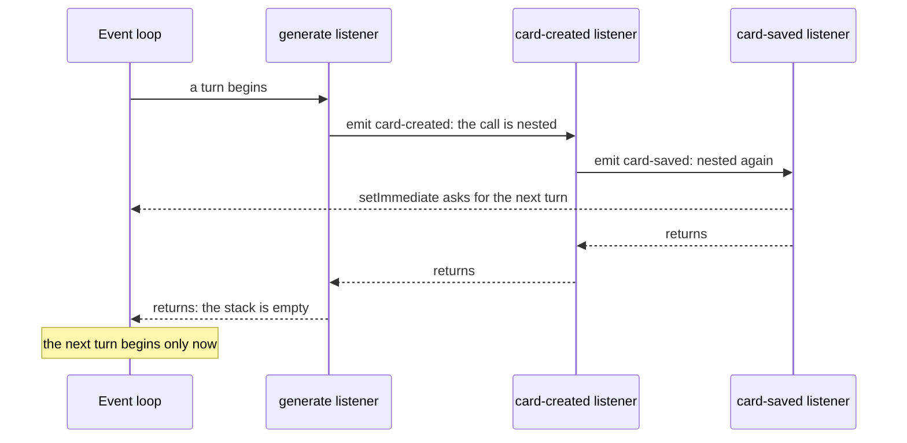

# Events, callbacks and reactive control study guide

## What this guide is for

"What runs next?" has three answers in this repository. *The program chooses*: a loop asks itself before every card. *The consumer chooses*: a pull, where nothing happens until someone asks. *The producer chooses*: a push, where something announces that it happened and every function that registered for it runs. This guide is about the third. The core question is: **who owns the next turn, and what does reentrancy change?**

When you finish, you should be able to:

1. Say, for an entry, whether the program, the consumer or the producer chooses what runs next.
2. Explain the difference between a synchronous `emit()` and a call that hands the next step to the event loop, and what each does to the call stack.
3. Trace `javascript-events` through three cards, naming the turns and the nesting depth.
4. Explain reentrancy: what happens when a callback triggers the thing that called it, and how the entries prevent or limit it.
5. Tell a real event from a look-alike (a window's own loop, a trigger, a callout).
6. Label claims as guaranteed, implementation-permitted or accidentally exploited.

**Scope limits.** The guide uses Node.js's `EventEmitter` as the main example and compares it with other callback mechanisms in the entries. It does not teach GUI frameworks, async/await or reactive libraries. Its source chapter is [Events, callbacks and reactive control flow](../../cs/10-events-callbacks-and-reactive-control-flow.md).

## Before you begin

**Safety model.** The cards are fictional **DEMO ONLY** data. Programs can write to local scratch files or databases and can start processes or timers. Read the source first and run it in the sandbox first (`sandbox/container/run-image.sh src/javascript-events`). Work on copies ([Running things safely](../../exercises.md#running-things-safely)). A deliberately removed turn boundary can crash a run: use a scratch data folder.

**Prediction rule.** Before each run, write the *order* of events and mark which arrows are plain calls (the stack grows) and which are hops to a later turn (the stack unwinds). In this topic the order is the program.

**Vocabulary.**

| Term | Meaning here |
| --- | --- |
| Callback | A function you hand to someone else, to be called later or from elsewhere. |
| Event | An announcement that something happened. |
| Emitter | An object that calls the listeners registered for an event. |
| Turn | One pass of the event loop. Work queued with `setImmediate` runs on a later turn. |
| Reentrancy | A callback running while the thing that triggered it is still in progress. |
| Backpressure | A way for a slow consumer to slow a producer. |

## The shared challenge

The [challenge specification](../../intro.md#what-the-challenge-does) calls for cards with a category and 10 to 19 whole hours. Categories cycle through Meetings, Coding, Debugging and Learning. Add each card's hours to the running total. Stop when the total passes 40. Keep the **first card that takes the total over 40**. A total of exactly 40 continues. Four 10-hour cards need a fifth card, in the Meetings category. Conforming runs finish with 3 to 5 cards and a total of 41 to 59 hours.

In the events program the rule is one line: `total-updated` emits `finished` when `total > limit` (so 40 is not over), and otherwise schedules `generate` for a later turn. The category of card *n* is `(n - 1) % 4`, so a fifth card is Meetings again. The program takes a `world` object (`rng`, `schedule`, `open`, ...) so a test can inject its own.

## The machine to identify

**What repeats.** A cycle of events: `generate`, `card-created`, `card-saved`, `total-updated` and back to `generate`. No statement repeats. Each event's listener does one small thing and emits the next event.

**Where state lives.** In one object `s` (`n`, `total`, `db`, `frame`, `stop`) shared by the listeners, and in the emitter's *registrations*: which listeners exist is part of the program. Removing every listener at the end (`removeAllListeners`) is how the program makes itself unable to run again.

**What advances the next step.** A plain `emit` calls every listener *now*, before it returns, in registration order. `later(name)` calls `setImmediate`, so the next step waits for a new turn. Two kinds of arrow, two different machines.

**What stops it.** `total-updated` emits `finished` instead of scheduling another `generate`. After `finished`, `done` removes every listener.

**What commits.** `start` runs `BEGIN`, `card-created` inserts a row synchronously (`node:sqlite` is synchronous) and `finished` runs `COMMIT`. A throw in any listener is caught and emitted as `failed`, which runs `ROLLBACK` *once*, and removes all listeners so that a second failure finds nobody to tell.

<!-- diagram-source: lessons/cs-source/chapters/10-events-callbacks-and-reactive-control-flow.md#block-1 -->



The book's picture of one turn of scheduled events: `emit` nests, and the event loop separates turns. The trace below follows it with real numbers.

## Trace one run

With `SEED=1105` the hours are 15, 19, 12. A scratch script wrapped the entry's `emit` and `schedule` to log each emit (indented by depth) and each hop. The run printed:

```text
--- event loop turn 1 ---
emit start
  [setImmediate queued: next step waits for a new turn]
--- event loop turn 2 ---
emit generate
  emit card-created
    emit card-saved
      emit total-updated
  [setImmediate queued: next step waits for a new turn]
--- event loop turn 3 ---
emit generate  ...  (Coding 19 34, same shape)
--- event loop turn 4 ---
emit generate
  emit card-created
    emit card-saved
      emit total-updated
        emit finished
          emit done
```

(Rows and the summary appear between these lines in the real output.) Read three facts from it. **`emit start` returned before any card existed**: the first card is made on turn 2. **Each card is its own turn**, four emits deep, and the stack unwinds before the next turn. **The last turn is different**: the total is 46, so `total-updated` emits `finished` directly, and `finished` and `done` nest one and two levels deeper. The commit runs inside the same turn, before anything else can intervene.

| Turn | What runs | Stack depth at deepest | Total after |
| --- | --- | ---: | ---: |
| 1 | `start`: open, `BEGIN`, queue `generate` | 1 | 0 |
| 2 | Meetings 15 | 4 | 15 |
| 3 | Coding 19 | 4 | 34 |
| 4 | Debugging 12, then `finished` and `done` | 6 | 46 |

**The same cards, three machines.** The book compares a loop, a synchronous emitter and scheduled events. All produce the same rows for a small run. They differ when the run is large: the loop and the scheduled events keep the stack flat, while the synchronous emitter adds a few frames per card.

**Exactly 40.** With four 10-hour cards the total is 40, and `40 > 40` is false, so `total-updated` schedules a fifth `generate`. This program has no fixed list of four names, so it continues.

## Compare the ordinary and weird designs

| Dimension | A loop | `javascript-events` | Other callback entries |
| --- | --- | --- | --- |
| **Representation** | A statement | Listeners registered on an emitter | PCRE2 callouts, tar checkpoints, SQLite triggers |
| **Observability** | Step the loop | Log every `emit`: the whole program is its event trace | Callouts: print in the dispatcher. tar: the tick count. Triggers: the `born` log. |
| **Tests** | Call the function | Inject a `world`: a fake `rng`, a synchronous `schedule`, a recording `out` | `check.sh` with a simulation (tar), mutation (PCRE2 flags) |
| **Debugging** | A stack trace | A throw travels *up* through `emit` to whoever called it, which may be a scheduled callback nobody waits for | Errors mix the host's stack with the engine's |
| **Portability** | Any language | Node's `EventEmitter` semantics (listener order, synchronous `emit`) | GNU tar's checkpoints, PCRE2's callouts |
| **Cost** | Normal | A hop per card, a flat stack | Per-tick process starts, per-callout calls |

**Who owns the next turn.** In `javascript-events`, the *runtime* owns it: after `setImmediate`, the event loop decides when the next `generate` runs, and anything else on the loop (timers, I/O) may run first. In `tar-gnu-weird`, *tar* owns it: it calls the tick once per record, and the program cannot stop it. In PCRE2, the *engine* owns it: it calls a callout when the pattern reaches that point. In each, the program is a set of callbacks and the environment holds the loop.

## What the exercises demonstrate

| Exercise | Predict first | What the evidence shows |
| --- | --- | --- |
| [B22. JavaScript, event-driven](../../exercises.md#b22-javascript-event-driven-predict-the-trace-then-remove-the-boundary-verified), step 2 | `listener`, `after emit`, `immediate`: what order? | `listener`, `after emit`, `immediate`. `emit()` calls before it returns, and `setImmediate()` only asks. |
| B22, step 3 | The trace of three 19-hour cards. | `>start <start main is done`, then three turns, with `<start` before the first `>generate`. |
| B22, step 4 | Replace `later('generate')` with `events.emit('generate')`. | A normal run still works. The lab fails two tests, and a very long run prints `Maximum call stack size exceeded` and exits 1. With the boundary back and `limit: 30_000`, about 2000 cards run and nothing prints. |
| [B17. tar, weirder: predict the clock](../../exercises.md#b17-tar-weirder-predict-the-clock-verified) | `--ticks 45` against `46`. | Callbacks the program does not control: too few and the machine stalls, with `the clock ran out` and exit 3. |
| [B12. Tcl: edit the program in the database](../../exercises.md#b12-tcl-edit-the-program-in-the-database-verified) | `recursive_triggers = OFF`. | One row printed, `entries=2`: a trigger's own insert does not re-fire a trigger unless recursion is enabled. Reentrancy is opt-in. |
| [B21. JavaScript, weirder](../../exercises.md#b21-javascript-weirder-move-the-stop-rule-in-a-closure-and-watch-the-demand-verified) | `take(1)` against `take(2)`. | The pull version: the consumer decides how many cards exist. |

## Failure modes, costs and boundaries

| Behavior | Label | Why |
| --- | --- | --- |
| `emit()` calls listeners synchronously, in registration order, before it returns | **guaranteed** | Documented Node.js behavior. |
| `emit('error', e)` with no `error` listener throws `e` | **guaranteed** | Documented. The program turns it into `failed`. |
| `setImmediate` runs its callback on a later turn | **guaranteed** | Documented scheduling. |
| `node:sqlite` is synchronous | **implementation-permitted** | A property of the built-in module. The `card-saved` guarantee depends on it. |
| tar runs one callback per record written and ignores its exit status | **implementation-permitted** (the callback) and **accidentally exploited** (the exit status) | Documented GNU option; the exit-status behavior is observed. |
| SQLite limits trigger recursion (1000 by default) | **guaranteed** | The challenge needs 3 to 5. |
| A PCRE2 callout's return value: 0 continue, positive fail the path, negative abort | **guaranteed** | Documented API. |

**Costs to state.**

- **The trap in the middle.** A synchronous emitter *looks* like events and behaves like recursion. It is correct for the sizes you test and fails at a size you do not.
- **Throws have no caller.** A throw inside a scheduled callback would end the process. Each listener catches it and emits `failed`.
- **Hidden order.** Listener order is registration order. Reordering registrations changes the program.
- **Backpressure.** A push has no brake: a producer announces whether or not anyone is ready. The events program is self-paced (one card per turn), and the pull program lets the consumer set the pace. See [Backpressure](../../cs/10-events-callbacks-and-reactive-control-flow.md#backpressure).
- **Look-alikes.** A window's own loop (`Application.Run`, Tk, GTK) pumps a dispatcher, but nothing in the logic subscribes to anything. The XAML `Loaded` trigger only starts an animation. These are counterexamples in the book, not events.
- **Where this is legitimate.** User interfaces, servers and pipelines are event-driven. Making a card generator out of an emitter is a stunt that shows how.

## Connections across the repository

- **The JavaScript guide.** [JavaScript](../languages/javascript.md) traces all three styles. This guide generalizes B22.
- **Callbacks that the engine owns.** [Regex engines and sed](../languages/regex-engines-and-sed.md) (PCRE2 callouts) and [tar](../languages/tar.md) (checkpoints) are synchronous callbacks from a host, not an event loop.
- **Triggers as reentrancy.** [Tcl](../languages/tcl.md) uses a recursive trigger as a loop.
- **Thread affinity.** [C#, LINQ, XAML and ports](../languages/csharp-linq-xaml-and-ports.md) covers the dispatcher and the STA thread.
- **Demand and state.** [Evaluation, demand and laziness](evaluation-demand-and-laziness.md) is the pull version of this question, and [State and control beyond variables](state-and-control-beyond-variables.md) asks where each step is stored.
- **In the book.** [Event-driven programming](../../cs/10-events-callbacks-and-reactive-control-flow.md#event-driven-programming), [Callbacks](../../cs/10-events-callbacks-and-reactive-control-flow.md#callbacks), [Publish and subscribe](../../cs/10-events-callbacks-and-reactive-control-flow.md#publish-and-subscribe), [The event loop and scheduling turns](../../cs/10-events-callbacks-and-reactive-control-flow.md#the-event-loop-and-scheduling-turns) and [Backpressure](../../cs/10-events-callbacks-and-reactive-control-flow.md#backpressure).

## Self-check

Answer each question in your own words before you read the italic text. Say what evidence would support each answer.

1. **Trace.** In `javascript-events`, hours are 12, 14, 13, 11 (totals 12, 26, 39, 50). How many turns does the run take, and in which does `finished` run? *(Five turns: one for `start`, then one per card. `finished` runs in turn 5, nested inside `total-updated`, because the fourth card makes 50.)*
2. **Explain.** What goes wrong if `total-updated` calls `events.emit('generate')` instead of `later('generate')`? *(Every card adds a few frames to the call stack, because each `emit` returns only after the whole rest of the run. A long run exceeds the stack limit and fails with `Maximum call stack size exceeded`.)*
3. **Transfer.** In a language you use, what plays the part of `setImmediate`, the call that ends a stack and starts a new turn? *(For example `setTimeout(fn, 0)`, `queueMicrotask`, `asyncio.create_task`, a message posted to a dispatcher or a goroutine started with `go`.)*
4. **Evidence.** A reviewer says, "The events program keeps a flat stack for any number of cards." Design a test that could fail. *(Wrap `emit` with a depth counter and run with a very large `limit`, as in B22, then assert the maximum depth. The negative control is the version with the boundary removed, whose depth grows with the number of cards.)*

## Further reading

- [Event loop](https://en.wikipedia.org/wiki/Event_loop) (Wikipedia): the idea behind turns.
- [The Node.js event loop](https://nodejs.org/en/learn/asynchronous-work/event-loop-timers-and-nexttick) (Node.js): the runtime's own account of `setImmediate` and turns.
- [Events](https://nodejs.org/api/events.html) (Node.js): the `EventEmitter` documentation, including synchronous `emit` and the special `error` event.
- [Callback (computer programming)](https://en.wikipedia.org/wiki/Callback_(computer_programming)) (Wikipedia): the general idea.
- [Back pressure](https://en.wikipedia.org/wiki/Back_pressure) (Wikipedia): why a push needs a brake.
