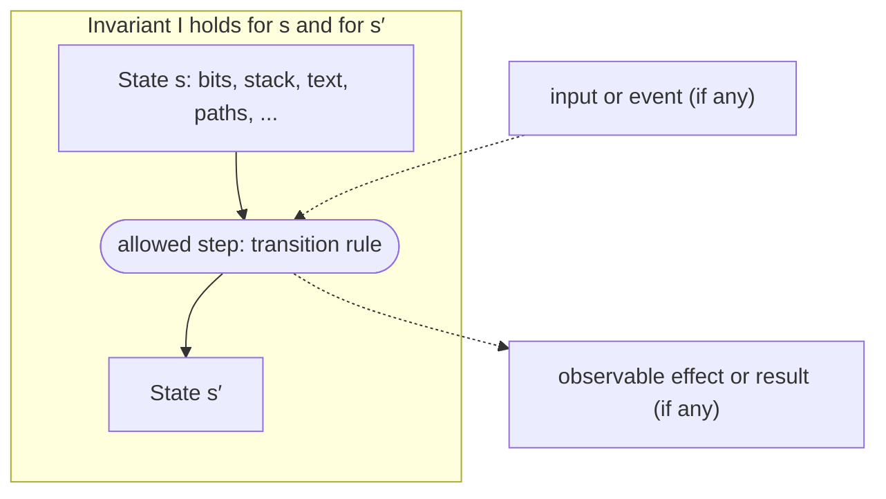

# State and control beyond variables study guide

## What this guide is for

This guide answers two questions about every program: **what runs next, and what does it remember?** Most languages answer with a program counter, a call stack and variables. The book's entries answer elsewhere: in a jump target, a parse position, the set of files that exist, regex captures, source text, table rows, a class chain, an archive's size. The guide teaches you to find the answer in a program that has no obvious loop and no obvious variable.

When you finish, you should be able to:

1. Describe any program as a machine: a state, a set of allowed steps, a representation and an invariant.
2. Say, for COBOL, Forth, Make, CMake, Tcl, APL, Common Lisp, ed, Ex and tar, where the *next step* is stored and where the *remembered state* is stored, and say how they differ.
3. Explain why a debugger that shows variables can give an incomplete picture of such a program.
4. Distinguish control state that is *data the program edits* (a jump target, a mark, source text) from control state that is *derived* (a counter, a position).
5. State an invariant for a program and say how its output could prove or refute it.
6. Label claims as guaranteed, implementation-permitted, or accidentally exploited.

Scope limits. The guide uses facts verified in the language guides and does not repeat their traces. It does not cover concurrency or the event loop (see [Events, callbacks, and reactive control](events-callbacks-and-reactive-control.md)). Its source chapters are [What counts as a machine?](../../cs/02-what-counts-as-a-machine.md), [Control flow and continuations](../../cs/03-control-flow-and-continuations.md) and [State beyond variables](../../cs/06-state-beyond-variables.md). `find` and AWK are cited here rather than given their own guide.

## Before you begin

**Safety model.** The cards are fictional **DEMO ONLY** data. Programs can write to local scratch files or databases and can start processes. Read the source first and run it in the sandbox first, for example `sandbox/container/run-image.sh src/cobol-weird`. Work on copies ([Running things safely](../../exercises.md#running-things-safely)).

**Prediction rule.** Before each run, write the *two* facts a trace needs: where the program is, and what it remembers. They are different columns. For COBOL's `ALTER`, one tells you where execution *is*, and the other tells you where the next `GO TO` *will go*.

**Vocabulary.**

| Term | Meaning here |
| --- | --- |
| State | Whatever persists between steps and can change a later step. |
| Program counter | The place that says what runs next. |
| Representation | How a value is written down: bits, text, marks, a position. |
| Invariant | A fact that stays true while the machine runs, at least after each step. |
| Continuation | "The rest of the computation", stored as something other than a stack frame. |

## The shared challenge

The [challenge specification](../../intro.md#what-the-challenge-does) calls for cards with a category and 10 to 19 whole hours. Categories cycle through Meetings, Coding, Debugging and Learning. The running total rises until it passes 40. The run **retains the first card that takes the total above 40**. A total of exactly 40 does *not* stop it, and four 10-hour cards need a fifth. Conforming runs finish with 3 to 5 cards and a total of 41 to 59.

As a machine, the challenge has a small state: `(cards so far, total)`, plus the next category. One step takes a number of hours, adds it to the total, records the card and either continues or finishes. The *invariant* after each recorded card is "the total equals the sum of the recorded hours". For the weird COBOL variant there is a second invariant that holds only after each successful add: `WS-HEADROOM` equals 59 plus the total. The examples in this trace represent that machine in different ways. The fixed LINQ demos and the XAML ceiling show where the shared model needs an extra stopping condition.

## The machine to identify

Use this worksheet for every entry. The five answers in the first column were checked in the language guides.

**What repeats.** What is the thing that happens again? A performed paragraph, a rewound parse position, a restarted build, a regex pass, an event, a method in a chain, a tick. The repetition is not always in the code: for Make it is the *whole process*, and for Ex it is a register that runs itself.

**Where state lives.** The remembered facts, beyond the variables you can see:

| Entry | Next step is stored in | Memory is stored in |
| --- | --- | --- |
| [`cobol-weird`](../languages/cobol.md) | the target of one `GO TO` (changed by `ALTER`) | `WS-TOTAL`, and `WS-HEADROOM` (59 plus the total) |
| [`forth-weird`](../languages/forth.md) | the parse position `>in` | the data stack: `( n total anchor )` |
| [`make-gnu`](../languages/make-and-cmake.md) | which `.tc-N.mk` files exist, and `MAKE_RESTARTS` | the same files, one card each |
| [`cmake`](../languages/make-and-cmake.md) | the regex captures `CMAKE_MATCH_1`..`5`, rebuilt each pass | the same captures, as runs of `x` |
| [`tcl-weird`](../languages/tcl.md) | SQLite's trigger firing again | table rows, and `count(*)` for the card number |
| [`apl-weird`](../languages/apl.md) | the call chain of functions that were written at run time | genes: four lines of each function's source |
| [`lisp-weird`](../languages/common-lisp.md) | the class precedence list | the `ledger` object |
| [`ed-weird`](../languages/ed-and-ex.md) | the next line matched by one global command | marks (`x`) on each line, and a ledger line |
| [`ex-weird`](../languages/ed-and-ex.md) | register `n`, copied from a tape line | the position of mark `t` on the tape: the total |
| [`tar-gnu-weird`](../languages/tar.md) | tar's checkpoint callbacks | one `fsm` row in SQLite |
| [`find-gnu`](../../../src/find-gnu/README.md) | the walk into the directory just made | the depth of the path: the total |
| [`awk-weird`](../../../src/awk-weird/README.md) | awk's own record loop | the stream and the record separator `RS` |

**What advances the next step.** Something must change the state, and it is not always the program's own statement. The text interpreter in Forth, `find`'s walk, awk's record loop, tar's checkpoints and SQLite's trigger machinery are *the environment* advancing the program.

**What stops it.** How the machine halts: an overflowing field, a flag that is zero, a file that is not written, a literal of 41 characters, a comment on a tape line, an empty compression, a method that returns true. A stop rule can be a *value* (a flag) or an *absence* (no file, no row, no input left).

**What commits.** Look for where the effects become permanent. A transaction can collect a whole run, while pcre2grep uses separate SQLite calls and the .NET regex host appends a TSV report. State and commit are separate concerns: a debugger can see the state while the commit has not happened.

<!-- diagram-source: lessons/cs-source/chapters/02-what-counts-as-a-machine.md#block-1 -->

The book's picture of a machine: a state, an allowed step and an invariant that holds across it. Every row of the table above is one way to fill in the boxes.

## Trace one run

With hours 15, 19, 12, here is the *same machine* in three substances. Each was verified by running a scratch copy in the sandbox.

| Step | `cobol-weird`: target of `NEXT-CARD`, headroom | `make-gnu`: files at pass start, total | `ex-weird`: mark `t` (tape line), instruction |
| --- | --- | --- | --- |
| start | Meetings, 59 | none, 0 | 0, `@a` |
| card 1 (15) | Coding, 74 | `.tc-0.mk`, 15 | 15, `@a` |
| card 2 (19) | Debugging, 93 | `.tc-0.mk` `.tc-1.mk`, 34 | 34, `@a` |
| card 3 (12) | **FINISH-RUN**, 93 (the add overflowed and left 93) | three files, 46 | 46, `"` (a comment: stop) |

Read across. Three different substances hold the same facts: a jump target and a number, a set of files, a position on a tape. The invariant "the total equals the sum of the hours" is true in every column, but you must *compute* it differently. In COBOL it is `headroom - 59` until the overflow. In Make it is the length of the `x` list built from the files. In Ex it is the number under the mark.

**Look at the stopped state.** In COBOL, `WS-HEADROOM` held 93 *twice*: once after a successful add and once after a failed one. A field that holds the same value at two different moments with two different meanings is a sign that the program's state is partly elsewhere: here, in the jump target.

**Exactly 40.** A conforming entry has a fifth card available even though there are four different category names. A supply of four slots makes that impossible, as in XAML and the original four-name implementations ([Comparative machine design](comparative-machine-design.md) traces the fixes). The machine's *representation* decides what boundary it can express.

## Compare the ordinary and weird designs

| Dimension | Ordinary (variables and a loop) | Control and state stored elsewhere |
| --- | --- | --- |
| **Representation** | `total`, `count`, a loop condition | A jump target, a position, a file set, captures, source text |
| **Observability** | Print the variables | You must look at the right place: the target, `>in`, `ls`, the registers, `⎕CR` |
| **Tests** | Unit-test a function | Test the whole machine, driven by controlled inputs (`DICE`, `SEED`, `--hours`) |
| **Debugging** | Watch variables | A variable watch is *incomplete*: it misses the control state |
| **Portability** | Standard language | Depends on the feature that holds the state (`ALTER`, `>in`, `MAKE_RESTARTS`, `CMAKE_MATCH_n`) |
| **Cost** | Normal | Reviewability and reentrancy: two callers cannot share one rewritten jump target or one parse position |

A language can hide control state from you in two ways. It can store it *in data you do not think of as state* (a jump target). Or it can store it *in the environment* (the filesystem, the database). Both hide it from a variables-only view.

## What the exercises demonstrate

| Exercise | Predict first | What the evidence shows |
| --- | --- | --- |
| [B1. COBOL: predict, then break ALTER](../../exercises.md#b1-cobol-predict-then-break-alter-verified) | Start the headroom at 49. Where does the run stop? | Above 50. One number in the data encodes the rule, and the entry's own check fails because it hard-codes 40. |
| [B3. Forth: move the anchor](../../exercises.md#b3-forth-move-the-anchor-verified) | Write `>in @ 0 0 step rewind?` (state after the anchor). | It runs away: the state is re-created on every pass. The *order* of state and anchor is part of the program. |
| [B4. Make: remove the no-op, and override the clock](../../exercises.md#b4-make-remove-the-no-op-and-override-the-clock-verified) | Delete `@:`. | `entries=0`: no command ran, so no file was "remade" and Make never restarted. |
| [B5. CMake: mutate the literal](../../exercises.md#b5-cmake-mutate-the-literal-verified) | Shorten the 41-`x` literal. | The stop rule moves, because the literal *is* the rule. |
| [B19. Ex: move the limit on the tape and cut the loop](../../exercises.md#b19-ex-move-the-limit-on-the-tape-and-cut-the-loop-verified) | Remove `\|@n`. | One card. Nothing runs the register again, so the program never restarts itself. |
| [C3. A loop whose state is not a variable](../../exercises.md#c3-a-loop-whose-state-is-not-a-variable-verified) | In awk, with no loop keyword, print 1 to N for a caller-chosen N. Where can the state live? | In the input: the *caller's* data is the counter. |

## Failure modes, costs, and boundaries

| Behavior | Label | Why |
| --- | --- | --- |
| A size error leaves the receiving field unchanged | **Guaranteed** | Specified COBOL semantics. |
| `ALTER` is accepted by the compiler | **Implementation-permitted** | Deleted from the standard in 2002; GnuCOBOL still runs it. |
| `>in` holds the parse offset and may be written | **Guaranteed** that it exists | Where it points after `>in @` is system-specific. |
| Make re-executes itself after remaking an included makefile | **Implementation-permitted** | GNU Make's documented behavior. |
| Using that restart as a loop, with a recipe that expands to nothing not counting as a remake | **Accidentally exploited** | The book's own example. |
| The main `MATCHES` runs even when the CMake stop test already said stop | **Accidentally exploited** | Observed, and needed to log the last card. |
| Method combination `or` stops at the first true method | **Guaranteed** | Defined by ANSI Common Lisp. |
| Tar's checkpoint count when listing differs from when creating | **Accidentally exploited** knowledge | Only creation is used. |

**Costs to state.**

- **A variables-only view lies.** In COBOL, Forth, Make and CMake, the variables are an incomplete state.
- **Reentrancy.** State stored in the code's own control flow is shared by every caller. That was `ALTER`'s fatal objection.
- **Where it is legitimate.** A parse position is how every parser works. A restart is how build systems regenerate themselves. A database trigger keeps invariants. A jump table is a state machine. The stunt is using them as the *only* state.
- **Silent failure.** A wrong line count in APL's copy (`4↓` for `5↓`), a typo in an ed pattern or an `s` that matches nothing all fail without an error.

## Connections across the repository

- **The language guides.** [COBOL](../languages/cobol.md), [Forth](../languages/forth.md), [Make and CMake](../languages/make-and-cmake.md), [Tcl](../languages/tcl.md), [APL](../languages/apl.md), [Common Lisp](../languages/common-lisp.md), [ed and Ex](../languages/ed-and-ex.md) and [tar](../languages/tar.md) each trace one of these machines.
- **Demand and laziness.** [Evaluation, demand, and laziness](evaluation-demand-and-laziness.md) asks *when* a step runs; this guide asks *where it is stored*. [Haskell](../languages/haskell.md) stores it in a data dependence.
- **Events.** [Events, callbacks, and reactive control](events-callbacks-and-reactive-control.md) asks who owns the next turn.
- **Reading safely.** [Reading adversarial programs](reading-adversarial-programs.md) uses "where is the state?" as the first question.
- **In the book.** [What counts as a machine?](../../cs/02-what-counts-as-a-machine.md), [The program counter](../../cs/03-control-flow-and-continuations.md#the-program-counter), [Self-modifying code](../../cs/03-control-flow-and-continuations.md#self-modifying-code), [State](../../cs/06-state-beyond-variables.md#state) and [Dependency graphs](../../cs/06-state-beyond-variables.md#dependency-graphs).

## Self-check

Answer before you read the italic text after each question.

1. **Trace.** In `ex-weird` with `DICE="2 2 2 2 2"` (12 hours each), give the mark position and tape instruction after each pass. *(12 `@a`, 24 `@a`, 36 `@a`, 48 `"`. Four cards. The fifth die is unused.)*
2. **Explain.** Why does a debugger that watches `WS-TOTAL` and `WS-ENTRIES` in `cobol-weird` give an incomplete picture? *(The next category is stored in the target of the `GO TO` in `NEXT-CARD`, which is not a variable. You must also know the last `ALTER` that ran.)*
3. **Transfer.** Name where the next step is stored in a recursive-descent parser, and in a game's main loop. *(A parser: the call stack and the input position. A game loop: the loop statement and the game-state object, with the frame as the clock.)*
4. **Evidence.** A reviewer claims "Make's loop state is only the set of `.tc-N.mk` files". Design a test that could fail. *(Run in an empty directory, record the files after each pass, and check that deleting one changes the card count and the restart count. The negative control is a run that leaves a stale file, which the entry refuses. Claim label: implementation-permitted.)*

## Further reading

- [State (computer science)](https://en.wikipedia.org/wiki/State_(computer_science)) (Wikipedia): what counts as state.
- [Finite-state machine](https://en.wikipedia.org/wiki/Finite-state_machine) (Wikipedia): the formal sense of "state and step".
- [Program counter](https://en.wikipedia.org/wiki/Program_counter) (Wikipedia): the register behind "what runs next".
- [Continuation](https://en.wikipedia.org/wiki/Continuation) (Wikipedia): the idea that "the rest of the computation" can be stored as a value.
