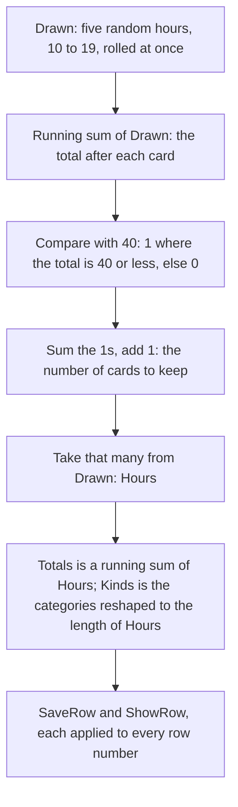
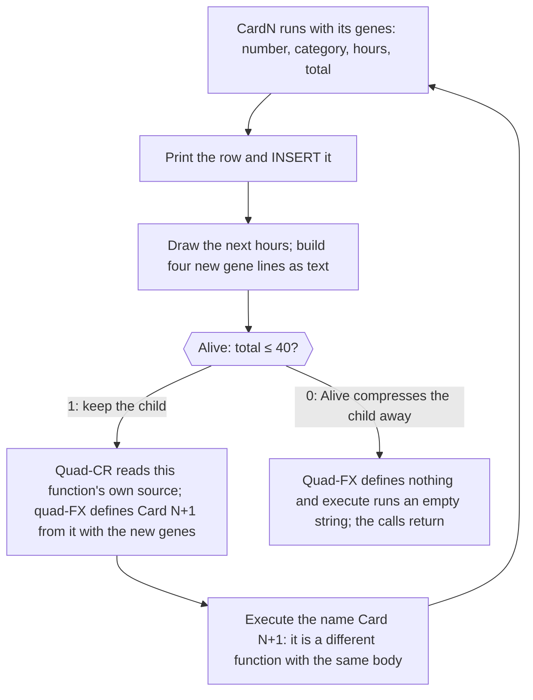

# APL study guide

## What this guide is for

This guide reads two GNU APL programs: [`src/apl`](../../../src/apl/README.md), whose card calculation uses four named array assignments, and [`src/apl-weird`](../../../src/apl-weird/README.md), where each card is a function *written as text by the previous card* and then run. The question is: **when the program works on whole arrays, or on its own source text, what replaces the loop and what holds the state?**

When you finish, you should be able to:

1. Read `Hours←Drawn↑⍨1++/40≥+\Drawn` from right to left and say what each primitive produces on a given input.
2. Explain why an eager, whole-array program draws more values than it needs, and why that is a *bound* and not a loop count.
3. Explain how `⎕CR` and `⎕FX` let a function read and write functions, and why the stop rule in `apl-weird` is a compress over text.
4. Trace both programs through the same three cards, showing the arrays in one and the generated source in the other.
5. Label each behavior as guaranteed, implementation-permitted, or accidentally exploited.

Scope limits. You need to read basic APL: `⍳`, `⍴`, `+\` (scan), `+/` (reduce), `/` (compress) and `↑` (take). The guide does not teach the whole glyph set, GNU APL's `⎕FIO` file functions beyond what the programs use, or SQL. If the APL symbols show as empty boxes, see [Seeing the glyphs](../../../src/apl/README.md#seeing-the-glyphs).

The book's page is [APL](../../languages/apl.md). The ideas are in [Array programming](../../cs/04-evaluation-and-demand.md#array-programming), [Homoiconicity: code as data](../../cs/06-state-beyond-variables.md#homoiconicity-code-as-data) and [Self-modifying code](../../cs/03-control-flow-and-continuations.md#self-modifying-code).

## Before you begin

**Safety model.** Every entry writes fictional **DEMO ONLY** data. Both programs start a shell snippet that creates a folder and runs `sqlite3`, and `apl-weird` *defines new functions while it runs*. Read the source before you run it, and run it in the sandbox first:

```bash
sandbox/container/run-image.sh src/apl
sandbox/container/run-image.sh src/apl-weird
```

Edit only copies ([Running things safely](../../exercises.md#running-things-safely)). A broken self-rewriting program may recurse for ever and never fail: set `SANDBOX_TIMEOUT=40` for any change to `apl-weird`.

**Prediction rule.** Before each run, write down the arrays (or the generated function text) you expect, and what output would prove you wrong.

**Vocabulary.**

| Term | Meaning here |
| --- | --- |
| Scan `+\` | Running total: `+\ 15 19 12` is `15 34 46`. |
| Reduce `+/` | Total: `+/ 1 1 0` is `2`. |
| Compress `/` | A boolean on the left selects items on the right. A scalar `0` selects nothing and a scalar `1` selects everything. |
| `⎕CR` / `⎕FX` | "Canonical representation": a function's source as a character matrix. "Fix": define a function from such text. |
| `⎕IO` | The index origin: whether the first index is 0 or 1. |

## The shared challenge

The [challenge specification](../../intro.md#what-the-challenge-does) calls for cards with a category and 10 to 19 whole hours. Categories cycle through Meetings, Coding, Debugging and Learning. Keep a running total and stop when it passes 40. The run **retains the first card that takes the total above 40**. A total of exactly 40 does *not* stop it: four 10-hour cards total exactly 40, and a fifth is drawn. Conforming runs finish with 3 to 5 cards and a total of 41 to 59.

APL expresses the boundary in one comparison, `40≥`, "is the total at most 40?". It is true for 40. The program counts the cards for which it is true and then adds one, to include the card that crosses.

## The machine to identify

**What repeats.** In `apl`, nothing repeats in the code: the array primitives apply to every element. [Four named assignments](../../../src/apl/timecards.apl#L30-L39) hold the calculation: five draws in `Drawn`, then three results derived from it in `Hours`, `Totals` and `Kinds`. In `apl-weird`, a *chain of calls*: `Card0` calls `Card1`, which `Card0` wrote, which calls `Card2`, and so on ([L43-55](../../../src/apl-weird/timecards.apl#L43-L55)). The chain is recursion-shaped, but each link is a *different function*.

**Where state lives.** In `apl`, in arrays: `Drawn`, `Hours`, `Totals`, `Kinds`. All five values are drawn at once, so the state is *the whole vector*. In `apl-weird`, in the **source text** of each function. Lines 1 to 4 of every card are four "gene" lines: `N←` (card number), `C←` (category), `H←` (hours) and `T←` (running total). Each child gets new gene lines.

**What advances the next step.** In `apl`, nothing advances: each primitive runs once over its argument. In `apl-weird`, a card builds the next card's text with `⎕FX` and runs it with `⍎`.

**What stops it.** In `apl`, `+/40≥+\Drawn` counts the leading cards whose running total is at most 40. Because running totals only grow, "still at most 40" is true for a prefix and false for ever after, so the count *is* the position of the boundary. In `apl-weird`, `Alive←40≥T` is 1 or 0. `Alive/` compresses the child's source: a scalar 0 keeps no lines, so `⎕FX` defines nothing, and the same `Alive/` empties the call so `⍎` runs an empty string.

**What commits.** In `apl`, rows are written to a pipe to `sqlite3` *after* the arrays are computed, followed by `COMMIT;` and a pipe close that waits for `sqlite3`. In `apl-weird`, each card writes its `INSERT` as it runs, and `COMMIT;` is written after the whole chain returns ([L67-68](../../../src/apl-weird/timecards.apl#L67-L68)). The row printing in `apl-weird` happens on the way *down* the chain: the crossing card prints and saves itself, then finds it is not alive and writes no child.

<!-- diagram-source: src/apl/README.md#program-flow -->



The first diagram is data flowing through array steps. There is no loop edge.

<!-- diagram-source: src/apl-weird/README.md#program-flow -->



The second diagram has a cycle, but each trip around it goes through a function that did not exist a moment earlier.

## Trace one run

The programs draw random numbers. Use hours **15, 19, 12** for the trace. To check it against real behavior, scratch copies were run in the sandbox with the draws replaced by fixed values (and, for `apl`, a few lines added to print the intermediate arrays).

**`apl`: four named arrays.** The original GNU APL scratch run used `Drawn←15 19 12 10 10`. The values below were re-derived from the four assignments in source order. It printed:

```text
Drawn         15 19 12 10 10
+\Drawn       15 34 46 56 66
40≥+\Drawn    1 1 0 0 0
+/40≥+\Drawn  2
1++/40≥+\Drawn  3
```

| Step | Expression | Result | Meaning |
| --- | --- | --- | --- |
| 1 | `Drawn` | `15 19 12 10 10` | Five draws. Five cards of 10 hours always reach 50, so five is a bound. |
| 2 | `+\Drawn` | `15 34 46 56 66` | The running total after each card. |
| 3 | `40≥+\Drawn` | `1 1 0 0 0` | "Total is still at most 40": true, true, then false for ever. |
| 4 | `+/` of that | `2` | Two cards are at or under 40. |
| 5 | `1+` | `3` | Add the one card that crosses. |
| 6 | `Drawn↑⍨3` | `15 19 12` | Take that many. |

The output was `Meetings 15 15`, `Coding 19 34`, `Debugging 12 46` and `# committed total=46 entries=3 DEMO ONLY`. `Totals` was `15 34 46`. `Kinds` reshapes the four category names to the length of `Hours`, filling three slots in this run and up to five in any conforming run. Draws 4 and 5 (10 and 10 here) were scanned and discarded. That waste is the price of eager evaluation.

**`apl-weird`: the chain of functions.** The scratch copy gave `Card0` the hours 15 and let each card take the next card's hours from the list 19, 12, 10, ... The generated source of `Card2`, printed with `⎕CR`, was:

```text
Card2;N;C;H;T;D;Alive;Kid;Genes
N←2
C←2
H←12
T←46
_←(Show (⊃Categories[C]) H T Week) ⎕FIO[22] 1
_←(Insert RunId (⊃Categories[C]) H T Week) ⎕FIO[22] Sqlite
D←(19 12 10 10 10)[N]
Genes←('N←',⍕N+1) ('C←',⍕4|C+1) ('H←',⍕D) ('T←',⍕T+D)
Alive←40≥T
Kid←⎕FX Alive/(⊂'Card',(⍕N+1),Locals),Genes,5↓⊂[1]⎕CR 'Card',⍕N
⍎Alive/'Card',⍕N+1
```

(The `D←` line is the scratch edit. In the real program it is `D←10+?10`.) Lines 2 to 5 are the genes: card number 2, category 2 (Debugging, with `⎕IO←0`), hours 12, total 46. Everything below them is copied unchanged from the parent.

| Function | Genes (N, C, H, T) | Prints | `Alive←40≥T` | What it does next |
| --- | --- | --- | --- | --- |
| `Card0` (written by the host) | 0, 0, 15, 15 | Meetings 15 15 | `40≥15` = 1 | Writes `Card1` with genes 1, 1, 19, 34. Calls it. |
| `Card1` | 1, 1, 19, 34 | Coding 19 34 | `40≥34` = 1 | Writes `Card2` with genes 2, 2, 12, 46. Calls it. |
| `Card2` | 2, 2, 12, 46 | Debugging 12 46 | `40≥46` = **0** | Compresses the child away. `⎕FX` defines nothing. `⍎` runs an empty string. The calls return. |

The report then lists the functions in the workspace with `⎕NL 3` and reads each one's hours gene: `Card0 ⇐ H←15`, `Card1 ⇐ H←19`, `Card2 ⇐ H←12`. The program wrote two of those three functions. The crossing card, `Card2`, is *kept*, because its genes were written when its parent was still alive. The stop rule suppresses the *next* card.

**Exactly 40.** With four 10-hour cards, `+\Drawn` is `10 20 30 40 50`, `40≥` gives `1 1 1 1 0`, `+/` gives 4, plus 1 is 5, and all five draws are used. In `apl-weird`, `Card3` has `T←40`, so `Alive←40≥40` is 1 and it writes `Card4`.

## Compare the ordinary and weird designs

| Dimension | `apl` | `apl-weird` |
| --- | --- | --- |
| **Representation** | Arrays. The data is the program: each line is a function of the previous array. | Functions as text. Each card's state is four literal lines in its source. |
| **Observability** | Print any intermediate array and see the whole state. | The state is in source text. `⎕CR 'Card2'` shows it, but only for functions that exist. A card that was never written leaves no evidence. |
| **Tests** | Pure array expressions: fix `Drawn` and compare `Hours`. | You must run the chain. The book's check runs under `timeout` because a broken stop rule recurses for ever. |
| **Debugging** | Read an array. | Read generated source, and remember that locals are *dynamically scoped*: a child sees its parent's variables unless each card declares its own (that is what `Locals` is for). |
| **Portability** | Standard array primitives, plus GNU APL's `⎕FIO` for files and pipes. | Needs `⎕CR` and `⎕FX`, and the off-by-one in the copy (`5↓`) is invisible unless you run it. |
| **Cost** | Draws five values and scans all five, even when three suffice. | Cheap: each card draws one value. But it defines a new function per card and leaves them in the workspace. |

The honest summary: the first program wastes data to avoid a decision, and the second wastes clarity to avoid a loop. The first needs the bound (five draws always suffice) to be true. The second needs the copy to be exactly right.

## What the exercises demonstrate

| Exercise | Predict first | What the evidence shows |
| --- | --- | --- |
| [B6. APL: the off-by-one rewrite](../../exercises.md#b6-apl-the-off-by-one-rewrite-verified), step 1 to 2 | Change `,5↓⊂[1]` to `,4↓⊂[1]` in `apl-weird`. What does each child keep from its parent? | Each child keeps one line too many of its parent's genes, which restarts the running total, so the stop rule never fires. The run ends only by timeout (or the container's memory limit), with no `# committed` line and rows whose total equals their own hours. Self-modifying code fails *structurally* and silently, which is why the entry's check runs under `timeout`. |
| B6, step 3 | Change `⎕IO←0` to `⎕IO←1`. What happens? | An `INDEX ERROR` and no rows. `Categories[C]` and the `N`-indexed lookups assume origin 0. The plain `apl` entry avoids this by never assuming an origin. |
| [C1. Weird next to boring](../../exercises.md#c1-weird-next-to-boring-verified) | In which program can you point at the state? | `apl` shows state as arrays you can print. `apl-weird` stores it in source lines that exist only while the program runs. |
| [A1. Read the rows](../../exercises.md#a1-read-the-rows-verified) | Which card crossed 40 here? | For `apl`, check that `+/40≥+\Drawn` counted the cards at or under 40. For `apl-weird`, check which `Card` function has the last `T←`. |
| [F. Prove a README claim](../../exercises.md#f-prove-a-readme-claim-verified) | What would show that "five draws are always enough" is a bound? | A test that draws five 10-hour cards and checks that the fifth total is 50. A negative control would draw only four and show that the count of 4 stops at exactly 40. |

## Failure modes, costs, and boundaries

| Behavior | Label | Why |
| --- | --- | --- |
| `+\`, `+/`, `/` and `↑` have fixed array semantics | **Guaranteed** | Core language definitions. Verified in the trace above. |
| Five draws are enough because five cards of at least 10 hours reach 50 | **Guaranteed** | Arithmetic about this challenge, not about APL. |
| `?`'s result depends on `⎕IO`, so the program subtracts it back out | **Guaranteed** | Specified behavior. `apl` is written to work in either origin. |
| `⎕CR` returns a function's source as a matrix and `⎕FX` defines a function from one | **Implementation-permitted** | Part of the APL2 family, but their exact behavior, including what `⎕FX` returns for empty input, is an interpreter detail. The programs use GNU APL. |
| Compressing a function's lines with `0` makes `⎕FX` define nothing | **Implementation-permitted** | Observed in GNU APL. The final workspace listing shows only the functions that should exist. |
| GNU APL starts with `⎕RL←16807`, so every run draws the same cards unless seeded | **Implementation-permitted** | The program reseeds from the clock. |
| `⎕FIO[24]`, `⎕FIO[22]` and friends | **Implementation-permitted** | GNU APL's file-and-process extension. Not portable to other APLs. |
| The report finds the last card from the order of names `⎕NL 3` returns | **Accidentally exploited** | `Card0` to `Card4` sort correctly as text. With ten or more cards `Card10` would sort before `Card2`. The challenge's maximum is five cards, so the dependence never fails. Nobody promised the order for other bounds. |

**Costs to state.**

- **Dynamic scope.** APL locals are visible to everything *called* from a function. Every card must declare `N;C;H;T;...` in its header, or a child's genes would overwrite its parent's.
- **Silent structural failure.** A wrong line count in the copy does not raise an error: it changes the *program*, and the stop rule may never fire.
- **`⊃` is not "first".** In GNU APL `⊃` discloses and `↑` takes the first item. Dyalog APL swaps those meanings, so the programs would need edits to run there.
- **Workspace pollution.** Functions defined by `⎕FX` stay in the workspace until it ends.
- **Where this is legitimate.** Array languages make "compute everything, then cut" natural, and it is often the fast way. Writing code at run time is how some APL systems implement macros and meta-tools. Rewriting your own source to avoid a loop is a stunt.

## Connections across the repository

- **Code as data in other languages.** [Tcl](tcl.md) stores program text in a database row and defines it when needed. [Common Lisp](common-lisp.md) can build and run forms. [COBOL](cobol.md) patches a jump instead of text.
- **Eager versus lazy.** `apl` computes five values and discards two. [Haskell](haskell.md) reads only as much of an infinite list as it needs. The deferred LINQ pipelines in [C#, LINQ, XAML, and ports](csharp-linq-xaml-and-ports.md) wait for enumeration. The separate C# `for` header enumerates eagerly with `Sum()` each time it tests the condition. The concept guide [Evaluation, demand, and laziness](../concepts/evaluation-demand-and-laziness.md) sets these three side by side.
- **State outside variables.** `apl-weird` keeps its state in source lines, as [Make](make-and-cmake.md) keeps it in files and [Forth](forth.md) in a parse position. See [State and control beyond variables](../concepts/state-and-control-beyond-variables.md).
- **Reproducibility of "random".** The APL entries reseed from the clock; the sed entry in [Regex engines and sed](regex-engines-and-sed.md) uses a seeded shift register and gives the same cards for the same seed.
- **In the book.** [APL](../../languages/apl.md), [Array programming](../../cs/04-evaluation-and-demand.md#array-programming), [Eager evaluation](../../cs/04-evaluation-and-demand.md#eager-evaluation) and [Homoiconicity: code as data](../../cs/06-state-beyond-variables.md#homoiconicity-code-as-data).

## Self-check

Answer before you read the italic text after each question.

1. **Trace.** `Drawn` is `12 14 13 10 11`. For `apl`, give `+\Drawn`, the boolean from `40≥`, the count, and the final `Hours`. *(Totals `12 26 39 49 60`. The boolean is `1 1 1 0 0`. The count is 3, plus 1 is 4. `Hours` is `12 14 13 10`, with a final total of 49. The crossing card is the fourth.)*
2. **Explain.** In `apl-weird`, why does `Card2` in the trace still print and save a row even though its `Alive` is 0? *(Printing and saving come *before* the `Alive` test in the card's body. `Alive` only controls whether the *next* card is written and called. The crossing card was written by a parent whose total was still at most 40.)*
3. **Transfer.** In the Haskell weird entry, the stop rule is "how much of the list I read". In `apl`, it is "how many items a prefix count says to take". What is the main difference in *work done*? *(Haskell builds only the demanded prefix. APL builds five values and trims. Both answer "which cards are kept" the same way. They differ in whether the unused work happens.)*
4. **Evidence.** A student claims "`apl-weird` never draws more than five hours." Design a test that could fail. *(Run the program many times in the sandbox and count the `Card` functions listed in the report. The count must never exceed 5. For a negative control, use the exercise B6 edit and show that the count, and the run time, explode. Remember the timeout.)*

## Further reading

- [APL (programming language)](https://en.wikipedia.org/wiki/APL_(programming_language)) (Wikipedia): the history of array notation and the glyph set.
- [Array programming](https://en.wikipedia.org/wiki/Array_programming) (Wikipedia): why whole-array operations replace loops, and what that does to the cost of unused work.
- [Homoiconicity](https://en.wikipedia.org/wiki/Homoiconicity) (Wikipedia): code as data. APL is not homoiconic in the Lisp sense. `⎕CR` and `⎕FX` give a text route to the same effect.
- [GNU APL](https://www.gnu.org/software/apl/) (GNU Project): the interpreter these entries use, and the source of its `⎕FIO` extension.
