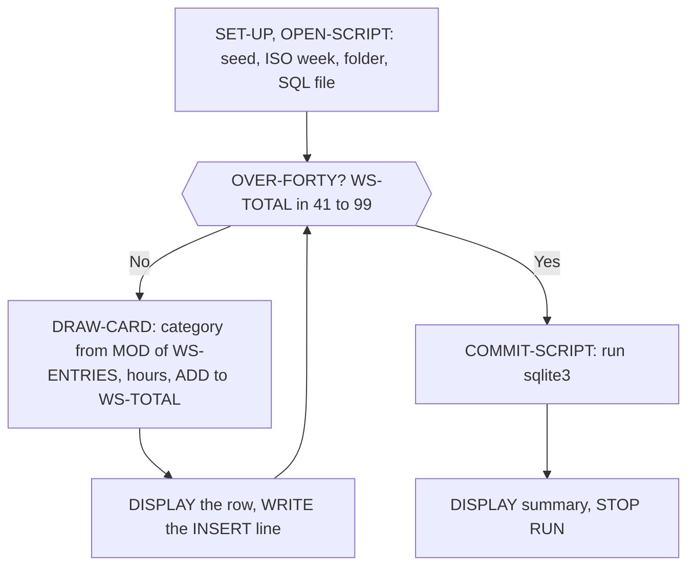
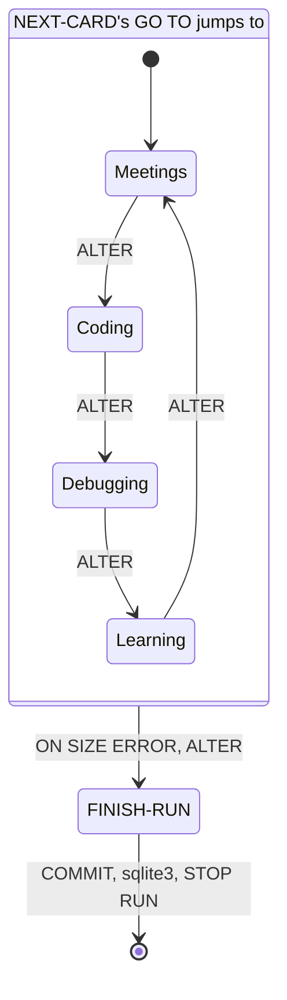

# COBOL study guide

## What this guide is for

This guide reads two COBOL programs side by side: [`src/cobol`](../../../src/cobol/README.md), which declares its stop rule as data, and [`src/cobol-weird`](../../../src/cobol-weird/README.md), which stores its loop in the target of a `GO TO` that rewrites itself. It treats them as two answers to one question: *where does a program keep "what happens next" and "when to stop"?*

It began as a study guide written by the book's co-author Ken Astl for the COBOL chapter, and it keeps his method: predict the state change, then run, then compare.

When you finish, you should be able to:

1. Explain how a level-88 condition name turns a stop rule into a property of the data, and why the idiomatic loop contains no comparison.
2. Trace both programs through the same three cards and name the state that decides each step: `WS-TOTAL` and `WS-ENTRIES` in one program, the target of `NEXT-CARD` and `WS-HEADROOM` in the other.
3. Say exactly what `ALTER` changes, what it leaves alone, and why it needs a paragraph that is only one `GO TO`.
4. Explain why a size error is a conditional, and what a field holding 99 can mean.
5. Label each COBOL behavior in the programs as guaranteed, implementation-permitted, or accidentally exploited, and say what evidence supports the label.

Scope limits. This is not a COBOL tutorial: it does not teach divisions, files or the full `PICTURE` language. It covers GnuCOBOL 3.1 or later in fixed format. It does not teach the SQL, which both programs build as text and hand to `sqlite3`. For the general lesson, read [COBOL in the book](../../languages/cobol.md) first, or after.

## Before you begin

**Safety model.** Every entry writes fictional **DEMO ONLY** data to a local SQLite file, and nothing connects to a real time-reporting system. The programs start processes (`mkdir`, `sqlite3`), so read the source before you run it, and run it in the sandbox first. From the repository root, with the one-time setup in [`SANDBOX-SETUP.md`](../../../SANDBOX-SETUP.md) done:

```bash
sandbox/container/run-image.sh src/cobol
sandbox/container/run-image.sh src/cobol-weird
```

Work on a copy when an exercise asks you to edit (see [Running things safely](../../exercises.md#running-things-safely)). The output is random, so your numbers will differ from every number printed here. The properties will not.

**Prediction rule.** Before each run, write down which state will change, which statement will run next, and what output would prove you wrong. The check script tells you whether you got a result. Only the prediction tells you whether you understood.

**Vocabulary you need.**

| Term | Meaning here |
| --- | --- |
| `PIC 99` | A field that holds exactly two decimal digits, 00 to 99. Its shape is part of its meaning. |
| Level 88 | A named condition on the field above it. It has no storage of its own. |
| Paragraph | A named block of statements. Control falls from one paragraph into the next unless a jump redirects it. |
| `GO TO` / `ALTER` | `GO TO` jumps. `ALTER` changes where a given `GO TO` will jump the next time it runs. |
| Size error | An arithmetic result that does not fit its receiving field. |

## The shared challenge

Every entry in the book builds the same fictional data set. A *card* is one time-card row: a category and a whole number of hours from 10 through 19. Categories cycle through Meetings, Coding, Debugging and Learning. The program keeps a running total and adds cards until the total passes 40.

Be exact about the boundary. The run retains **the first card that takes the total above 40**. A total of exactly 40 does *not* stop it. Four 10-hour cards total exactly 40, so a fifth card is drawn, and the category wraps back to Meetings. The final total is therefore always 41 to 59, and the card count is 3 to 5. (Two cards reach at most 38, so a run cannot end in two.)

Every run saves its rows as a single transaction in a SQLite file and prints a summary. The shared checker, [`lessons/tools/check-demo.sh`](../../tools/check-demo.sh), verifies the *shape* of the output: the `DEMO ONLY` marker, hours in range, correct running sums, a stop on the first crossing, and a summary that agrees with the rows.

For a stop rule of exactly this shape, notice how COBOL says it. In the idiomatic program the rule is `88 OVER-FORTY VALUE 41 THRU 99`: the first total *above* 40. There is no `<=` or `>` anywhere to get wrong.

## The machine to identify

Name the machine before you read the code. Both programs answer the same five questions, with different parts of the language.

**What repeats.** In `cobol`, one statement repeats a paragraph: `PERFORM DRAW-CARD UNTIL OVER-FORTY` ([L93](../../../src/cobol/timecards.cob#L93)). In `cobol-weird`, nothing is *performed*. Control makes a circuit: `NEXT-CARD` jumps to a category paragraph, that paragraph joins `RECORD-CARD`, and `RECORD-CARD` jumps back to `NEXT-CARD` ([L150-200](../../../src/cobol-weird/timecards.cob#L150-L200)).

**Where state lives.** In `cobol`, the running total `WS-TOTAL` and the count `WS-ENTRIES` are ordinary fields, and the category is computed from the count: `MOD(WS-ENTRIES, 4) + 1` ([L106](../../../src/cobol/timecards.cob#L106)). In `cobol-weird`, "which category is next" is not in any variable. It exists only as the current target of the `GO TO` inside `NEXT-CARD`. A second number, `WS-HEADROOM`, starts at 59 and tracks `59 + total` ([L44](../../../src/cobol-weird/timecards.cob#L44)).

**What advances the next step.** In `cobol`, the `PERFORM` statement decides, by testing the condition before each pass. In `cobol-weird`, each category paragraph executes `ALTER NEXT-CARD TO PROCEED TO <next category>` ([L157](../../../src/cobol-weird/timecards.cob#L157), [L162](../../../src/cobol-weird/timecards.cob#L162), [L167](../../../src/cobol-weird/timecards.cob#L167), [L172](../../../src/cobol-weird/timecards.cob#L172)), so the *same* `GO TO` leads somewhere new on the next trip.

**What stops it.** In `cobol`, the data declaration `88 OVER-FORTY VALUE 41 THRU 99` on `WS-TOTAL` ([L41-42](../../../src/cobol/timecards.cob#L41-L42)). In `cobol-weird`, an overflow: `ADD WS-HOURS TO WS-HEADROOM ON SIZE ERROR ...` ([L196-199](../../../src/cobol-weird/timecards.cob#L196-L199)). `59 + total` fits in two digits while the total is 40 or less. The first card that makes it 100 or more is a size error, and the handler rewrites `NEXT-CARD` one last time, to `FINISH-RUN`.

**What commits.** Both programs write `INSERT` lines to a line-sequential script file and print each row as they go. Nothing reaches the database until the finishing paragraph closes the file and runs `sqlite3` on it. The script has a `BEGIN` and a `COMMIT`, so the run lands as one transaction or not at all. The `DISPLAY` rows are *not* part of that transaction: they are already on the terminal, whatever `sqlite3` later does.

Here are the two Program Flow diagrams from the entries. Read each one with the five answers above beside it.

<!-- diagram-source: src/cobol/README.md#program-flow -->



The first diagram is a conventional loop. The test is a real node, and the cycle is a real edge. The test node asks the data a question.

<!-- diagram-source: src/cobol-weird/README.md#program-flow -->



The second diagram has no test node at all. It is a state diagram whose single state is the *target of one jump*. The exit is one more rewrite of that same target, triggered by overflow.

## Trace one run

The programs draw random hours, so a real run cannot be fixed in advance. For a trace, use hours **15, 19, 12**, in that order. To check the trace against real behavior, a scratch copy of `cobol-weird` was run in the sandbox with the hours read from a fixed string and two `DISPLAY` lines added to show `WS-HEADROOM` around the add. (Those lines sit in `RECORD-CARD`. A `DISPLAY` inside `NEXT-CARD` would be a different matter: see the exercises.) The output was:

```text
Meetings	15	15	DEMO ONLY
before add: headroom=59
after add:  headroom=74
Coding	19	34	DEMO ONLY
before add: headroom=74
after add:  headroom=93
Debugging	12	46	DEMO ONLY
before add: headroom=93
SIZE ERROR; headroom stays 93
after add:  headroom=93
# committed total=46 entries=3 DEMO ONLY
```

(The ISO-week column was removed for width.) The tables below list the state that decides each step.

**`cobol`, the idiomatic version.** The test runs *before* each pass.

| Step | `OVER-FORTY` tested on | Draw | `WS-HOURS` | `WS-TOTAL` after | `WS-ENTRIES` after |
| --- | --- | --- | ---: | ---: | ---: |
| 1 | total 0: false | `MOD(0,4)+1` = 1, Meetings | 15 | 15 | 1 |
| 2 | total 15: false | `MOD(1,4)+1` = 2, Coding | 19 | 34 | 2 |
| 3 | total 34: false | `MOD(2,4)+1` = 3, Debugging | 12 | 46 | 3 |
| end | total 46: **true** | none | none | 46 | 3 |

The third card is kept because the test happens *before* the next pass, so it only sees the effect of the card just completed. That is the reason the crossing card is part of the result.

**`cobol-weird`, the self-rewriting version.** `NEXT-CARD` starts pointing at Meetings.

| Step | Target of `NEXT-CARD` on entry | Category runs, then `ALTER` sets target to | `WS-TOTAL` after | `WS-HEADROOM` before, then after | Outcome of the add |
| --- | --- | --- | ---: | --- | --- |
| 1 | Meetings | Coding | 15 | 59, then 74 | fits |
| 2 | Coding | Debugging | 34 | 74, then 93 | fits |
| 3 | Debugging | Learning, then **FINISH-RUN** | 46 | 93, then 93 | size error: 93 + 12 = 105 |
| end | FINISH-RUN | none | 46 | 93 | commit and stop |

Look at step 3. The category paragraph for Debugging has already set the target to Learning. Then the size error handler in `RECORD-CARD` overwrites that target with `FINISH-RUN`. The last `ALTER` wins. The statement `GO TO NEXT-CARD` that follows is byte-for-byte the same statement as in steps 1 and 2.

**The boundary case: exactly 40.** Use ten hours for every card. This was also run in the scratch copy.

| Card | Category | True total | Headroom before | After the add |
| --- | --- | ---: | ---: | --- |
| 1 | Meetings | 10 | 59 | 69 |
| 2 | Coding | 20 | 69 | 79 |
| 3 | Debugging | 30 | 79 | 89 |
| 4 | Learning | 40 | 89 | 99, fits |
| 5 | Meetings | 50 | 99 | size error, stays 99 |

At card 4 the total is exactly 40 and the headroom is 99, the largest value two digits can hold. It still fits, so the run continues. The fifth card overflows it. Now change the starting value from 59 to 49 and run the same ten-hour cards. The headroom reaches 99 on card **5** (total 50), still fits, and overflows on card 6 (total 60). The final total was 60. The field holds 99 at two different moments with two different meanings: "this add fit exactly" and "this add failed and left the old value". To tell them apart, check whether the error clause ran, and where `NEXT-CARD` points now.

## Compare the ordinary and weird designs

Line count is the weakest comparison. By the book's counting convention (non-comment lines, blank lines included), the idiomatic program has 156 lines and the weird one has 170. They are about the same size. What differs is where the information sits.

| Dimension | `cobol` (idiomatic) | `cobol-weird` |
| --- | --- | --- |
| **Representation** | The stop rule is a named range on the data: `OVER-FORTY` is true for 41 to 99. The category is arithmetic on a counter. | The next category is the destination of a `GO TO`. The stop rule is the capacity of a two-digit field plus an error clause. |
| **Observability** | Print `WS-TOTAL`, `WS-ENTRIES` and `OVER-FORTY` and you have the machine. | The variables do not show the next category. You must know the last `ALTER` that ran. The source text of `NEXT-CARD` says `GO TO MEETINGS-CARD` and, at run time, almost never does. |
| **Tests** | Set `WS-TOTAL` to 40, then 41, and check the condition. | You must drive the program with controlled hours and observe whether the next dispatch finishes. The rule cannot be unit-tested apart from the paragraphs. |
| **Debugging** | A watch on three fields is enough. | A watch on the numeric fields is incomplete. You need the current jump target, which most debuggers do not display. |
| **Portability** | Standard COBOL: the `PIC`, level 88 and `PERFORM UNTIL` semantics are part of the language. | `ALTER` was declared obsolete in 1985 and deleted from the standard in 2002. GnuCOBOL accepts it and warns five times. A compiler in standards mode may not. |
| **Cost** | A readable loop. Changing the limit means editing one `VALUE` range, and renaming the condition if you want to keep the name honest. | The program cannot be reentered safely, because two callers would share one rewritten `NEXT-CARD`. Optimizers can assume little about a `GO TO` that might change. |

Notice the asymmetry in what each design *can't* say. The idiomatic version cannot make the loop target data. The weird version cannot make the stop rule readable. Neither is morally better. The book's historical case for `ALTER` is a tightly controlled batch system in which a switch set once and tested by an unconditional `GO TO` was cheaper than testing a flag on every pass, when memory and cycles were the constraint. That is a statement about 1978. It is not a recommendation for new code.

## What the exercises demonstrate

All of these exercises are marked verified in the book: the reference solutions were run against the real entries. Predict before you run each one, and write the prediction down.

| Exercise | Predict first | What the evidence shows |
| --- | --- | --- |
| [A1. Read the rows](../../exercises.md#a1-read-the-rows-verified) | Which card crossed 40, and what was the total just before it? Could a run reach exactly 40 and continue? | The stop rule is a precise boundary, not an approximation. The output alone proves the invariant "each row total equals the previous total plus hours" and exposes an off-by-one error even though the hours change every run. |
| [B1, part 1. Change the starting value](../../exercises.md#b1-cobol-predict-then-break-alter-verified) | Above what total will the run stop if `WS-HEADROOM` starts at 49 instead of 59? | The stop point moves to "first total above 50" (final totals 51 to 69). The shared checker passes with limit 50, and the entry's own `check.sh`, which hard-codes 40, fails. One number encodes the business rule. |
| [B1, part 2. Add a `DISPLAY` to `NEXT-CARD`](../../exercises.md#b1-cobol-predict-then-break-alter-verified) | Will you ever see the `x` printed? At what stage will it fail? | It fails at *compile time*, not run time: `'NEXT-CARD' is not an alterable paragraph`, once per `ALTER` (five times). The compiler checks the structural rule that makes the target patchable. |
| [C1. Weird next to boring](../../exercises.md#c1-weird-next-to-boring-verified) | For each program, which fields would you watch, isolate and change? | Programs can satisfy the same output contract while exposing different state. Readability and testability depend on where the rule lives. |
| [F. Prove a README claim](../../exercises.md#f-prove-a-readme-claim-verified) | What would a compile-time assertion look like for "GnuCOBOL warns five times about `ALTER`"? | A claim is only evidence if it can fail. A negative control (remove one `ALTER`, expect the count to change) shows that your test can detect the change. |

Two cautions from the book's answer key. In B1 part 1, a single random run can satisfy *both* checkers if it crosses 40 and 50 on the same card, so use the entry's own check for the failure evidence. In F, the book's worked solution uses Haskell. A COBOL version is an adaptation you design yourself, and the claim it proves is the behavior of the tested build only.

## Failure modes, costs, and boundaries

Label every behavior by the strength of its promise (see [Three kinds of knowledge](../../intro.md#three-kinds-of-knowledge)). The label changes what you may safely rely on.

| Behavior | Label | Why |
| --- | --- | --- |
| A size error leaves the receiving field unchanged and runs the `ON SIZE ERROR` clause | **Guaranteed** | Specified COBOL semantics. Verified in a scratch run: `ADD 1 TO B ON SIZE ERROR ...` left B at 99. |
| Without `ON SIZE ERROR`, a two-digit add silently drops the leading digit (99 + 1 gives 00) | **Implementation-permitted** | The standard does not promise a usable result when a size error happens and no handler is written. The tested GnuCOBOL build stored `00`: verified with `ADD 1 TO A` and A = 99. Rely on the clause, not on the truncation. |
| Storing 17.9 into `PIC 99` gives 17 | **Guaranteed** | Truncation by the receiver's declared scale. Verified: it printed `17`. |
| `STRING` leaves bytes to the right of what it writes | **Guaranteed** | Defined behavior of `STRING`. Verified: writing `XY` into a buffer holding `ABCDEFGH` left `XYCDEFGH`. Hence `MOVE SPACES` first. |
| `ALTER` is accepted and runs | **Implementation-permitted** | Deleted from the standard in 2002. GnuCOBOL still supports it and prints five obsolescence warnings. |
| `CALL "SYSTEM"` returns a raw wait status (exit 3 appears as 768) | **Implementation-permitted** | A host detail of the tested Linux build. The program divides by 256 to recover the exit code. |
| `ACCEPT ... FROM ENVIRONMENT` blanks the field when the variable is unset | **Implementation-permitted** | This is how the tested runtime behaves. The weird program turns it into a table subscript on purpose (see below). |
| The program needs `mkdir` and `sqlite3` on the host | **Implementation-permitted** | These are host commands, not COBOL. |

Nothing in the two COBOL entries is merely *accidentally exploited*. `ALTER` has a documented place in the compiler's history, which is not the same as an accident. The label exists for programs like the [Make entry](make-and-cmake.md), whose restart behavior nobody promised.

**Costs to be able to state.**

- **You cannot understand a paragraph by reading it.** This is the complaint that removed `ALTER`. The text of `NEXT-CARD` and its behavior are different things.
- **Fixed format makes whitespace significant.** Columns 1-6 are the old sequence area, `*` in column 7 starts a comment, area A begins at column 8 and area B at column 12, and text after column 72 is ignored. The entry's `check.sh` rejects any line over 72 characters because a silently ignored tail can change the program a human thinks they wrote. In exercise B1 part 2, line up the new `DISPLAY` with the existing `GO TO`.
- **Choosing without `IF`.** The weird program picks a data folder with `1 + FUNCTION MIN(WS-XDG-LENGTH, 1)` ([L119](../../../src/cobol-weird/timecards.cob#L119)): length 0 selects table slot 1 and any longer length selects slot 2. A conditional can be written as a calculation plus a lookup, and the reader pays for it.
- **Host details leak in.** `TAB` is a reserved word in GnuCOBOL, which is why the field is named `WS-TAB`. The ISO week is built by hand from `FUNCTION INTEGER-OF-DATE`, because an ISO week belongs to the year that holds its Thursday, so dates near New Year need care.
- **SQL by string building.** Both programs assemble `INSERT` text. It is safe here only because every value is a number computed by the program or one of four fixed words. Do not copy it.

## Connections across the repository

- **Control state outside variables.** `ALTER` is one of several ways in this repository to keep the next step somewhere other than a variable. [Forth](forth.md) keeps it in the parse position `>in`. [Make](make-and-cmake.md) keeps it in which files exist. CMake keeps it in regex captures. [Tcl](tcl.md) keeps it in a database trigger. The concept guide [State and control beyond variables](../concepts/state-and-control-beyond-variables.md) compares them directly.
- **Self-modifying behavior.** [APL's `apl-weird`](apl.md) rewrites a function while it runs. The comparison with `ALTER` is useful because APL's rewrite is explicit text and COBOL's is a patched jump.
- **Declarative stop rules.** The level-88 rule resembles the stop rules in [Haskell](haskell.md) (how much of a list you read) and the 41-character literal in CMake. In each, the rule is *data or structure* rather than a comparison in a loop.
- **Arithmetic error as control flow.** The size-error trick is a cousin of the exception and exit-status ideas in [Effects, errors, and commitment](../concepts/effects-errors-and-commitment.md).
- **What the label means.** [Portability, abstraction, and cost](../concepts/portability-abstraction-and-cost.md) explains the vocabulary of guaranteed and implementation-permitted behavior.
- **In the book.** The concept chapters are [What counts as a machine?](../../cs/02-what-counts-as-a-machine.md), [Control flow and continuations](../../cs/03-control-flow-and-continuations.md), [Effects, errors, and commitment](../../cs/07-effects-errors-and-commitment.md) and [Abstraction leaks and implementation dependence](../../cs/08-abstraction-leaks-and-implementation-dependence.md). The language page is [COBOL](../../languages/cobol.md).

## Self-check

Answer in your own words before you read the italic text after each question, and for each answer say what evidence would prove it.

1. **Trace.** Hours are 12, 17, 11, 10, in that order. For `cobol-weird`, write the true total and `WS-HEADROOM` after each card and say what happens on the fourth. *(Totals 12, 29, 40, 50. Headroom 71, 88, 99, then a size error on the fourth. The third card makes the total exactly 40, so the run continues.)*
2. **Explain.** Why does `DISPLAY "x"` inside `NEXT-CARD` fail to compile, when the same `DISPLAY` inside `RECORD-CARD` works? What would a compiler need to know to patch a jump? *(The target of `ALTER` must be a paragraph that is exactly one unconditional `GO TO`, which the compiler can check before the program runs.)*
3. **Transfer.** Change the idiomatic program so that it stops on the first total above 50. What do you edit? What would you edit in the weird program, and which of the two edits is easier to review? *(Idiomatic: `OVER-FORTY` becomes `51 THRU 99`, and you should rename it. Weird: the starting value 59 becomes 49. Both are one-line edits, but the first states the rule and the second hides it in an offset.)*
4. **Evidence.** A colleague claims, "GnuCOBOL warns five times about `ALTER` in `cobol-weird`." Design a test that could fail. What is your negative control, and which label does the claim get? *(Compile the unmodified entry, capture the diagnostics, and assert five `ALTER` warnings. For the control, remove one `ALTER` in a copy and expect four. The claim is implementation-permitted, because it describes one build's diagnostics.)*

## Further reading

Short, annotated, and every host is on the book's allowlist.

- [COBOL](https://en.wikipedia.org/wiki/COBOL) (Wikipedia): a broad orientation, including the language's history and the standards that followed 1985.
- [Goto and structured programming](../../cs/03-control-flow-and-continuations.md#goto-and-structured-programming) (this book): the argument that `ALTER` is exhibit A for.
- [Self-modifying code](https://en.wikipedia.org/wiki/Self-modifying_code) (Wikipedia): where `ALTER` fits among other ways programs change themselves. `ALTER` changes a jump target, not instruction bytes, and the difference matters.
- [Undefined, unspecified and implementation-defined behavior](../../cs/08-abstraction-leaks-and-implementation-dependence.md#undefined-unspecified-and-implementation-defined-behavior) (this book): the three standards terms behind the labels in this guide.
