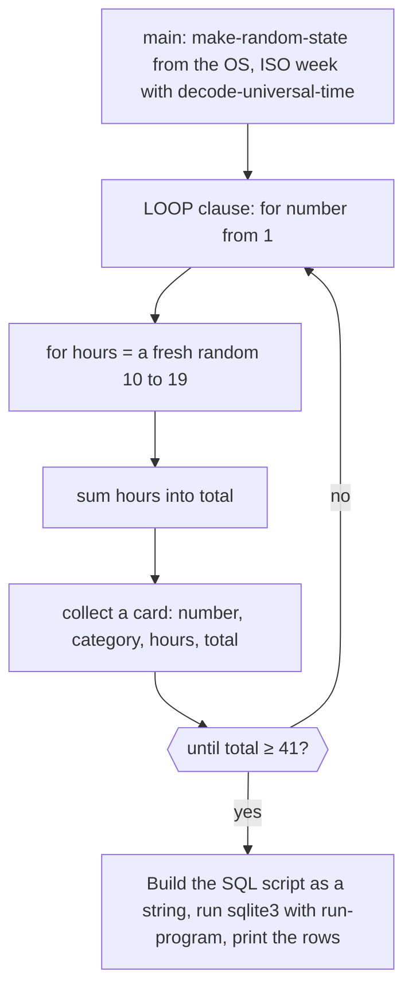
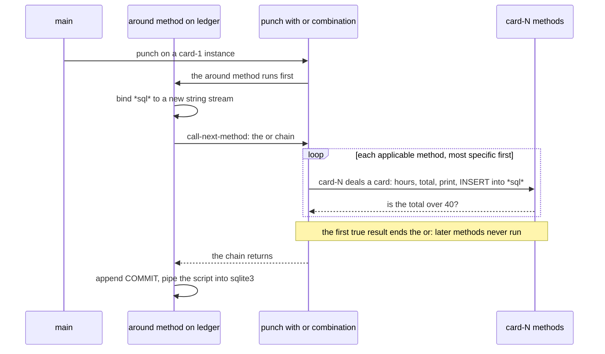

# Common Lisp study guide

## What this guide is for

This guide reads two Common Lisp programs: [`src/lisp`](../../../src/lisp/README.md), which is one `LOOP` form, and [`src/lisp-weird`](../../../src/lisp-weird/README.md), which has no loop and no conditional below the line marked "RUN TIME". In the weird program each card is a *method* of one generic function, and the cards are chained through the class precedence list. The question is: **when the object system chooses and orders code, can its dispatch rules serve as the loop and the stop rule?**

When you finish, you should be able to:

1. Explain what a class precedence list is, and in what order the applicable methods of a generic function run.
2. Explain what the built-in `or` method combination does, and why its short-circuit is the stop rule.
3. Explain how a macro moves the repetition from run time to compile time.
4. Trace both programs through the same three cards.
5. Say why five is the most cards the weird program can deal, and what you would change to raise that.
6. Label each behavior as guaranteed, implementation-permitted, or accidentally exploited.

Scope limits. You need to read Lisp syntax and know what a class and a method are. The guide does not teach the whole of CLOS, the reader macros beyond the one circular list, or the SQL. It uses SBCL 2.x (`sbcl --script`). The book's page is [Common Lisp](../../languages/lisp.md). For the ideas, see [Short-circuit evaluation](../../cs/04-evaluation-and-demand.md#short-circuit-evaluation) and [Control flow](../../cs/03-control-flow-and-continuations.md#control-flow).

## Before you begin

**Safety model.** Every entry writes fictional **DEMO ONLY** data to a scratch SQLite file. Both programs start `sqlite3` as a child process, and the weird one builds SQL as text. Read the source before you run it, and run it in the sandbox first:

```bash
sandbox/container/run-image.sh src/lisp
sandbox/container/run-image.sh src/lisp-weird
```

Edit only copies ([Running things safely](../../exercises.md#running-things-safely)). Your numbers will differ from the ones printed here; the structure will not.

**Prediction rule.** Before each run, write down which methods will run, in what order, and what the method that stops the chain returns.

**Vocabulary.**

| Term | Meaning here |
| --- | --- |
| Generic function | A function whose code is a set of *methods*, chosen by the classes of the arguments. |
| Class precedence list | The ordered list of a class and all its ancestors, most specific first. |
| Method combination | The rule that says how the applicable methods are combined into one result. |
| `or` combination | Run applicable methods most-specific-first, return the first non-`NIL` value, and stop. |
| `:around` method | A method that wraps the others and decides when they run, via `call-next-method`. |

## The shared challenge

The [challenge specification](../../intro.md#what-the-challenge-does) calls for cards with a category and 10 to 19 whole hours. Categories cycle through Meetings, Coding, Debugging and Learning. Add each card's hours to a running total and stop when it passes 40. The run **retains the first card that takes the total above 40**. A total of exactly 40 does *not* stop it: four 10-hour cards total exactly 40, and a fifth is drawn. Conforming runs finish with 3 to 5 cards and a total of 41 to 59.

Both Lisp entries save the cards in one SQLite transaction and print a summary. Lisp writes the boundary as `(> total 40)`: false for 40. In the `LOOP` the test is `until (> total +limit+)` and comes *after* `collect`, which is why the crossing card is kept ([L39-46](../../../src/lisp/timecards.lisp#L39-L46)). In the weird program each method ends with `(> (total ledger) 40)`, and the method that returns true stops the chain ([L84](../../../src/lisp-weird/timecards.lisp#L84)).

## The machine to identify

**What repeats.** In `lisp`, one `LOOP` form in `draw-cards`: `for number from 1`, `for hours = ...`, `sum hours into total`, `collect ...`, `until ...`. In `lisp-weird`, nothing repeats. Five *different* methods run in a fixed order, one per card. The "loop" is a chain.

**Where state lives.** In `lisp`, in the loop's own variables (`number`, `hours`, `total`) and the list it collects. In `lisp-weird`, in two places: a `ledger` object holds `total`, `entries` and the random state, and the *position in the class precedence list* says how many cards have been dealt. The class hierarchy is the loop counter.

**What advances the next step.** In `lisp`, `LOOP` itself. In `lisp-weird`, the `or` method combination: when one method returns `NIL`, the combination calls the next applicable method, which is the next card. The next card is a method on the *parent* class.

**What stops it.** In `lisp`, the `until` clause. In `lisp-weird`, a method that returns true, because `or` stops at the first true value. If no method returns true the chain simply ends after card 5.

**What commits.** In `lisp`, SQL is built from the finished list of cards, then `sqlite3` is run with it, and rows are printed after that ([L154-165](../../../src/lisp/timecards.lisp#L154-L165)). In `lisp-weird`, each card writes its `INSERT` to a dynamically bound string stream and prints its row as it is dealt. An `:around` method on the whole chain adds `BEGIN` at the start, and after `call-next-method` returns it adds `COMMIT` and runs `sqlite3` once ([L93-107](../../../src/lisp-weird/timecards.lisp#L93-L107)).

<!-- diagram-source: src/lisp/README.md#program-flow -->



The first diagram is a conventional loop with one exit clause.

<!-- diagram-source: src/lisp-weird/README.md#program-flow -->



The second has no loop edge. The sequence is fixed in the class hierarchy before the program runs.

## Trace one run

The programs draw random hours. Use hours **15, 19, 12** for the trace. To check it, a scratch copy of `lisp-weird` was run in the sandbox with the hours taken from a list, and with two print statements added: the class precedence list, and a line from each method saying what it returned. The output was:

```text
# class precedence list: CARD-1 -> CARD-2 -> CARD-3 -> CARD-4 -> CARD-5 -> LEDGER -> STANDARD-OBJECT -> SLOT-OBJECT -> T
Meetings	15	15	DEMO ONLY
  [method of card-1 ran: total 15, returns NIL (OR goes on)]
Coding	19	34	DEMO ONLY
  [method of card-2 ran: total 34, returns NIL (OR goes on)]
Debugging	12	46	DEMO ONLY
  [method of card-3 ran: total 46, returns T (OR stops)]
# committed total=46 entries=3 DEMO ONLY
# PUNCH had 5 OR methods and 3 ran: the class precedence list is the loop, and OR is the stop rule
```

(The ISO-week column was removed for width.) The instance is made as a `card-1`, so the precedence list starts at card 1 and ends at `ledger`.

**`lisp-weird`: which method runs.**

| Step | Method run | Hours | Total | Returns | What `or` does |
| --- | --- | ---: | ---: | --- | --- |
| 1 | `punch` on `card-1` | 15 | 15 | `NIL` | go on to the next applicable method |
| 2 | `punch` on `card-2` | 19 | 34 | `NIL` | go on |
| 3 | `punch` on `card-3` | 12 | 46 | **`T`** | stop: `card-4` and `card-5` never run |
| end | `:around` method resumes after `call-next-method` | none | 46 | none | writes `COMMIT`, runs `sqlite3` once |

Five methods were applicable, and three ran. The crossing card is the method that returned true, so it has already dealt its card.

**`lisp`: the `LOOP` clauses.** Each pass: `number` increases from 1, `hours` is drawn, `total` accumulates it, the card is collected, and *then* `until` tests. With 15, 19, 12 the totals are 15, 34, 46, and the test is true after the third pass. The collected list is the three cards in order. Because `until` is after `collect`, the third card is already on the list when the loop ends.

**Exactly 40.** With four 10-hour cards the totals are 10, 20, 30 and 40, and no method returns true. `card-5` is applicable and runs, because it is the last link. Its total is at least 50, so it returns true. The chain has exactly enough methods for the worst case, which is why the program has five classes.

## Compare the ordinary and weird designs

| Dimension | `lisp` | `lisp-weird` |
| --- | --- | --- |
| **Representation** | A list of card structures and a loop. | A chain of five classes and one method on each. |
| **Observability** | Print the list. | The order exists in the class hierarchy. `class-precedence-list` and `compute-applicable-methods` reveal it. |
| **Tests** | The loop is a function: pass a random state and compare the cards. | The chain needs an instance. The stop rule is an `or` and cannot be changed without editing every method's qualifier. |
| **Debugging** | Step a loop. | Which method runs next depends on inheritance. A method with the wrong qualifier produces a compiler warning, not a failure you can miss at run time. |
| **Portability** | ANSI Common Lisp, plus SBCL calls for `run-program` and environment variables. | Also SBCL's `sb-mop:compute-applicable-methods` for the closing note. |
| **Cost** | One loop and one list. | Five classes defined by a macro, run once. A limit above what five cards can reach requires more classes. |

A macro does the repetition at compile time. `defcard` is expanded five times as the file is compiled, and the expansions are straight-line code. This is the compile-time/run-time split in action: a loop exists, but it runs while the *program* is built, and it never touches a timecard.

## What the exercises demonstrate

| Exercise | Predict first | What the evidence shows |
| --- | --- | --- |
| [B10. Lisp: swap the method combination](../../exercises.md#b10-lisp-swap-the-method-combination-verified), step 1 | Replace `or` with `progn` in both places. How many cards on every run? | Exactly five on every run, and `PUNCH had 0 OR methods and 5 ran`. `progn` runs every method, so the stop rule vanishes. The entry's own check fails. |
| B10, step 2 | Change only the generic function's combination to `progn`, leaving the `or` qualifiers. | SBCL warns `Invalid qualifiers for PROGN method combination`. A method's qualifiers must belong to the combination of its generic function. |
| B10, step 3 | Change the stop test to `(> (total ledger) 100)`. | Exactly five rows on every run, total at most 95, and `check-demo.sh out.txt 100` fails. Five is the most the program can ever deal. Supporting 100 needs more classes. |
| [C1. Weird next to boring](../../exercises.md#c1-weird-next-to-boring-verified) | In which program does the stop rule live in one word? | In `lisp-weird` it is the word `or`. Removing it does not raise an error: the program deals all five cards. |
| [F. Prove a README claim](../../exercises.md#f-prove-a-readme-claim-verified) | What test fails if the chain is not most-specific-first? | Check that the methods run in the order card-1 to card-5. The negative control reverses the inheritance and expects the card order to change. |

The one-sentence answer the book asks for in B10 is the best test: *which single word is the stop rule, and why does removing it not make the program fail?* The word is `or`. Without it the methods still run, and a program that deals too many cards looks like a program that works.

## Failure modes, costs, and boundaries

| Behavior | Label | Why |
| --- | --- | --- |
| Applicable methods run in class-precedence order, most specific first | **Guaranteed** | Defined by ANSI Common Lisp. |
| The built-in `or` method combination returns the first non-`NIL` value and skips the rest | **Guaranteed** | A standard method combination. Verified: cards 4 and 5 did not run. |
| A method qualified `or` on a generic function using `progn` is invalid | **Guaranteed** | The standard requires qualifiers to match the combination. SBCL warns, as B10 step 2 shows. |
| `#1=(... . #1#)` reads a circular list, so `(nth 4 *week*)` is Meetings again | **Guaranteed** | Standard reader syntax. The program does not modify the literal, which would be undefined. |
| `make-random-state t` seeds from the operating system | **Guaranteed** that the state is randomly initialized | The exact source is implementation-defined. |
| `sb-mop:compute-applicable-methods`, `sb-ext:run-program`, `sb-ext:posix-getenv` | **Implementation-permitted** | SBCL-specific names. They are why the programs need SBCL, not just any Common Lisp. |
| Five classes are enough because five cards of 10 hours reach 50 | **Guaranteed** | Arithmetic, not Lisp. The class count is a *bound*. |

No behavior is merely accidentally exploited here: the weird entry uses documented features exactly as documented, in an order nobody would choose.

**Costs to state.**

- **The control flow is in a declaration.** Reading `punch` does not tell you how often it runs. You have to read the `defclass` forms.
- **A dispatch error looks like success.** An invalid qualifier or a wrong combination produces a warning (exercise B10 step 2) and the program still runs. The check script has to count rows.
- **A limit change is a structural change.** Raising the limit to 100 means defining more classes, not editing a number.
- **SQL quoting.** The weird entry's `sql-quote` does not escape. The plain entry's does. The weird entry is safe only because every value is a number or one of four fixed words.
- **Where the technique is legitimate.** Method combination is how CLOS composes behavior: `:before`, `:after` and `:around` methods are routine, and `or`, `and` and `progn` combinations are useful for plug-in checks. Chaining to count cards is a stunt.

## Connections across the repository

- **Control flow stored in a declaration.** The same idea appears in [COBOL](cobol.md), where a data declaration (`88 OVER-FORTY`) is the stop rule, and [Tcl](tcl.md), where database triggers fire the next step. The concept guide [State and control beyond variables](../concepts/state-and-control-beyond-variables.md) compares them.
- **Short-circuit as the stop rule.** `or` stops on the first true result, as a lazy `span` stops reading in [Haskell](haskell.md). Both stop by *not asking for more*. Lisp does it by not calling the next method.
- **Compile-time repetition.** [m4](m4.md) is a macro processor for text. Lisp macros transform code instead. The concept guide [Formal languages and weird machines](../concepts/formal-languages-and-weird-machines.md) places both.
- **A chain with a fixed bound.** The regex entries in [Regex engines and sed](regex-engines-and-sed.md) are limited to four cards by the length of a subject. Lisp-weird is limited to five by the length of a class chain.
- **In the book.** [Common Lisp](../../languages/lisp.md), [Short-circuit evaluation](../../cs/04-evaluation-and-demand.md#short-circuit-evaluation) and [Macros and text expansion](../../cs/05-formal-languages-as-computational-substrates.md#macros-and-text-expansion).

## Self-check

Answer before you read the italic text after each question.

1. **Trace.** In `lisp-weird`, hours are 11, 12, 10, 14. How many methods run, and what does each return? *(Four methods. Totals 11, 23, 33, 47. Cards 1, 2 and 3 return `NIL`, and card 4 returns `T`. `card-5` does not run.)*
2. **Explain.** Why must `defcard` be called for card 5 first and for card 1 last? *(A class must exist before another can inherit from it, and card 1 inherits from card 2, and so on. The chain is built from the tail.)*
3. **Transfer.** Which construct in Python, Java or Go would play the part of the `or` method combination? *(A chain of handlers where each returns a boolean and the caller stops at the first true, as in a middleware chain or a series of `||` calls. In Java, `Stream.anyMatch` has the same short-circuit shape.)*
4. **Evidence.** A reviewer says, "The weird program can never deal more than five cards." Design a test that could fail. *(Run it many times and count the rows, as B10 does. For a negative control, change the limit to 100 and see that the count is still five. The claim is guaranteed by the class count.)*

## Further reading

- [Common Lisp](https://en.wikipedia.org/wiki/Common_Lisp) (Wikipedia): the language and its standard.
- [Common Lisp Object System](https://en.wikipedia.org/wiki/Common_Lisp_Object_System) (Wikipedia): generic functions, multiple dispatch and method combination.
- [Short-circuit evaluation](https://en.wikipedia.org/wiki/Short-circuit_evaluation) (Wikipedia): the general idea behind `or`'s stop.
- [Control flow](../../cs/03-control-flow-and-continuations.md#control-flow) and [Short-circuit evaluation](../../cs/04-evaluation-and-demand.md#short-circuit-evaluation) (this book): the surrounding concepts.
