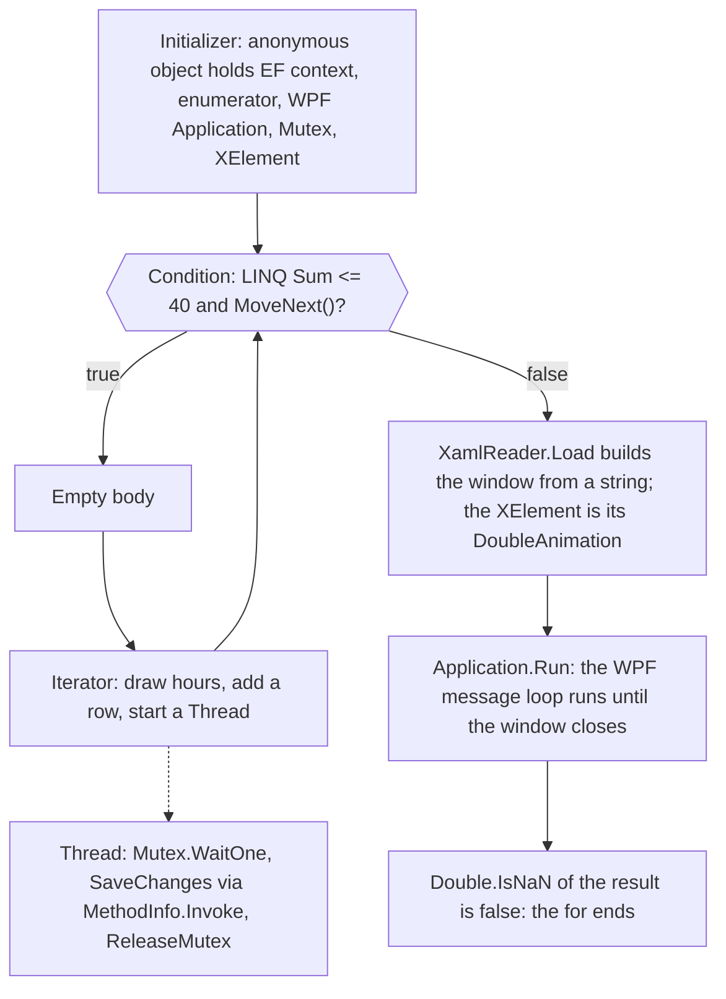
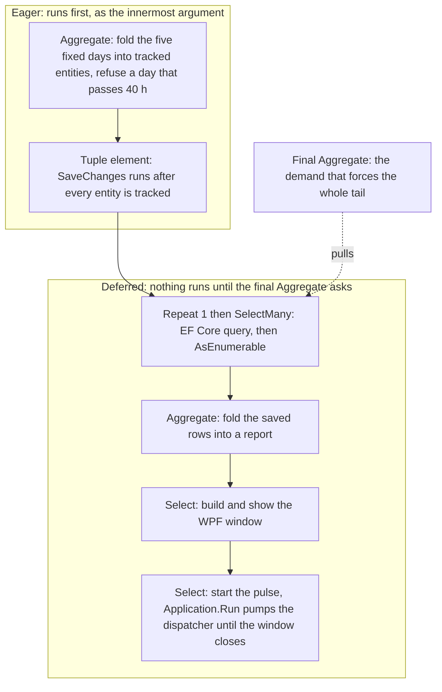
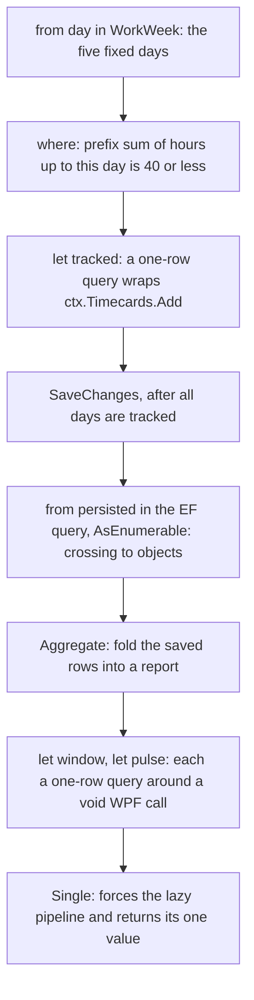
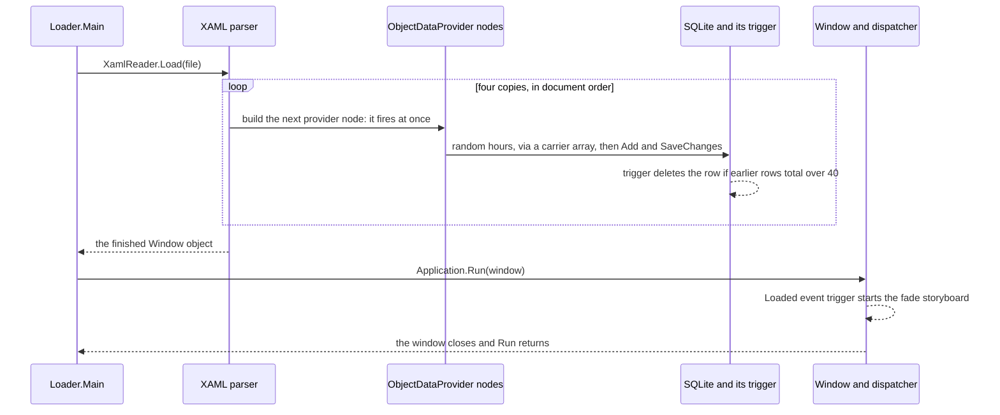

# C#, LINQ, XAML, and ports study guide

## What this guide is for

This guide reads the repository's C# family and its one-statement ports as one study: the original [`ModernChallenge1`](../../../src/ModernChallenge1/README.md) (a `for` statement with an empty body), the two LINQ entries [`LinqChallenge1`](../../../src/LinqChallenge1/README.md) and [`LinqChallenge2`](../../../src/LinqChallenge2/README.md), the markup interpreter [`xaml`](../../../src/xaml/README.md), and the ports to [Java](../../../src/JavaChallenge1/README.md), [Go](../../../src/GoChallenge1/README.md), [Kotlin](../../../src/KotlinChallenge1/README.md), [Python](../../../src/PythonChallenge1/README.md) and [Rust](../../../src/RustChallenge1/README.md). The question is: **when one statement, one expression or one document is the whole program, what is each slot of the construct for, when does each part run, and who owns the thread it runs on?**

When you finish, you should be able to:

1. Name the three slots of the `for` header (initializer, condition, iterator) and say what each carries in the original and in each port.
2. Explain deferred execution: what a LINQ query holds, when it runs, and why enumerating twice runs it twice.
3. Explain where a provider boundary is (`IQueryable` to `IEnumerable`) and why the position of `AsEnumerable()` matters.
4. Explain how a markup parser can run a program, and why the loop in the XAML files had to be unrolled.
5. Explain thread affinity: why WPF needs an STA thread and a dispatcher, and why the original guards EF Core's context with a mutex.
6. Label each behavior as guaranteed, implementation-permitted, or accidentally exploited, and say which claims were run and which were only read.

Scope limits. You need to read C# 9 or later and know what LINQ is. The guide does not teach WPF layout, EF Core mapping, Swing or Tk. It uses .NET 10. The book's page is [C#, LINQ and XAML (plus the one-statement ports)](../../languages/csharp-linq-xaml.md). For ideas, see [Deferred execution](../../cs/04-evaluation-and-demand.md#deferred-execution), [Thread safety and thread affinity](../../cs/07-effects-errors-and-commitment.md#thread-safety-and-thread-affinity) and [Reading an adversarial program](../../cs/01-reading-an-adversarial-program.md).

**What was run for this guide.** The WPF, EF Core, XAML, Swing, Tk and GTK parts need Windows or a display and were **not run here**. Their traces are read from the source and marked "read". Two things *were* run: a console reduction of the `for` header (WPF and EF removed, .NET 10), and the exercise-B7 deferred-execution experiment. Everything else is labeled.

## Before you begin

**Safety model.** Every entry writes fictional **DEMO ONLY** data to a local database or file, and none connects to a real time-reporting system. The XAML entry is the dangerous one: it runs *methods during parsing*, and a markup file that does this is a program. The book's [threat-model example](../../cs/01-reading-an-adversarial-program.md#threat-model) and the repository's related project [xaml-write-and-run](https://github.com/dullroar/xaml-write-and-run) show what that makes possible. Read the source first, and run the WPF entries only in Windows Sandbox:

```powershell
sandbox\windows\run.ps1 src\LinqChallenge1
sandbox\windows\run.ps1 src\xaml -RunArgs strict.xaml
```

The ports for Go, Java, Kotlin, Python and Rust run in the Linux sandbox with `sandbox/container/run-image.sh src/<entry>`. Edit only copies ([Running things safely](../../exercises.md#running-things-safely)).

**Prediction rule.** Before each run, write down what runs *first*, what is deferred, and on which thread. In this family the order of evaluation is the program.

**Vocabulary.**

| Term | Meaning here |
| --- | --- |
| Deferred execution | A query is a description. It runs when something enumerates it, and again each time. |
| Provider | The thing that turns a query into work: LINQ to Objects runs it in memory, EF Core's `IQueryable` translates it to SQL. |
| `ObjectDataProvider` | A WPF type that constructs an object and calls a method *when it is parsed*. |
| STA / dispatcher | A single-threaded apartment, and WPF's message queue. UI objects belong to the thread that made them. |

## The shared challenge

The [challenge specification](../../intro.md#what-the-challenge-does) calls for this: a *card* is a category and a whole number of hours from 10 to 19; categories cycle through Meetings, Coding, Debugging and Learning; keep a running total and stop when it passes 40; **retain the first card that takes the total above 40**; a total of exactly 40 does *not* stop the run. Final totals are 41 to 59, with 3 to 5 cards.

The two LINQ demos and XAML depart from that contract. The older four-name headers explain how the same edge case used to affect the ports.

1. **`LinqChallenge1` and `LinqChallenge2` do not draw random hours.** Their work week is five fixed 8-hour days, and they refuse any day that would push the total past 40. The result is exactly 40.0 hours over five rows, every run. They teach deferred execution, not the stop rule. Exercise E1 states this.
2. **The `for`-header entries used to stop after four cards, and `xaml` still does.** The original and the Java, Go, Kotlin, Python and Rust ports test `total <= 40 && a category remains` and take each category once. In `ModernChallenge1` the condition is `Sum() <= 40d && i.categories.MoveNext()`, where `categories` is a one-pass enumerator. With four category names, a reduction of that header run in a console project with every card worth 10 hours stopped with `stop: total 40 after 4 cards`: one run in 10,000 for random hours, and a contradiction of "exactly 40 continues". The 2008 original had four names, and the entry READMEs described that faithfully. It is now fixed in `ModernChallenge1` and in all five ports by a fifth name (`Meetings` repeats). After the fix, the same reduction stops with `stop: total 50 after 5 cards`, the C# project builds, Rust's unit tests pass (they now assert that exactly 40 continues), and Go, Java and Kotlin compile. The XAML entry's four unrolled passes still have the ceiling: a fifth pass could not be tested without Windows, so it was not added. With the shipped seed (`Random(42)`: 16, 11, 11, 15) it deals four cards and ends at 53, so the case never arises unless you change the seed (exercise E2).
3. **Storage depends on the XAML variant.** The EF Core variant has a SQLite trigger that deletes a row if the earlier rows already total more than 40. The direct SQLite variant puts the equivalent test in the insert statement. Both keep the crossing card. The strict variant writes XML. See [where entries differ](../../intro.md#where-entries-differ).

## The machine to identify

**What repeats.** In `ModernChallenge1`, the `for` header: one statement, an empty body, and three slots that do all the work. In `LinqChallenge1`, nothing repeats: one expression is a chain of LINQ operators, and `Aggregate` folds. In `LinqChallenge2`, the same, in query syntax. In `xaml`, *nothing*: four copied passes, in document order. In the ports: a three-clause `for` (Java, Go), `generateSequence` (Kotlin), `iter(step, False)` (Python), `std::iter::successors` (Rust).

**Where state lives.** In `ModernChallenge1`, in one anonymous object in the initializer slot (hours list, category enumerator, database context, random source, WPF application, mutex). A `for` initializer allows one declaration, and an anonymous object is the one declaration that holds many kinds of state. In the LINQ entries, in `Aggregate` accumulators and in EF Core's change tracker. In `xaml`, in "carrier" arrays: one provider fills a `char[]` or `byte[]`, the next reads it. In Rust, in an immutable batch: "adding" a card returns a new batch.

**What advances the next step.** In the `for` family, the iterator slot: draw hours and save one card. In the LINQ entries, the final `Aggregate`, which *demands* the lazy tail. In `xaml`, the parser reaching the next node.

**What stops it.** In the `for` family, the condition slot: when the total passes 40 (or the categories run out), the conditional's else branch shows the window and returns `false`. In the LINQ entries, a prefix cap (`where` recomputes a running total, or `Aggregate` refuses a day). In `xaml`, the trigger deletes late rows. In Rust, `extended` returns `None`.

**What commits.** In `ModernChallenge1`, each card is added to EF Core's context under a mutex and saved; the window is shown after the loop. In `LinqChallenge1`, tracked entities are saved by one `SaveChanges()` *eagerly*, inside the one statement but before the lazy stages. XAML providers invoke `Add` and `SaveChanges` in the EF Core variant, `ExecuteNonQuery` in the direct SQLite variant and `WriteXml` in the strict variant.

<!-- diagram-source: src/ModernChallenge1/README.md#program-flow -->



The original's flow is a loop with a conditional exit. Its condition is eager: the query expression constructs a deferred `Select`, then the terminal `Sum()` enumerates it immediately, on that condition check. This is the same placement of work as JavaScript's `reduce`. The LINQ demos below have deferred stages of their own and use terminal operators to run them.

<!-- diagram-source: src/LinqChallenge1/README.md#program-flow -->



LinqChallenge1 has no loop. It has an eager group that runs first, and a lazy group that the last `Aggregate` pulls.

<!-- diagram-source: src/LinqChallenge2/README.md#program-flow -->



LinqChallenge2 is the same idea in query syntax, which the compiler rewrites into the same method calls.

<!-- diagram-source: src/xaml/README.md#program-flow -->



The XAML flow has no loop edge. The parser walks the document once.

## Trace one run

**`ModernChallenge1`: the header slots (header reduced and run).** With hours 15, 19, 12 the evaluations are:

| Evaluation | Condition: `Sum() <= 40 && MoveNext()` | Iterator slot (after the empty body) | Sum after |
| --- | --- | --- | ---: |
| 1 | `0 <= 40` true, `MoveNext()` gives Meetings: **true** | Add 15 hours, card Meetings | 15 |
| 2 | `15 <= 40` true, `MoveNext()` gives Coding | Add 19, Coding | 34 |
| 3 | `34 <= 40` true, `MoveNext()` gives Debugging | Add 12, Debugging | 46 |
| 4 | `46 <= 40` false: `&&` **short-circuits**, `MoveNext()` is not called | none | else branch: show the window, return `false` |

The category enumerator advances only when the total test passes, so it is consumed exactly once per card. In the all-10 reduction, with four names (before the fix) evaluation 5 was `40 <= 40` true and `MoveNext()` returned `false` (the enumerator was exhausted), which stopped the loop at total 40. With five names the same evaluation returns the fifth name, a fifth 10-hour card is added, and evaluation 6 sees `50 <= 40` false and stops. The slot to name: the category enumerator is hidden state in the *condition*.

**LINQ: deferred execution (run).** The B7 experiment declares `q = Enumerable.Range(1, 3).Select(i => { print "effect i"; return i; })`. In a console project it printed:

```text
declared q:             (no effect lines)
q.Sum():                effect 1, effect 2, effect 3
q.Sum() then q.ToList():  effect 1..3, then effect 1..3 again
q.ToList() once, then Sum on the list:  effect 1..3 once
```

Running the [B7 console fixture](../../solutions/b7-linq/Program.cs) with .NET SDK 10.0.401 reproduces 0, 3, 6 and 3 effect lines. `Select` stores a description; each enumeration runs it again. A second experiment is this guide's own. It builds a lazy generator of cards (15, 19, 12, 10, 10) and takes `TakeWhile(c => c.total - c.hours <= 40)`, which keeps the crossing card. It printed *four* `drew` lines for three kept cards. To keep the crossing card, `TakeWhile` must look at the card *after* it to see the test fail, so the generator drew one card too many. Haskell's `span` has no such cost (see [Haskell](haskell.md)). A cap that retains the crossing card without over-drawing needs a stateful iterator, such as the weird JavaScript machine's `over` flag, or an `Aggregate` that refuses.

**`LinqChallenge1`: eager first, lazy second (read).** The innermost `Aggregate` folds the five fixed days into tracked entities and runs first, because it is the innermost argument. The tuple `(..., ctx.SaveChanges())` evaluates left to right, so `SaveChanges()` runs after every entity is tracked. Then a chain of `Select` and `SelectMany` stages does nothing until the final `Aggregate` pulls: query, fold, build the window, pulse and `Application.Run`. The reported total is 40.0 for five rows.

**`xaml`: document order (read).** With hours 15, 19, 12 and a fourth draw of 14: pass 1 inserts 15 (total 15), pass 2 inserts 19, pass 3 inserts 12, pass 4 inserts 14. A trigger on insert deletes any row whose earlier rows already total more than 40. Rows 1 to 3 have earlier totals of 0, 15 and 34, so they stay. Row 4's earlier rows total 46, so it is deleted. Three cards remain. The parser then returns the window.

## Compare the ordinary and weird designs

| Dimension | Ordinary program | `ModernChallenge1` | LINQ entries | `xaml` |
| --- | --- | --- | --- | --- |
| **Representation** | A loop and a list | `for` with an empty body; state in an anonymous object | One expression: LINQ operators and `Aggregate` | A document of `ObjectDataProvider` nodes |
| **Observability** | Debugger on a loop | Same, but the real work is in the header | The expression's *order* is the program, and a breakpoint sees only one statement | Parsing is running: nothing to step through but the parser |
| **Tests** | Unit-test a function | `check.ps1`-style structural checks | `check.ps1` forbids helper names such as `RunEverything` and checks the persisted 40.0 h | Windows Sandbox run: the harness closes the window |
| **Debugging** | Standard | Standard | Deferred stages hide when effects run | A bad provider fails at *parse time*, and the error points at markup |
| **Portability** | Any C# | Windows only (WPF) | Windows only (WPF, EF Core, SQLite) | Windows only; `strict.xaml` needs only .NET, the others add packages |
| **Cost** | Normal | Normal | Re-enumeration reruns effects | The loop is unrolled: four copies, with the category count baked into the markup |

### The ports, side by side

All five ports keep "one statement, empty body". Each finds its own three clauses. The result uses the port's host interface: for example, Go serves its summary over local HTTP.

| Port | Header mechanism | State holder | Stop test |
| --- | --- | --- | --- |
| Java | `for (init; condition; update) { }` | anonymous class | `sum <= 40d && categories.hasNext()` |
| Go | a real three-clause `for` | a struct; helpers such as `Seq` and `After` in `helpers.go` | `Sum(i.hours) <= 40 && len(i.categories) > 0` |
| Kotlin | `for (pass in generateSequence(...) { ... })`; a `null` from `takeIf` ends it | a class with a category iterator | `totalHours.sum() <= 40.0 && categories.hasNext()`; the body runs once before the first check |
| Python | `for _ in iter(<lambda>, False):` | an object holding a `deque` of categories | `sum(...) <= 40 and categories` |
| Rust | `for _ in std::iter::successors(...) {}` | an immutable `DemoBatch`; adding a card returns a new batch | `extended` returns `None` |

The ports show that the "bodiless loop" is a *shape*, not a C# feature. What carries the weight differs: an anonymous object, a struct plus hidden helpers, a lazy sequence, a function called until it returns `False`, or an iterator of values. Go needed helpers because it is statement-oriented, and its README says so as the cost of the port.

## What the exercises demonstrate

| Exercise | Predict first | What the evidence shows |
| --- | --- | --- |
| [B7. LINQ: enumerate twice](../../exercises.md#b7-linq-enumerate-twice-verified) | How many `effect` lines after (a) declaring `q`, (b) one `q.Sum()`, (c) `Sum` and `ToList`, (d) `ToList` then `Sum` on the list? | 0, 3, 6, 3. `Select` is deferred, and each enumeration reruns it. Verified in this guide too. |
| B7, the seed | The five hours for seed 42? | `16 11 11 15 11`. A seeded `Random` gives the same cards on every run, which is why a `.xaml` file seeded with 42 is reproducible. |
| B7, the eager operator | Which operator in `LinqChallenge1` is eager and forces the lazy stages after it? | `Aggregate`. |
| [E1. Run and read the evidence](../../exercises.md#e1-run-and-read-the-evidence) (Windows) | Which entry's rows total exactly 40 because the data is fixed? | `LinqChallenge1`. `xaml` is the random one. |
| [E2. Change the XAML interpreter's seed](../../exercises.md#e2-change-the-xaml-interpreters-seed) (Windows) | Change `42` to `7` in `strict.xaml`. Do the hours change? | Yes, and the same sequence every run of the same seed. The loop was unrolled four times because XAML has no loop (and a fifth pass has not been added, so `xaml` is the one entry that cannot deal a fifth card), and the `x:Array` carriers play the part of variables. |
| [C1. Weird next to boring](../../exercises.md#c1-weird-next-to-boring-verified) | Compare `ModernChallenge1` with an ordinary C# loop. | Same output contract; the original exposes its state in one anonymous object. |

## Failure modes, costs, and boundaries

| Behavior | Label | Why |
| --- | --- | --- |
| The B7 `Enumerable.Select` projection runs on enumeration, and the effect runs again on a second enumeration of that pipeline | **Guaranteed** | The LINQ-to-Objects `Select` contract; verified by B7. In the header, `Sum()` enumerates the projection during every check. |
| `Aggregate` is eager | **Guaranteed** | By definition: it consumes the sequence. |
| Tuple elements evaluate left to right | **Guaranteed** | C# language rule. It is why `SaveChanges()` runs after the entities are tracked. |
| `&&` short-circuits | **Guaranteed** | C# language rule. It is why the category enumerator advances once per card. |
| `IQueryable` operators translate to SQL until `AsEnumerable()`, then run in memory | **Implementation-permitted** | Provider behavior: what EF Core can translate is its own business, and a boundary in the wrong place changes where work runs. |
| `XamlReader.Load` runs `ObjectDataProvider` methods at parse time | **Accidentally exploited** | The XAML README classifies it so. WPF documents a declarative UI. Running a program is a side effect of how the parser constructs objects. |
| `Refresh` re-runs a provider, and an `x:Array` stops the parser unwrapping the call | **Accidentally exploited** | Observed behavior the entry relies on. |
| A `for` initializer takes one declaration, so state goes in one anonymous object | **Guaranteed** | A C# grammar rule. |
| `Random.Shared` is safe to use from several threads | **Guaranteed** | Documented. |
| WPF objects belong to the thread that created them, and `Application.Run` pumps the dispatcher | **Guaranteed** | WPF's threading model. `[STAThread]` is required. |
| A named `Mutex` can guard EF Core's non-thread-safe context | **Implementation-permitted** | It works as a cross-thread lock. The original keeps a background thread only as "a historic contrast". |

**Costs to state.**

- **Thread affinity is part of the design.** The original saves on a background thread and guards EF Core's context with a mutex, because the context is not thread-safe. The window must be created and run on the STA thread. In the LINQ entries `Application.Run()` is called from inside a `Select` lambda, which is what pumps the dispatcher so the window paints. See [Thread safety and thread affinity](../../cs/07-effects-errors-and-commitment.md#thread-safety-and-thread-affinity).
- **The provider boundary moves work.** A `where` that EF Core can translate runs in the database. The same `where` after `AsEnumerable()` runs in memory over every row.
- **Hidden eagerness.** `SaveChanges()` runs at one specific moment in the one statement, not at the final enumeration. "All lazy" is not true even of the lazy entry.
- **A parser that runs code.** Any program that loads XAML from a source it does not control is running that source. The XAML entry's own README says so.
- **Where the techniques are legitimate.** Deferred queries, providers and the dispatcher are ordinary. A statement made of one `for` is a classroom exercise from 2008.

## Connections across the repository

- **The same question as Haskell and JavaScript.** Deferred LINQ pipelines, lazy lists in [Haskell](haskell.md) and pull iteration in [JavaScript](javascript.md) all ask when a description runs. [Evaluation, demand, and laziness](../concepts/evaluation-demand-and-laziness.md) compares them. The difference worth remembering: Haskell remembers a computed value, and LINQ reruns.
- **Document order as the program.** The XAML entry, [tar](tar.md) and [Tcl](tcl.md) all make data into a program. The concept guide [Reading adversarial programs](../concepts/reading-adversarial-programs.md) takes them as one case.
- **The same four-card ceiling, now fixed.** The regex entries in [Regex engines and sed](regex-engines-and-sed.md) had it too, and were fixed the same way. [Comparative machine design](../concepts/comparative-machine-design.md) lists which entries obey "exactly 40 continues".
- **Threads and callbacks.** [Events, callbacks, and reactive control](../concepts/events-callbacks-and-reactive-control.md) compares who owns the next turn, which is what the dispatcher decides here.
- **In the book.** [C#, LINQ and XAML](../../languages/csharp-linq-xaml.md), [Deferred execution](../../cs/04-evaluation-and-demand.md#deferred-execution), [Domain-specific languages](../../cs/05-formal-languages-as-computational-substrates.md#domain-specific-languages) and [Arbitrary code execution](../../cs/01-reading-an-adversarial-program.md#arbitrary-code-execution).

## Self-check

Answer before you read the italic text after each question.

1. **Trace.** In the `ModernChallenge1` header, hours are 13, 14, 13, 10. Give the sum when each condition runs, and say when `MoveNext()` is called. *(Conditions see sums 0, 13, 27, 40, then 50. `MoveNext()` is called on the first four, giving Meetings, Coding, Debugging and Learning. The fifth condition has sum 50, so `&&` skips `MoveNext()`. The fourth card is the crossing card.)*
2. **Explain.** Why does `q.Sum()` followed by `q.ToList()` print the effects twice? What does that predict for the C# header? *(Each call enumerates the `Select` pipeline, so its effects run twice. In the header, each condition check constructs and immediately sums its projection, so the sum is computed before any next draw. Materializing the B7 projection with `ToList()` lets later consumers reuse its results.)*
3. **Transfer.** Which construct in Python plays the part of the C# `for` header's condition slot in `iter(step, False)`? *(The sentinel: the loop ends when `step` returns `False`, so the stop test lives inside the function that makes the next card.)*
4. **Evidence.** A reviewer says "four 10-hour cards in a `for`-header entry continue to a fifth." Design a test that could fail. *(Reproduce the header with all-10 hours, as the reduction above did, and check for five cards and a total of 50. The negative control is the header with four names, which stops at four cards and 40. The reduction was run for C#. Rust's unit tests assert it directly, and Go, Java and Kotlin were only compiled, so for those it is read from the source.)*

## Further reading

- [Language Integrated Query](https://en.wikipedia.org/wiki/Language_Integrated_Query) (Wikipedia): LINQ and its query syntax.
- [Lazy evaluation](https://en.wikipedia.org/wiki/Lazy_evaluation) (Wikipedia): the general idea behind deferred execution.
- [XAML](https://en.wikipedia.org/wiki/Extensible_Application_Markup_Language) (Wikipedia): what XAML is for, and what its parser was never meant to be.
- [Thread safety and thread affinity](../../cs/07-effects-errors-and-commitment.md#thread-safety-and-thread-affinity) and [Deferred execution](../../cs/04-evaluation-and-demand.md#deferred-execution) (this book): the two ideas that carry this family.
