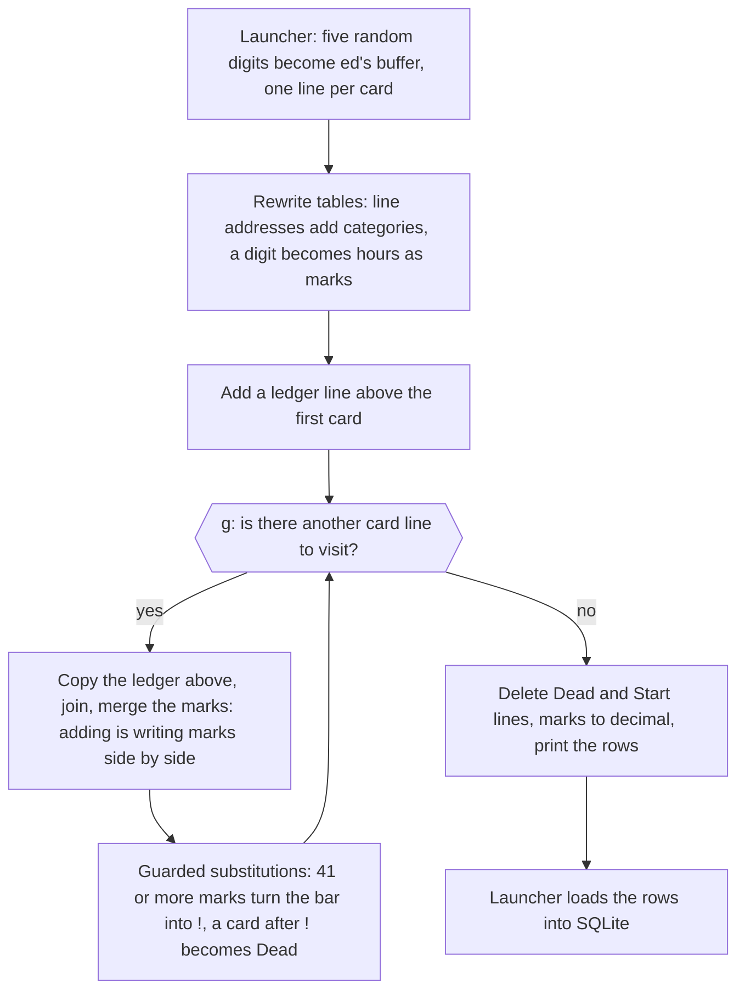
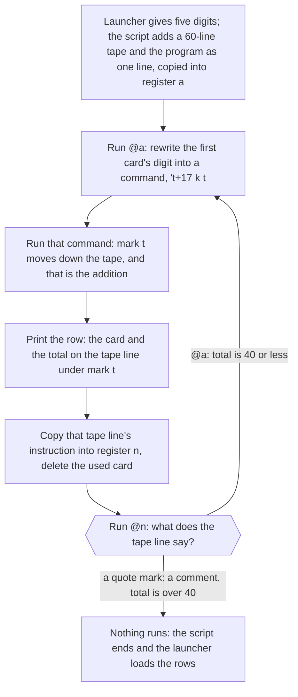

# ed and Ex study guide

## What this guide is for

This guide reads two editor scripts that solve the challenge by editing a text buffer: [`src/ed-weird`](../../../src/ed-weird/README.md), a script for `ed` where categories are line addresses, hours are rewrite rules and one global command does the whole run; and [`src/ex-weird`](../../../src/ex-weird/README.md), a script for `ex` where a *register* holds the program, a *tape* in the buffer holds the stop rule, and a *mark* is the program counter. The question is: **when the program is a buffer being edited, what are the addresses, the registers and the program counter?**

When you finish, you should be able to:

1. Explain what a line address, a mark and a register are in `ed` and `ex`, and what each one stores.
2. Explain why a failed substitution inside a global command is an `if`, not an error.
3. Trace both programs through the same five dice, naming the buffer contents at each stage.
4. Explain how the Ex program's loop works: a register runs a register, and the tape decides whether the next run is a command or a comment.
5. Explain why five dice are always enough, and how the launcher and the editor divide the work.
6. Label each behavior as guaranteed, implementation-permitted, or accidentally exploited.

Scope limits. You need to read basic `ed` commands: `s/re/new/`, `g/re/cmd`, `a`, `d`, `j`, `t`, `p`. The guide does not teach every Ex command, the SQL, or Vim. It uses POSIX `ed` and `ex` as shipped in the sandbox (nvi for Ex; Vim in Ex mode works with different flags). The book's page is [ed and Ex](../../languages/editors.md). For ideas, see [Computation versus orchestration](../../cs/02-what-counts-as-a-machine.md#computation-versus-orchestration), [Capability and authority](../../cs/01-reading-an-adversarial-program.md#capability-and-authority) and [Representing state](../../cs/02-what-counts-as-a-machine.md#representing-state).

## Before you begin

**Safety model.** Every entry writes fictional **DEMO ONLY** data to a scratch SQLite file. Editors can run shell commands: `ed` and `ex` both accept `!command`, and an editor script is a program with the authority of whoever runs it. The scripts here do not shell out, and a launcher script keeps the editor and SQLite apart. Read the source before you run it, and run it in the sandbox first:

```bash
sandbox/container/run-image.sh src/ed-weird
sandbox/container/run-image.sh src/ex-weird
```

Edit only copies ([Running things safely](../../exercises.md#running-things-safely)). Both launchers accept `DICE="a b c d e"`: five digits, each card's hours being 10 plus its digit. Use `DICE="5 9 2 0 0"` for hours 15, 19, 12, 10, 10.

**Prediction rule.** Before each run, write the buffer, line by line, as you expect it to look after each stage.

**Vocabulary.**

| Term | Meaning here |
| --- | --- |
| Buffer | The text the editor holds: one line per card at the start. |
| Address | A line number, or a pattern, that says which lines a command applies to. |
| `g/re/cmd` | Run `cmd` on every line that matches `re`. |
| Mark | A named position in the buffer, stored in a register-like slot. Ex uses `k t` to set one and `'t` to go to it. |
| Register | A named store of text. In Ex, `@a` *runs* register `a` as commands. |

## The shared challenge

A *card* is a category and a whole number of hours from 10 to 19. Categories cycle through Meetings, Coding, Debugging and Learning. Add each card's hours to a running total and stop when it passes 40. The run **retains the first card that takes the total above 40**. A total of exactly 40 does *not* stop it: four 10-hour cards total exactly 40, and the fifth card is drawn, with the category wrapping to Meetings. Final totals are 41 to 59, with 3 to 5 cards.

Both scripts handle this the same way: the launcher supplies **five** dice, because five cards of at least 10 hours always reach 50. The editor script decides how many of the five count. ed marks the first card whose marks reach 41 (`x\{41,\}`, [L46](../../../src/ed-weird/timecards.ed#L46)) and turns every later card into a "Dead" card. Ex reads a tape line for each new total: lines 0 to 40 say `@a` (go on), and lines 41 to 59 say `"` (a comment: do nothing) ([L53](../../../src/ex-weird/timecards.ex#L53)). A total of exactly 40 reads tape line 40, which says go on.

## The machine to identify

The launcher draws five digits, loads the editor, and afterwards stores the rows in SQLite. It is orchestration, not computing: "every card, total and stop decision is made by ed" (or Ex). See [Computation versus orchestration](../../cs/02-what-counts-as-a-machine.md#computation-versus-orchestration).

**What repeats.** In `ed-weird`, one global command over the card lines, in buffer order: `g/^[A-Za-z]* [0-9][0-9] x*$/` ([L42-46](../../../src/ed-weird/timecards.ed#L42-L46)). The global command is ed's own loop. In `ex-weird`, `@n`: the register `n` runs the program again, so the program runs itself ([L88-91](../../../src/ex-weird/timecards.ex#L88-L91)).

**Where state lives.** In `ed-weird`, in the text of the lines: a card is `Name hours marks`, and the running total is the number of `x` marks. A "ledger" line above the first card holds the total so far. Adding is writing marks side by side. In `ex-weird`, in a *position*: a mark `t` says where on the 60-line tape we are, and moving it down by the card's hours is the addition. The tape line under the mark has the total as its number.

**What advances the next step.** In `ed-weird`, the global command visits the next card line. In `ex-weird`, `@n` runs the instruction that was copied from the tape line under the mark.

**What stops it.** In `ed-weird`, three substitutions in the global command are guarded by their own patterns. The first needs a ledger that says "40 or less" (`|`). The second needs a ledger that says "already over" (`!`) and turns the card into `Dead`, and the third turns `|` into `!` when the marks reach 41. In `ex-weird`, the tape line under the mark is `"` once the total is 41 or more, so `@n` runs a comment and nothing happens.

**What commits.** The editor commits nothing. It prints rows to standard output, and the launcher loads them into SQLite in one go, with the `CHECK` constraints that enforce DEMO ONLY and the hours range. The "commit" is in the launcher: this is a clean example of an authority boundary. The editor has no database access, and the database has no editor access.

<!-- diagram-source: src/ed-weird/README.md#program-flow -->



The ed diagram is a pipeline of rewrites over lines, with one global command in the middle.

<!-- diagram-source: src/ex-weird/README.md#program-flow -->



The Ex diagram has a cycle that goes through a register, and the cycle ends when the register holds a comment.

## Trace one run

Use `DICE="5 9 2 0 0"`: hours 15, 19, 12, 10, 10. Both traces were produced by running scratch copies of the scripts in the sandbox with a few print commands added.

### ed: the buffer after each stage

The scratch copy printed the buffer (`,p`) after each stage:

```text
after step 1 (categories are addresses):        after step 2 (hours as rewrite rules):
Meetings 5                                      Meetings 15 xxxxxxxxxxxxxxx
Coding 9                                        Coding 19 xxxxxxxxxxxxxxxxxxx
Debugging 2                                     Debugging 12 xxxxxxxxxxxx
Learning 0                                      Learning 10 xxxxxxxxxx
Meetings 0                                      Meetings 10 xxxxxxxxxx
```

After step 3 a ledger line `Start 0|` sits at the top. After step 4 (the global command), with the marks shortened here to counts, the buffer was:

```text
Start 0|
Meetings 15|(15 x)
Coding 19|(34 x)
Debugging 12!(46 x)
Dead 0!(46 x)
Dead 0!(46 x)
```

After step 5 the `Dead` and `Start` lines are deleted and a decimal rewrite turns marks into digits. The final output was `Meetings 15 15`, `Coding 19 34`, `Debugging 12 46`.

| Card | Ledger above it | Substitution that fires | Result |
| --- | --- | --- | --- |
| Meetings 15 | `Start 0\|` | the first: ledger has `\|` | `Meetings 15\|` and 15 marks |
| Coding 19 | `...\|` (15 marks) | the first | `Coding 19\|` and 34 marks |
| Debugging 12 | `...\|` (34 marks) | the first, then the third: marks reach 41 | `Debugging 12!` and 46 marks: the `!` means "over" |
| Learning 10 | `...!` | the second: ledger has `!` | `Dead 0!` and 46 marks |
| Meetings 10 | `...!` | the second | `Dead 0!` |

The crossing card (Debugging) is kept because the *third* substitution marks it, and every later card sees `!` and dies. A failed `s` inside a `g` command does nothing and is not an error, so the three substitutions act as an `if`/`else if` chain by whichever pattern matches.

### Ex: the mark on the tape

The scratch copy of the Ex program added one command (`'tp`, "print the line with mark `t`") after each addition. It printed:

```text
15 @a
Meetings 15 15
34 @a
Coding 19 34
46 "
Debugging 12 46
```

The line `15 @a` is the tape line the mark points at after card 1: total 15, instruction "go on". After card 3 the mark is at line 46, whose instruction is `"`: a comment, so `@n` does nothing and the program ends.

| Pass | Mark `t` before | Card hours | Mark `t` after (= total) | Tape instruction | What `@n` runs |
| --- | ---: | ---: | ---: | --- | --- |
| 1 | 0 | 15 | 15 | `@a` | register `a` again: the next pass |
| 2 | 15 | 19 | 34 | `@a` | the next pass |
| 3 | 34 | 12 | 46 | `"` | a comment: **stop** |

Adding is moving the mark down the tape by the card's hours. The tape has a line for every total from 0 to 59, so the total *is* the position. Dice 4 and 5 are never used.

**Exactly 40.** With `DICE="0 0 0 0 0"` (all 10 hours) the totals are 10, 20, 30, 40, 50. The tape line for 40 says `@a`, so a fifth card is drawn, with category Meetings (B18 step 1, B19 step 1). Both scripts bound the run at five cards, which is exactly the worst case.

## Compare the ordinary and weird designs

| Dimension | Ordinary program | `ed-weird` | `ex-weird` |
| --- | --- | --- | --- |
| **Representation** | Variables and a loop | Text lines; numbers are runs of `x` | A tape of lines; a total is a position |
| **Observability** | Print the variable | `,p` shows the whole machine at any stage | `'tp` shows the tape line; registers and marks must be printed on purpose |
| **Tests** | Unit-test a function | `DICE` fixes the input, so output is testable | Same; `EX_PROGRAM` swaps the script |
| **Debugging** | Step | Insert `,p` anywhere | The program is a register that is rewritten as it runs, so print its contents |
| **Portability** | One language | GNU ed only: busybox ed cannot run it | Needs an Ex with marks, registers and `@`: nvi works, Vim needs `-s -u NONE -N` |
| **Cost** | None | Three rule tables of ten rewrites | A 60-line tape, and a limit that cannot exceed it |

The two scripts split the same job differently. ed represents *what was added* (marks), and Ex represents *where we are* (a position). That is the difference between keeping a tally and keeping a ruler.

## What the exercises demonstrate

| Exercise | Predict first | What the evidence shows |
| --- | --- | --- |
| [B18. ed: move the stop rule and break the cleanup](../../exercises.md#b18-ed-move-the-stop-rule-and-break-the-cleanup-verified), step 1 | `DICE="0 0 0 0 0"` and `"9 9 9 9 9"`: how many cards? | Five (10, 20, 30, 40, 50) and three (19, 38, 57). Exactly 40 does not stop the run, and the fifth category wraps to Meetings. |
| B18, step 2 | Change `x\{41,\}` to `x\{31,\}`. | The run stops after the first total over 30. One number in a regular expression moved the stop rule. |
| B18, step 3 | Delete `g/^Dead /d`. | An extra line `Dead 0 52`. The `Dead` rule stops cards from counting. The cleanup only hides them. |
| [B19. Ex: move the limit on the tape and cut the loop](../../exercises.md#b19-ex-move-the-limit-on-the-tape-and-cut-the-loop-verified), steps 1-2 | `DICE="1 1 1 1 1"`: how many cards? Then make the tape say "go on" up to 45. | Four cards (11, 22, 33, 44), then five (11 to 55). The program did not change: only a line of data did. |
| B19, step 3 | Remove `\|@n`. | One card. Nothing runs register `n`, so the program never starts itself again. |
| [C1. Weird next to boring](../../exercises.md#c1-weird-next-to-boring-verified) | In which script is the stop rule data? | In Ex, it is a line of the tape. In ed, it is a pattern. |

A good one-sentence answer for B18: the `g` command made the loop, the failed `s` made the `if`, and the regular expression's repeat count made the limit.

## Failure modes, costs, and boundaries

| Behavior | Label | Why |
| --- | --- | --- |
| A `g/re/cmd` command runs `cmd` on every matching line | **Guaranteed** | Documented ed behavior. |
| A failed `s` inside a `g` command does nothing and does not stop the command | **Accidentally exploited** | The entry's README classifies it so. The GNU manual says a command list stops on the first error, and does not say that a substitution that finds nothing is not an error. On GNU ed 1.20.1 it is not, and without that there is no `if`. |
| The program runs on GNU ed | **Implementation-permitted** | The README tested GNU ed 1.20.1. busybox ed has none of `t`, `m`, `j`, `g`, `v` or `Q`, no `#` comments, and cannot substitute on `^`, so it cannot run the script, and the check says so. |
| `x\{41,\}` (an interval in a basic regular expression) | **Implementation-permitted** | POSIX BRE, and supported by GNU ed. busybox ed does not support intervals. |
| Marks, registers and `@` in Ex | **Implementation-permitted** | Part of Ex as implemented by nvi and Vim. Register contents and the exact `@` semantics differ in small ways. |
| A line that starts with `"` is a comment in Ex | **Guaranteed** by the Ex language | It is what makes a tape line a "stop". |
| nvi prints `Error: stderr: Inappropriate ioctl for device` when it has no terminal | **Implementation-permitted** | A known message the launcher filters. Anything else that is not a row is an error. |
| Vim in Ex mode needs `-s -u NONE -N` | **Implementation-permitted** | The launcher chooses flags by the editor's `--version`. |
| Five dice always suffice | **Guaranteed** | Arithmetic: five cards of at least 10 hours reach 50. |
| The tape ends at 59, matching the maximum total | **Guaranteed** by the challenge's range | A change to the hours range would need a longer tape. |

Most of this is documented features used as documented. The exception is the silent failed `s`, which the ed README classifies as accidentally exploited: the `if` that the whole chain depends on is behavior of one implementation, not a promise. The unusual part elsewhere is the *combination*, such as using a register as both a program and a loop.

**Costs to state.**

- **An editor script has the authority of its caller.** `!` runs a shell. The scripts avoid it, and the launcher is the only part that talks to SQLite. See [Capability and authority](../../cs/01-reading-an-adversarial-program.md#capability-and-authority).
- **A silent no-op is easy to write.** A failed `s` inside `g` does nothing without a message, so a typo in a pattern looks like a program that works and does nothing.
- **The state is hard to see in Ex.** Marks and registers are not in the buffer. You must print them.
- **A hard ceiling.** The ed script holds at most five cards and the Ex tape at most 59, which are the limits of the challenge. Raising the limit needs a longer tape and more dice (see the Lisp guide for the same shape).
- **Where this is legitimate.** `ed` scripts are real tools for batch edits, and `ex` scripts are used in build and migration tools. The loops and registers are the stunt.

## Connections across the repository

- **A data-driven program counter.** In Ex, the position on a tape *is* the total and the stop rule is a line of text. [COBOL](cobol.md) stores the next step in a jump target, [Forth](forth.md) in the parse position, and [Make and CMake](make-and-cmake.md) in files and captures. The concept guide [State and control beyond variables](../concepts/state-and-control-beyond-variables.md) lines these up.
- **Rewriting as arithmetic.** ed adds by writing marks side by side, as the sed entry in [Regex engines and sed](regex-engines-and-sed.md) does with `#`. Both are string-rewriting machines.
- **A failed match as an `if`.** The failed `s` inside `g` is the same move as the failed `MATCHES` in CMake and the failed pass in the regex entries, and like the CMake behavior it is accidentally exploited.
- **Orchestration against computation.** The launcher is the same kind of host as the one in [tar](tar.md): the real work is the tool, and the shell glues it to SQLite.
- **In the book.** [ed and Ex](../../languages/editors.md), [Markov algorithms](../../cs/02-what-counts-as-a-machine.md#markov-algorithms) and [Term and string rewriting](../../cs/05-formal-languages-as-computational-substrates.md#term-and-string-rewriting).

## Self-check

Answer before you read the italic text after each question.

1. **Trace.** `DICE="2 2 2 2 2"` (hours 12 each). For the Ex script, give the mark position after each pass and the tape instruction there. *(Positions 12, 24, 36, 48. Instructions `@a`, `@a`, `@a`, `"`. Four cards, the fourth is the crossing card, and the fifth die is unused.)*
2. **Explain.** Why does a `Dead` card keep the `!` and the marks? *(The `Dead` rule copies the ledger's `!` and marks onto the card, so the next card sees a ledger with `!` and dies too. The rule passes the "already over" state down the buffer.)*
3. **Transfer.** The Ex tape stores the stop rule as 60 lines of data. What does a language with ordinary variables use instead, and what is the trade-off? *(A comparison on a variable. It is shorter and easier to read, and it cannot be changed by editing a line of data while the program is not running.)*
4. **Evidence.** A reviewer claims "these scripts never run a shell command." Design a test that could fail. *(Search the script for `!` commands outside comments and strings, as `check.sh` style tests do for banned words. The negative control is a copy with an added `!true`, which the test must flag.)*

## Further reading

- [ed (text editor)](https://en.wikipedia.org/wiki/Ed_(text_editor)) (Wikipedia): the line editor, its history and why `g/re/p` became `grep`.
- [Ex (text editor)](https://en.wikipedia.org/wiki/Ex_(text_editor)) (Wikipedia): the line editor under `vi`.
- [Markov algorithm](https://en.wikipedia.org/wiki/Markov_algorithm) (Wikipedia): the model behind rewriting marks to add.
- [Computation versus orchestration](../../cs/02-what-counts-as-a-machine.md#computation-versus-orchestration) (this book): where the line between editor and launcher falls.
