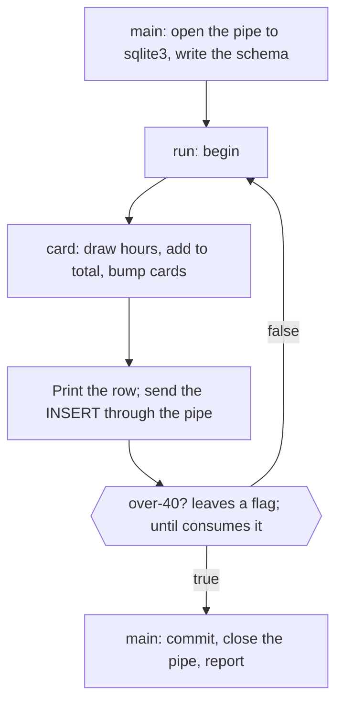
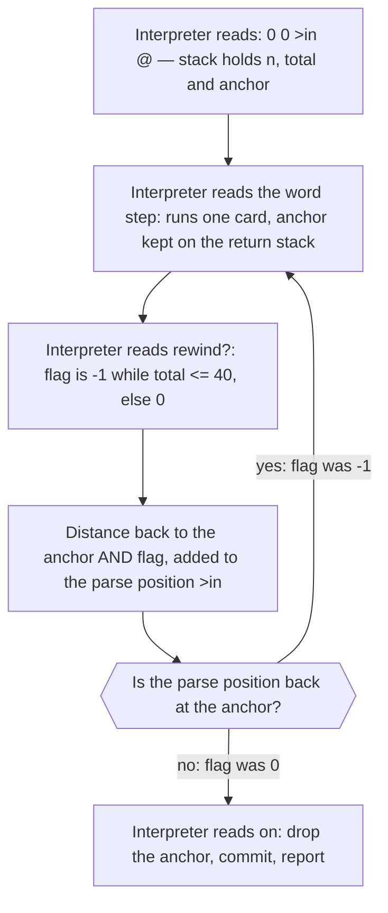

# Forth study guide

## What this guide is for

This guide reads two Forth programs: [`src/forth`](../../../src/forth/README.md), which uses a normal `begin ... until` loop and two variables, and [`src/forth-weird`](../../../src/forth-weird/README.md), which has no loop word and no variable. Its loop is a line of source text that the interpreter reads again because a word moved the parse position backwards. The question is: **what can serve as a program counter, and what can serve as memory?**

When you finish, you should be able to:

1. Read a stack-effect comment and use it to trace what a word does to the data stack.
2. Explain what `>in` is, and why changing it re-executes text that was already read.
3. Trace the weird program through three cards, naming the stack contents and the value of `>in` at each step.
4. Explain why the weird loop works only on an input line, and why moving the anchor changes the machine.
5. Label each behavior as guaranteed, implementation-permitted, or accidentally exploited.

Scope limits. This guide does not teach Forth syntax from scratch. You need to know that words pop their inputs from a data stack and push their results, and that a definition is written `: name ... ;`. It uses Gforth 0.7.3 or later. It does not cover the SQLite pipe or `random.fs` beyond what the trace needs.

The book's page is [Forth](../../languages/forth.md). The ideas are in [What counts as a machine?](../../cs/02-what-counts-as-a-machine.md#stack-machines) and [The program counter](../../cs/03-control-flow-and-continuations.md#the-program-counter).

## Before you begin

**Safety model.** Every entry writes fictional **DEMO ONLY** data. The Forth programs start a shell process that creates a folder and runs `sqlite3`. Read the source before you run it, and run it in the sandbox first:

```bash
sandbox/container/run-image.sh src/forth
sandbox/container/run-image.sh src/forth-weird
```

Edit only copies ([Running things safely](../../exercises.md#running-things-safely)). If a change might loop for ever, as one exercise here does, set `SANDBOX_TIMEOUT=30`: a run that exceeds it prints `TIMEOUT after 30s`.

**Prediction rule.** Write down the stack and the value of `>in` that you expect before each run. A trace you did not predict teaches little.

**Vocabulary.**

| Term | Meaning here |
| --- | --- |
| Data stack | Where words take their inputs and leave their results. The weird program's only memory. |
| Return stack | A second stack. A word may park a value there for a moment (`>r` and `r>`). |
| Stack effect | A comment like `( n total -- n' total' )`: the stack before, then after. It is convention, not enforced. |
| Text interpreter | The loop that reads a word, finds it, and runs it (or compiles it). |
| `>in` | A variable holding the text interpreter's current offset into the input line. |

## The shared challenge

The [challenge specification](../../intro.md#what-the-challenge-does) calls for cards with a category and 10 to 19 whole hours. Categories cycle through Meetings, Coding, Debugging and Learning. Add each card's hours to a running total and keep going until the total passes 40. The run **retains the first card that takes the total above 40**. A total of exactly 40 does *not* stop the run: four 10-hour cards total exactly 40, so a fifth card is drawn, and its category wraps back to Meetings. Conforming runs finish with 3 to 5 cards and a total of 41 to 59.

Both Forth entries save the cards in one SQLite transaction and print a summary. Forth writes the boundary in two different ways, and the difference is worth seeing. The plain program says `total @ 40 >` ([L105](../../../src/forth/timecards.fs#L105)): stop when the total is *over* 40. The weird program says `over 41 <` ([L93](../../../src/forth-weird/timecards.fs#L93)): *keep going* while the total is *below 41*. Both are the same rule. Exactly 40 is below 41, so the loop continues.

## The machine to identify

**What repeats.** In `forth`, a `begin ... until` loop inside the word `run` ([L108](../../../src/forth/timecards.fs#L108)). In `forth-weird`, a *segment of source text*: the words `step rewind?` on one line, read repeatedly by the text interpreter ([L101](../../../src/forth-weird/timecards.fs#L101)).

**Where state lives.** In `forth`, two variables, `total` and `cards`, and a few values. In `forth-weird`, the data stack, and only the data stack. The file contains no `variable` at all. Between passes, the stack holds three numbers: `( n total anchor )`, where `n` is the number of cards so far, `total` is the running total, and `anchor` is the `>in` value to return to.

**What advances the next step.** In `forth`, `until` consumes a flag that `over-40?` leaves on the stack, and either repeats or falls out. In `forth-weird`, the text interpreter simply reads the next word on the line. The loop exists because the word `rewind?` can move the interpreter's position *backwards*. The program counter is `>in`.

**What stops it.** In `forth`, `until` receives a true flag. In `forth-weird`, `rewind?` computes the flag `-1` (true, all bits set) while the total is 40 or less and `0` otherwise, and uses it to mask the distance back to the anchor. When the flag is `0` the distance becomes `0`, `>in` does not move, and the interpreter reads on to the next line.

**What commits.** The same in both: `INSERT` text goes through a pipe to `sqlite3` as each card is made, between a `BEGIN` and a `COMMIT`, and the commit happens once after the last card. The rows printed on the terminal are separate and already visible. The weird program has no branch to skip the commit, because there is no `if`: it reaches the commit because it reaches the end of the loop line.

Here are the entries' Program Flow diagrams.

<!-- diagram-source: src/forth/README.md#program-flow -->



The first diagram is a loop with a flag test. The flag is computed *after* the card, so the crossing card is kept.

<!-- diagram-source: src/forth-weird/README.md#program-flow -->



The second has no test that chooses between two *statements*. The loop edge exists because `>in` is set back to the anchor. The only "decision" is arithmetic on the flag.

## Trace one run

The programs draw random hours. Use hours **15, 19, 12** for the trace. To check it against real behavior, a scratch copy of `forth-weird` was run in the sandbox with the random-hours step replaced by a fixed table (15, 19, 12) and with three print statements added: the stack and `>in` after each `step`, and `>in` before and after `rewind?`. The values below are what it printed.

The line being interpreted is line 101: `0 0 >in @ step rewind?`. Offsets count characters from the start of that line.

| Moment | Data stack `( n total anchor )` | `>in` | What happened |
| --- | --- | ---: | --- |
| After `0 0 >in @` | `0 0 10` | 10 | `>in @` pushed the offset just after `@`, which is where the word `step` begins. That value, 10, is the **anchor**. |
| After `step`, pass 1 | `1 15 10` | 15 | `card` drew 15 hours, made total 15, printed the row and wrote the `INSERT`. The anchor rode on the return stack so `card` could not touch it. |
| `rewind?`, pass 1 | flag is `-1` (15 < 41) | 23, then **10** | The distance 10 − 23 = −13 was kept (flag true) and added to `>in`. The text interpreter is back before `step`. |
| After `step`, pass 2 | `2 34 10` | 15 | Coding, 19 hours, total 34. The `0 0` was *not* read again: the anchor is after them. |
| `rewind?`, pass 2 | flag is `-1` (34 < 41) | 23, then **10** | Rewound again. |
| After `step`, pass 3 | `3 46 10` | 15 | Debugging, 12 hours, total 46. |
| `rewind?`, pass 3 | flag is `0` (46 is not below 41) | 23, then **23** | The distance is masked to 0. `>in` does not move. The interpreter reads on and runs `drop` on the next line. |

The scratch run printed these cards: `Meetings 15 15`, `Coding 19 34`, `Debugging 12 46`, then `# committed total=46 entries=3 DEMO ONLY`.

Two things to notice. First, `>in` is 15 after every `step` and 23 at every `rewind?`. The text interpreter does not "know" it is in a loop: it reads the same characters in the same places each time. Second, the numbers 10, 15 and 23 are offsets into one specific line. Edit the spaces on line 101 and the offsets change, but the anchor, which is read at run time, follows. That is why the program survives reformatting and why it fails if you read the anchor *after* the state (see the exercise below).

**The plain program for comparison.** `run` executes `card`, then `over-40?` leaves `total @ 40 >` as a flag, and `until` consumes it. With hours 15, 19, 12 the totals are 15, 34, 46, and the flags are false, false, true. The variables `total` and `cards` hold 46 and 3 at the end.

**Exactly 40.** With hours 10, 10, 10, 10 the totals are 10, 20, 30, 40. At 40 the weird flag is `-1` (40 < 41), so the interpreter rewinds and a fifth card is drawn. Predict the fifth card's category before you check: the category is chosen by `n` modulo 4 ([L29](../../../src/forth-weird/timecards.fs#L29)), and `n` is 4.

## Compare the ordinary and weird designs

| Dimension | `forth` | `forth-weird` |
| --- | --- | --- |
| **Representation** | State in two named variables. Loop is `begin ... until`. | State is three numbers on the data stack. Loop is a rewound parse position. |
| **Observability** | Inspect `total @` and `cards @` at any time. | The state exists only as stack depth and order. `.s` prints it, but nothing has a name. A wrong stack effect shows up as garbage several words later. |
| **Tests** | Call `over-40?` after setting `total`. | The rule is inside `rewind?`, which needs a stack and a live `>in`. You test the whole line, not the rule. |
| **Debugging** | Standard: trace the variables. | The program counter is data. A debugger that shows the stack but not `>in` cannot say where it will read next. |
| **Portability** | Standard Forth control words in a definition. | Depends on `>in` being writable and on the interpreter re-reading the same line. The program works because input comes from a file line by line. |
| **Cost** | Normal. | Each pass re-parses the words (a dictionary lookup per word). A typing mistake in the stack effects gives silent wrong data, not an error. |

Forth's standard says control words such as `begin` work only inside definitions, so the plain program must wrap its loop in `run`. The weird program goes the other way: it uses the *interpreter's* loop, which needs no definition.

## What the exercises demonstrate

| Exercise | Predict first | What the evidence shows |
| --- | --- | --- |
| [B3. Forth: move the anchor](../../exercises.md#b3-forth-move-the-anchor-verified), change (a) | Put `0 0` on its own line *before* `>in @ step rewind?`. Does anything break? | Harmless. The anchor is still read after the `0 0` are pushed, so rewinding never re-reads them. |
| B3, change (b) | Write the line as `>in @ 0 0 step rewind?`. What happens? | It runs away. Rewinding to the anchor now re-reads `0 0`, which pushes a fresh card count and total every pass, so the state resets each time. The book's check: no `# committed` line, hundreds of rows, and every row's total equals its own hours. **State must be created before the anchor.** |
| B3, change (c) | Change `41 <` to `51 <`. What is the new stop rule? | The stop rule becomes "total passes 50" and `check-demo.sh out.txt 50` passes. The limit lives in one constant inside `rewind?`. |
| [C2. Make the constraint real](../../exercises.md#c2-make-the-constraint-real-verified) | What would a check that bans loop words need to ignore? | The [reference checker](../../solutions/c2-forth-rule-check.sh) strips backslash line comments, parenthesized comments and `." strings"` before checking banned words. A constraint check is itself a small parser. |
| [C1. Weird next to boring](../../exercises.md#c1-weird-next-to-boring-verified) | In which program can you name the loop's state? | `forth` names it (`total`, `cards`). `forth-weird` has three unnamed numbers and a parse position. |

The question the book asks about change (b) is the best test of understanding: *why does only (b) break the loop?* If your answer is not "because `>in @` captures the position after the state is pushed, and (b) moves the state to the other side of that position", read the trace table again.

## Failure modes, costs, and boundaries

| Behavior | Label | Why |
| --- | --- | --- |
| Words take inputs from and leave outputs on a data stack, per their stack effects | **Guaranteed** | The core model of the language. |
| `>in` holds an offset into the current input buffer, and writing it changes where the interpreter reads next | **Guaranteed** that `>IN` exists, holds the parse offset and can be written | That is its documented purpose. Keeping the new value inside the current line is the program's own responsibility, and this program does. |
| `-1` is true and `0` is false, so `AND` can mask a number with a flag | **Guaranteed** | Forth flags are all-bits-set or zero. A word that returns `1` for true would break the trick. |
| The input comes from a file one line at a time, so `>in` is relative to *that line* | **Implementation-permitted** | How the line buffer is refilled is the system's business. The program has been checked with Gforth. |
| After `>in @`, the stored value points just after the `@` and before `step` (here, 10) | **Implementation-permitted** | The exact offset depends on whether the system consumes the delimiter after a word. It follows the tested system's parser. |
| The ISO week comes from `date +%G-W%V` run through a pipe | **Implementation-permitted** | A host command, not Forth. |

No behavior in the Forth entries is merely accidentally exploited. The closest is the dependence on the exact offset above: it is observable, tested and documented in the README, but a different Forth could place the anchor one character away. For this program that would be harmless, because rewinding to the delimiter or to the word start re-reads the same text.

**Costs to state.**

- **The same rewind inside a definition does not work.** Once a line is compiled into a word, the text interpreter is no longer reading it. The loop needs the *interpreter*. The book's note: this works because the words are read from an input line.
- **Silent stack errors.** Stack effects are comments, and nothing enforces them. One word that leaves one extra number turns the next pass's total into the wrong number.
- **The program counter can be corrupted by ordinary data.** `rewind?` adds a *computed number* to `>in`. A bug in that computation reads the wrong text, not an error message.
- **Where the idea is legitimate.** A Forth implementer, a parsing word or a debugger may rewind `>in` on purpose. The stunt is that technique used for an application loop.

## Connections across the repository

- **Parse position as control state.** [COBOL](cobol.md) stores the next step in a jump target. [Make and CMake](make-and-cmake.md) store it in which files exist and in regex captures. [Tcl](tcl.md) stores it in a database trigger. The concept guide [State and control beyond variables](../concepts/state-and-control-beyond-variables.md) compares them with one worksheet.
- **Memory that has no names.** [Haskell](haskell.md)'s weird program also keeps its running total somewhere nameless: inside the list of cards being built, where each card reads its predecessor.
- **Text re-read.** [m4](m4.md) reads its own expansions again (rescanning), which is the text-level cousin of "read the same text again". [ed and Ex](ed-and-ex.md) execute lines out of a buffer, so their program counter is data too.
- **Concept guides.** [Reading adversarial programs](../concepts/reading-adversarial-programs.md) and [Comparative machine design](../concepts/comparative-machine-design.md).
- **In the book.** [Forth](../../languages/forth.md), [Stack machines](../../cs/02-what-counts-as-a-machine.md#stack-machines) and [The stack as a data structure](../../cs/06-state-beyond-variables.md#the-stack-as-a-data-structure).

## Self-check

Answer before you read the italic text after each question.

1. **Trace.** In the weird program, hours are 11, 11, 11, 11. Give the stack `( n total anchor )` after the fourth `step` and the flag from `rewind?`. Does the program draw a fifth card? *(Stack `4 44 10`. The flag is `0`, because 44 is not below 41. It draws no fifth card. The totals are 11, 22, 33, 44, and the fourth card is the crossing card.)*
2. **Explain.** Why is the anchor kept on the return stack while `card` runs, and not on the data stack? *(`card` changes the depth of the data stack: it consumes the card number and the total and replaces them. Parking the anchor on the return stack keeps it out of the way, and `step` takes it back with `r>`.)*
3. **Transfer.** The program counter of the weird machine is `>in`. Name the program counter, or the closest thing to one, of the COBOL weird entry and of the Make entry. *(COBOL: the current target of `NEXT-CARD`'s `GO TO`, plus the normal fall-through from paragraph to paragraph. Make: the set of `.tc-N.mk` files that exist, which decides whether Make restarts. The concept guide on state and control develops both.)*
4. **Evidence.** Claim: "Only the position of the anchor, not the stop rule, decides whether this loop runs away." Design two edits that test it, one expected to break the loop and one expected to leave it intact. *(Move `0 0` after `>in @`: the state resets each pass and it runs away. Move `0 0` to its own earlier line: it still passes. Run both with `SANDBOX_TIMEOUT=30`.)*

## Further reading

- [Forth (programming language)](https://en.wikipedia.org/wiki/Forth_(programming_language)) (Wikipedia): the language's history, the two stacks, and the dictionary.
- [Stack machine](https://en.wikipedia.org/wiki/Stack_machine) (Wikipedia): why a stack can be the whole memory of a program.
- [Stack machines](../../cs/02-what-counts-as-a-machine.md#stack-machines) and [The program counter](../../cs/03-control-flow-and-continuations.md#the-program-counter) (this book): the two ideas this program puts together.
