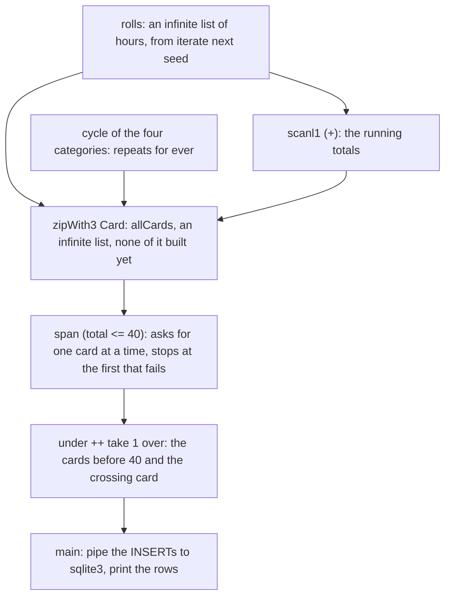
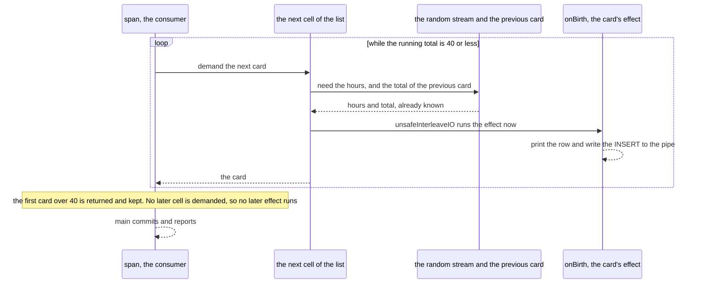
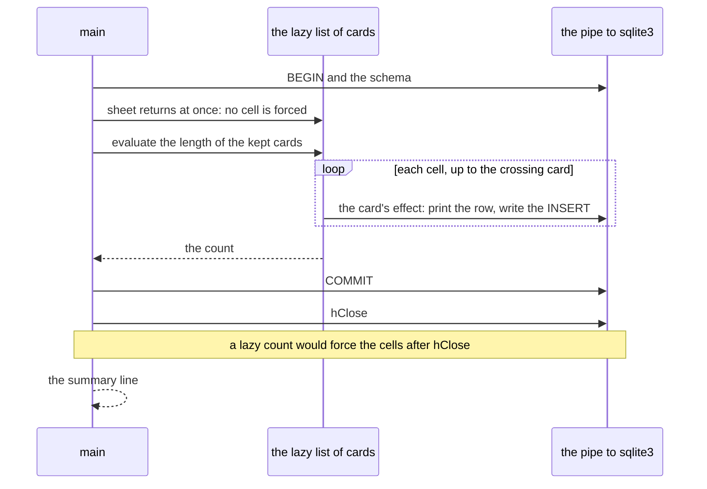

# Haskell study guide

## What this guide is for

This guide reads two Haskell programs that solve the time-card challenge with no loop: [`src/haskell`](../../../src/haskell/README.md), which is one pure function over infinite lists, and [`src/haskell-weird`](../../../src/haskell-weird/README.md), where *reading* the list is what performs the effects. The question is: **who demands work, and when?**

When you finish, you should be able to:

1. Explain how `span` turns "how much of an infinite list I read" into a stop rule, and why `takeWhile` would give the wrong answer.
2. Say which parts of each program are *demanded* in a given step, and which are never built.
3. Explain what `unsafeInterleaveIO` adds, and why that is where the program stops being referentially transparent.
4. Predict what happens when a forcing point moves relative to the lifetime of a resource (the pipe to `sqlite3`).
5. Label each behavior as guaranteed, implementation-permitted, or accidentally exploited.

Scope limits. You need to read Haskell type signatures and know what `map`, `zip` and `fix` do. The guide does not teach monads, the type classes in the source, or the SQL. It uses GHC's `runghc`; the programs need only packages that ship with GHC.

The matching book material is [Haskell](../../languages/haskell.md), and for the idea itself, [Evaluation and demand](../../cs/04-evaluation-and-demand.md).

## Before you begin

**Safety model.** Every entry writes fictional **DEMO ONLY** records to a local SQLite file. Both programs start the `sqlite3` process, so read the source first and run in the sandbox first:

```bash
sandbox/container/run-image.sh src/haskell
sandbox/container/run-image.sh src/haskell-weird
```

Work on a copy for any edit ([Running things safely](../../exercises.md#running-things-safely)). Output is random, so compare properties, not numbers.

**Prediction rule.** Before each run, write down (a) which list cells will be forced, (b) which effects will fire, and (c) what output would prove you wrong.

**Vocabulary.**

| Term | Meaning here |
| --- | --- |
| Lazy / non-strict | A value is computed only when something demands it. |
| Thunk | A suspended computation that stands in for a value until it is forced. |
| Forcing | Evaluating a thunk, as far as the demanding code needs (usually to its outermost constructor). |
| `fix` | `fix f = f (fix f)`: gives a function its own result, so a value can be defined in terms of itself. |
| `unsafeInterleaveIO` | Defers an IO action until its *result* is demanded. |

## The shared challenge

A *card* has a category and a whole number of hours from 10 to 19. Categories cycle through Meetings, Coding, Debugging and Learning. Add cards to a running total. The run **retains the first card that takes the total above 40**. A total of exactly 40 continues, so four 10-hour cards need a fifth. Totals end between 41 and 59, with 3 to 5 cards. Rows are saved to a local SQLite file as one transaction, and a summary is printed.

In Haskell the rule appears as the predicate `(<= 40)` inside `span`. That detail matters. `<= 40` is true for exactly 40, so exactly 40 stays in the "under" half and the next card is read. The crossing card is the *first element of the other half*, which is why the program writes `under ++ take 1 over`.

## The machine to identify

Both programs are demand-driven. The difference is what a demand *does*.

**What repeats.** Nothing repeats in a statement. The lists are infinite (`cycle [minBound ..]`, and a random stream), so "repeating" is the consumer asking for one more element. In `haskell`, `span` is the consumer ([L56-59](../../../src/haskell/timecards.hs#L56-L59)). In `haskell-weird`, `span` inside `untilOver40` is the consumer too ([L82-85](../../../src/haskell-weird/timecards.hs#L82-L85)).

**Where state lives.** In `haskell`, state is *position in lists*: the running total is `scanl1 (+) hs` over the hours ([L49](../../../src/haskell/timecards.hs#L49)), so each card carries its own total. In `haskell-weird`, the total of card *n* is read off card *n-1*, an element of the list being built. `fixIO` hands `sheet` its own result before it exists ([L74-78](../../../src/haskell-weird/timecards.hs#L74-L78)). The random stream is also self-referential: `fix (\xs -> seed : map next xs)` ([L53](../../../src/haskell-weird/timecards.hs#L53)).

**What advances the next step.** The consumer's demand. Forcing cell *n* needs the hours (from the stream) and the total (from card *n-1*). There is no counter and no accumulator. Data dependence supplies the order.

**What stops it.** The consumer stops asking. `span` returns when the predicate first fails, and `take 1 over` takes only the crossing card. No later cell is ever forced.

**What commits.** The two programs differ most here. `haskell` builds the whole SQL script as a pure string, runs `sqlite3` on it with `readProcess`, and only then prints the rows ([L103-120](../../../src/haskell/timecards.hs#L103-L120)). In `haskell-weird`, each forced cell *prints its row and writes its `INSERT` to an open pipe* as a side effect. The `COMMIT` is written afterwards by `main`, and `hClose` ends the stream ([L144-146](../../../src/haskell-weird/timecards.hs#L144-L146)). The rows on the terminal are not part of the transaction, and a row can be printed before the transaction is committed.

The two Program Flow diagrams from the entries follow.

<!-- diagram-source: src/haskell/README.md#program-flow -->



Data flows left to right through descriptions, and demand flows the other way, from `span` back to the lists. Only the demanded prefix is ever built.

<!-- diagram-source: src/haskell-weird/README.md#program-flow -->



Here a demand has a *consequence*: the effect runs in the middle of the evaluation. The next diagram is new. It adds what the source diagram leaves out, the lifetime of the pipe.

<!-- diagram-new: lazy-demand-trace - shows when the cells are forced relative to hClose, which the source diagram omits -->



## Trace one run

The programs draw random hours. For a trace, use hours **15, 19, 12**. To check the trace against real behavior, scratch copies of both programs were run in the sandbox with the random stream replaced by `[15, 19, 12] ++ error "a 4th card was demanded"`. If any code had forced a fourth hours value, the program would have crashed with that message. Neither did. The weird copy also printed a marker to standard error each time a card's effect fired:

```text
# DEMO ONLY run <id>
  [effect fired for a card of 15 hours]
Meetings	15	15	DEMO ONLY
  [effect fired for a card of 19 hours]
Coding	19	34	DEMO ONLY
  [effect fired for a card of 12 hours]
Debugging	12	46	DEMO ONLY
# committed total=46 entries=3 DEMO ONLY
```

(The ISO-week column was removed for width.) Both copies finished normally with three rows and total 46. The tables below name the *demand*, which is the decisive state in a lazy program.

**`haskell`: what `span` forces.** `span p xs` tests one element at a time.

| Step | `span` demands | The test `total <= 40` | Result |
| --- | --- | --- | --- |
| 1 | cell 1: Meetings, 15 hours, total 15 | true | goes in `under` |
| 2 | cell 2: Coding, 19 hours, total 34 | true | goes in `under` |
| 3 | cell 3: Debugging, 12 hours, total 46 | **false** | becomes the head of `over`, and `span` stops |
| after | `take 1 over` takes cell 3 | none | no cell 4 is demanded, so the 4th hours value is never evaluated |

The crossing card is already built when `span` rejects it, because the predicate needed its total. That is why the "retain the crossing card" rule costs nothing: `take 1 over` returns an element that exists. It is also why `takeWhile` is wrong here. `takeWhile (<= 40)` stops at the same place but throws the crossing card away.

**`haskell-weird`: what each demand does.**

| Step | Demand | Needs | Effect fired now | Pipe state |
| --- | --- | --- | --- | --- |
| 0 | `sheet` called | nothing | none: the list is only a promise | open, BEGIN and schema written |
| 1 | `span` forces cell 1 | hours 15, previous total 0 | row 1 printed, INSERT 1 written | open |
| 2 | `span` forces cell 2 | hours 19, total 15 from card 1 | row 2 printed, INSERT 2 written | open |
| 3 | `span` forces cell 3 | hours 12, total 34 from card 2 | row 3 printed, INSERT 3 written | open |
| 4 | `span` sees 46 > 40 and stops | none | **none**: cell 4 is never forced | open |
| 5 | `main` writes `COMMIT`, then `hClose` | none | transaction committed | closed |

**The same cells, forced too late.** Move step 5 *before* the forcing and the effects have nowhere to go. In the repository's own history the first draft counted with `let entries = length cards`. That binding is lazy, so nothing forced the cards until the summary line was printed, after the pipe was closed. The output began `# committed total=` and crashed with `handle is closed`. The fix is `entries <- evaluate (length cards)` ([L144](../../../src/haskell-weird/timecards.hs#L144)). `evaluate` is not decoration: it is the line that decides *when* the rows exist.

**Exactly 40.** With four 10-hour cards the totals are 10, 20, 30, 40. The test `40 <= 40` is true, so card 4 goes in `under`, and `span` demands card 5. Its total is at least 50, so it is the crossing card. Predict the category of card 5, then check yourself. (`cycle [minBound ..]` repeats from `Meetings`.)

## Compare the ordinary and weird designs

| Dimension | `haskell` | `haskell-weird` |
| --- | --- | --- |
| **Representation** | The whole challenge is one pure function, `timecards :: Word64 -> [Card]`. Output and SQL are derived from its result. | The list of cards *is* the program. Each cell carries an `IO` action that runs when the cell is forced. |
| **Observability** | Deterministic: the same seed always gives the same list, and you can print it. | The list looks pure and is not. Looking at `cards` in a debugger forces cells and fires effects. |
| **Tests** | Call `timecards seed` and check the list. No I/O is needed. | The effect is injected (`sheet` takes `onBirth`), so a test can pass a recorder instead of a pipe. But the order of effects depends on the consumer, so you must drive it too. |
| **Debugging** | Standard. A wrong value has one pure cause. | The *order of effects* is decided by the evaluator. A change that adds a second consumer, or a different consumer, changes what is written. |
| **Portability** | Plain Haskell 2010 plus the GHC-shipped `time`, `directory`, `process` and `unix` packages. | The same packages, plus `unsafeInterleaveIO` and `fixIO`, which are GHC library functions with documented but delicate behavior. |
| **Cost** | A list is built lazily, so a few cards are built. Output happens after the SQL is generated. | Effects interleave with evaluation, so a failure part-way leaves partial output and a half-written pipe. |

The weird version gives up an important property: you can no longer treat an expression as a value. In the idiomatic version, `timecards seed` can be evaluated twice and gives the same thing, and nothing happens in the world. In the weird version, evaluating a cell is an *event*.

## What the exercises demonstrate

| Exercise | Predict first | What the evidence shows |
| --- | --- | --- |
| [B2. Haskell: break the laziness](../../exercises.md#b2-haskell-break-the-laziness-verified), change 1 | What happens when `evaluate (length cards)` becomes a lazy `let`? | The output contains `handle is closed` and the shared checker fails. The cards were demanded *after* the pipe closed. Forcing order is part of the program's meaning once effects are involved. |
| B2, change 2 | What happens if `unsafeInterleaveIO` is removed from `lazily`? Does it hang? | It stops with `cyclic evaluation in fixIO`, not a hang. The list of actions is now forced before the list of cards exists, so each value needs the other. |
| [C1. Weird next to boring](../../exercises.md#c1-weird-next-to-boring-verified) | In each program, what would a test need to control? | A pure function is tested by calling it. A lazy-effect list is tested by controlling its consumer. |
| [F. Prove a README claim](../../exercises.md#f-prove-a-readme-claim-verified) | Will a lazily evaluated `span` ever demand a fourth card? | The book's worked solution tests "`takeWhile` is not enough." A good evidence test needs a negative control: show that the test fails when the claim is false. |
| *Guide experiment* (verified in the sandbox) | In a scratch copy, replace the random stream with `[15, 19, 12] ++ error "a 4th card was demanded"`. Will the program crash? | It does not. Three effects fire and no more. This is direct evidence that `take 1 over` does not force the cell after the crossing card. It is not in the book's exercise list, so treat it as this guide's own. |

## Failure modes, costs, and boundaries

| Behavior | Label | Why |
| --- | --- | --- |
| `span` and `take` read only as much of a list as their result needs | **Guaranteed** | Non-strict semantics of Haskell. Verified by the error-tail experiment. |
| Total of card *n* depends on card *n-1*, so cell *n* cannot be forced first | **Guaranteed** | A data dependence in the program. It is why the program is correct, whatever the evaluator does. |
| `unsafeInterleaveIO` runs its action when its result is demanded, not before | **Guaranteed** | The library documents this contract. The word "unsafe" in the name is about what the contract does *not* say. |
| Where an interleaved effect lands relative to *unrelated* effects | **Implementation-permitted** | The language does not order them. This program is correct only because each cell depends on the one before it, so the order of the card effects follows from data dependence, not from a promise by the evaluator. |
| `evaluate (length cards)` forces every kept cell before `COMMIT` | **Guaranteed** | `evaluate` forces to weak head normal form, and `length` walks the spine, so the spine is built, and building it forces the cells. The exact wording of this chain matters: change one link and the effects move. |
| `fixIO` hands a function the result it is still building | **Guaranteed** | The library documents it. Forcing that result too early is an error you see at run time (`cyclic evaluation in fixIO`), which is what exercise B2 change 2 produces. |
| The 64-bit generator wraps around at the width of `Word64` | **Guaranteed** | Documented wraparound of the type. The generator uses Knuth's constants and the high bits. |

No behavior here is *accidentally exploited* in the book's sense: nothing relies on an effect nobody promised. The weird entry sits as close to that line as the Haskell entries get, which is why the unrelated-effects row matters.

**Costs to state.**

- **The pipe lifetime is an invisible dependency.** Nothing in the type of `cards :: [Card]` says "valid only while this handle is open". This is the same hazard that made people move from lazy `getContents` to streaming libraries.
- **Partial failure.** If a card's effect fails halfway, rows have already been printed. The transaction is protected by SQLite, but the terminal is not.
- **A second consumer breaks it.** Calling `length cards` twice is harmless because cells run only once. Reading `cards` from two threads, or adding a consumer before `COMMIT`, changes when effects run.
- **Where the technique is legitimate.** Lazy streaming of large input is real. Knot-tying (`fix`) is a respectable technique for circular data and memo tables.

## Connections across the repository

- **The same question as LINQ.** [C#, LINQ, XAML, and ports](csharp-linq-xaml-and-ports.md) asks "when does a description run?" with deferred execution. A LINQ pipeline re-runs when enumerated again, while a Haskell cell is evaluated once and remembered.
- **Pull iteration in JavaScript.** [JavaScript](javascript.md)'s lazy iterator in `javascript-weird` is a consumer that pulls one card at a time. The mechanism differs and the shape of the stop rule is the same.
- **Array languages go the other way.** [APL](apl.md) is eager: it builds more values than it needs and trims the result.
- **A stop rule as structure.** [COBOL](cobol.md) declares the rule on the data. Haskell chooses it by how much it reads. CMake uses a literal 41 characters long. All three avoid a visible loop condition.
- **Concept guides.** [Evaluation, demand, and laziness](../concepts/evaluation-demand-and-laziness.md) puts Haskell, LINQ and JavaScript on one scale. [Effects, errors, and commitment](../concepts/effects-errors-and-commitment.md) explains what survives a failure.
- **In the book.** [Haskell](../../languages/haskell.md) and [Evaluation and demand](../../cs/04-evaluation-and-demand.md).

## Self-check

Answer before you read the italic text after each question.

1. **Trace.** Hours are 10, 10, 10, 10, 14. For `haskell`, list the cards `span` forces, say which one is the crossing card, and say how many cards the final list has. *(Five cards are forced. Totals 10, 20, 30, 40, 54. The fifth, Meetings with 14 hours, is the crossing card. The final list has five cards.)*
2. **Explain.** In `haskell-weird`, why does the program not need a counter or an accumulator to know card *n*'s total? Which language feature makes `cards` usable before it exists? *(Each card's total is read from the previous card, an element of the same list. `fixIO` passes the list to `sheet` lazily, so reading card *n-1* works once that cell exists.)*
3. **Transfer.** In a language with generators, such as the JavaScript or Python entries, which construct plays the part of `span`, and what is the equivalent of "stop demanding"? *(The consumer that pulls from the generator, and stopping means not calling `next` again. A `for` loop that breaks is the usual form.)*
4. **Evidence.** A reviewer says, "`take 1 over` never builds a fourth card." Design a test that could fail. What is the negative control? *(Replace the hours stream with a fixed list whose tail is an error that fires if forced. The program must finish. For the control, write a variant that pattern-matches one cell past the crossing card. The error must then fire.)*

## Further reading

- [Lazy evaluation](https://en.wikipedia.org/wiki/Lazy_evaluation) (Wikipedia): call-by-need, thunks and sharing, with the vocabulary used here.
- [Referential transparency](https://en.wikipedia.org/wiki/Referential_transparency) (Wikipedia): the property `unsafeInterleaveIO` stops honoring.
- [Evaluation and demand](../../cs/04-evaluation-and-demand.md) (this book): the same ideas across Haskell, LINQ, APL and JavaScript, with the table of every entry's strategy.
- [Monads and effect systems](../../cs/07-effects-errors-and-commitment.md#monads-and-effect-systems) (this book): the usual, safe way Haskell keeps effects in order, which `unsafeInterleaveIO` deliberately steps around.
