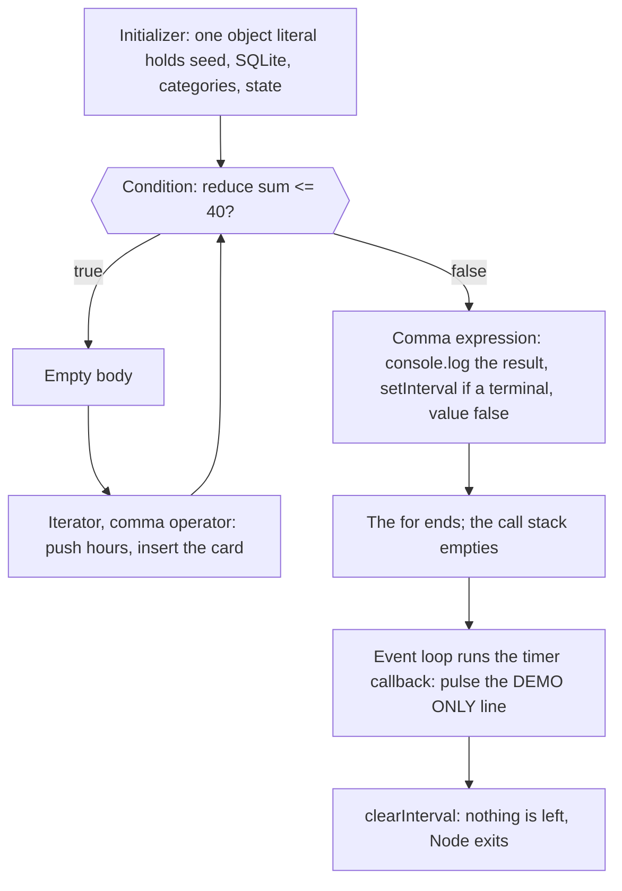
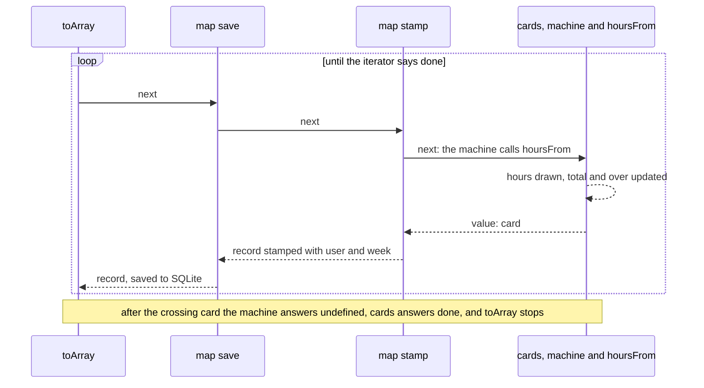
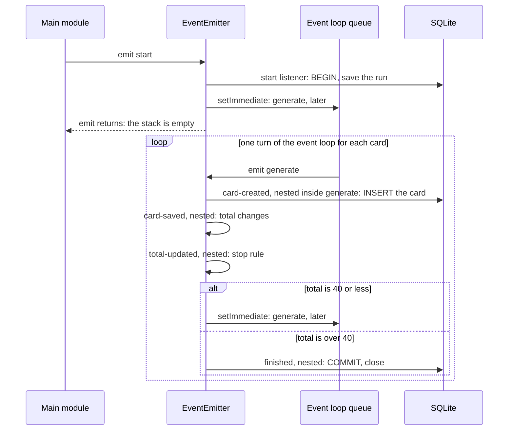

# JavaScript study guide

## What this guide is for

This guide reads three Node.js programs that solve the same challenge in three different control styles: [`src/javascript`](../../../src/javascript/README.md), one bodiless `for` statement whose three clauses do everything; [`src/javascript-weird`](../../../src/javascript-weird/README.md), three closures and a lazy iterator with no loop statement; and [`src/javascript-events`](../../../src/javascript-events/README.md), ten listeners on one `EventEmitter`. The question is: **who owns the next step: the loop header, the consumer that pulls, or the event loop?**

When you finish, you should be able to:

1. Say which clause of the `for` header does what, and why the stop test sees the card the iterator just added.
2. Explain how a closure keeps state that nothing else can reach, and why the weird program's stop rule is one assignment (`over = total > 40`).
3. Explain pull iteration: nothing is drawn until a consumer asks, and the consumer decides how many cards exist.
4. Explain the difference between `emit()` (a synchronous call) and `setImmediate()` (a new turn of the event loop), and what happens to the call stack without that boundary.
5. Trace all three programs through the same three cards.
6. Label each behavior as guaranteed, implementation-permitted, or accidentally exploited.

Scope limits. You need to read modern JavaScript: arrow functions, object literals, spread and the comma operator. The guide does not teach SQLite or the terminal pulse. It uses Node.js 24 with built-in `node:sqlite` and iterator helpers. The language page is [JavaScript](../../languages/javascript.md). For events in general, see the chapter [Events, callbacks, and reactive control flow](../../cs/10-events-callbacks-and-reactive-control-flow.md).

## Before you begin

**Safety model.** Every entry writes fictional **DEMO ONLY** data to a scratch SQLite file. These programs open files and, for the pulse, set timers. Read the source before you run it, and run it in the sandbox first:

```bash
sandbox/container/run-image.sh src/javascript
sandbox/container/run-image.sh src/javascript-weird
sandbox/container/run-image.sh src/javascript-events
```

Edit only copies ([Running things safely](../../exercises.md#running-things-safely)). All three entries accept `SEED` (an integer) to replay a run, and `NOW=YYYY-MM-DD` to fix the date. This guide uses `SEED=1105`, which gives hours 15, 19, 12 in all three.

**Prediction rule.** Before each run, write down the order in which things happen. In this family, *order* is the whole lesson.

**Vocabulary.**

| Term | Meaning here |
| --- | --- |
| Closure | A function together with the variables it was made next to. Here those variables are the program's state. |
| Iterator protocol | An object with `next()` that answers `{ value, done }`. |
| Pull | The consumer asks for the next value. Nothing is produced until it does. |
| `emit()` | Calls every listener of an event, in registration order, *before it returns*. |
| Turn | One pass of the event loop. `setImmediate` runs its function on a later turn. |

## The shared challenge

The [challenge specification](../../intro.md#what-the-challenge-does) calls for cards with a category and 10 to 19 whole hours. Categories cycle through Meetings, Coding, Debugging and Learning. Add each card's hours to a running total and stop when it passes 40. The run **retains the first card that takes the total above 40**. A total of exactly 40 does *not* stop it: four 10-hour cards total exactly 40, and a fifth is drawn, with the category wrapping to Meetings. Conforming runs finish with 3 to 5 cards and a total of 41 to 59.

All three stop on the first crossing and print a summary, but their SQLite write boundaries differ. The first two insert as they go. The events version wraps the run in one transaction. Each style writes the stop test differently. In the `for`, the condition is `reduce(...) <= 40 ? true : (...show the result..., false)`: `<= 40` is true for 40, so the loop goes round ([L54](../../../src/javascript/timecards.mjs#L54)). In the weird program, `over = total > 40` is false for 40, so the machine keeps answering ([core.mjs L14](../../../src/javascript-weird/core.mjs#L14)). In the events program, `total > limit` is false for 40, so the next card is scheduled ([L115](../../../src/javascript-events/timecards.mjs#L115)).

## The machine to identify

**What repeats.** In `javascript`, a `for` statement with an empty body: the *header's* three clauses repeat ([L10-67](../../../src/javascript/timecards.mjs#L10-L67)). In `javascript-weird`, a consumer asking an iterator for the next card, over and over: `.toArray()` ([L30](../../../src/javascript-weird/timecards.mjs#L30)). In `javascript-events`, a cycle of events: `generate` leads to `card-created`, `card-saved` and `total-updated`, and `total-updated` schedules the next `generate`.

**Evaluation.** The three original entries seed via the global Web Crypto `crypto.getRandomValues` when `SEED` is absent. In the bodiless `for`, `reduce` sums the array immediately on every condition check. The [C# header](csharp-linq-xaml-and-ports.md) does the same work with `Sum()`, even though its inner LINQ projection is deferred until `Sum()` enumerates it. The pull iterator below uses a different driver.

**Where state lives.** In `javascript`, the properties of one object literal that the `for` initializer builds: hours so far, the database, the random closure and the clock. In `javascript-weird`, three closures: a source of hours over one number, a card machine over `n`, `total` and `over`, and an iterator wrapper. None of that state can be reached except by calling the function ([core.mjs](../../../src/javascript-weird/core.mjs)). In `javascript-events`, an object `s` (`n`, `total`, `db`, ...) shared by the listeners, plus the registrations on the emitter itself.

**What advances the next step.** In `javascript`, the third `for` clause draws one card and saves it. In `javascript-weird`, a call to the iterator's `next()`. In `javascript-events`, one listener emits the event that the next listener is waiting for.

**What stops it.** In `javascript`, the condition returns `false` after showing the result. In `javascript-weird`, the machine's `over` flag: after the crossing card, every ask answers `undefined`, and the iterator says `done`. In `javascript-events`, `total-updated` emits `finished` instead of scheduling another `generate`.

**What commits.** In `javascript`, rows are saved by the iterator clause as they are made, and the condition prints. In `javascript-weird`, each ask saves its record in a `.map(save)` stage, and the summary is printed after the pipeline is complete. In `javascript-events`, `start` runs `BEGIN`, `card-created` inserts a row synchronously, and `finished` runs `COMMIT`. A throw in any listener becomes a `failed` event, which does a `ROLLBACK` exactly once.

<!-- diagram-source: src/javascript/README.md#program-flow -->



The first diagram is a loop whose header is the program. The second shows who asks whom.

<!-- diagram-source: src/javascript-weird/README.md#program-flow -->



In the second, demand flows backward from `toArray` to the machine. Nothing happens until it asks.

<!-- diagram-source: src/javascript-events/README.md#program-flow -->



The third distinguishes two kinds of arrow: a plain `emit` that returns after the listeners have run, and a hop to a later turn.

## Trace one run

With `SEED=1105` all three programs draw hours 15, 19, 12. The traces use scratch copies with logging around the entry's own functions. On Node 24.15.0, running the original `timecards.mjs` of each entry with that seed and a fresh `XDG_DATA_HOME` reproduced the reported rows and the persisted totals 15, 34 and 46.

**`javascript`: the `for` clauses.** Total starts at 0 with no cards.

| Evaluation | Condition (`sum <= 40`) | Iterator clause draws | Sum after |
| --- | --- | --- | ---: |
| 1 | 0 ≤ 40: true | `10 + rnd() % 10` = 15, saves Meetings | 15 |
| 2 | 15 ≤ 40: true | 19, saves Coding | 34 |
| 3 | 34 ≤ 40: true | 12, saves Debugging | 46 |
| 4 | 46 ≤ 40: **false** | none | print result, end |

The condition runs *after* each iterator step, except the first, so the crossing card (12 hours) is saved by the iterator before the test refuses to continue. The output was `Meetings 15 15`, `Coding 19 34`, `Debugging 12 46`.

**`javascript-weird`: who asked.** A scratch script wrapped the machine so that each ask was logged:

```text
building the pipeline: nothing asked yet (asks = 0)
pipeline built: asks = 0
ask 1: machine answers {"category":"Meetings","hours":15,"total":15}
ask 2: machine answers {"category":"Coding","hours":19,"total":34}
ask 3: machine answers {"category":"Debugging","hours":12,"total":46}
ask 4: machine answers undefined (over)
toArray done: asks = 4 cards = 3
```

Two facts matter. Building the pipeline asked for nothing. And there were *four* asks for three cards. The third answer set `over = true` (46 > 40), and the fourth ask was needed to learn that there were no more. The stop is in the machine, not in the consumer.

**`javascript-events`: the turns.** A scratch script logged every `emit` (indented by nesting depth) and every hop to a new turn:

```text
--- event loop turn 1 ---
emit start
  [setImmediate queued: next step waits for a new turn]
--- event loop turn 2 ---
emit generate
  emit card-created
    emit card-saved
      emit total-updated
  [setImmediate queued: next step waits for a new turn]
--- event loop turn 3 ---
emit generate
  ...same shape: Coding 19 34...
--- event loop turn 4 ---
emit generate
  emit card-created
    emit card-saved
      emit total-updated
        emit finished
          emit done
```

(The printed rows and the summary appear between the lines in the real output and are omitted here.) `emit start` returned before any card existed. Each card ran in its own turn, four emits deep, and the stack unwound before the next turn. On turn 4 the total was 46, so `total-updated` emitted `finished` directly instead of scheduling, and `finished` committed.

**Exactly 40.** With four 10-hour cards: the `for` test `40 <= 40` is true, so a fifth card is drawn. The weird machine has `over = 40 > 40`, false, so it answers again. The events listener evaluates `40 > 40`, false, and schedules a fifth `generate`. All three continue.

## Compare the ordinary and weird designs

| Dimension | `javascript` | `javascript-weird` | `javascript-events` |
| --- | --- | --- | --- |
| **Representation** | One statement, with a state object in the initializer | Three closures; no statement-level loop | Listeners registered on one emitter |
| **Observability** | Open the state object in a debugger | State is *unreachable* by design: you can only call the closure | Log every `emit`: the whole program is its event trace |
| **Tests** | Structure check: the body must be empty, and the program a single statement | A "closure lab" (`node --test check.mjs`) pins the machine's rules, with `world`-free pure functions | The program takes a `world` object (`rng`, `schedule`, `open`, ...), so a test can inject its own and run the trace |
| **Debugging** | Step through the header clauses | Step through `next()` calls | A throw travels up through `emit()`; every listener catches it and emits `failed` once |
| **Portability** | Node 22+ for `node:sqlite` | Also needs iterator helpers (`Iterator.from`, `.map`, `.toArray`) | Only Node's `EventEmitter` semantics (listener order, synchronous `emit`) |
| **Cost** | One pass | Lazy: a card is made only when asked | A hop per card, and a flat call stack |

The three programs separate three questions that most code ties together: *what is the next step* (the header, `next()`, or an event), *who decides to take it* (the loop, the consumer, or the loop in the runtime) and *where is the state* (an object, a closure, or a shared bag). A synchronous `emit` looks like an asynchronous event and is a function call. The event chain is recursion unless something breaks it.

## What the exercises demonstrate

| Exercise | Predict first | What the evidence shows |
| --- | --- | --- |
| [B20. JavaScript: read the clauses, move the limit and fail the structure check](../../exercises.md#b20-javascript-read-the-clauses-move-the-limit-and-fail-the-structure-check-verified) | With `SEED=42`, which card crosses 40? Change `<= 40` to `<= 20`: how many cards? | Three cards (12, 17, 17: total 46) and, with `<= 20`, two cards (12 then 29). The condition is evaluated after the iterator added a card. A statement added to the body still runs correctly and the *structure check* fails: the constraint was real. |
| B20, step 4 | `NOW=2026-12-31` and `NOW=2024-12-30` with `SEED=42`: what week? | `2026-W53` and `2025-W01`. The ISO year can differ from the calendar year at New Year. |
| [B21. JavaScript, weirder](../../exercises.md#b21-javascript-weirder-move-the-stop-rule-in-a-closure-and-watch-the-demand-verified) | Change `over = total > 40` to `total > 20`. What rows? Does the closure lab pass? | Two cards. The lab fails 7 of 12 tests (the ones that pin the stop rule) and passes the 5 about closures, which do not care about the limit. |
| B21, step 3-4 | `take(1)` against `take(2)` on the pipeline: how many `drawn` lines? | `built`, then one `drawn` for `take(1)`; two for `take(2)`. The consumer decides how many cards exist. |
| [B22. JavaScript, event-driven](../../exercises.md#b22-javascript-event-driven-predict-the-trace-then-remove-the-boundary-verified), steps 2-3 | `listener`, `after emit` and `immediate`: in what order? And the trace of three 19-hour cards? | `listener`, `after emit`, `immediate`. `emit()` calls listeners before it returns; `setImmediate()` only asks. In the card trace `emit('start')` returns before any card is made. |
| B22, step 4 | Replace `later('generate')` with `events.emit('generate')`. What happens to a very long run? | A normal run still works, but the lab fails 2 tests and a long run prints `Maximum call stack size exceeded` and exits 1. The boundary is what keeps the stack flat. |

B22 step 4 is the most instructive failure in this family: the program is *correct* for the sizes you test and breaks at a size you do not. A chain of synchronous `emit` calls is a recursion whose depth grows with the number of cards.

## Failure modes, costs, and boundaries

| Behavior | Label | Why |
| --- | --- | --- |
| A closure keeps its captured variables alive and private | **Guaranteed** | Language semantics. |
| On the dense hours array, the reducer visits every card on each call | **Guaranteed** | `Array.prototype.reduce` runs the callback for every present element unless evaluation throws. The plain entry calls it during every condition check. The weird entry folds once after collection. |
| `emit()` calls listeners synchronously, in registration order, before it returns | **Guaranteed** | Documented Node.js behavior (see [`emitter.emit`](https://nodejs.org/api/events.html)). |
| `emit('error', e)` with no `error` listener throws `e` | **Guaranteed** | Documented. The program registers an `error` listener to turn a stray error into `failed`. |
| `setImmediate` runs its callback after the current code finishes and before timers of a later phase | **Guaranteed** | Documented Node.js scheduling. |
| The Park-Miller closure replays a run for a given `SEED` | **Guaranteed** | It is plain arithmetic. `Math.random` cannot be seeded, which is why it is not used. |
| `node:sqlite` is synchronous, so a row is written when `run()` returns | **Implementation-permitted** | A property of Node's built-in module at the tested version. If the API became asynchronous, the `card-saved` guarantee ("nothing downstream sees an unsaved card") would break. |
| `Iterator.from(...).map(...).toArray()` | **Implementation-permitted** | Iterator helpers are recent. They exist in the Node 24 the entries target, not in older runtimes. |
| A flat stack over about 2000 cards depends on the `setImmediate` boundary | **Guaranteed** by design, tested | Removing it fails a test and a long run, as exercise B22 shows. |

No JavaScript behavior here is merely accidentally exploited. The closest is that the `for` header uses the comma operator inside an arrow function because a `for` initializer accepts only one declaration; that is a language rule, but one the code works around rather than uses.

**Costs to state.**

- **A throw in a scheduled callback has no caller.** It would end the process. The events program wraps every listener so that a throw becomes `failed`, and `failed` removes every listener so that it runs exactly once.
- **Re-entrancy.** A listener that emits can re-enter other listeners. The programs avoid it by having each listener do one thing and emit once.
- **Hidden order dependence.** Listener order is registration order. Reordering the `on(...)` calls changes the program.
- **Where the techniques are legitimate.** Closures as private state, lazy iterators for large or infinite sources, and an emitter with explicit turn boundaries are ordinary JavaScript. The stunts are the empty-body `for` and the absence of any statement loop.

## Connections across the repository

- **The same question as Haskell and LINQ.** Pull iteration in `javascript-weird` is the JavaScript form of [Haskell](haskell.md)'s lazy list and the deferred pipelines of [C#, LINQ, XAML, and ports](csharp-linq-xaml-and-ports.md). The concept guide [Evaluation, demand, and laziness](../concepts/evaluation-demand-and-laziness.md) puts them side by side.
- **The `for` header as the whole program.** Four other ports (C#, Java, Go and Kotlin) use the same bodiless-`for` shape. See the comparison in the C# guide.
- **Turn boundaries and re-entrancy.** [Events, callbacks, and reactive control](../concepts/events-callbacks-and-reactive-control.md) generalizes B22. [XAML and thread affinity](csharp-linq-xaml-and-ports.md) is a related hazard: *where* a callback runs matters.
- **Callbacks in other entries.** The PCRE2 callouts in [Regex engines and sed](regex-engines-and-sed.md) and the checkpoint actions in [tar](tar.md) are synchronous callbacks too, but the engine calls them, not an event loop.
- **In the book.** [JavaScript](../../languages/javascript.md), [Iterators and generators](../../cs/04-evaluation-and-demand.md#iterators-and-generators), [Closures and lexical environments](../../cs/06-state-beyond-variables.md#closures-and-lexical-environments), [Callbacks](../../cs/10-events-callbacks-and-reactive-control-flow.md#callbacks) and [The event loop and scheduling turns](../../cs/10-events-callbacks-and-reactive-control-flow.md#the-event-loop-and-scheduling-turns).

## Self-check

Answer before you read the italic text after each question.

1. **Trace.** Hours are 10, 10, 10, 10, 13. For `javascript-weird`, how many times does `toArray` ask the machine, and what does the last ask return? *(Six asks. The fifth card (13 hours, total 53) sets `over`, and the sixth ask returns `undefined`. Five asks produce cards, because exactly 40 does not set `over`.)*
2. **Explain.** In `javascript-events`, why does `total-updated` call `later('generate')` but call `events.emit('finished')` directly? *(`later` hops to a new turn so the stack unwinds between cards. `finished` ends the chain, so there is no recursion to avoid, and it runs inside the same turn so the commit happens before anything else can intervene.)*
3. **Transfer.** What would you use in Python or Rust to get the same "nothing is produced until asked" behavior as the iterator pipeline? *(A generator or an iterator adapter chain. Nothing runs until something consumes it, and the consumer decides how many items exist.)*
4. **Evidence.** A reviewer says the events program "never nests more than five calls deep." Design a test that could fail. *(Wrap `emit` with a depth counter on a very long run, as in exercise B22, and assert the maximum depth. The negative control is the version with `later('generate')` replaced by a direct `emit`, whose depth grows with the number of cards. The claim is guaranteed by design and tested.)*

## Further reading

- [Closure (computer programming)](https://en.wikipedia.org/wiki/Closure_(computer_programming)) (Wikipedia): what a closure captures and why it can serve as private state.
- [Iterators and generators](https://developer.mozilla.org/en-US/docs/Web/JavaScript/Guide/Iterators_and_generators) (MDN): the iterator protocol the weird program implements by hand.
- [Using iterator helpers](https://developer.mozilla.org/en-US/docs/Web/JavaScript/Reference/Global_Objects/Iterator) (MDN): `Iterator.from`, `map` and `toArray`, and their lazy semantics.
- [The Node.js event loop](https://nodejs.org/en/learn/asynchronous-work/event-loop-timers-and-nexttick) (Node.js): why `setImmediate` runs on a later turn, from the runtime's own documentation.
- [Event loop](https://en.wikipedia.org/wiki/Event_loop) (Wikipedia): the general idea, outside Node.
