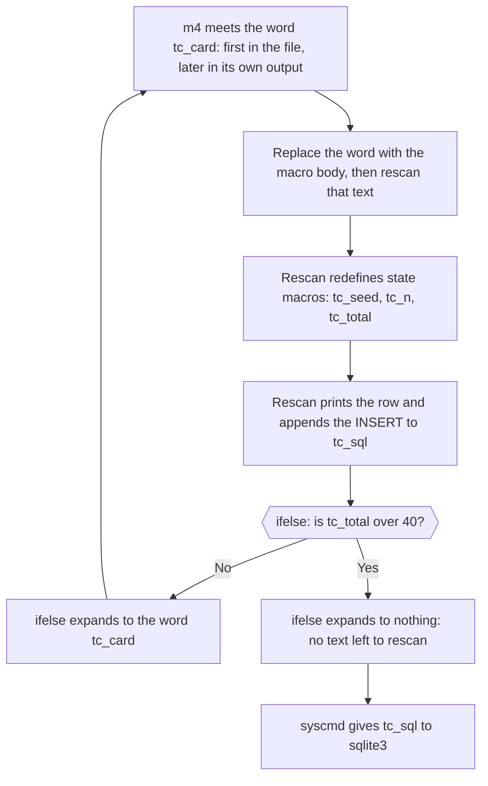

# m4 study guide

## What this guide is for

This guide reads one program: [`src/m4`](../../../src/m4/README.md). There is no weird sibling, because using a macro processor to run a program is already the stunt. The program has no loop statement and no variable. It has macros, and **what a macro expands to is scanned again**. The question is: **when the whole language is "read text, replace names, read the result", what do quoting, expansion order and rescanning each decide?**

When you finish, you should be able to:

1. Explain what m4 does with a macro name, a quoted string and a macro's replacement text, and in what order.
2. Explain why the brackets around `[tc_card()]` are the stop rule, in terms of *when m4 expands arguments*.
3. Trace the program through three cards, naming the macros that change and the text that is rescanned.
4. Explain why the recursion does not deepen the nesting, and what would deepen it.
5. Explain why every macro in this file starts with `tc_`.
6. Label each behavior as guaranteed, implementation-permitted, or accidentally exploited.

Scope limits. You need to know that a macro is a name with a replacement text. The guide does not teach every built-in, the 32-bit generator in detail, or the SQL. It uses GNU m4 1.4.x (the sandbox has 1.4.19). The book's page is [m4](../../languages/m4.md). For the ideas, see [Macros and text expansion](../../cs/05-formal-languages-as-computational-substrates.md#macros-and-text-expansion), [Fixed-point iteration](../../cs/03-control-flow-and-continuations.md#fixed-point-iteration) and [Recursion](../../cs/03-control-flow-and-continuations.md#recursion).

## Before you begin

**Safety model.** Every entry writes fictional **DEMO ONLY** data to a scratch SQLite file. m4 can run shell commands (`syscmd`, `esyscmd`), and this program uses all three: for entropy, for the clock, and to hand the finished SQL to `sqlite3`. Read the source before you run it, and run it in the sandbox first:

```bash
sandbox/container/run-image.sh src/m4
```

Edit only copies ([Running things safely](../../exercises.md#running-things-safely)). You can pin the run with `m4 -Dtc_seed=N -Dtc_week=2026-W47 timecards.m4`. A pinned seed must be 1 to 2147483646.

**Prediction rule.** Before each run, write down what m4 will read next, not only what it will print. In m4 the *input stream* is the machine's state.

**Vocabulary.**

| Term | Meaning here |
| --- | --- |
| Macro | A name with a replacement text. |
| Quote | `[` and `]` here. Quoted text is passed on without expansion. |
| Rescan | After a macro is replaced, m4 pushes the replacement back onto its input and reads it again. |
| Diversion | A numbered output buffer. `divert(-1)` discards what follows. |
| `dnl` | "Delete to newline": removes the rest of a line, including the newline. |

## The shared challenge

A *card* is a category and a whole number of hours from 10 to 19. Categories cycle through Meetings, Coding, Debugging and Learning. Add each card's hours to a running total and stop when it passes 40. The run **retains the first card that takes the total above 40**. A total of exactly 40 does *not* stop it: four 10-hour cards total exactly 40, and a fifth is drawn, with the category wrapping to Meetings. Final totals are 41 to 59, with 3 to 5 cards. Rows go into SQLite as one transaction and a summary is printed.

The m4 stop rule is the last line of `tc_card`: `ifelse(eval(tc_total > 40), 1, [], [tc_card()])` ([L82](../../../src/m4/timecards.m4#L82)). `eval(40 > 40)` is `0`, so the `ifelse` takes the else branch and the macro calls itself. A 5-card run exists: seed 4020 gives four 10-hour cards (total 40) and then a fifth card of 15, ending at 55. That run was checked in the sandbox and is now a case in the entry's `check.sh`.

## The machine to identify

**What repeats.** One macro, `tc_card`, whose last word is itself. There is no loop construct. After `tc_card` is replaced by its body, m4 *rescans* the body, and the final `ifelse` either yields nothing or yields the text `tc_card()`, which is read as another call.

**Where state lives.** In macros that redefine themselves: `tc_n` (card number), `tc_total` (running total), `tc_seed` (the generator's state) and `tc_sql` (a script that grows by "redefine yourself as yourself plus more", via `defn`) ([L28-29](../../../src/m4/timecards.m4#L28-L29), [L69](../../../src/m4/timecards.m4#L69)). There are no variables. A redefinition is the only assignment.

**What advances the next step.** The input stream. `ifelse` returns text, and that text is pushed back and read. The loop counter is *what m4 has not yet read*.

**What stops it.** `ifelse` returns the empty string `[]`. The input runs out, and m4 goes on to the code after the call.

**What commits.** Each card appends an `INSERT` to `tc_sql` and prints its row, both as the macro expands. After the loop, one `syscmd` hands the finished script (with `BEGIN` at the start and `COMMIT` at the end) to `sqlite3` through a here-document ([L95-98](../../../src/m4/timecards.m4#L95-L98)). Rows appear on the terminal *before* the commit. If `sqlite3` fails, `sysval` is non-zero and `m4exit(1)` ends the run, but the rows are already printed.

<!-- diagram-source: src/m4/README.md#program-flow -->



The diagram is a cycle, and the cycle passes through the input stream: the `ifelse` writes the word `tc_card` back to be read.

## Trace one run

The program draws pseudo-random hours from a Park-Miller generator written in 32-bit `eval` arithmetic. A pinned seed makes it deterministic. Seed **230** gives hours **15, 19, 12** (computed outside m4 and confirmed by running the entry in the sandbox with `-Dtc_seed=230`). The output was `Meetings 15 15`, `Coding 19 34`, `Debugging 12 46`, then `# committed total=46 entries=3 DEMO ONLY`.

| Pass | `tc_seed` after `tc_next` | Hours (`10 + seed / 1024 % 10`) | `tc_n` | `tc_total` | `eval(tc_total > 40)` | `ifelse` gives |
| --- | ---: | ---: | ---: | ---: | --- | --- |
| 1 | 3865610 | 15 | 1 | 15 | 0 | the text `tc_card()` |
| 2 | 544797860 | 19 | 2 | 34 | 0 | the text `tc_card()` |
| 3 | 1694845859 | 12 | 3 | 46 | 1 | nothing |

After pass 3 the input ends, the summary lines print, and `syscmd` runs.

**Is it recursion?** The usual reading is that each card nests one level deeper. m4's own tracing says otherwise. Running with `-t tc_card -t tc_total` printed the trace marks `m4trace: -1- tc_card` three times, all at depth 1. Then the nesting limit option confirmed it: with `-L 3` the run fails (m4 says `recursion limit ... exceeded`), and with `-L 4` it succeeds. That minimum was the same, 4, for the 3-card run (seed 230) and the 5-card run (seed 4020). The expansion of `tc_card` finishes before its output is rescanned, so the next `tc_card()` is read from the *input*, not called from inside the previous one. The loop is iteration written as text.

**Exactly 40.** With seed 4020 the cards are 10, 10, 10, 10 (total 40, so `eval(40 > 40)` is 0 and the macro continues) and then a fifth card of 15, total 55. The category of card 5 is `tc_category(5)`: `(5 - 1) % 4` is 0, which is Meetings.

## Compare the ordinary and weird designs

m4 has no idiomatic loop, so the comparison is between how an ordinary language would do each job and how this program does it.

| Dimension | Ordinary program | `m4` |
| --- | --- | --- |
| **Representation** | A loop and variables. | A macro that ends by naming itself, and macros that redefine themselves. |
| **Observability** | A debugger. | The trace options: `-t name` traces a macro, `-d` flags debug output, and the output itself shows the expansion. `m4 -L N` makes depth visible by failing. |
| **Tests** | Call a function with a seed. | Pin `tc_seed` and `tc_week` with `-D` and compare with a reference: the same seed gives the same cards. |
| **Debugging** | Look for the wrong value. | Look for the *wrong expansion time*. A quote in the wrong place makes m4 call a macro too early, and the program never stops. |
| **Portability** | Standard language. | GNU m4 extensions: `esyscmd`, `format`, and a 32-bit `eval`. `syscmd` is POSIX. |
| **Cost** | A loop costs nothing extra. | Every pass re-reads and re-expands text. The SQL script is a macro that is redefined with a longer body at each card, so the text is copied again every time: harmless at 5 cards, and the reason a thousand-card version would want another shape. |

**Why `tc_` on every name.** m4 expands *every* word that is a macro name, including words inside the SQL text. A macro called `row` or `total` would silently rewrite the SQL. A shared prefix keeps macro names out of the data's vocabulary. This is the m4 equivalent of an injection defense.

**Why the quotes were changed first.** By default `#` starts a comment and `'` closes a quote, and the output needs `# DEMO ONLY` lines and SQL strings. The first lines, `changecom()` and `changequote([, ])`, fix both before anything else happens. Everything until `divert(0)` is sent to diversion -1, so the definitions print nothing.

## What the exercises demonstrate

| Exercise | Predict first | What the evidence shows |
| --- | --- | --- |
| [B11. m4: quote the recursion](../../exercises.md#b11-m4-quote-the-recursion-verified), step 1 | Run twice with `-Dtc_seed=12345`. What differs? | The card rows are identical (`Meetings 19`, `Coding 13`, `Debugging 16`; totals 19, 32, 48). Only the run id, which contains the clock, can differ. The generator is a formula, so a pinned seed pins the cards. |
| B11, step 2 | Remove the brackets: `[tc_card()]` becomes `tc_card()`. What happens? | Without `-L`: `TIMEOUT after 20s` and no output. With `-L 50`: `recursion limit of 50 exceeded`, a non-zero exit and no `# committed` line. m4 expands arguments *before* it calls the macro, so the call runs while `ifelse` is still collecting its arguments, before it has decided anything. The brackets turn the name into text that is read only after `ifelse` chooses it. |
| B11, step 3 | Change `tc_total > 40` to `> 60`. | `check-demo.sh out.txt 60` passes. One number is the rule. |
| [C1. Weird next to boring](../../exercises.md#c1-weird-next-to-boring-verified) | Which state macro would you inspect first? | `tc_total` tells you the rule's input. `tc_sql` tells you what will be committed. |
| *Guide experiment* (verified in the sandbox) | Run with `-L 3`, `-L 4` and `-L 5`. Predict where it first works. | `-L 4`. The depth does not depend on the card count. It shows that the *bracketed* recursion does not nest, while the *unbracketed* recursion in B11 does. |

B11 step 2 and the `-L` experiment are two halves of one fact. With the brackets, the call is read from the input after `ifelse` has chosen, so the stack stays flat. Without them, the call is made while arguments are being collected, so each pass nests inside the previous one until the limit.

## Failure modes, costs, and boundaries

| Behavior | Label | Why |
| --- | --- | --- |
| A macro's replacement text is pushed back to the input and rescanned | **Guaranteed** | The defining behavior of m4, and what the whole program rests on. |
| `ifelse` groups its arguments in threes and treats a lone last argument as the else | **Guaranteed** | Documented. `tc_pick` repeats the tested value in every group because of it. |
| Quoted text is not expanded; arguments are expanded before the call | **Guaranteed** | Documented. This is the stop rule. |
| `esyscmd` and `format` | **Implementation-permitted** | GNU m4 extensions. A non-GNU m4 will not run the file. |
| `eval` is 32-bit, so the generator needs Schrage's trick | **Implementation-permitted** | GNU m4 1.4.x behavior, and the entry's README notes that the naive product overflows silently (`2147483647*4` gives `-4`). |
| `syscmd` runs the shell and sets `sysval` | **Guaranteed** by POSIX | Used to hand the SQL to `sqlite3`. |
| The loop does not deepen the nesting | **Guaranteed** by how rescanning works, observed with `-t` and `-L` | Checked in this guide, and now asserted by the entry's `check.sh` (the smallest working `-L` is the same for a 3-card and a 5-card run). |

**A documentation note, now fixed.** While this guide was prepared, the entry's README said, under "Recursion depth", that "every card nests one more expansion". The trace and the `-L` experiment disagreed: the nesting depth is constant. The README now says so, and explains that what does grow with the card count is the copying of `tc_sql`.

**Costs to state.**

- **Quoting errors fail late and silently.** A missing quote does not give an error at the line you wrote. It changes *when* something expands.
- **Every word is a candidate macro.** Data and code share one namespace. The `tc_` prefix is the only separation.
- **The SQL is not escaped.** Every value is a number or one of four fixed words. Do not feed user text into `tc_insert`.
- **The shell does the plumbing.** m4 computes; `syscmd` saves.
- **Where this is legitimate.** m4 is the engine behind `configure` scripts and many generated files. Rescanning is a real tool there. Using it as a loop is a stunt.

## Connections across the repository

- **Rescanning as a fixed-point loop.** The `sed` loop in [Regex engines and sed](regex-engines-and-sed.md) rewrites one line until a pattern stops matching, and [Make](make-and-cmake.md) restarts until no file is remade. All three run "until nothing changes".
- **Code and data in one namespace.** [Tcl](tcl.md) stores code as strings in a database. m4's data and macro names share one space, with the same lesson: whoever controls the text controls the program.
- **Lazy against eager, in a language with no values.** The quoting that decides when `tc_card()` is expanded is the m4 form of the question in [Evaluation, demand, and laziness](../concepts/evaluation-demand-and-laziness.md).
- **Formal languages as machines.** [Formal languages and weird machines](../concepts/formal-languages-and-weird-machines.md) places m4's rescanning beside the Markov algorithm.
- **In the book.** [m4](../../languages/m4.md), [Macros and text expansion](../../cs/05-formal-languages-as-computational-substrates.md#macros-and-text-expansion), [Fixed-point iteration](../../cs/03-control-flow-and-continuations.md#fixed-point-iteration) and [Term and string rewriting](../../cs/05-formal-languages-as-computational-substrates.md#term-and-string-rewriting).

## Self-check

Answer before you read the italic text after each question.

1. **Trace.** Hours are 18, 12, 10, 14. At the end of each pass, give `tc_total` and what `ifelse` returns. *(Totals 18, 30, 40, 54. For the first three passes the test `eval(tc_total > 40)` is 0 and `ifelse` returns `tc_card()`. After the fourth pass the total is 54, the test is 1, and `ifelse` returns nothing. The third pass, at exactly 40, continues.)*
2. **Explain.** Why must the last argument of `ifelse` be `[tc_card()]` with brackets? *(m4 expands arguments before it calls the macro. Without brackets, `tc_card()` would be called while `ifelse` is still collecting its arguments, so the loop would never reach the decision.)*
3. **Transfer.** Which construct in a language with tail-call optimization plays the part of "the replacement text is rescanned"? *(A tail call, where the last action of a function is a call to itself, which reuses the frame instead of adding one. Both are iteration written as recursion.)*
4. **Evidence.** The README says every card nests one more expansion. Design a test that could show it is wrong, and say what the negative control is. *(Run with a small `-L` on a 3-card seed and a 5-card seed. If the minimal working `-L` is the same, depth does not grow with cards. For the control, run B11's unbracketed variant, where depth does grow and any `-L` fails.)*

## Further reading

- [m4 (computer language)](https://en.wikipedia.org/wiki/M4_(computer_language)) (Wikipedia): the language, its history and where it is used.
- [Macro (computer science)](https://en.wikipedia.org/wiki/Macro_(computer_science)) (Wikipedia): text macros against syntactic macros.
- [GNU M4 manual](https://www.gnu.org/software/m4/manual/m4.html) (GNU Project): the authority for `ifelse`, `defn`, `divert`, `eval` and the trace options. Read the sections on quoting and on the order of expansion before you change any bracket.
- [Macros and text expansion](../../cs/05-formal-languages-as-computational-substrates.md#macros-and-text-expansion) (this book): the general idea.
