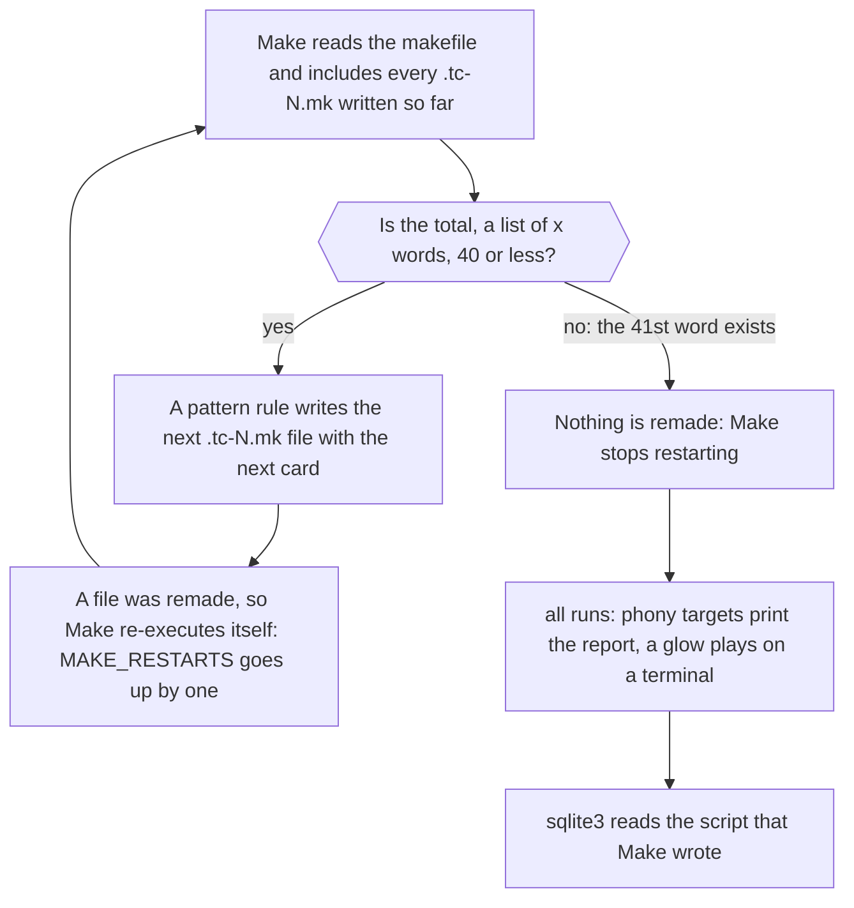
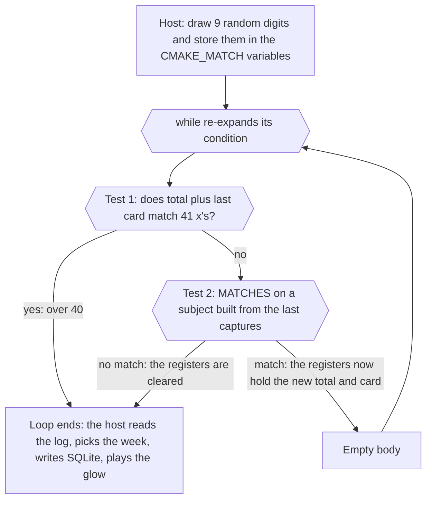

# Make and CMake study guide

## What this guide is for

This guide reads two build-tool programs that have no loop statement: [`src/make-gnu`](../../../src/make-gnu/README.md), where GNU Make *restarts itself* once per card, and [`src/cmake`](../../../src/cmake/README.md), where one `while()` with an empty body runs a register machine inside its condition. The question is: **when the tool, not the program, decides what runs next, where does the program's state live?**

When you finish, you should be able to:

1. Explain what makes GNU Make re-execute itself, and why the file system is the state.
2. Explain what `MATCHES` leaves behind in `CMAKE_MATCH_1` to `CMAKE_MATCH_9`, and why those variables can act as registers.
3. Trace each program through the same three cards, naming the state before and after each pass.
4. Explain why each stop rule is a *length* (41 words or 41 characters) rather than a comparison.
5. Label each behavior as guaranteed, implementation-permitted, or accidentally exploited, and say what a reproducibility check can and cannot prove.

Scope limits. You need to read a Makefile and know that `$(...)` expands a function or variable. You need to know that CMake runs scripts with `cmake -P`. This guide does not teach the calendar arithmetic in the Make entry (which computes an ISO week without a shell), the animated glow, or Windows Terminal support. It uses GNU Make and CMake 3.19 or later.

The book's page is [Make and CMake](../../languages/make-cmake.md). For the ideas, see [Build automation](../../cs/05-formal-languages-as-computational-substrates.md#build-automation), [Dependency graphs](../../cs/06-state-beyond-variables.md#dependency-graphs) and [Fixed-point iteration](../../cs/03-control-flow-and-continuations.md#fixed-point-iteration).

## Before you begin

**Safety model.** Every entry writes fictional **DEMO ONLY** data to a local SQLite file. Make and CMake are programs that *run other programs*: both start `sqlite3`, and Make runs `mkdir` and `rm`. Read the source before you run it, and run it in the sandbox first:

```bash
sandbox/container/run-image.sh src/make-gnu
sandbox/container/run-image.sh src/cmake
```

Work on a copy for any edit ([Running things safely](../../exercises.md#running-things-safely)). The Make entry refuses to start if it finds a leftover `.tc-*.mk` file from an interrupted run: `make clean` removes them.

**Prediction rule.** Before each run, write down which files will exist when each pass starts, or what each `CMAKE_MATCH_n` will hold, and what you would expect to see if you were wrong.

**Vocabulary.**

| Term | Meaning here |
| --- | --- |
| Remake | GNU Make's step of bringing a *makefile itself* up to date. If it was rebuilt, Make re-executes itself. |
| `MAKE_RESTARTS` | A variable that Make sets to the number of times it has re-executed itself. |
| Pattern rule | A rule with `%` that says how to build any file matching a name. |
| `CMAKE_MATCH_n` | CMake variables that hold capture group *n* after a successful `MATCHES` or `string(REGEX ...)`. |
| Unary | A number written as that many copies of one symbol. Both programs count in `x`. |

## The shared challenge

A *card* is a category and a whole number of hours from 10 to 19. Categories cycle through Meetings, Coding, Debugging and Learning. Add each card's hours to a running total and stop when the total passes 40. The run **retains the first card that takes the total above 40**. A total of exactly 40 does *not* stop it: four 10-hour cards make exactly 40, so a fifth card is drawn, and since there are only four categories it reuses Meetings. Final totals are 41 to 59, with 3 to 5 cards. The rows go into SQLite and the program prints a summary.

Both programs write numbers in unary, so the stop rule becomes a question about length, and the boundary is easy to get wrong by one. In Make the test is *"does a 41st word exist?"* (`$(word 41, ...)`, [L111](../../../src/make-gnu/Makefile#L111)). In CMake it is *"does the total match 41 `x` characters?"* ([L41](../../../src/cmake/timecards.cmake#L41)). A total of 40 has no 41st word and does not match 41 characters, so both continue.

## The machine to identify

**What repeats.** In `make-gnu`, the *whole Make process*: Make reads the makefile, includes every `.tc-N.mk` file written so far, and may write one more. In `cmake`, a `while()` with an empty body: only its condition does any work ([L41-54](../../../src/cmake/timecards.cmake#L41-L54)).

**Where state lives.** In `make-gnu`, in *which files exist* (`.tc-0.mk`, `.tc-1.mk`, ...) and in `MAKE_RESTARTS`. Each file holds one card as two variable assignments, such as `C0:=Meetings` and `H0:=15`. In `cmake`, in five variables that the program does not declare: `CMAKE_MATCH_1` is the total so far, `_2` is the digit peeked on the last pass, `_3` is the rest of a random digit tape, `_4` is the log of finished cards, and `_5` is the hours of the card added last pass ([L28-32](../../../src/cmake/timecards.cmake#L28-L32)). All numbers are runs of `x`.

**What advances the next step.** In `make-gnu`, a file that gets *written*. A makefile that has been remade makes Make start over, and the pattern rule `.tc-%.mk` writes the next card file ([L110-111](../../../src/make-gnu/Makefile#L110-L111)). In `cmake`, `while()` re-expands its condition on every pass, and the condition builds its next subject string and pattern out of the previous pass's captures.

**What stops it.** In `make-gnu`, the rule *declines to write a file*. If a 41st word exists, the recipe expands to nothing, no file appears, Make has nothing to restart for, and the default goal `all` runs. In `cmake`, the first of the two tests in the condition: `NOT` (total plus last card matches 41 `x`s). Or the main `MATCHES` fails.

**What commits.** Both build a SQL script, then hand it to `sqlite3`: Make writes `.rows.sql` with `$(file ...)` and runs `sqlite3 $(DB) <.rows.sql`; CMake does the same with `file(WRITE)` and `execute_process`. The script's last statement tests the stop rule *inside SQLite*: it inserts `total <= 40` into a table whose only column has `CHECK(ok=1)`. When the rule is right, the insert fails and SQLite prints a named constraint error on stderr. That message is the stop rule announcing itself, not a program failure. The rows on the terminal are printed by the tool, not by SQLite.

Here are the two Program Flow diagrams from the entries.

<!-- diagram-source: src/make-gnu/README.md#program-flow -->



The Make loop is a cycle through the file system: read the files, write one more, restart. The state is the set of files that exist.

<!-- diagram-source: src/cmake/README.md#program-flow -->



The CMake loop is a cycle through one expression. The test boxes are in the order the source uses. That order is not decoration, as the trace shows.

## Trace one run

The programs draw random hours. Use hours **15, 19, 12** for the trace. To check it against real behavior, scratch copies were run in the sandbox with the random digits replaced by fixed ones and with print statements added.

### GNU Make

The scratch copy printed one line at the top of every Make process. The Make clock was fixed with `NOW=1700000000`. The output was:

```text
pass K=0: files=[] HOURS=[] total=0 41st-word-exists=no
pass K=1: files=[.tc-0.mk] HOURS=[15] total=15 41st-word-exists=no
pass K=2: files=[.tc-0.mk .tc-1.mk] HOURS=[15 19] total=34 41st-word-exists=no
pass K=3: files=[.tc-0.mk .tc-1.mk .tc-2.mk] HOURS=[15 19 12] total=46 41st-word-exists=yes
# committed total=46 entries=3 DEMO ONLY
# make re-executed itself 3 times, once per card
```

| Pass (`MAKE_RESTARTS`) | Files at the start | Total | Rule fires? | What happens |
| --- | --- | ---: | --- | --- |
| 0 | none | 0 | yes | Writes `.tc-0.mk` with Meetings and 15 hours. A file was remade, so Make restarts. |
| 1 | `.tc-0.mk` | 15 | yes | Writes `.tc-1.mk`, Coding, 19 hours. Restart. |
| 2 | `.tc-0.mk`, `.tc-1.mk` | 34 | yes | Writes `.tc-2.mk`, Debugging, 12 hours. Restart. |
| 3 | all three | 46 | **no**: the 41st word exists | Nothing is written. No restart. The goal `all` runs and prints the report. |

Pass 3 is the stop. The crossing card (12 hours, from `.tc-2.mk`) was written at the end of pass 2, when the total was 34. The rule checks the total *before* it writes, so it cannot refuse to write the crossing card. It can only refuse to write the card *after* it. That is the same shape as "retain the first card over 40", seen from the other side.

### CMake

The scratch copy replaced the random tape with the digits 5, 9, 2 (so hours 15, 19, 12) and printed the registers after each pass. `CMAKE_MATCH_n` is written `M1` to `M5` below.

```text
seed        : total(M1)=0  peeked(M2)=5  tape(M3)=92000000  log-length(M4)=0   last-card(M5)=0
after pass 1: total(M1)=0  peeked(M2)=9  tape(M3)=2000000   log-length(M4)=1   last-card(M5)=15
after pass 2: total(M1)=15 peeked(M2)=2  tape(M3)=000000    log-length(M4)=17  last-card(M5)=19
after pass 3: total(M1)=34 peeked(M2)=0  tape(M3)=00000     log-length(M4)=37  last-card(M5)=12
loop ended  : total(M1)=46 peeked(M2)=0  tape(M3)=0000      log-length(M4)=50  last-card(M5)=10
Meetings 15 15 / Coding 19 34 / Debugging 12 46
# an empty while() went round 3 times, once per card
```

(Lengths are the number of `x` characters or dashes. The lines are reformatted for width.)

Read it this way. **The hours of a card are looked up one pass late.** The digit 5 is in the seed, and pass 1 looks it up in the table inside the subject (the row `5:xxxxxxxxxxxxxxx`) and finds 15 `x`s, while peeking the next digit, 9. Pass 2 looks up 9 and finds 19. Pass 3 looks up 2 and finds 12.

| Evaluation | Test 1: total + last card, 41 `x`s? | Test 2 result | State after |
| --- | --- | --- | --- |
| 1 | 0 `x`s: no, so continue | matches; looks up digit 5 | last card 15, total 0 |
| 2 | 15 `x`s: no | matches; looks up 9 | last card 19, total 15 |
| 3 | 34 `x`s: no | matches; looks up 2 | last card 12, total 34 |
| 4 | 46 `x`s: **yes**, so the loop ends | *also ran* | log now holds all three cards; last card is a fourth, unused lookup (10) |

The last row is the surprise, and it is why this program is classed as accidentally exploited. The condition is `NOT (stop test) AND (main match)`. When the stop test says stop, the loop ends, but the *main match still ran in that same evaluation*, with the registers from pass 3. The log after pass 3 had only two cards (length 37 is `-`, 15 `x`, `-`, 19 `x`, `-`). The third card, 12 hours, moves into the log only in evaluation 4. The program needs the main match to run when the loop ends, because that is how the last card gets logged. The fifth register then holds a fourth lookup (10 hours) that the host never reports, because the host reads only the log (`CMAKE_MATCH_4`). I could not find a promise in the CMake documentation that both operands of `AND` are always evaluated, so treat this as observed, not guaranteed. The entry's source comment and README now record this dependence.

**Exactly 40.** With hours 10, 10, 10, 10, the total after four cards is 40 `x`s, which does not match 41 characters. The loop continues, and a fifth card is looked up.

## Compare the ordinary and weird designs

The "ordinary" version of each is the program the authors threw away or wrote first. For CMake it is a `while()` loop with `math(EXPR)` and `list(GET)`. The README records discarding it because it was "`RunEverything()` in CMake's accent". For Make there is no ordinary version in the repository: Make has no loop. The comparison below is between the tool's *intended* job (a dependency graph) and what these programs make it do.

| Dimension | Make as intended | `make-gnu` | `cmake` |
| --- | --- | --- | --- |
| **Representation** | A graph: targets, prerequisites, recipes. | Numbers are lists of `x`. Control is "a file appeared". | Numbers are strings of `x`. Control is a regex match whose captures feed the next match. |
| **Observability** | `make -n` shows what would run. | The state is the files in the directory. `ls .tc-*.mk` and `$(info ...)` show it. | The state is hidden in variables the program never declares. You must print them (as the scratch run did) to see them. |
| **Tests** | Build a target; compare output. | `check.sh` runs Make 25 times in an empty directory and requires the directory to be empty afterward. | `check.sh` runs it 25 times and mutates the 41-character literal to 51, then expects totals to go over the legal maximum. |
| **Debugging** | Read the dependency graph. | A crashed run leaves `.tc-*.mk` behind and the next `make` refuses to start. | A condition that fails clears every register: a typo in the stop test may produce an empty report, not an error. |
| **Portability** | GNU Make and POSIX Make differ on many details. | Uses GNU extensions (`$(file ...)`, `$(wordlist ...)`, `MAKE_RESTARTS`). Reads `/proc` for entropy and the clock, so it is Linux-specific. | Needs CMake 3.19 or later. Its regex has no counted repetition, no lookahead, no backreferences. |
| **Cost** | Normal. | Make restarts once per card and the unary arithmetic is slow in proportion to the numbers (the ruler is 60,000 words long). | Cheap, but a tempting 40-way `(x?x?...)` for "at most 40" would backtrack exponentially on failure. |

**Reproducibility.** The programs show two different answers to the question of what depends on the clock. Make reads the clock from `/proc` and lets you override it (`NOW=1700000000`), so the week in the output is a pure function of the override. CMake asks `string(TIMESTAMP)`, which honors `SOURCE_DATE_EPOCH`. The *cards* are random in both, so a reproducibility check can fix the week but not the totals. What the check proves is bounded by what it controls.

## What the exercises demonstrate

| Exercise | Predict first | What the evidence shows |
| --- | --- | --- |
| [B4. Make: remove the no-op, and override the clock](../../exercises.md#b4-make-remove-the-no-op-and-override-the-clock-verified), step 1 | Delete the trailing `@:` from the recipe. What happens? | The run ends `# committed total=0 entries=0` and `make re-executed itself 0 times`. The card file is written while the recipe line is *expanded*, but Make restarts only if a command *ran*. A recipe that expands to nothing is not a remake. The `@:` is the one place the loop needs a shell at all. |
| B4, step 2 | Run with `NOW=1700000000`. Which ISO week do you expect? | `2023-W46`, which agrees with `date -u -d @1700000000 +%G-W%V`. The clock is an input you can fix. |
| [B5. CMake: mutate the literal](../../exercises.md#b5-cmake-mutate-the-literal-verified) | Shorten the 41-`x` literal to 31. What is the new stop rule? | Stop on the first total over 30. The shared checker passes with limit 30, and the entry's own check fails. The literal *is* the stop rule. |
| B5, the order question | Why must the stop test come first in the `while()` condition? | The first test's match clears or rewrites the capture registers. The main match must run last so its captures are the ones that survive. The scratch trace shows the consequence: the main match runs even on the final evaluation. |
| [C1. Weird next to boring](../../exercises.md#c1-weird-next-to-boring-verified) | What is the state of each program, and who can read it? | Make's state is files, readable with `ls`. CMake's is five hidden variables, readable only if you print them without disturbing them (see below). |

**A trap when instrumenting CMake.** The scratch run first printed the registers with a helper that called `string(REGEX REPLACE ...)`. That command *also* writes `CMAKE_MATCH_n`, so it erased the registers and the loop ended at once, with zero cards. Looking at this program changes it unless you look through commands that do not touch the registers. `string(LENGTH ...)` does not, and it is what the trace above used.

## Failure modes, costs, and boundaries

| Behavior | Label | Why |
| --- | --- | --- |
| Make re-executes itself after it remakes an included makefile, and `MAKE_RESTARTS` counts the restarts | **Implementation-permitted** | Documented GNU Make behavior (see "Remaking Makefiles" in the GNU Make manual, linked below). It is a GNU feature, not POSIX. |
| Using that restart, triggered by a file the rule creates, as a loop | **Accidentally exploited** | This is the book's own example of the label. The feature exists to keep generated makefiles current. Nobody promised it for counting cards. |
| A recipe that expands to nothing does not count as remaking the file | **Accidentally exploited** | The loop needs it, and it is observed rather than promised. Verified in exercise B4: delete `@:` and the restart never happens. |
| A file going from missing to present is an unambiguous change; a rewritten file may look unchanged on a filesystem with coarse timestamps | **Implementation-permitted** | The README records that its first design rewrote one state file and restarted only once, on WSL. One file per pass avoids the problem. |
| `MATCHES` sets `CMAKE_MATCH_n`, and `while()` re-expands its condition each pass | **Guaranteed** by the documentation | Both are documented. |
| A failed match clears every register | **Implementation-permitted** | Observed, not promised in so many words. |
| The main match runs in the same evaluation where the stop test says stop | **Accidentally exploited** | Observed in the scratch trace. The program needs it to log the last card. I found no promise of it in the CMake documentation. |
| Reading `/proc/stat`, `/proc/uptime` and the kernel's uuid with `$(file </...)` | **Implementation-permitted** | Linux only. It is how the Make entry avoids `$(shell)`. |

**Costs to state.**

- **The state is outside the program.** In Make, a crashed or interrupted run leaves files behind, and the next run reads them as real cards. The entry refuses to start rather than trust them. That is a *protection against its own control state being polluted*.
- **Make expands every line of a recipe before it runs any of them**, so the report must be a chain of phony targets (`init`, `rows`, `footer`) to keep SQLite's header and the rows in order.
- **CMake output cannot happen inside a condition.** Printing, SQL and the ISO week are ordinary CMake after the loop. This is the "tiny host reports a result" allowance.
- **Tests that look inside can break the machine.** See the trap above.
- **Where the technique is legitimate.** Make restarting itself is exactly how automatic dependency generation works. CMake regex captures legitimately parse versions and paths. The stunt uses the same features for arithmetic.

## Connections across the repository

- **Control state outside variables.** [COBOL](cobol.md) keeps it in a jump target and [Forth](forth.md) in a parse position. Make keeps it in files and CMake in captures. [Tcl](tcl.md) keeps it in a database trigger. The concept guide [State and control beyond variables](../concepts/state-and-control-beyond-variables.md) lines them up.
- **Rewriting until nothing changes.** [m4](m4.md) rescans its output, and [sed](regex-engines-and-sed.md) can loop with a branch. Make's restart is the same fixed-point idea with files as the text.
- **A regex that is the program.** [Regex engines and sed](regex-engines-and-sed.md) puts the loop inside a single match. CMake lets the loop re-expand a regex on every pass.
- **Reproducibility.** [Portability, abstraction, and cost](../concepts/portability-abstraction-and-cost.md) covers deterministic builds and what a fixed clock does and does not prove.
- **In the book.** [Make and CMake](../../languages/make-cmake.md), [Build automation](../../cs/05-formal-languages-as-computational-substrates.md#build-automation) and [Dependency graphs](../../cs/06-state-beyond-variables.md#dependency-graphs).

## Self-check

Answer before you read the italic text after each question.

1. **Trace.** In `make-gnu`, hours are 11, 11, 11, 11 (total 44). How many times does Make re-execute itself, and in which pass does the rule decline to write? *(Four times. Passes 0 to 3 each write one card file, and in pass 4 the total is 44, so the 41st word exists and the rule writes nothing. `MAKE_RESTARTS` is 4 at the end.)*
2. **Explain.** Why does deleting `@:` from the recipe give `entries=0`? *(The `$(file ...)` that writes the card runs while the recipe line is expanded, but if the line expands to no command, Make treats the file as not remade. No file counts as remade, so Make never restarts and the first pass reports zero cards.)*
3. **Transfer.** Suppose the CMake condition were written with the main match first and the stop test second. Predict the output. *(The run reports zero cards. This was checked in a scratch copy. The main match sets the registers, then the stop test's own `MATCHES`, which has no capture groups and fails on the small total, clears all of them. The next evaluation starts from empty registers and the loop ends. The first order exists so that the match whose captures you need runs last.)*
4. **Evidence.** A reviewer claims: "Make's loop needs a shell exactly once." Design a test that could fail, and say what the negative control is. *(Check that the only commands in the recipes are `mkdir`, `sqlite3`, `rm`, `sleep` and the no-op `:`, which the entry's `check.sh` does. For a control, add a `$(shell date)` and expect the check to fail. The claim is the entry's own and is classified as implementation-permitted.)*

## Further reading

- [Make (software)](https://en.wikipedia.org/wiki/Make_(software)) (Wikipedia): what Make is for and how its dependency rules work.
- [CMake](https://en.wikipedia.org/wiki/CMake) (Wikipedia): a broad orientation. The CMake manual describes `if()` and `while()` conditions, but its host is not on this book's allowlist, so read it from your installed copy with `cmake --help-command while`.
- [Remaking Makefiles](https://www.gnu.org/software/make/manual/html_node/Remaking-Makefiles.html) (GNU Make manual): the official statement that Make re-executes itself after it remakes an included makefile. Everything in the Make entry rests on it.
- [Reproducible builds](https://en.wikipedia.org/wiki/Reproducible_builds) (Wikipedia): why a build that reads the clock needs an override like `SOURCE_DATE_EPOCH`.
- [Fixed-point iteration](../../cs/03-control-flow-and-continuations.md#fixed-point-iteration) and [Reproducibility and deterministic builds](../../cs/08-abstraction-leaks-and-implementation-dependence.md#reproducibility-and-deterministic-builds) (this book): the two ideas these programs lean on.
