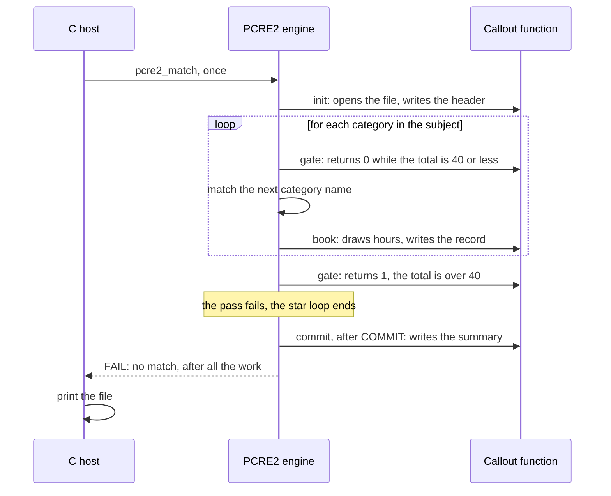
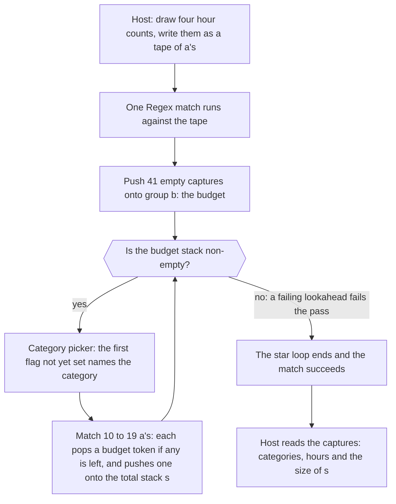
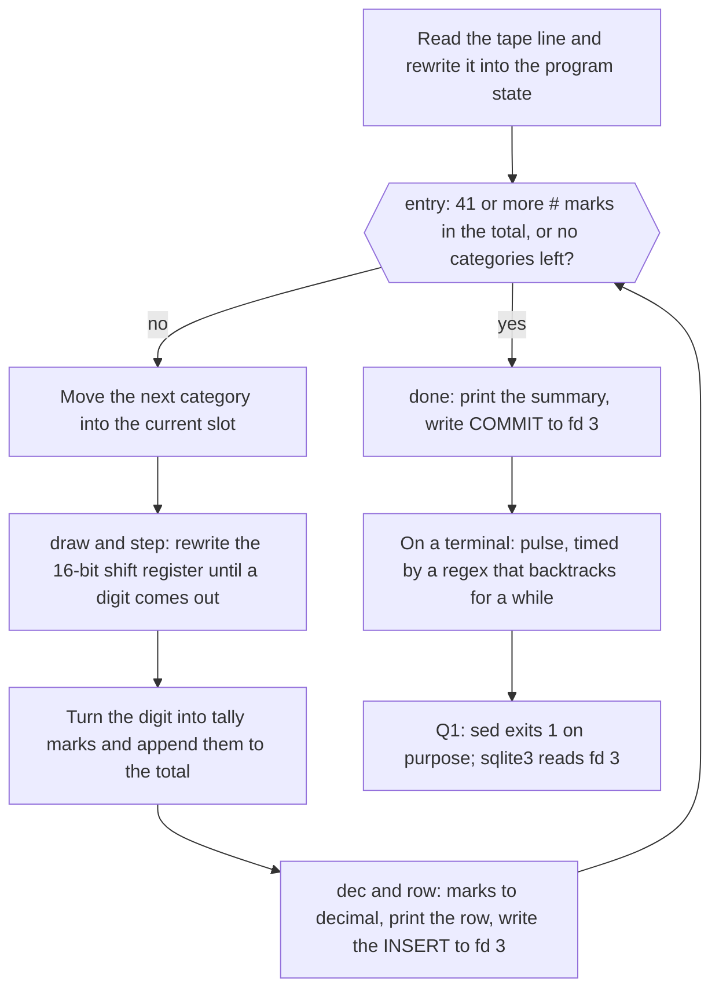

# Regex engines and sed study guide

## What this guide is for

This guide reads five programs that use a regular-expression engine, or a stream editor built on one, as the whole machine: [`regex-perl`](../../../src/regex-perl/README.md), [`regex-pcre2`](../../../src/regex-pcre2/README.md), [`regex-pcre2grep`](../../../src/regex-pcre2grep/README.md), [`regex-dotnet`](../../../src/regex-dotnet/README.md) and [`regex-sed`](../../../src/regex-sed/README.md). The question is: **a match is a search, a substitution is a rewrite. What does each engine keep, undo and lose when the search fails?**

When you finish, you should be able to:

1. Explain the difference between *searching* (one match that explores and abandons paths) and *rewriting* (a loop of substitutions over one string), and say which entries are which.
2. Say what survives a failed match in each engine: Perl's `local`, PCRE2's C state, pcre2grep's database writes, .NET's captures, sed's pattern space.
3. Explain what `(*COMMIT)`, `(*FAIL)` and a callout's return value do, and why the order of the pieces matters.
4. Trace PCRE2, .NET and sed through a fixed run and name the state at each step.
5. Explain why the regex entries can run at most four cards, what that does to the "exactly 40 continues" rule, and how a backtracking pattern becomes a denial-of-service risk.
6. Label each behavior as guaranteed, implementation-permitted, or accidentally exploited.

Scope limits. You need to know what a capture group, a greedy quantifier and alternation are. The guide does not teach regex syntax from scratch, the SQL, or the terminal "pulse" animation. It covers Perl 5, PCRE2 10.x, pcre2grep with callout scripts, .NET 10 and GNU sed. For the theory, see [Regular expressions](../../cs/05-formal-languages-as-computational-substrates.md#regular-expressions) and [Backtracking](../../cs/07-effects-errors-and-commitment.md#backtracking) in the book. The language page is [Regular expressions: five engines](../../languages/regex.md).

## Before you begin

**Safety model.** Every entry writes fictional **DEMO ONLY** data. This family is the most dangerous to run unread. A Perl pattern here runs Perl code and starts `sqlite3`, a PCRE2 callout runs host C, and `pcre2grep` callouts start programs. Read the source first and run it in the sandbox first:

```bash
sandbox/container/run-image.sh src/regex-pcre2
sandbox/container/run-image.sh src/regex-dotnet
sandbox/container/run-image.sh src/regex-sed
```

Edit only copies ([Running things safely](../../exercises.md#running-things-safely)). Two warnings from experience. First, `regex-sed` writes SQL to file descriptor 3. Run its script only through the entry's wrapper, or in the sandbox with `3>/dev/null`. While this guide was being prepared, a harness that left fd 3 closed let the script's `w /dev/fd/3` open the *script file itself* and overwrite it. Second, run any sed or regex experiment on a scratch copy, never in your checkout.

**Prediction rule.** Before each run, write down what state each engine holds when the match ends, and what you would see if the match failed instead.

**Vocabulary.**

| Term | Meaning here |
| --- | --- |
| Backtracking | When a path fails, the engine returns to the last choice point and tries the next alternative. |
| `(*COMMIT)` | Once the match gets past this point, backtracking may not retry before it. |
| `(*FAIL)` | Fail at once. Used here to end a pass or the whole match. |
| Callout | A point in a PCRE2 pattern where the engine calls out to host code. Its return value says continue, fail this path, or abort. |
| Balancing group | A .NET group that pops one capture stack and pushes another. |
| Pattern space | sed's working buffer: one line of text. |

## The shared challenge

A *card* is a category and a whole number of hours from 10 to 19. Categories cycle through Meetings, Coding, Debugging and Learning. Add each card's hours to a running total and stop when it passes 40. The run **retains the first card that takes the total above 40**. A total of exactly 40 does *not* stop it: four 10-hour cards total exactly 40, so a fifth is drawn. Final totals are 41 to 59, with 3 to 5 cards.

This family cannot fully obey that last sentence, and the guide treats that as a finding, not an error in your reading. Each regex entry walks a *finite list of four category names* (the subject string, the scaffold, or sed's `cats:` list). When the four names run out, the loop ends, whatever the total is. A run of four 10-hour cards ends at exactly 40 with four rows. That has probability one in 10,000 per run, so the entries pass their own checks, and the repository's own `check.sh` files accept "four entries" as a legitimate stop. But the shared checker, `lessons/tools/check-demo.sh`, rejects such a run (see Trace). Everywhere else in the book, exactly 40 continues. Here it can only continue if a fifth name exists.

## The machine to identify

The five entries split into two models of computation. *Searching:* Perl, PCRE2, pcre2grep and .NET are one match, and the work happens along the paths the engine explores. *Rewriting:* sed is a loop of substitutions, and the program is a sequence of find-and-replace steps over one line.

**What repeats.** In Perl, a greedy quantifier, `(?: ... )*`, whose body is a code block ([L7](../../../src/regex-perl/timecards.pl#L7)). In PCRE2, the same shape with callouts: `(?:(?C"gate")(Meetings|Coding|Debugging|Learning)(?C"book"))*` ([L24-26](../../../src/regex-pcre2/timecards.c#L24-L26)). In pcre2grep, the same, with callouts that run `sqlite3` ([L14-20](../../../src/regex-pcre2grep/timecards.sh#L14-L20)). In .NET, `(?: ... )*` over a pattern of balancing groups only ([L13](../../../src/regex-dotnet/Program.cs#L13)). In sed, a jump back to the label `:entry`, taken by `b` and `t` behind regex addresses ([timecards.sed](../../../src/regex-sed/timecards.sed)).

**Where state lives.** Perl: package variables `$::t` and `$::n`, assigned with `local`. PCRE2: a C struct that the callouts share. pcre2grep: SQLite, which each callout re-reads. .NET: *stack depth*, in the captures of group `b` (the budget) and group `s` (the total). sed: one line of text. Numbers are runs of `#` (tally marks), random numbers are a 16-character string of 0s and 1s, and even the return address of a subroutine is text.

**What advances the next step.** Perl and PCRE2: the engine reaches the next pass of the quantifier. pcre2grep: the exit code of a program the callout ran. .NET: the engine matches 10 to 19 letters `a`, each popping one budget token. sed: a `b` or `t` jump that goes back to `:entry`.

**What stops it.** Perl: a postponed block that returns the next category as a *pattern*, or `(*FAIL)` once the total passes 40 or the names run out. PCRE2: `gate` returns 1 when the total is over 40. pcre2grep: SQLite refuses to insert "total is at most 40" into a `CHECK(ok=1)` column, so `sqlite3` exits non-zero, which vetoes the branch. .NET: when the budget stack is empty the pass hits `(?!)`. sed: `/ tot:#{41}/b done`, which asks whether 41 tally marks occur.

**What commits.** In Perl and PCRE2, the work is done by side effects that survive the failed match: the transaction really commits, and the match then returns false. In pcre2grep, each callout is its own `sqlite3` process, so each statement commits at once. There is no outer transaction. In .NET, *nothing commits inside the match*: a regex cannot write. The host reads the captures after the match and writes the file. In sed, the SQL goes to fd 3 for `sqlite3` to read, with `BEGIN` and `COMMIT` in the stream.

<!-- diagram-source: src/regex-pcre2/README.md#program-flow -->



The PCRE2 diagram is a conversation: the engine calls back into C at every callout, and the return value is the decision.

<!-- diagram-source: src/regex-dotnet/README.md#program-flow -->



The .NET diagram has no callback at all. The only output is what the engine captured.

<!-- diagram-source: src/regex-sed/README.md#program-flow -->



The sed diagram is a flowchart with a real cycle, because sed has a goto. It is a rewriting machine with a program counter, not a single match.

## Trace one run

The entries draw random hours, and in this family the hours are not always under your control. For PCRE2 and .NET, the trace uses scratch copies with the random draws replaced by fixed values, run in the sandbox (PCRE2) or locally from a scratch folder (.NET). For sed, the entry has a seed: the README's seed `1011001110100101` always gives the same cards, so it is a fixed run, with hours 15, 14, 14 instead of 15, 19, 12. All three were run to check this section.

### PCRE2: the callout conversation

With hours 15, 19, 12, and a line of output added to stderr at each callout, the run printed:

```text
  gate:   total=0, returns 0
  book:   matched Meetings, hours=15, total now 15
  gate:   total=15, returns 0
  book:   matched Coding, hours=19, total now 34
  gate:   total=34, returns 0
  book:   matched Debugging, hours=12, total now 46
  gate:   total=46, returns 1
  commit: total=46 entries=3
pcre2_match returned -1 (no match)
```

| Callout | State before | Return | Effect |
| --- | --- | --- | --- |
| `init` | none | 0 | opens the file, writes the header |
| `gate` | total 0 | 0 | continue |
| `book` (Meetings) | total 0 | 0 | draws 15, total 15, writes the row |
| `gate` | total 15 | 0 | continue |
| `book` (Coding) | total 15 | 0 | 19, total 34 |
| `gate` | total 34 | 0 | continue |
| `book` (Debugging) | total 34 | 0 | 12, total 46 |
| `gate` | total 46 | **1** | fail this branch: the `*` ends |
| `commit` | total 46 | 0 | after `(*COMMIT)`, writes the summary once |
| match result | none | none | `(*FAIL)`: `pcre2_match` returns -1 (no match) |

The crossing card is already booked when the gate fires. That is the rule "keep the first card over 40": the gate tests *before* each category, so it rejects the card *after* the crossing one. The match returned no match, and the file still holds three rows and a summary.

### .NET: the budget stack

The scratch copy drew from the command line instead of `Random`. With draws `15 19 12 17` it printed three rows and `# captured total=46 entries=3`. The fourth draw was ignored. The trace in terms of stacks:

| Step | Budget stack `b` | Total stack `s` | What the pattern does |
| --- | --- | --- | --- |
| Start | 41 tokens | 0 | `(?:(?<b>)){41}` pushes the budget |
| Pass 1: Meetings | 41, then 26 | 15 | stack `b` non-empty, picker takes Meetings, 15 letters `a` each pop one `b` and push one `s` |
| Pass 2: Coding | 26, then 7 | 34 | 19 letters |
| Pass 3: Debugging | 7, then 0 | 46 | 12 letters: the first 7 pop a token and the last 5 pop nothing, because the conditional `(?(b)...)` finds the stack empty |
| Pass 4 test | 0 | 46 | `(?(b)...|(?!))` finds `b` empty and takes `(?!)`, which fails the pass. The `*` ends and the match *succeeds* |

The crossing card can overshoot the budget in the middle of its hours. Only the next pass is refused.

**The boundary the family cannot cross.** The scratch copies were also run with four 10-hour draws. Both the PCRE2 and the .NET copy stopped with `total=40 entries=4`. After `Learning` there is no fifth category name in the subject, so no fifth pass can start, although 40 is not over 40. For PCRE2, the shared checker confirmed it:

```text
$ bash lessons/tools/check-demo.sh out.txt
FAIL: final total 40 does not pass 40
```

The same holds for the Perl entry (its postponed block returns `$::c[$::n] // '(*FAIL)'`, which fails when the four names are used up) and for sed (`/ cats: /b done`). Only PCRE2 and .NET were run with forced draws. For Perl and sed this is read from the code.

### sed: one line, rewritten

`TRACE=1` prints sed's state line at every loop head. With the README's seed, the state at each `:entry`, without its unchanging prefix, was:

```text
rng:1011001110100101 cats:Meetings,Coding,Debugging,Learning, tot: n:
rng:0101101100111010 cats:Coding,Debugging,Learning, tot:############### n:%
rng:0100101001011011 cats:Debugging,Learning, tot:############################# n:%%
rng:0100010010100101 cats:Learning, tot:########################################### n:%%%
```

| Loop head | Total (marks) | Categories left | `/ tot:#{41}/` | Next |
| --- | ---: | --- | --- | --- |
| 1 | 0 | four | no match | take Meetings, draw 15 |
| 2 | 15 | three | no match | take Coding, draw 14 |
| 3 | 29 | two | no match | take Debugging, draw 14 |
| 4 | **43** | one | **match** | `b done`: print the summary, write `COMMIT` |

The rows were `Meetings 15 15`, `Coding 14 29` and `Debugging 14 43`, with `# committed total=43 entries=3`. Each trip between loop heads rewrites the shift register to produce a digit, rejects draws of 10 to 15 (`/ rng:1(01|1)/b draw`) and turns the accepted digit into tally marks. The number of state lines per card is not constant, because a rejected draw repeats a step. Learning was never used: the stop rule fired first. Had the total been 40 at the fourth head, `cats:` would hold one name and a fourth card would be drawn. The list, not the total, would stop the fifth.

## Compare the ordinary and weird designs

There is no ordinary version of this family in the repository: the "ordinary" way to do the challenge is any entry in another language. The useful comparison is between the five regex designs.

| Dimension | Perl | PCRE2 | pcre2grep | .NET | sed |
| --- | --- | --- | --- | --- | --- |
| **Representation** | Code blocks in the pattern | Callout names as opcodes | Callout scripts that name programs | Balancing groups as stacks | Substitutions on one line |
| **State** | `local` variables | C struct | SQLite | stack depth | the line |
| **Observability** | Hidden in package variables | `gdb`, or printing in the dispatcher | `sqlite3` log | Only the final captures | The whole machine is one printable line (`TRACE=1`) |
| **Tests** | Run it and read the database | Same, plus the host is ordinary C | Black box: the pattern and the exit codes | Fix the draws and read the captures | Same seed gives same cards, so the output is testable |
| **Portability** | Perl 5 code-block features | Needs a PCRE2 built with callouts; no JIT | Needs an upstream build with callout scripts | Any .NET | GNU sed only (`T`, `Q`, `--debug`, `-E` intervals) |
| **Cost** | Cheap | Optimizer switched off to keep callouts honest | One process per callout | No side effects possible | about 137 commands per card; a deliberately slow regex as a clock |

Searching and rewriting differ in a way worth stating. A single match always finishes, because the input is fixed and the engine tries a bounded number of paths. A loop of substitutions can run for ever, which is why rewriting systems are universal and why sed's check needs the stop rule to be real.

## What the exercises demonstrate

| Exercise | Predict first | What the evidence shows |
| --- | --- | --- |
| [B8. Regex: what survives a failed match](../../exercises.md#b8-regex-what-survives-a-failed-match-verified), .NET | Append `(?!)` to the pattern. What can the host still read? | `match returned: false` and `total=0 entries=0`. A failed .NET `Match` exposes no captures. The "return no match on purpose" move is impossible here, so this track must return true. |
| B8, pcre2grep | Change the first `(?C{/usr/bin/sqlite3` to `(?C{sqlite3`. What happens? | No output at all and exit code 0. `pcre2grep` uses `fork` and `execv`, which do not search `PATH`, so a callout that cannot start looks the same as a vetoed branch. |
| [B9. sed: watch a computation](../../exercises.md#b9-sed-watch-a-computation-verified) | Roughly how many state lines per card? | Many, and not a constant number, because rejected draws repeat a step. The last `tot:` has 41 or more `#`. |
| [C1. Weird next to boring](../../exercises.md#c1-weird-next-to-boring-verified) | Which entry would you debug first? | The one whose whole state you can print: sed. |
| [A1. Read the rows](../../exercises.md#a1-read-the-rows-verified) | Run `src/regex-dotnet`, whose rows have no running-total column. How many cards? | You must sum the hours yourself. This is also where the four-card ceiling is invisible, because the rarest case, exactly 40, almost never appears. |

The B8 exercise asks for three sentences contrasting what survives a failed match. The version that shows you understood: Perl's `local` values are restored when the engine backtracks, but the prints and inserts stay done. PCRE2's C struct is never rewound. In .NET nothing survives, because the only output was the captures.

## Failure modes, costs, and boundaries

| Behavior | Label | Why |
| --- | --- | --- |
| Perl runs `(?{ })` and `(??{ })` code during a match, and `local` is undone on backtracking | **Guaranteed** | Documented Perl features. |
| PCRE2 calls the callout function at each callout point, and a positive return fails the path | **Guaranteed** | Documented API. |
| The optimizer would not skip or reorder callouts, given `PCRE2_NO_AUTO_POSSESS`, `PCRE2_NO_START_OPTIMIZE` and `PCRE2_NO_DOTSTAR_ANCHOR`, and no JIT | **Implementation-permitted** | The README tested the system PCRE2 with those flags and did not test what the optimizer would elide without them. |
| `pcre2grep` callout scripts run programs, and their exit codes steer the match | **Implementation-permitted** | A build option. Ubuntu's own `pcre2grep` is built without it, so the sandbox pins an upstream build. |
| .NET balancing groups pop one capture stack and push another | **Guaranteed** | Documented .NET regex behavior. |
| A failed .NET `Match` exposes no captures | **Guaranteed** | Verified in exercise B8. |
| sed's `T`, `Q`, `--debug`, `\x1b` and `-E` intervals | **Implementation-permitted** | GNU extensions. BSD and macOS sed will not run the script. |
| The sed pulse takes about 50 ms per frame because a regex backtracks catastrophically | **Accidentally exploited** | The cost of a failing pattern is a performance cliff nobody promised, and it varies with the CPU. The pulse is skipped in pipes and in `check.sh`. |
| Four category names is the maximum number of cards | **Accidentally exploited** | A consequence of how the subject was written, not a stated design rule. It contradicts the shared challenge for one run in 10,000. |

**Costs to state.**

- **ReDoS is the same mechanism.** The sed entry uses catastrophic backtracking as a clock, and the CMake guide notes that a pattern for "at most 40" written as 40 optional groups would backtrack exponentially on failure. In a production service, a pattern like that on attacker-chosen input is a denial-of-service bug. See [Regular-expression denial of service](../../cs/08-abstraction-leaks-and-implementation-dependence.md#regular-expression-denial-of-service).
- **A pattern that runs code is a program.** The book's threat-model example is exactly this entry: if your threat model only worries about a slow regex, update it ([Threat model](../../cs/01-reading-an-adversarial-program.md#threat-model)).
- **Callouts that run programs are command execution.** The entry's `check.sh` allows only `/usr/bin/sqlite3`, `/usr/bin/test` and `/bin/sleep`.
- **State rewinding differs by engine.** Code that is correct under Perl's `local` can be wrong in a language whose state does not unwind.
- **A host that only reports is still a host.** .NET and CMake need a host to seed randomness and to write files, because a regex cannot do either.

## Connections across the repository

- **The loop inside one match, in another tool.** [Make and CMake](make-and-cmake.md): CMake lets a `while()` re-expand a regex every pass, so its captures become registers.
- **Rewriting until nothing changes.** [m4](m4.md) rescans its own output, and sed's `b` and `t` loop does the same on one line. The concept guide [Formal languages and weird machines](../concepts/formal-languages-and-weird-machines.md) puts string rewriting beside the Markov algorithm.
- **A failed match as information.** [Effects, errors, and commitment](../concepts/effects-errors-and-commitment.md) compares what survives failure here with transactions, exit status and the cut.
- **Authority from the command, not the data.** [tar](tar.md) shows the same worry from another side: whether reading the data runs it.
- **In the book.** [Regular expressions: five engines](../../languages/regex.md), [Regular expressions](../../cs/05-formal-languages-as-computational-substrates.md#regular-expressions), [Backtracking](../../cs/07-effects-errors-and-commitment.md#backtracking), [The cut](../../cs/07-effects-errors-and-commitment.md#the-cut-committing-to-a-choice) and [Markov algorithms](../../cs/02-what-counts-as-a-machine.md#markov-algorithms).

## Self-check

Answer before you read the italic text after each question.

1. **Trace.** In the PCRE2 entry, hours are 13, 12, 14, 15. List the `gate` returns and the number of rows. *(The gate sees totals 0, 13, 25 and 39 and returns 0 each time, so four cards are booked. A fifth gate sees 54 and returns 1, which ends the loop. Four rows, total 54, and the crossing card is the fourth. Had the total been exactly 40 after four cards, the fifth gate would return 0 and the loop would still end, because the subject has no fifth category name.)*
2. **Explain.** Why does PCRE2 need `(*COMMIT)` before the `commit` callout? *(The final `(*FAIL)` makes the engine backtrack. Without `(*COMMIT)` it would retry shorter loops, and `commit` would run more than once.)*
3. **Transfer.** The .NET entry cannot "return false on purpose" and the PCRE2 entry can. What is the difference in where each keeps its output? *(PCRE2 writes to a file in side effects that survive the failure. .NET's only output is its captures, and a failed `Match` discards them.)*
4. **Evidence.** A reviewer claims: "These entries can never draw a fifth card." Design a test that could fail, and say which entries your evidence covers. *(Run PCRE2 or .NET with a fixed four-draw tape of 10s and check the card count is 4 and the total 40. The negative control is a variant with a fifth category name, which must draw a fifth card. This covers only the entries you ran, and the others are an inference from code. The claim's label is accidentally exploited.)*

## Further reading

- [Regular expression](https://en.wikipedia.org/wiki/Regular_expression) (Wikipedia): the formal and practical senses of the term, and why practical engines exceed the formal definition.
- [ReDoS](https://en.wikipedia.org/wiki/ReDoS) (Wikipedia): how catastrophic backtracking becomes an attack.
- [Regular Expression Denial of Service](https://owasp.org/www-community/attacks/Regular_expression_Denial_of_Service_-_ReDoS) (OWASP): examples and defenses.
- [Markov algorithm](https://en.wikipedia.org/wiki/Markov_algorithm) (Wikipedia): the formal model behind sed's find-and-replace machine.
- [sed, a stream editor](https://www.gnu.org/software/sed/manual/sed.html) (GNU Project): the manual for the GNU extensions the sed entry uses.
