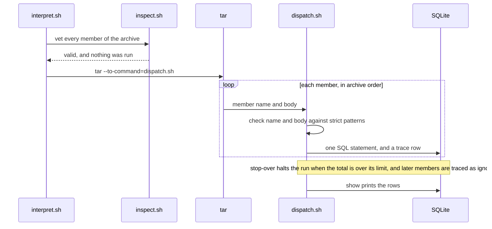
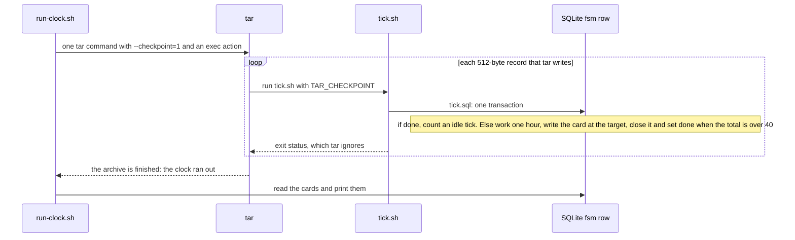

# tar study guide

## What this guide is for

This guide examines two programs that use GNU `tar` as the machine. In [`src/tar-gnu`](../../../src/tar-gnu/README.md), an archive is a serialized program. The `tar --to-command` option processes its members in order. In [`src/tar-gnu-weird`](../../../src/tar-gnu-weird/README.md), the archive size sets the clock. Each checkpoint advances a state machine by one hour. **What gives the archive an effect and what makes it safe to read?**

When you finish, you should be able to:

1. Explain the difference between *reading* an archive and *running* one, and name which command gives the archive an effect.
2. Explain why the dispatcher passes no part of a member to a shell, and what the inspector adds.
3. Trace both programs through the same three cards: members in order for one, checkpoint ticks for the other.
4. Explain why the weird program's number of ticks is set by the archive's layout and not by its content.
5. Explain why a failing callback or a short archive stalls the clock instead of failing loudly.
6. Label each behavior as guaranteed, implementation-permitted or accidentally exploited.

**Scope limits.** You need to know that tar writes a stream of 512-byte blocks and that GNU tar has options for callbacks. The guide does not teach the ustar header format, the SQL or the awk simulator that tests the weird entry. It uses GNU tar 1.34 or 1.35. BSD and macOS tar have no `--to-command`. The book's page is [tar](../../languages/tar.md). For ideas, see [Serialization, deserialization and object pickling](../../cs/06-state-beyond-variables.md#serialization-deserialization-and-object-pickling), [Capability and authority](../../cs/01-reading-an-adversarial-program.md#capability-and-authority) and [Logical clocks and event ordering](../../cs/03-control-flow-and-continuations.md#logical-clocks-and-event-ordering).

## Before you begin

**Safety model.** Every entry writes fictional **DEMO ONLY** data to a scratch SQLite file. An archive that carries a program is exactly what you should not run unread, and `tar-gnu` is built around that rule: *reading* and *running* are separate commands, and running needs an explicit flag. Read the source before you run it, and run it in the sandbox first:

```bash
sandbox/container/run-image.sh src/tar-gnu
sandbox/container/run-image.sh src/tar-gnu-weird
```

Edit only copies ([Running things safely](../../exercises.md#running-things-safely)). You can write an archive with chosen hours: `sh build-archive.sh --seed 7 --hours "15 19 12 10 10" program.tar`. The weird entry takes `--seed N`; seed 1105 gives hours 15, 19, 12.

**Prediction rule.** Before each run, write down which members will be read, which will run and how many ticks the clock will receive.

**Vocabulary.**

| Term | Meaning here |
| --- | --- |
| Member | One file in an archive. Here a member is one *instruction*. |
| `--to-command` | A GNU tar option that sends each member's contents to a command instead of writing a file. |
| Record | The unit tar writes at a time. With `-b 1` it is 512 bytes. |
| Checkpoint | A callback tar can run every N records, meant to show progress. |
| Dispatcher | The one program that gives a member name its meaning. |

## The shared challenge

The [challenge specification](../../intro.md#what-the-challenge-does) calls for cards with a category and 10 to 19 whole hours. Categories cycle through Meetings, Coding, Debugging and Learning. Add each card's hours to the running total. Stop when the total passes 40. Keep the **first card that takes the total over 40**. A total of exactly 40 continues. Four 10-hour cards need a fifth card, in the Meetings category. Conforming runs finish with 3 to 5 cards and a total of 41 to 59 hours.

Both tar entries report from SQLite. The archive program dispatches member operations, while the checkpoint program commits each tick. In `tar-gnu`, the archive has five card slots (Meetings, Coding, Debugging, Learning, Meetings), each followed by a `stop-over` member that carries `limit=40` and means "halt if the total is *over* 40". Exactly 40 is not over 40, so the next slot runs. In `tar-gnu-weird`, a card is closed at the tick whose number equals the running total, and `done` is set when `total > 40`. A run needs between 41 and 59 ticks.

## The machine to identify

**What repeats.** In `tar-gnu`, tar: it walks the members in archive order and calls the dispatcher once per member (`tar --to-command`, [interpret.sh](../../../src/tar-gnu/interpret.sh)). In `tar-gnu-weird`, tar again, but through its *checkpoints*: one callback per 512-byte record written, using one `tar` command ([README](../../../src/tar-gnu-weird/README.md#the-clock)).

**Where state lives.** In `tar-gnu`, in the archive itself (the instructions, the card hours, the limit) and in SQLite (the running total and a `halted` flag in the `runs` row, plus a trace table). In `tar-gnu-weird`, in *one row* of a table called `fsm`: the generator seed, the card number, hours worked, the target, the total and a `done` flag.

**What advances the next step.** In `tar-gnu`, the next member in the archive. In `tar-gnu-weird`, the next checkpoint. Nothing else moves it: if tar wrote no records, no hours would pass.

**What stops it.** In `tar-gnu`, a `stop-over` member, which sets `halted` when the total exceeds its limit. From then on the later members are traced as `ignored: halted`. In `tar-gnu-weird`, the `done` flag, set by the transition that closes the crossing card. tar does *not* stop: the remaining ticks only count as idle.

**What commits.** In `tar-gnu`, the dispatcher runs one SQL statement per member, and `show` prints the rows. In `tar-gnu-weird`, each tick is one SQLite transaction; the launcher reads and prints the cards after tar finishes. In both, the operator, not the archive, decides to run: the archive carries no authority.

<!-- diagram-source: src/tar-gnu/README.md#program-flow -->



The first diagram shows the order of members as the order of execution, with a passive inspector in front.

<!-- diagram-source: src/tar-gnu-weird/README.md#program-flow -->



The second shows a callback made by tar for each record. The program does not call tar's loop. tar calls the program.

## Trace one run

**`tar-gnu`: the members, in order.** A scratch copy built an archive with `--hours "15 19 12 10 10"`, listed it with plain `tar -tvf`, read it with the inspector and ran it with `interpret.sh --execute`. The inspector printed each member decoded:

```text
seq  member         decoded
1    000.begin      format=tarprog/1 seed=7 label=DEMO ONLY
2    010.card       category=Meetings hours=15
3    011.stop-over  limit=40
4    020.card       category=Coding hours=19
5    021.stop-over  limit=40
6    030.card       category=Debugging hours=12
7    031.stop-over  limit=40
8    040.card       category=Learning hours=10
9    041.stop-over  limit=40
10   050.card       category=Meetings hours=10
11   051.stop-over  limit=40
12   990.show       (empty)
# 12 member(s); 0 the interpreter would refuse
```

and the run printed `Meetings 15 15`, `Coding 19 34`, `Debugging 12 46`, then `# committed total=46 entries=3 DEMO ONLY`.

| Member | Meaning | Total after | Halted? |
| --- | --- | ---: | --- |
| `000.begin` | start a run | 0 | no |
| `010.card` | Meetings, 15 | 15 | no |
| `011.stop-over` | halt if total > 40 | 15 | no |
| `020.card` | Coding, 19 | 34 | no |
| `021.stop-over` | halt if total > 40 | 34 | no |
| `030.card` | Debugging, 12 | 46 | no |
| `031.stop-over` | halt if total > 40 | 46 | **yes** |
| `040.card` ... `051.stop-over` | traced as `ignored: halted` | 46 | yes |
| `990.show` | print the rows | 46 | yes |

The members after the halt are still *read* by tar and handed to the dispatcher, which records them as ignored. A halted program does not stop tar. It stops the dispatcher from acting.

**`tar-gnu-weird`: the ticks.** With `--seed 1105` the program printed `Meetings 15 15`, `Coding 19 34`, `Debugging 12 46`, and the closing line `# clock: last tick 64, idle ticks after the stop 18, tape 32768 bytes`. The default layout is 64 records, so there are 64 ticks.

| Ticks | What the machine does | State |
| --- | --- | --- |
| 1 to 15 | works one hour per tick on card 1 (Meetings), target 15 | worked rises to 15 |
| 15 | worked equals target: writes card 1, closes it, draws the next length (19) | total 15, done no |
| 16 to 34 | works card 2 (Coding) | worked rises to 19 |
| 34 | writes card 2 | total 34 |
| 35 to 46 | works card 3 (Debugging), target 12 | worked rises to 12 |
| 46 | writes card 3; the total 46 is over 40, so `done` is set | total 46, **done** |
| 47 to 64 | each tick only increments `idle` | 18 idle ticks |

Each card is closed at the tick whose number is its running total: 15, 34, 46. The stop rule runs *after* the card is written, so the crossing card is kept. 64 minus 46 is the 18 idle ticks.

**Exactly 40.** In `tar-gnu`, four cards of 10 reach 40, `stop-over` does not halt and the fifth slot (Meetings again) runs. In `tar-gnu-weird`, card 4 closes at tick 40 and `done` stays unset (40 is not over 40), so card 5 starts and closes at a tick of 50 or more, which the default 64 ticks cover.

## Compare the ordinary and weird designs

The two entries are an ordinary use and a stunt of the same tool, and they use *different* parts of tar.

| Dimension | `tar-gnu` | `tar-gnu-weird` |
| --- | --- | --- |
| **Representation** | The program is the archive's contents: member names are opcodes, bodies are operands. | The program is `tick.sql`; the archive is a stream of zeros whose size is the clock. |
| **Observability** | `tar -tvf` lists the program. `inspect.sh` decodes it without running anything. | The state is one SQLite row. `check.sh` has an awk simulation that predicts it. |
| **Tests** | The inspector and a fixed `--hours` list make the run deterministic. | The test *predicts* the cards for 65 combinations of layouts, and compares. |
| **Debugging** | Read the trace table: `ok` or `ignored: halted` for each member. | A failed tick leaves tar running and the machine unmoved: the run ends with `the clock ran out` and exit 3. |
| **Portability** | GNU tar only: `--to-command` does not exist in BSD or macOS tar. | GNU tar only, and the number of records a command writes was *measured* on 1.34 and 1.35. |
| **Cost** | One shell process per member. | One `sqlite3` start per tick: a few tenths of a second for 64 ticks. |

The first is about what a layout **means**. The second is about **when** things happen. In the first, tar is a parser that happens to call your code. In the second, tar is an event source: a program written as a callback, with no loop of its own.

## What the exercises demonstrate

| Exercise | Predict first | What the evidence shows |
| --- | --- | --- |
| [B16. tar: read the program, then run it](../../exercises.md#b16-tar-read-the-program-then-run-it-verified), step 1 | `--hours "12 12 12 12 12"`: how many cards run, and which slot is read and ignored? | Four cards (12, 24, 36, 48), and the fifth slot is read and ignored. |
| B16, step 2 | Change `limit=40` in `021.stop-over` to `limit=20` and pack it again in the same order. | Two cards (12, 24). The limit is in the archive, so editing a member changed the stop rule, and `dispatch.sh` did not change. The trace shows `ok` then `ignored: halted`. |
| B16, step 3 | Add a member `025.exec` that is not in the instruction set. | The inspector prints `REFUSE (unknown record type)` and exits 4, `interpret.sh` runs nothing and no `pwned` file appears. Plain `tar -xf` would not create it either: a member name is not a command. |
| [B17. tar, weirder: predict the clock](../../exercises.md#b17-tar-weirder-predict-the-clock-verified), step 1 | `--seed 42 --ticks 45`, then `46`. | With 45 ticks the third card is not finished: two cards, `the clock ran out` and exit 3. With 46, three cards and exit 0. |
| B17, steps 2-3 | `--interval 2` with 92 and 91 ticks; `--blocking 4`. | 92 records give 46 ticks and finish. 91 give 45 and stall. `-b 4` with 260 blocks gives 65 records and 65 ticks, so 19 idle. |
| B17, step 4 | What is in the tape? | Almost all zeros, plus one 512-byte header. The payload does not matter. Its *size* is the clock. |

The B16 one-line answer is the lesson: the *inspector* parsed the program, the *interpreter* ran it and the trust boundary was the operator's decision to use `--execute`, not anything in the archive.

## Failure modes, costs and boundaries

| Behavior | Label | Why |
| --- | --- | --- |
| `tar --to-command` sends each member to a command, in archive order | **implementation-permitted** | A documented GNU tar feature, absent in POSIX tar and BSD tar. |
| Plain `tar -xf` writes files and does not run their contents | **guaranteed** | An archive is data. Only the command the operator attaches gives members an effect. |
| `--checkpoint=N` and `--checkpoint-action=exec=` with `TAR_CHECKPOINT` | **implementation-permitted** | Documented GNU tar features. A checkpoint counts *records*. |
| How many records a command writes for a given set of members | **implementation-permitted** | Measured on tar 1.34 and 1.35, with identical numbers, but worked out from observation. |
| Creating an archive of 21 blocks gives 21 ticks, but *listing* it gives 10 | **accidentally exploited** knowledge | The mode changes the count because tar skips data it need not read. Nobody promises it. The entry uses only creation, the simplest rule. |
| The callback's exit status is ignored | **accidentally exploited** | A command that exits 7 leaves tar's own status at 0 on every release tried. The entry does not rely on it: it makes extra ticks harmless and a failed tick merely idle. |
| tar keeps writing after the stop rule | **implementation-permitted** | tar cannot be told to stop, so the machine has a `done` flag. |
| Reading an archive with the inspector runs nothing | **guaranteed** by design, tested | `inspect.sh` parses only. `check.sh` verifies refusals. |

**Costs to state.**

- **The authority is in the command, not the data.** Every unsafe thing here would be a *decision by the operator*: choosing `--to-command`, choosing `--execute`. See [Capability and authority](../../cs/01-reading-an-adversarial-program.md#capability-and-authority).
- **The dispatcher is a trust boundary.** Names and bodies are checked against strict patterns before any SQL runs, and no part of a member reaches a shell. A relaxed pattern would turn the archive into an injection vector.
- **A clock without a stop.** The weird machine cannot stop tar, so a layout that is too short stalls the run mid-card, and one that is too long idles. The run needs 41 to 59 ticks, and the default is 64.
- **Scheduling with a progress indicator.** Checkpoints were designed to show progress. This is a hack that depends on counting records.
- **Where this is legitimate.** Serializing work as an archive, and running it with an explicit, reviewable command, is how many build and install tools work. A scheduler made from checkpoints is a stunt.

## Connections across the repository

- **Document order as the program.** `tar-gnu` is the repository's example of data that is read in order and given meaning by the reader. [XAML in the C# guide](csharp-linq-xaml-and-ports.md) is the same worry in a markup file: a parser that runs what it parses. The concept guide [Reading adversarial programs](../concepts/reading-adversarial-programs.md) uses both.
- **A callback inverted.** `tar-gnu-weird` is a program called by its environment, as the PCRE2 callouts in [Regex engines and sed](regex-engines-and-sed.md) and the listeners in [JavaScript](javascript.md) are. The concept guide [Events, callbacks and reactive control](../concepts/events-callbacks-and-reactive-control.md) compares who owns the next turn.
- **A state machine in one row.** [Tcl](tcl.md) keeps its state in table rows too. The concept guide [State and control beyond variables](../concepts/state-and-control-beyond-variables.md) compares them.
- **Prediction as a test.** `check.sh` contains a second implementation of the machine and compares the two. The concept guide [Portability, abstraction and cost](../concepts/portability-abstraction-and-cost.md) uses this to ask what an observation proves.
- **In the book.** [tar](../../languages/tar.md), [Serialization, deserialization and object pickling](../../cs/06-state-beyond-variables.md#serialization-deserialization-and-object-pickling), [Logical clocks and event ordering](../../cs/03-control-flow-and-continuations.md#logical-clocks-and-event-ordering) and [Capability and authority](../../cs/01-reading-an-adversarial-program.md#capability-and-authority).

## Self-check

Answer each question in your own words before you read the italic text. Say what evidence would support each answer.

1. **Trace.** `tar-gnu` is built with hours 11, 11, 11, 11, 10 (totals 11, 22, 33, 44). Which members run and which are ignored? *(The first four cards run. After card 4, `041.stop-over` sees 44 and halts. `050.card`, `051.stop-over` are read and traced `ignored: halted`. `990.show` prints four rows.)*
2. **Explain.** Why does `tar-gnu-weird` still tick after the run is done? *(tar writes all its records and runs the callback for each. tar cannot be told to stop, so the machine's `done` flag makes later ticks only count as idle.)*
3. **Transfer.** In `tar-gnu`, the limit lives in the archive. In another entry it lives in a regex, a tape line or a data declaration. Which is the easiest to change by someone who can edit data but not code, and what does that imply for review? *(The archive and the Ex tape: both are data. Reviewing the *data* is then as important as reviewing the code, so a change to the limit must be visible to the reviewer.)*
4. **Evidence.** The README says, "Exit status 7 from the callback leaves tar's status at 0." Design a test that could fail. Which label applies to the claim? *(Run a copy whose `exec` action is `sh -c 'exit 7'` and check tar's exit status. The negative control is a run where tar itself fails, for example on an unreadable file, which must give non-zero. The claim describes tested releases only, so it is accidentally exploited.)*

## Further reading

- [Tar (computing)](https://en.wikipedia.org/wiki/Tar_(computing)) (Wikipedia): the format, its blocks and its history.
- [GNU tar: Checkpoints](https://www.gnu.org/software/tar/manual/html_node/checkpoints.html) (GNU Project): the official description of `--checkpoint`, `--checkpoint-action` and `TAR_CHECKPOINT`. The checkpoint behavior this guide leans on is documented here, but how many records a command writes is measured, not promised.
- [Serialization](https://en.wikipedia.org/wiki/Serialization) (Wikipedia): why data that is written down and read back can become a program.
- [Capability and authority](../../cs/01-reading-an-adversarial-program.md#capability-and-authority) (this book): why authority comes from the command that runs a program, not from the data it reads.
