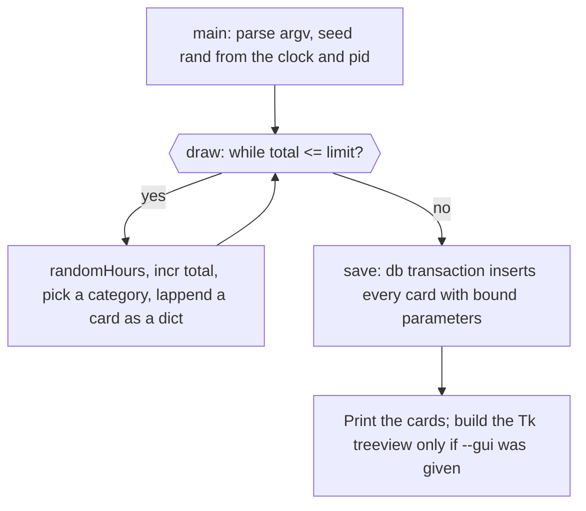
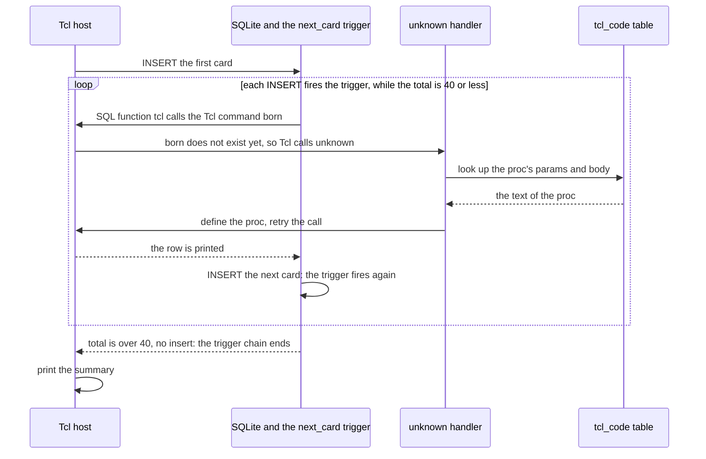
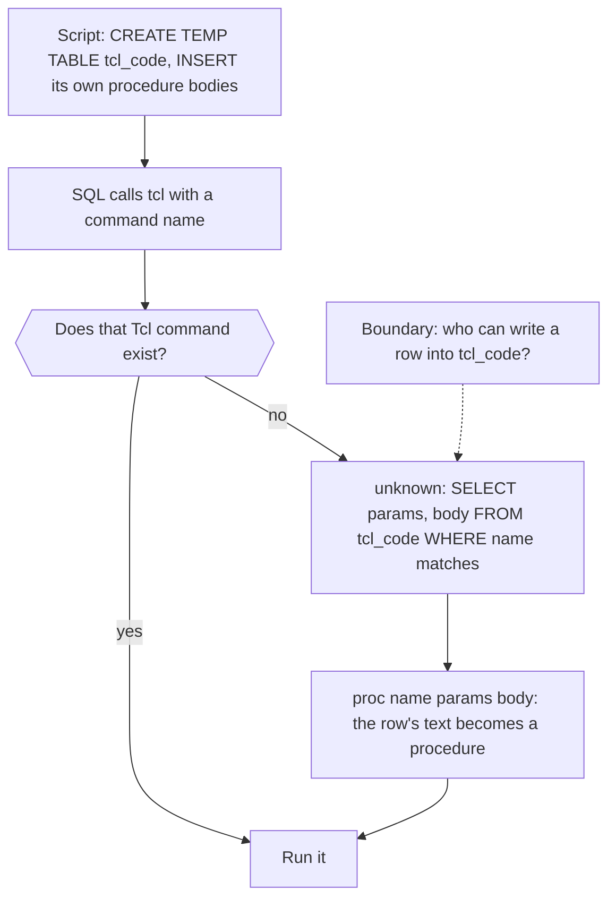

# Tcl study guide

## What this guide is for

This guide reads two Tcl programs: [`src/tcl`](../../../src/tcl/README.md), an ordinary `while` loop in one procedure, and [`src/tcl-weird`](../../../src/tcl-weird/README.md), where the program is *rows in a SQLite table* and one `INSERT` starts it. The weird program defines no Tcl loop and no Tcl procedure that deals or prints a card: the loop is a recursive SQLite trigger, and the code lives as text that Tcl's `unknown` handler fetches on demand. The question is: **if code is just a string, who may write the string, and which engine decides what runs next?**

When you finish, you should be able to:

1. Explain Tcl's command model: everything is a command whose arguments are strings, and an unknown command goes to `unknown`.
2. Explain how `tcl-weird`'s three hooks work together: an SQL function that calls Tcl, an `unknown` handler that defines procedures from table rows, and a trigger that inserts the next card.
3. Trace both programs through the same three cards, naming which engine acts at each step.
4. Explain why `PRAGMA recursive_triggers = ON` is the loop, and what the `WHERE` in the trigger is.
5. Name the trust boundary in this design and explain why it holds here.
6. Label each behavior as guaranteed, implementation-permitted, or accidentally exploited.

Scope limits. You need to read Tcl (braces group, brackets substitute, `$` reads a variable) and basic SQL. The guide does not teach Tk (the optional window is also built from table rows) or SQLite's query planner. It uses Tcl 8.6 with the `sqlite3` package. The book's page is [Tcl](../../languages/tcl.md). For ideas, see [Database triggers](../../cs/06-state-beyond-variables.md#database-triggers), [Arbitrary code execution](../../cs/01-reading-an-adversarial-program.md#arbitrary-code-execution) and [Homoiconicity: code as data](../../cs/06-state-beyond-variables.md#homoiconicity-code-as-data).

## Before you begin

**Safety model.** Every entry writes fictional **DEMO ONLY** data to a scratch SQLite file. `tcl-weird` runs *text from a table as code*. That is safe here only because the program builds the table itself, in memory, in the same file. Read the source before you run it, and run it in the sandbox first:

```bash
sandbox/container/run-image.sh src/tcl
sandbox/container/run-image.sh src/tcl-weird
```

Edit only copies ([Running things safely](../../exercises.md#running-things-safely)). When you edit `tcl-weird`, you are editing a Tcl program *inside a SQL string inside a Tcl script*, so braces nest and nothing is substituted until the text is run.

**Prediction rule.** Before each run, write down which engine (Tcl, SQLite) acts at each step, and what each prints. In this program the engines hand control to each other.

**Vocabulary.**

| Term | Meaning here |
| --- | --- |
| Command | A Tcl word followed by arguments. Even `if` and `while` are commands. |
| `unknown` | The command Tcl calls when a command name does not exist. |
| Trigger | SQL code that SQLite runs automatically when a row is inserted, updated or deleted. |
| Recursive trigger | A trigger whose action fires itself again. SQLite allows it only with `PRAGMA recursive_triggers = ON`. |
| `TEMP` | A table or trigger that lives only as long as this database connection. |

## The shared challenge

A *card* is a category and a whole number of hours from 10 to 19. Categories cycle through Meetings, Coding, Debugging and Learning. Add each card's hours to a running total and stop when it passes 40. The run **retains the first card that takes the total above 40**. A total of exactly 40 does *not* stop it: four 10-hour cards total exactly 40, and a fifth is drawn. Final totals are 41 to 59, with 3 to 5 cards. Rows are stored in SQLite and the program prints a summary.

Tcl writes the boundary two ways. In `tcl`, `while {$total <= $limit}` ([L40](../../../src/tcl/timecards.tcl#L40)): true for 40, so the loop goes round. In `tcl-weird`, the trigger inserts the next card `WHERE NEW.running_total <= 40` ([L107](../../../src/tcl-weird/timecards.tcl#L107)). A card is inserted only if the *previous* card's total was at most 40, so the crossing card is the last one inserted.

## The machine to identify

**What repeats.** In `tcl`, a `while` loop in the procedure `draw`. In `tcl-weird`, a trigger: inserting a card fires `next_card`, which inserts another card, which fires `next_card` again ([L99-108](../../../src/tcl-weird/timecards.tcl#L99-L108)). SQLite does the repeating.

**Where state lives.** In `tcl`, in local variables (`total`, `cards`). In `tcl-weird`, in *the table*. The card number is not a counter: the category is looked up as `count(*)` of the run's existing rows plus one, and the total is carried in the inserted row's `running_total`. The next step reads the row that caused it, `NEW`.

**What advances the next step.** In `tcl`, the loop. In `tcl-weird`, the end of the trigger's own `INSERT`, which fires the trigger for the new row.

**What stops it.** In `tcl`, the loop condition. In `tcl-weird`, the trigger's `WHERE NEW.running_total <= 40`: when it is false the `INSERT ... SELECT` yields no rows, so nothing is inserted and the chain ends.

**What commits.** In `tcl`, `save` writes the finished list in one `db transaction`. In `tcl-weird`, the whole chain of triggered inserts runs inside one `db transaction` that wraps the starting `INSERT` ([L124-130](../../../src/tcl-weird/timecards.tcl#L124-L130)). The rows are *printed* by the `born` procedure as each card is inserted, so a row can be printed before the transaction commits.

<!-- diagram-source: src/tcl/README.md#program-flow -->



The first diagram is an ordinary loop in a procedure.

<!-- diagram-source: src/tcl-weird/README.md#program-flow -->



The second is SQLite's trigger firing itself, with Tcl called back at every step. The next diagram adds what the source diagram leaves out: where the code *comes from*, and who can write it.

<!-- diagram-new: authority-boundary - shows where the Tcl text comes from and which party may write it, which the source diagram omits -->



## Trace one run

The programs draw random hours. Use hours **15, 19, 12**. To check it, a scratch copy of `tcl-weird` was run in the sandbox with the `hours` row's body replaced by a lookup in a fixed list (an edit to the text inside the SQL string), and with two lines of logging added to the `hours` and `born` rows. The output, with the log lines (printed to standard error) shown first, was:

```text
# DEMO ONLY run <id>
  (hours proc: handing out 15)
  (born: card of 15 hours, total 15; the trigger inserts the next card only if total <= 40)
  (hours proc: handing out 19)
  (born: card of 19 hours, total 34; the trigger inserts the next card only if total <= 40)
  (hours proc: handing out 12)
  (born: card of 12 hours, total 46; the trigger inserts the next card only if total <= 40)
Meetings	15	15	DEMO ONLY
Coding	19	34	DEMO ONLY
Debugging	12	46	DEMO ONLY
# committed total=46 entries=3 DEMO ONLY
# every proc that ran was fetched from SQLite by unknown: born category hours init runid week
```

(The ISO-week column was removed. Standard output and standard error are separate streams, so their relative order in a terminal capture is not the order of events. The *order of the log lines among themselves* is the order of events.)

| Step | Engine acts | What happens | State after |
| --- | --- | --- | --- |
| 0 | Tcl | `db eval {SELECT tcl('init')}`: `unknown` fetches `init` from the table and runs it | procedures defined: `init` |
| 1 | SQLite | The starting `INSERT ... SELECT` calls `tcl('hours')`: Tcl asks `unknown` for `hours`, and gets 15 | card 1 row: 15 hours, total 15 |
| 2 | SQLite trigger | `AFTER INSERT` fires `next_card`. It calls `born` (prints card 1), then evaluates `WHERE 15 <= 40`: true | card 2 inserted |
| 3 | SQLite trigger | Fires again on card 2 (19 hours, total 34). `born` prints it. `34 <= 40`: true | card 3 inserted |
| 4 | SQLite trigger | Fires on card 3 (12 hours, total 46). `born` prints it. `46 <= 40`: **false**. The `INSERT ... SELECT` produces no row | chain ends |
| 5 | Tcl | The transaction commits. Tcl runs a `SELECT count(*), max(running_total)` and prints the summary | 3 entries, total 46 |

The procedures fetched from the table were `born`, `category`, `hours`, `init`, `runid` and `week`: exactly the ones that were *called*. The table held more text than ran.

**Plain `tcl`.** The loop runs `randomHours`, adds to `total`, appends a dict and tests `$total <= $limit`. The test is after the draw in program order and before the next draw, which is why the crossing card is kept ([L32-34](../../../src/tcl/timecards.tcl#L32-L34)). With 15, 19, 12 the totals are 15, 34 and 46, and the loop exits.

**Exactly 40.** With four 10-hour cards, the fourth card has total 40, `40 <= 40` is true, and the trigger inserts a fifth. Exercise B12 step 2 shows five rows at 10, 20, 30, 40, 50.

## Compare the ordinary and weird designs

| Dimension | `tcl` | `tcl-weird` |
| --- | --- | --- |
| **Representation** | A procedure with a loop and a list of dicts. | Rows. The program is data in `tcl_code`, the loop is a trigger, and the window (with `--gui`) is also rows. |
| **Observability** | Print `$cards`. | You must read the table and the trigger. The procedures that deal and print cards do not exist until something calls them. |
| **Tests** | Call `timecards::draw`. | Run the whole thing. The stop rule is a `WHERE` inside a trigger, not testable alone. |
| **Debugging** | Standard Tcl stack traces. | A Tcl error inside an SQL function is reported through SQLite, and the stack mixes `unknown`, `uplevel` and `db eval`. |
| **Portability** | Tcl 8.6 and the `sqlite3` package. | The same, plus SQLite's trigger and recursion semantics, and the order SQLite evaluates a subquery's function call. |
| **Cost** | A loop. | One trigger firing per card, with a Tcl callback at each. The recursion depth is limited (1000 by default), and the challenge needs 3 to 5. |

The difference to remember: `tcl` has *one* engine and `tcl-weird` has *two*, SQLite and Tcl, and each calls the other. The control moves between them, and neither has the whole picture.

## What the exercises demonstrate

| Exercise | Predict first | What the evidence shows |
| --- | --- | --- |
| [B12. Tcl: edit the program in the database](../../exercises.md#b12-tcl-edit-the-program-in-the-database-verified), step 1 | Set `recursive_triggers` to `OFF`. How many rows print? How many does the summary count? | One row prints and the summary says `entries=2`. The trigger fired once, card 2 was inserted and counted, but an insert made by a trigger does not fire the trigger again unless recursion is enabled. The pragma *is* the loop. |
| B12, step 2 | Change the `hours` row's body to `expr {10}`. | Exactly five rows, totals 10, 20, 30, 40, 50, and the shared checker passes. The run does not stop at 40, because exactly 40 continues. You edited text inside an SQL string, not a Tcl procedure. |
| B12, the three hooks | Name them. Which did you change in step 2? | An SQL function that calls Tcl, the `unknown` handler, and the trigger. Step 2 changed the *data that `unknown` serves*. |
| [C1. Weird next to boring](../../exercises.md#c1-weird-next-to-boring-verified) | In which program can you see the rule in one place? | `tcl`: the `while` condition. `tcl-weird`: the `WHERE` in a trigger, three layers deep. |
| [F. Prove a README claim](../../exercises.md#f-prove-a-readme-claim-verified) | The README says the hours value is the same in `h` and in `NEW.running_total + h`. Can you test it? | The shared checker fails if the running totals do not equal the sum of hours, which is the evidence. A negative control needs a version that draws the hours twice. See the next section for why this is risky. |

## Failure modes, costs, and boundaries

| Behavior | Label | Why |
| --- | --- | --- |
| Tcl calls `unknown` for a command that does not exist | **Guaranteed** | A documented Tcl hook. |
| A command's arguments are strings, and code can be built and run as text | **Guaranteed** | Tcl's core model. |
| An SQLite trigger fires for each inserted row, and a trigger's own inserts fire triggers only with `recursive_triggers` on | **Guaranteed** | Documented SQLite behavior. Verified by B12 step 1. |
| SQLite limits trigger recursion (1000 by default) | **Guaranteed** | The challenge needs 3 to 5. |
| The same `h` value appears in `h` and in `NEW.running_total + h` | **Accidentally exploited** | SQLite evaluates the subquery's non-deterministic function call once per row here, so both uses see one value. SQLite does not promise it for non-deterministic functions. The check fails if it ever changes, because running totals would no longer add up. |
| `TEMP` tables and triggers disappear with the connection | **Guaranteed** | Documented. It keeps the program out of the file on disk. |
| `INSERT INTO main.demo_timecards` is rejected inside a trigger, so the trigger body uses the bare name | **Implementation-permitted** | SQLite's rule about qualified names in triggers. The `TEMP` trigger resolves the bare name to the one table in `main`. |
| Tk keeps `tclsh` alive after the script ends | **Implementation-permitted** | Why the script ends with `destroy .`. |

**The trust boundary.** `unknown` runs whatever text is in the table. In `tcl-weird` the table is built by the program itself, in memory, in a `TEMP` table, and filled from literals in the script. Nobody else can write to it. That is the entire defense. If the table were a normal table in the file on disk, anyone able to edit the database could make the program run their Tcl. This is the same lesson as the book's threat-model examples: treat anything that is read as code as code. See [Arbitrary code execution](../../cs/01-reading-an-adversarial-program.md#arbitrary-code-execution).

**Costs to state.**

- **Two engines, two stacks.** An error in a procedure shows a trace that mixes Tcl and SQLite frames.
- **Order of evaluation belongs to SQLite.** The program depends on one call per row, as above. A hardened version would draw the hours once and store them first.
- **Hidden control flow.** Reading the top-level script tells you almost nothing about what runs. The loop is in a `CREATE TRIGGER` statement.
- **Where the technique is legitimate.** Triggers are how databases enforce rules and keep audit trails. `unknown` is how Tcl implements autoloading. Putting both to work as a loop is a stunt.

## Connections across the repository

- **A rule that fires the next step.** The trigger is the same idea as the `88`-level condition in [COBOL](cobol.md) and the `or` combination in [Common Lisp](common-lisp.md): the next step comes from a *declared rule*, not from a statement you can see in order. The concept guide [State and control beyond variables](../concepts/state-and-control-beyond-variables.md) compares them.
- **Code as data, in other languages.** [APL](apl.md) writes its own functions as text with `⎕FX`. Tcl fetches them from a table. [XAML in the C# guide](csharp-linq-xaml-and-ports.md) runs methods while it parses markup.
- **A boundary you must defend.** [Reading adversarial programs](../concepts/reading-adversarial-programs.md) uses this entry and the XAML and tar entries as its main examples of "data that is also code".
- **Transactions and commit.** The whole trigger chain runs in one `db transaction`, as in [Effects, errors, and commitment](../concepts/effects-errors-and-commitment.md), while the printing does not roll back.
- **In the book.** [Tcl](../../languages/tcl.md), [Database triggers](../../cs/06-state-beyond-variables.md#database-triggers) and [Arbitrary code execution](../../cs/01-reading-an-adversarial-program.md#arbitrary-code-execution).

## Self-check

Answer before you read the italic text after each question.

1. **Trace.** In `tcl-weird`, hours are 12, 14, 13, 11 (totals 12, 26, 39, 50). For each card, say whether the trigger inserts a next card. *(After card 1 (total 12): yes. After card 2 (26): yes. After card 3 (39): yes. After card 4 (50): no, because `50 <= 40` is false. Four cards, the fourth is the crossing card.)*
2. **Explain.** Why does `PRAGMA recursive_triggers = OFF` give exactly one printed row and `entries=2`? *(The starting `INSERT` fires the trigger once. The trigger prints card 1 and inserts card 2, but a trigger's own insert does not fire the trigger again, so card 2 is never printed. The summary counts both rows.)*
3. **Transfer.** In a relational database you use, which feature would play the part of the trigger-as-loop, and what would limit the depth? *(A recursive trigger or a recursive common table expression. In both cases the engine caps the recursion depth.)*
4. **Evidence.** A reviewer says "every procedure `tcl-weird` runs comes from the table." Design a test that could fail. *(Check that the list of fetched procedures printed at the end contains `born`, `category`, `hours`, `init`, `runid` and `week`, and that none of them is defined by a `proc` in the script. The negative control is to define one of them in the script: it should then be missing from the fetched list, because `unknown` is never called for it.)*

## Further reading

- [Tcl](https://en.wikipedia.org/wiki/Tcl) (Wikipedia): the language, and why "everything is a string" shapes it.
- [Database trigger](https://en.wikipedia.org/wiki/Database_trigger) (Wikipedia): what triggers are for and where they cause surprises.
- [Code injection](https://owasp.org/www-community/attacks/Code_Injection) (OWASP): the general risk when text becomes code, which `unknown` makes concrete.
- [Database triggers](../../cs/06-state-beyond-variables.md#database-triggers) and [Arbitrary code execution](../../cs/01-reading-an-adversarial-program.md#arbitrary-code-execution) (this book): the concepts behind this entry.
