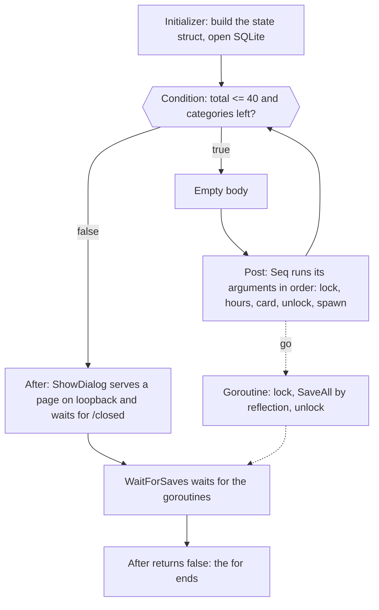

# One Statement, Go Edition

Ken's Go port of Jim Lehmer's C# challenge. It is one of four sibling ports, along with [Java](../JavaChallenge1/README.md), [Kotlin](../KotlinChallenge1/README.md) and [Python](../PythonChallenge1/README.md). The Java README has [what every version does](../JavaChallenge1/README.md#what-every-version-does) and the [side-by-side comparison](../JavaChallenge1/README.md#side-by-side) of all four.

The constraint: `main` contains exactly one statement, a `for` loop with an empty body. This is a stunt in expression mechanics, not good production code. Nothing here connects to a real time-reporting system: the cards are flagged `is_demo`.

## Run it

You need the Go toolchain (`winget install GoLang.Go`). The first run downloads one module.

```powershell
cd src\GoChallenge1
go run .
```

Or, from the repo root, through Gradle: `.\gradlew.bat runGo`.

The window is a page in your default browser. Press Close in the page, or close the tab, to finish. Records land in `src/GoChallenge1/data/demo-timecards.db`; the path is relative to the working directory, so run it from this folder. Delete `data` to start over.

If a running IDE doesn't see `go` after installing it, restart the IDE so it picks up the new PATH.

## Run it in a container

Prerequisite: Docker, set up once as described in [`SANDBOX-SETUP.md`](../../SANDBOX-SETUP.md#docker).

```bash
sandbox/container/run-image.sh src/GoChallenge1
```

It builds this folder's [`Dockerfile`](Dockerfile) and runs the result with no network, a read-only file system and user `nobody`, then prints the output and a read-only look at the rows it wrote. The image holds a static Go binary, sqlite3 (for the inspect step) and a tiny `wget`. It has no Go toolchain. It needs `--online-build` (`sandbox/container/run-image.sh --online-build src/GoChallenge1`) because the build downloads the SQLite module; the run itself has no network. The page the program serves on `127.0.0.1` is fetched from *inside* the container with `wget`, saved as `page.html`, and then "closed", so nothing is ever published to your machine.

## Run it in Windows Sandbox

Prerequisites: Windows Sandbox and this entry's toolchain on your machine, set up once as described in [`SANDBOX-SETUP.md`](../../SANDBOX-SETUP.md#windows-sandbox).

```powershell
sandbox\windows\run.ps1 src\GoChallenge1
```

It runs the entry in a throwaway VM with networking off, screenshots the window, asks it to close, and prints what it saved. The page opens in Edge inside the VM, and the harness also fetches it over loopback and saves it. **Not yet tested on real hardware.**

## Layout

| File | Role |
| --- | --- |
| [main.go](main.go) | `main` and its one statement |
| [helpers.go](helpers.go) | The entity, the repository and the expression helpers |
| `go.mod`, `go.sum` | Module definition |

As in the original, the entity and the data-access type sit outside `main`. Go also needs small helper functions there (explained below).

## Program Flow



**What this shows:** Go's `for` has the same three clauses as the C# original, but Go allows only simple statements there. So the work moves into helper functions, and `Seq(...)` runs its arguments in order in place of the comma list. The dashed edges are the concurrent part: each pass starts a goroutine, and the program must wait for all of them before it exits.

**Why this mechanism matters:** the loop ends through its condition, not through a `break`. The `||` makes the false branch do the final work (show the page, wait for the saves) and then yield `false`. The window is a browser page, because Go has no standard-library GUI.

## How the stunt works

The work splits three ways: an **initializer** that builds the loop's state, a **condition** that decides whether to keep going (and, on the last check, shows the window), and an **update** that does one pass of work. Comment banners in the source mark the boundaries.

Go is the strictest: a `for` clause allows only simple statements, and Go has no ternary, no comma expression and no statements inside expressions. The loop is still a real three-part `for i := &struct{...}{...}; condition; post { }` with the same two semicolons as the Java port.

- **Initializer.** `i := &struct{...}{...}`. An anonymous struct holds the state: the CSS fragment, hours, user, repository, staged cards, categories and a mutex.
- **Condition.** `total <= 40 && len(categories) > 0 || After(false, ShowDialog(...), WaitForSaves())`. The `||` plays the role of the ternary: when the loop should end, the page is shown, the saves are awaited, and the result is `false`.
- **Update.** One call, `Seq(...)`, whose arguments run left to right. Go evaluates function calls in an argument list in order, so `Seq` takes the place of the comma list: `Lock`, `Append` hours, `Append` a card, `Unlock`, `Spawn`.
- **The price.** Anything that needs a statement (`Lock`, `Append`, `Pop`, `Spawn`, `ShowDialog`) is a small value-returning function in `helpers.go`. The goroutine's body is one `Seq(...)` call.
- **Window.** Go has no standard-library GUI, so `ShowDialog` serves a page on a loopback port and opens it in the default browser. The pulse is a CSS animation fragment, as the original had an animation fragment. The page posts to `/closed` when you press Close or leave it, which unblocks the loop.
- **Saving.** The driver is `modernc.org/sqlite`, a pure-Go driver that needs no C compiler. `reflect`'s `MethodByName` calls `SaveAll`. `WaitForSaves` stops the process from exiting before the goroutines finish.

## Gotchas worth knowing

- **Helper functions are the price.** Go has no statement-expressions, so every statement-only operation (`Lock`, `Append`, `Pop`, `Spawn`, `ShowDialog`) lives in a small function in `helpers.go`. That is the stated cost of this version.
- **The window is a web page.** Go has no standard-library GUI, so the program serves a page on a loopback port and opens your default browser. Press Close in the page, or close the tab, to finish.
- **Run it from this folder.** The data path is relative to the working directory.
- **The container build needs the network.** `--online-build` is needed because the build downloads the SQLite module. The run itself has no network.
- **The Windows Sandbox profile is not yet tested on real hardware,** and this port has no check script, so the sandbox gate does not cover it yet.
