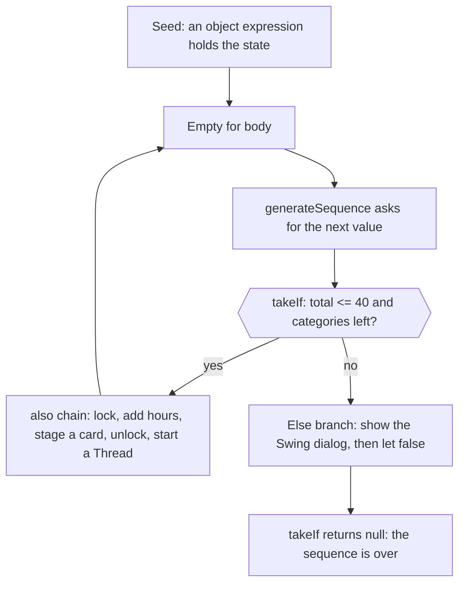

# One Statement, Kotlin Edition

Ken's Kotlin port of Jim Lehmer's C# challenge. It is one of four sibling ports, along with [Java](../JavaChallenge1/README.md), [Python](../PythonChallenge1/README.md) and [Go](../GoChallenge1/README.md). The Java README has [what every version does](../JavaChallenge1/README.md#what-every-version-does) and the [side-by-side comparison](../JavaChallenge1/README.md#side-by-side) of all four.

The constraint: `main` contains exactly one statement, a `for` loop with an empty body. This is a stunt in expression mechanics, not good production code. Nothing here connects to a real time-reporting system: the cards are flagged `is_demo`.

## Run it

You need JDK 25. The Gradle wrapper does the rest. Run it from a desktop session:

```powershell
cd src\KotlinChallenge1
.\gradlew.bat runKotlin
```

From the repo root, the same task name works without the `cd`: `.\gradlew.bat runKotlin`.

`bootRun` runs the same program. The window is a Swing dialog. Records land in `src/KotlinChallenge1/data/demo-timecards.db`; delete `data` to start over. The data path is relative to the working directory, which the Gradle run tasks set to this folder.

## Run it in a container

Prerequisite: Docker, set up once as described in [`SANDBOX-SETUP.md`](../../SANDBOX-SETUP.md#docker).

```bash
sandbox/container/run-image.sh --online-build --out ./results src/KotlinChallenge1
```

It builds this folder's [`Dockerfile`](Dockerfile) and runs the result with no network, a read-only file system and user `nobody`. Gradle and OpenJDK 25 build one Spring Boot jar in a build stage; the image holds only that jar on an OpenJDK 25 JRE with AWT, Xvfb and a screenshot tool, with no JDK, Gradle or Kotlin compiler (about 770 MB, the largest of the set). The window opens on a virtual display (Xvfb) *inside* the container, so nothing is drawn on your desktop: the run screenshots it, closes it, and prints the rows it wrote. With `--out`, `results/screenshot.png` is the window. `--online-build` is needed because the build downloads Gradle (from this entry's wrapper) and the Maven dependencies; the run itself has no network.

## Run it in Windows Sandbox

Prerequisites: Windows Sandbox and this entry's toolchain on your machine, set up once as described in [`SANDBOX-SETUP.md`](../../SANDBOX-SETUP.md#windows-sandbox).

```powershell
sandbox\windows\run.ps1 src\KotlinChallenge1
```

It runs the entry in a throwaway VM with networking off, screenshots the window, asks it to close, and prints what it saved. **Not yet tested on real hardware**; it needs a JDK and a populated Gradle home on the host.

## Layout

| File | Role |
| --- | --- |
| [Program.kt](src/main/kotlin/challenge1/kotlinversion/Program.kt) | `main` and its one statement |
| `DemoTimeCard.kt` | The entity |
| `DemoTimeCardRepository.kt` | The Spring Data repository |

As in the original, the entity and the data-access type are the only code outside `main`.

## Program Flow



**What this shows:** Kotlin has no three-clause `for`, so the loop iterates a sequence. The condition is `takeIf`, and "stop" is a `null`. The update is the chain of `?.also { ... }` calls that runs only when the condition passed. The body runs once before the first test, which makes no difference here because the body is empty.

**Why this mechanism matters:** it is the same three jobs as the Java port (initialize, test, update), carried by a lazy sequence that is pulled one value at a time. Ending the sequence is a value (`null`), not a statement.

## How the stunt works

The work splits three ways: an **initializer** that builds the loop's state, a **condition** that decides whether to keep going (and, on the last check, shows the window), and an **update** that does one pass of work. Comment banners in the source mark the boundaries.

Kotlin has no three-part `for` and no semicolons, so the loop iterates a sequence: `for (pass in generateSequence(seed) { ... }) { }`.

- **Initializer.** An `object { ... }` expression is the sequence seed.
- **Condition.** `takeIf { if ... else ... }`. A null result ends the sequence. When the loop should end, the else branch shows the window and finishes with `.let { false }`, so `takeIf` returns null.
- **Update.** The update is a chain of `?.also { ... }` calls.
- **Several steps in one expression.** Chain them: `x.also { ... }.also { ... }`.
- **Window and saving.** The same Swing, Spring XML and Spring Data JPA as the Java port. The XML is one raw string with `${...}` templates instead of joined text blocks.
- **One behavior difference.** The Kotlin loop body runs once before the first condition check, where Java checks first. The body is empty, so both programs do the same things in the same order.

## Gotchas worth knowing

- **The loop body runs once before the first condition check.** Java checks first. The body is empty, so both programs do the same things in the same order.
- **Run it from the right place.** The data path is relative to the working directory, which the Gradle run tasks set to this folder.
- **The container image is the biggest of the set** (about 770 MB), and `--online-build` is needed because the build downloads Gradle and the Maven dependencies. The run itself has no network.
- **The Windows Sandbox profile is not yet tested on real hardware.** It needs a JDK and a populated Gradle home on the host, and this port has no check script, so the sandbox gate does not cover it yet.
