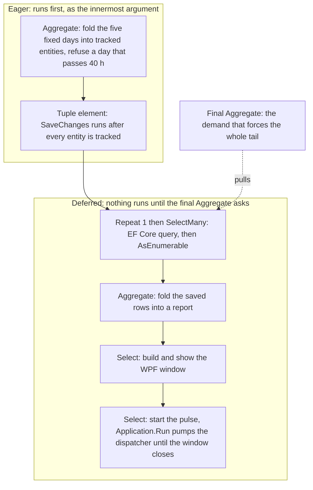

# LINQ challenge, Variant A: one fluent method-chain statement

**Teaches you:** that a chain of LINQ methods can express the entire program.

> **Not the shared challenge.** This entry draws no random hours: its work week is five fixed 8-hour days, capped so that the total is exactly 40.0 hours and no card crosses the line. It teaches deferred execution and LINQ method chains, not the stop rule "keep the first card over 40".

One `;`-terminated expression statement, built entirely from LINQ method calls. It generates a fixed 40-hour timecard, tracks and saves it through EF Core and SQLite, crosses the `IQueryable<T>` → `IEnumerable<T>` boundary, and builds, shows, pulses, and closes a WPF **DEMO ONLY** terminal window - all inside that one statement. No `RunEverything`-style helper does the real work; `Main` only sets up the STA thread, the `DbContext`, and the `Application` before calling it.

## Run it

You need Windows and the .NET 10 SDK.

```powershell
cd src\LinqChallenge1
dotnet restore
dotnet run
```

A small terminal-styled window appears, pulses three times, and closes itself; the process then exits on its own. Records land in `%LOCALAPPDATA%\LinqChallenge1\timecards.db`; delete that file to start fresh. Each run's rows are tagged with a fresh `RunId`, so the window's report always shows just that run's 40.0h. The file keeps every run's history, like the other entries in this repo.

```powershell
.\check.ps1    # build, structural check, one end-to-end run against a throwaway DB
```

## Run it in Windows Sandbox

Prerequisites: Windows Sandbox and this entry's toolchain on your machine, set up once as described in [`SANDBOX-SETUP.md`](../../SANDBOX-SETUP.md#windows-sandbox).

```powershell
sandbox\windows\run.ps1 src\LinqChallenge1
```

It runs the entry in a throwaway VM with networking off, screenshots the window, asks it to close, and prints what it saved. This entry has a `check.ps1`, so that is what runs.

## Program Flow



**What this shows:** the whole program is one expression, so the order of work is the order of *evaluation*. The inner `Aggregate` is eager and runs first. Everything after it is a lazy chain of `LINQ` stages, and the last `Aggregate` is what makes them run. The dotted edge is demand, not data.

**Why this mechanism matters:** this is the difference between a query as a description and a query as an execution. `Enumerable.Repeat(…, 1)` turns one value into a one-element sequence so that each stage can stay a real `LINQ` operator. Every `void` call is wrapped to return a value, as the `void`-to-value trick (a section of this README) explains.

## How the stunt works

The fixed work week (`WorkWeek`, five 8-hour days: Planning / Implementation / Review / Testing / Documentation) and the challenge statement live in [`Program.cs`](Program.cs). Reading top to bottom, the one statement is:

| Stage | LINQ operator | What it does |
| --- | --- | --- |
| 1 | `Aggregate` | Folds the fixed days into tracked `TimecardEntry` entities, refusing any day that would push the running total past 40h. Eager, so it runs first. |
| - | tuple `(…, ctx.SaveChanges())` | Tuple elements evaluate left to right, so `SaveChanges()` only runs once every entity above is tracked. |
| 2 | `Enumerable.Repeat(…, 1).SelectMany` | Crosses from the in-memory fold into EF Core's `IQueryable<T>` (`Where`/`OrderBy`/`Select` - all SQL-translatable), then explicitly back with `AsEnumerable()`. The outer sequence has exactly one element, so the query runs exactly once. |
| 3 | `Aggregate` | Back on LINQ to Objects: folds the persisted rows into a report (`Lines`, `Total`). |
| 4 | `Enumerable.Repeat(…, 1).Select` | Builds, styles, and shows the WPF window, inline. |
| 5 | `.Select` | Starts a finite pulse (`DoubleAnimation`, `AutoReverse`, three repeats), then calls `Application.Run()` to pump the dispatcher until the completion handler closes the window and shuts the app down. |
| final | `.Aggregate(0, …)` | Forces the whole lazy tail (stages 2-5) to actually execute. |

## The `void`-to-value trick

WPF and EF Core are full of `void` methods - `Add`, `Show`, `BeginAnimation`, `Close`, `Shutdown` - and a LINQ chain only has room for values. Every side effect above sits inside an inline `new Func<T>(() => { sideEffect(); return value; }).Invoke()`, immediately invoked right where the chain needs its return value. It is a deliberate compromise, not a recommendation: ordinary code would just write a statement.

## Why two nested `Enumerable.Repeat(…, 1)` calls

C# only allows a handful of expression shapes as a top-level expression statement - invocation, object creation, assignment, increment/decrement, `await` - not an arbitrary `&&` or `is` expression. That rules out binding intermediate stages to a pattern-matched local (`x is var report && …`) at the top level: the statement has to *end* in an invocation. So the program does not name the fold result or the report. Instead, each one is nested directly as the argument to the next `Enumerable.Repeat(…, 1)`. That call turns a single computed value back into a one-element sequence, so the next stage can stay a genuine LINQ operator (`SelectMany`, `Select`) and not a bare method call. The whole statement is one deeply nested expression tree whose outermost call is `.Aggregate(…)` - an invocation, which is legal.

## What `check.ps1` enforces

`check.ps1` first makes sure no orchestration helper hides the workflow: `RunEverything`, `BuildAndPersistCards`, `ShowTerminal`, `DoChallenge` and `Orchestrate` may not appear in `Program.cs`. Then it builds the project and runs it against a throwaway data folder, with a hard 15-second timeout in case the dispatcher gets stuck. The program must exit with code 0 and print `PERSISTED 5 rows, total=40.0h`. All five rows (2024-01-01 to 2024-01-05, 8.0h each, Planning to Documentation) must be in the report, and `timecards.db` must exist.

## Gotchas worth knowing

- `SaveChanges()` is called once, eagerly, at the point where the outer `Enumerable.Repeat(…, 1)` call evaluates its argument - before any of the lazy LINQ-to-Objects/EF stages begin enumerating. That is still entirely inside the one statement. It is just not deferred to the final `Aggregate`'s enumeration, the way `Select`/`SelectMany` stages are. `Aggregate` is an eager LINQ operator by definition, so some eagerness here is unavoidable.
- The accumulator state in both `Aggregate` calls is mutated in place (`list.Add(...)`) rather than rebuilt immutably. That mirrors the mutation shortcut the original `ModernChallenge1` takes with `i.totalHours.Add(...)`, and is called out here for the same reason: it is a pragmatic shortcut, not a LINQ-purity claim.
- `Application.Run()` (no window argument) is called from inside a `.Select` lambda, which is what actually pumps WPF dispatcher messages so the window paints and the animation ticks. `ShutdownMode` is set to `OnExplicitShutdown` so the animation's `Completed` handler, not an implicit "last window closed" rule, decides when the app (and `Run()`) exits.
- `Console.WriteLine` calls inside the window-creation stage exist purely so `check.ps1` can verify the persisted report from stdout, without needing a SQLite CLI tool on the test machine.

See [the root README](../../README.md#the-results-so-far) for how this compares to the other one-statement entries, and [`src/LinqChallenge2`](../LinqChallenge2/README.md) for the query-expression variant of the same idea.
