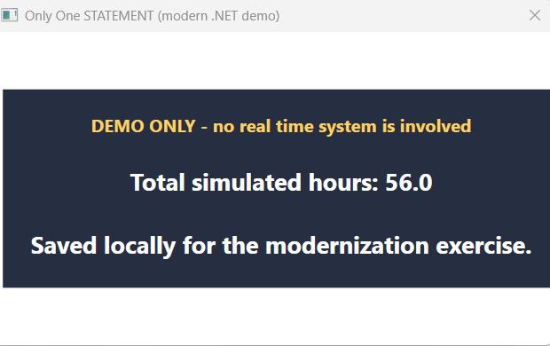

# C# challenge: the original (modernized)

**Teaches you:** runtime XAML, LINQ to Objects, EF Core, and WPF animation - all from inside a `for` statement that has no body.

This is where the whole thing started: a 2008 classroom exercise, kept alive and rebuilt for current .NET. The rule is one C# statement. `Main` contains exactly one `for` loop, and that loop's body is empty (`{ /* Intentionally empty. */ }`). Every piece of behavior - the random draws, the running total, the database save, the window, the animation - has to happen inside the loop's three `;`-separated clauses: initializer, condition, iterator.

## Run it

Needs Windows and the .NET 10 SDK (WPF is Windows-only).

```powershell
cd src\ModernChallenge1
dotnet restore
dotnet run
```

The window says **DEMO ONLY** on purpose. Records go to a local SQLite file under `%LOCALAPPDATA%\ModernChallenge1`; the program never talks to a real time-reporting system.



## How the stunt works

Open [`Program.cs`](Program.cs) and look for the two arrow comments:

```text
      *                  *
     *                  *
;    <- first semicolon *
      *                  *
```

Everything between those two semicolons is the `for` statement. Read it as three clauses:

| Clause | Job |
| --- | --- |
| **Initializer** | One `var i = new { ... }` builds every piece of state the loop needs (the SQLite context, the random source, a category enumerator, the WPF `Application`, a `Mutex`, and an `XElement` that will become part of a `DoubleAnimation`) as fields on one anonymous object. A `for` initializer allows only one declaration, even when the loop needs seven kinds of state - the anonymous object is the one legal container. |
| **Condition** | `(from hours in i.totalHours select hours).Sum() <= 40d && i.categories!.MoveNext()`. While the running total is 40 or under and there is still a category left to hand out, the condition is `true` and the loop goes again. Once either runs out, the condition instead builds and shows the result window, inline, as the *value* the comparison would have returned - `Double.IsNaN(i.app.Run(...))`, wrapped in a `Func<bool>` so it can sit where a `bool` is expected. |
| **Iterator** | Draws one random hour count, adds a new timecard row to the EF Core context, and starts a background `Thread` that calls `Mutex.WaitOne`, `SaveChanges`, and `Mutex.ReleaseMutex` - not directly, but through `MethodInfo.Invoke`. The reflection and the thread add nothing useful; they are here on purpose, as a time capsule of 2008-era style next to the EF Core code that replaced LINQ to SQL. |

The window itself is also built from inside the condition clause: a string of raw XAML is handed to `XamlReader.Load` at runtime, and the `XElement` built in the initializer becomes the `<DoubleAnimation>` that fades the window in and out until it is closed.

## What changed since 2008, and what did not

The project deliberately keeps the original's shape. A clean modern rewrite would use declarative XAML, view models, dependency injection, and `await SaveChangesAsync()` - all intentionally skipped here, so each old-fashioned piece still has a visible, current-day counterpart next to it.

| Original construct | Current construct | Why |
|---|---|---|
| C# 3.0 / .NET 3.x project | SDK-style `net10.0-windows` WPF project | Current Windows WPF target |
| `[STAThread]` and `Program.Main` | Kept as-is | WPF still needs a single-threaded UI entry point |
| One empty-body `for` statement | Kept as-is | The challenge rule |
| Anonymous object as loop state | Kept as-is | Still the only way to pack mixed state into one `for` initializer |
| `XElement` builds a `DoubleAnimation` | Kept as-is | Still fed into runtime XAML |
| `List<float>` + LINQ `Sum()` | `List<double>` + LINQ `Sum()` | `double` is the common modern default |
| `Environment.GetEnvironmentVariable("USERNAME")` | `Environment.UserName` | A direct, typed API for the same value |
| LINQ to SQL / `NorthwindDataContext` | EF Core / `DemoTimeCardContext` / SQLite | LINQ to SQL no longer ships; SQLite keeps the demo self-contained |
| `InsertOnSubmit` / `SubmitChanges` | `TimeCards.Add` / `SaveChanges` | The closest current equivalent |
| Live `TimeCard` records | Local, clearly marked `DemoTimeCard` records | Keeps generated values from being mistaken for real ones |
| `new Random()` | `Random.Shared` | Avoids creating a throwaway generator each run |
| `DayOfYear / 7` | `ISOWeek.GetWeekOfYear` | A correctly defined ISO calendar week |
| Runtime WPF window + `XamlReader.Load` | Kept as-is | Keeps the program recognizably code-first |
| `Viewbox.Triggers` | `FrameworkElement.Triggers` | Current runtime XAML accepts this inherited syntax |
| An external `Bliss.jpg` image | A plain color panel | Removes a dependency on a file that was never checked in |
| Named `Mutex` | Kept as-is | Keeps the deliberately awkward shared-context path |
| Background `Thread` + reflection | Kept as-is, for contrast | Modern code would use `Task`/`await`, not reflection, to call these methods |

### One caveat, left visible on purpose

`DbContext` is not thread-safe. The `Mutex` exists only to keep the original thread-plus-reflection shape working at all - read it as a historical artifact, not a modern data-access pattern.

## The why

The why is simple: the original was built to show off C# 3.0 and .NET 3.x features that were new at the time, inside a classroom exercise. This version keeps that spirit and gives it a current-day body. The fun is treating a `for` loop's three clauses as a tiny language of their own; the flex is making real, working WPF, LINQ, and EF Core machinery fit inside them.

---

See the [root README](../../README.md) for how this compares to the other entries, and [`CHALLENGE.md`](../../CHALLENGE.md) if you want to write your own.
