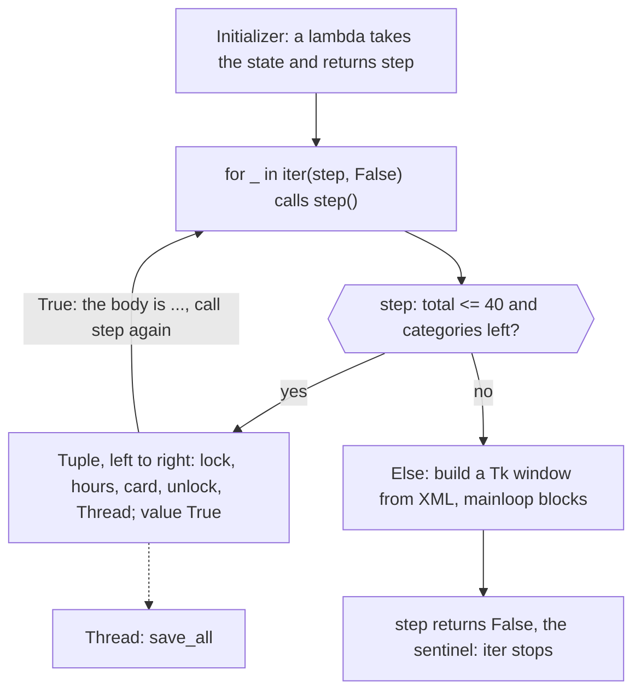

# One Statement, Python Edition

Ken's Python port of Jim Lehmer's C# challenge. It is one of four sibling ports, along with [Java](../JavaChallenge1/README.md), [Kotlin](../KotlinChallenge1/README.md) and [Go](../GoChallenge1/README.md). The Java README has [what every version does](../JavaChallenge1/README.md#what-every-version-does) and the [side-by-side comparison](../JavaChallenge1/README.md#side-by-side) of all four.

The constraint: `main` contains exactly one statement, a `for` loop with an empty body. This is a stunt in expression mechanics, not good production code. Nothing here connects to a real time-reporting system: the cards are flagged `is_demo`.

## Run it

You need only Python 3: `tkinter` and `sqlite3` are built in.

```powershell
py src\PythonChallenge1\program.py
```

Or, from the repo root, through Gradle: `.\gradlew.bat runPython`.

The window is a Tk window. Records land in `src/PythonChallenge1/data/demo-timecards.db`, beside `program.py`, whatever the working directory. Delete `data` to start over.

## Run it in a container

Prerequisite: Docker, set up once as described in [`SANDBOX-SETUP.md`](../../SANDBOX-SETUP.md#docker).

```bash
sandbox/container/run-image.sh --out ./results src/PythonChallenge1
```

It builds this folder's [`Dockerfile`](Dockerfile) and runs the result with no network, a read-only file system and user `nobody`. The image holds Python 3 with Tk, Xvfb and a screenshot tool. It has no pip and no compiler (about 340 MB). The window opens on a virtual display (Xvfb) *inside* the container, so nothing is drawn on your desktop: the run screenshots it, closes it, and prints the rows it wrote. With `--out`, `results/screenshot.png` is the window.

## Run it in Windows Sandbox

Prerequisites: Windows Sandbox and this entry's toolchain on your machine, set up once as described in [`SANDBOX-SETUP.md`](../../SANDBOX-SETUP.md#windows-sandbox).

```powershell
sandbox\windows\run.ps1 src\PythonChallenge1
```

It runs the entry in a throwaway VM with networking off, screenshots the window, asks it to close, and prints what it saved. This one has been tested.

## Layout

[program.py](program.py) is the whole port. The entity and repository classes sit in the same file, above `main`.

## Program Flow



**What this shows:** Python has no three-clause `for`, so the loop is `iter(step, False)`: call `step` until it returns the sentinel. One conditional expression is the test, and a tuple stands in for the comma list. Python evaluates the tuple's items in order, and the last item (`True`) is the value of the update.

**Why this mechanism matters:** the stop is a return value compared by `iter` with the sentinel, not a condition that the `for` itself checks. The window shows the same idea as the other ports: the final branch does the last work, then returns the value that ends the loop.

## How the stunt works

The work splits three ways: an **initializer** that builds the loop's state, a **condition** that decides whether to keep going (and, on the last check, shows the window), and an **update** that does one pass of work. Comment banners in the source mark the boundaries.

Python has no three-part `for`, no comma expressions and no statements inside expressions, so the loop is `for _ in iter(step, False): ...`. Calling `step` again and again is the loop. It stops when `step` returns the sentinel `False`.

- **Initializer.** A `SimpleNamespace` holds the state. It is passed to a lambda that builds `step`.
- **Condition.** One conditional expression: `(update ...) if total <= 40 and categories else (show the window ...)`.
- **Update.** A tuple of calls whose last element is `True`; `[-1]` picks it. Tuples evaluate left to right, which takes the place of the comma list. It locks, adds hours, stages a card, unlocks, and starts a `threading.Thread`.
- **Empty body.** The body is `...`, a bare constant expression. A `pass` would be a second statement.
- **Window.** The window is a Tk window, described by an XML string that is parsed at runtime with `xml.etree.ElementTree`, one widget per element via `getattr(tkinter, tag)`. `after()` repeats a timer that blends each label's color toward the background (Tk labels have no alpha). `mainloop()` blocks until the window closes.
- **Saving.** The program uses the standard-library `sqlite3`. `getattr(repo, "save_all")` plays the role of reflection.
- **Caveat.** `main` is exactly one `for` statement, but the lambdas and comprehensions inside it are expressions only. Imports, the entity and the repository sit outside `main`.

## Gotchas worth knowing

- **`main` is one `for` statement, but not everything is.** The lambdas and comprehensions inside it are expressions only. Imports, the entity and the repository sit outside `main`.
- **The empty body is `...`.** A `pass` would be a second statement.
- **The data lives beside the program.** Records land in `data/` next to `program.py`, whatever the working directory.
- **Tk labels have no alpha.** So the pulse blends each label's color toward the background instead of fading it.
- **This port has no check script,** so the sandbox gate does not cover it yet. Its Windows Sandbox profile has been tested.
