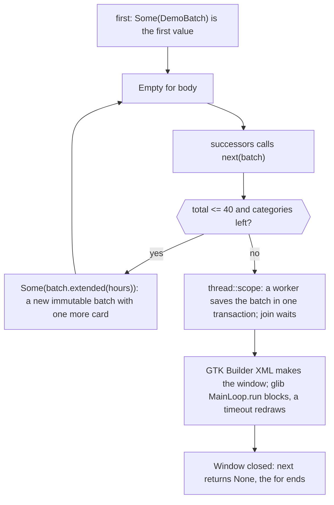

# One Statement, Rust Edition

**Teaches you:** that iterators and closures can express the control flow of a whole Rust program.

A WSL/GTK 4 companion to Jim Lehmer's C# challenge and Ken's [Java](../JavaChallenge1/README.md), [Kotlin](../KotlinChallenge1/README.md), [Python](../PythonChallenge1/README.md), and [Go](../GoChallenge1/README.md) versions. The point is to explore expression mechanics through a deliberately ridiculous constraint, not to offer a production architecture.

## Run it

You need a working WSLg desktop session. In Ubuntu 24.04, install the APT toolchain and the native libraries:

```bash
sudo apt-get update
sudo apt-get install -y build-essential pkg-config cargo rustc rustfmt \
    libgtk-4-dev libsqlite3-dev sqlite3
cd src/RustChallenge1
cargo run --locked
```

The locked dependencies are tested with Ubuntu's Rust and Cargo 1.75. Cargo needs network access to download crates on the first build. See Microsoft's [WSLg setup](https://learn.microsoft.com/en-us/windows/wsl/tutorials/gui-apps) if the window cannot open.

The window displays the generated total over a gently shifting shade; closing it ends the program. Each run appends fictional records to `$XDG_DATA_HOME/RustChallenge1/demo-timecards.db` (by default `~/.local/share/RustChallenge1/demo-timecards.db`), the Linux counterpart of the C# version's `%LOCALAPPDATA%\ModernChallenge1`. Delete that directory to start over. The database is **DEMO ONLY**, with no connection to a real time-reporting system.

## Run it in a container

Prerequisite: Docker, set up once as described in [`SANDBOX-SETUP.md`](../../SANDBOX-SETUP.md#docker).

```bash
sandbox/container/run-image.sh --online-build --out ./results src/RustChallenge1
```

This is the Linux home of this entry, and it needs no WSLg: the [`Dockerfile`](Dockerfile) compiles it with Ubuntu's Rust in a build stage, then runs the one binary on a base with the GTK 4 runtime, a virtual display (Xvfb) and a screenshot tool, and no Rust, headers or compiler. The window opens on that virtual display *inside* the container, the entrypoint screenshots it after a few seconds and closes it, and the run prints the SQLite rows it wrote. With `--out`, `results/screenshot.png` is the window. `--online-build` is needed because the build downloads the locked crates (the run itself has no network). The image is about 350 MB, because GTK 4 is big.

## Program Flow



**What this shows:** `std::iter::successors(first, next)` carries the three jobs of a `for`: `first` is the initializer, `next` is both the condition and the update, and returning `None` is the stop. The state is never mutated. Each step builds a new `DemoBatch`.

**Why this mechanism matters:** saving is a joined, scoped thread, so the program never says "saved" before the transaction finished. The GTK window runs its own event loop (`MainLoop.run`) inside the `next` call, which is the last step before the loop ends.

## How the stunt works

`main` is one empty-body `for` loop, and nothing inside it is a statement: no `;`, no `let`, no `return`. `tests/one_statement.rs` scans `src/main.rs` and fails if that stops being true. Helper types in `lib.rs` handle data generation and persistence, as the C# version's `DemoTimeCardContext` does.

Rust has no `;`-separated three-clause `for`, but `std::iter::successors(first, next)` has the same three jobs:

| `for` section | In the Rust version |
| --- | --- |
| Initializer | `first`: an immutable `DemoBatch` |
| Condition | `next` returns `None` to end the loop; as in the C#, the window is launched from inside it |
| Iterator | `next` returns `Some(batch.extended(hours))`, the batch plus one more card |

Two tricks take the place of the statements Rust would normally use:

- `match value { name => ... }` is a `let` that is an expression.
- `(a, b, c).2` is the comma operator: it evaluates `a`, `b`, `c` in order and yields the last.

The loop checks the running total before each record: while it is at most 40 and categories remain, it adds 10 to 19 hours for the next category. There are five category names (`Meetings` repeats), so a total of exactly 40 after four cards continues to a fifth card. When the batch is finished, a scoped worker thread saves it in one SQLite transaction. The thread borrows the cards, so nothing is cloned. The program joins the thread (waits for it to finish) before the window claims that anything was saved. Errors end the program with a message, and the program never reports success after a failure. The one exception is the GTK draw callback, where Cairo errors are ignored, because a panic there would abort across the C boundary. The calendar year and ISO week match the original's separate fields. Around New Year the ISO week-based year can differ from the calendar year.

| Original and Ken's ports | Rust companion |
| --- | --- |
| C# and Java use the three sections of a `for` with an empty body; Kotlin builds a sequence | Rust builds an iterator with `successors`, also with an empty body |
| Anonymous state objects and Kotlin `also` chains | An immutable `DemoBatch`; `match x { name => ... }` binds names |
| Comma-separated iterator expressions | Tuples, projected with `.N` |
| Runtime XAML or Spring XML builds the window | Runtime GTK Builder XML builds the window; a GLib timer moves a soft background shade |
| EF Core or Spring Data and SQLite | `rusqlite` and a local transaction |
| Background save and reflective method calls | A joined scoped thread; no reflection is needed, since `()` is an ordinary value in Rust |
| `Environment.UserName` | `$USER`, then `$LOGNAME`, ignoring empty values, else "unknown" |

The worker does not touch GTK. The UI and its event loop stay on the main thread. This version waits for persistence on purpose, unlike the original's intentionally awkward shared-context thread. So the thread is only a nod to the original, not a source of concurrency. The application is a language exercise, not a recommendation to hide work inside iterator expressions.

## Gotchas worth knowing

- **A test enforces the one-statement rule.** `tests/one_statement.rs` scans `src/main.rs` and fails if a `;`, a `let` or a `return` appears in `main`.
- **You need a desktop session.** Outside the container, the window needs WSLg. The locked dependencies were tested with Ubuntu's Rust and Cargo 1.75, and Cargo needs the network to download crates on the first build.
- **Cairo errors are ignored in the draw callback,** because a panic there would abort across the C boundary. Everywhere else, errors end the program with a message.
- **Around New Year, the ISO week-based year can differ from the calendar year.**
- **The thread is a nod to the original.** The worker waits for persistence on purpose, so it is not a source of concurrency.
- **There is no Windows Sandbox profile and no check script,** so the sandbox gate does not cover this port yet. The container image is about 350 MB, because GTK 4 is big.

## Check it

```bash
cargo fmt --check
cargo test --locked
cargo build --locked
```

Inspect the database with `sqlite3 data/demo-timecards.db 'select * from demo_timecards;'`.

---

See the [root README](../../README.md#the-results-so-far) for how this compares to the other entries, and [`CHALLENGE.md`](../../CHALLENGE.md) if you want to write your own.
