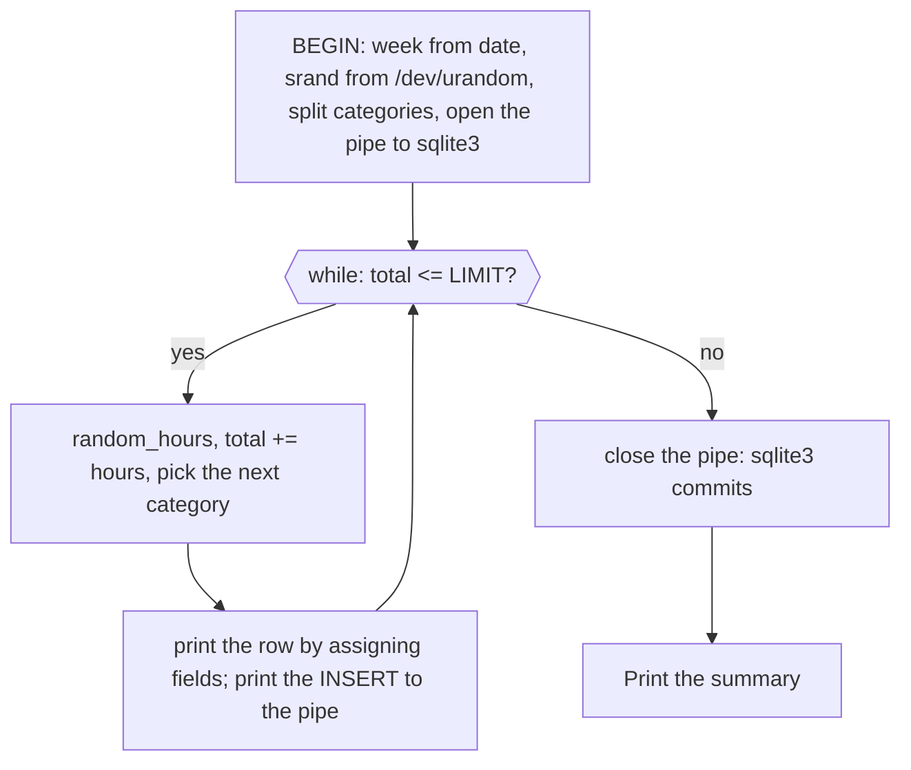

# AWK

**Teaches you:** that portable AWK can build records out of fields and stream its output through a pipe, with arrays and parameter-local variables for state.

> **DEMO ONLY.** Fictional timecards in a scratch SQLite file. No connection to any real time-reporting system.

This is the straight version, the one that shows how AWK is *meant* to be written. The challenge ("add 10 to 19 hour cards until the total passes 40") is one `while` loop; everything else in [`timecards.awk`](timecards.awk) is a small function that does one job. It is **portable POSIX awk**: it runs unchanged under gawk, mawk, the one-true-awk (BWK awk) and busybox awk. The weird version, which hands the loop to awk's own main loop and reads dice from `/dev/urandom`, is [`awk-weird`](../awk-weird/README.md).

## Run it

You need any POSIX `awk`, `sqlite3`, and the usual `date`, `od` and `mkdir`.

```bash
cd src/awk
awk -f timecards.awk
./check.sh                    # runs the check under every awk it finds; AWKS='gawk|mawk' ./check.sh to choose
```

Records go to `$XDG_DATA_HOME/Awk/demo-timecards.db` (default `~/.local/share/Awk/`). A run looks like this:

```text
# DEMO ONLY run 1794861273-1655779341
Meetings	19	19	2026-W47	DEMO ONLY
Coding	17	36	2026-W47	DEMO ONLY
Debugging	10	46	2026-W47	DEMO ONLY
# committed total=46 entries=3 DEMO ONLY
# a BEGIN-only awk program: arrays, a pipe to sqlite3, and fields rebuilding each row
```

## What it does

It draws cards of 10 to 19 hours, cycling through Meetings, Coding, Debugging and Learning, until the running total is greater than 40 (the card that crosses the line is kept), prints each row, and saves all of them to SQLite in one transaction.

## Program Flow



**What this shows:** the idiomatic shape of an AWK generator. There is no input, so `BEGIN` does everything, and an ordinary `while` is the loop. The test comes before each draw, so the card that crosses 40 is the last one added.

**Why this mechanism matters:** the pipe is an output stream with a name. `print ... | sqlite` starts `sqlite3` once and streams SQL to it, and `close` is what flushes it and returns its exit status. AWK's real loop, the one over input records, is not used here. The weird sibling [`awk-weird`](../awk-weird/README.md) uses it.

## How the stunt works

An AWK program is a list of `pattern { action }` rules that run once per input record, plus `BEGIN` and `END` rules. This program has **no input**, so everything happens in `BEGIN`, which is the idiomatic shape for a generator.

1. **Functions with locals in the parameter list.** AWK has no local-variable syntax: extra parameters *are* the locals, by convention written after a gap (`function command_line(command,    line)`). Any variable not in the list is global, which is why a function's parameters should not reuse the names the `BEGIN` block uses; `gawk --lint` warns about it, and `check.sh` runs that lint.
2. **`command_line`: a command as a data source.** `command | getline line` runs a shell command and reads its first output line; `close(command)` is required before you can run it again.
3. **`random_hours`.** `rand()` is in `[0, 1)`, so `int(rand() * 10)` is 0 to 9 and `HOURS_MIN + ...` makes it 10 to 19. The seed comes from `/dev/urandom` through `od` and goes to `srand`: without that, `rand()` repeats in most awks.
4. **Arrays.** `split("Meetings Coding Debugging Learning", CATEGORY, " ")` fills an array indexed from **1**. `CATEGORY[cards++ % 4 + 1]` picks the next one and counts the card in the same expression.
5. **The challenge.**
   ```awk
   while (total <= LIMIT) {
       hours = random_hours()
       total += hours
       category = CATEGORY[cards++ % 4 + 1]
       print_row(category, hours, total, week)
       print sql_insert(run, category, hours, total, week) | sqlite
   }
   ```
   The test is made before each draw, so the card that crosses 40 is the last one added.
6. **Fields as a record builder.** `print_row` assigns `$1` to `$5`; assigning to a field rebuilds `$0` joined with `OFS`, which `BEGIN` set to a tab, and `print` with no arguments prints it. No `printf` format string, no manual joining.
7. **A pipe as an output stream.** `print ... | sqlite` starts `sqlite3` once and streams SQL to it; the same command string is the same pipe. `close(sqlite)` flushes it and returns the command's exit status, which the program checks (see the gotcha on `close` below).
8. **Quoting.** `shell_quote` wraps a path as one shell word by `split`ting on `'` and joining with `'\''`; `sql_quote` doubles the quotes in a string. Both are done with plain string operations, because `gsub` replacement strings treat backslashes differently in different awks.

## Why this is idiomatic

- **Small functions** with their locals declared, and constants written in capitals.
- **`BEGIN` for a program without input**, and `ENVIRON` for the environment.
- **Arrays and `split`** for the lookup table; `printf`/`sprintf` for formatted text; the field-assignment idiom for a delimited row.
- **Pipes and `close`** for talking to other programs, the way AWK programs have since the 1970s.
- **Only POSIX features**: no `strftime`, `systime`, `gensub`, `RT` or arrays of arrays. Time comes from `date(1)`.

## What you can learn

- That AWK's local variables are extra parameters, and why that matters for naming.
- `$0` and the fields are one data structure: assigning either rebuilds the other.
- `getline` from a command and `close` to reuse it.
- Why you always seed `rand()`.
- Which AWK features are POSIX and which are GNU: this file is a small list of the portable ones.

## Gotchas worth knowing

- **Arrays from `split` start at 1**, not 0.
- **Uninitialized variables are `""` and `0` at once.** `total` and `cards` are set to 0 anyway, for readers and for the linter.
- **`srand()` with no argument seeds from the time of day**, which gives two runs started in the same second the same numbers; hence the `/dev/urandom` seed.
- **`close()` of a pipe returns different things in different awks.** Tested here: gawk and mawk return the command's exit status; busybox returns the raw wait status (exit status times 256, so still non-zero on failure); the one-true-awk build tested returns 0 whatever happened, so there a failing `sqlite3` would go unnoticed. The program's `!= 0` test is right for the first three; for a fourth awk, check what `close` gives you.
- **A path containing a double quote or newline** is not supported.
- **SQL by string building** is safe here only because every value is a number computed here or one of four fixed words. `sql_quote` is there anyway; do not copy this for untrusted input.
- **Formatting.** There is no formatter for AWK. `gawk --pretty-print` exists but rewrites the layout and drops most comments, so it is used here only as a parser check. The layout (four spaces, a comment above each function) is by hand.

## What `check.sh` enforces

The `DEMO ONLY` marker is there; no network-looking text; the challenge is a `while (total <= LIMIT)`; `gawk --lint --posix` has no complaints (so no GNU extensions and no shadowed variables). Then 25 real runs, under **each** awk found (gawk, mawk, the one-true-awk, busybox awk when installed), each checked for sane records (hours 10 to 19, categories in order, correct running totals, stopping exactly when the total passes 40) with SQLite agreeing with the printed output.

## Run it in a container

Prerequisite: Docker, set up once as described in [`SANDBOX-SETUP.md`](../../SANDBOX-SETUP.md#docker). The `cc-rt-awk` base image comes from `sandbox/container/build-bases.sh`.

```bash
sandbox/container/run-image.sh src/awk
```

It builds this folder's [`Dockerfile`](Dockerfile) and runs the result (under mawk, to show the portability) with no network, a read-only file system and user `nobody`, then prints the output and a read-only look at the rows it wrote. The image holds gawk, mawk and sqlite3 on a minimal Ubuntu.
