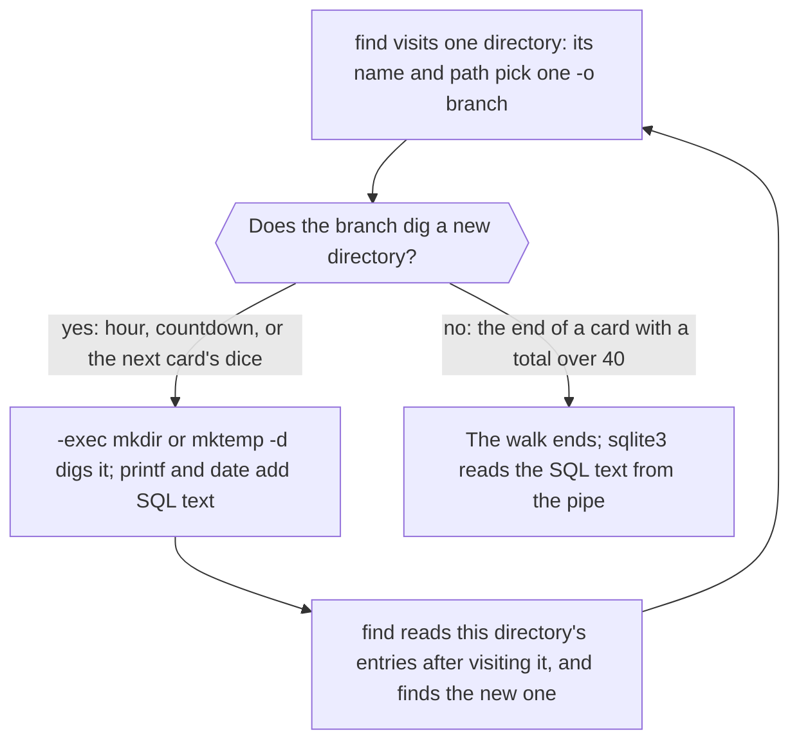

# POSIX find: the walk digs the tree it is walking

**Teaches you:** that a directory walk can be a loop and a program: find digs the tree it is walking, and the path to the current directory is the whole machine.

> **DEMO ONLY.** Fictional time cards, written to a scratch SQLite file under `$XDG_DATA_HOME/FindPosix/`.
> Nothing here touches real time reporting.

One `find` command is the whole program. It has no variables and no arithmetic. It does have a tree walk, `-name` and `-path` patterns, `-o` (or), and `-exec`. This entry asks: **can a file search be a time-card generator?** It can, if the walk keeps making new directories in front of itself and the directory names count for it.

The same output as the other entries:

```
# DEMO ONLY run 1
Meetings	19	19	2026-W47	DEMO ONLY
Coding	10	29	2026-W47	DEMO ONLY
Debugging	19	48	2026-W47	DEMO ONLY
# committed total=48 entries=3 DEMO ONLY
Runtime error near line 15: CHECK constraint failed: stop rule fired: total exceeds 40 (19)
```

The `find` line is about 5.7 KB long. (The GNU-only sibling, [`find-gnu`](../find-gnu/README.md), does the same job in about 3 KB by using `%d`, `%T` and `-regex`.) That is not a typo. find has no variables, so every "table" in it is written out as `-o` branches. [`build-line.py`](build-line.py) is the readable source of those tables, and `check.sh` makes sure the two agree.

## Run it

You need a POSIX shell, `find`, `mktemp`, `date`, `printf`, `mkdir` and `sqlite3` (`sudo apt install sqlite3`). Nothing else.

```bash
cd src/find-posix
./timecards.sh      # run the demo
./check.sh          # random runs, forced dice and the rules below, on every find it can see
python3 build-line.py   # print the find line (check.sh compares it with timecards.sh)
```

Records go to `$XDG_DATA_HOME/FindPosix/demo-timecards.db` (default `~/.local/share/FindPosix/`). `check.sh` tests GNU find, bfs and busybox find, whichever are installed. To pick your own: `FINDS="gnu=/usr/bin/find busybox=/usr/bin/busybox" ./check.sh`.

## Run it in a container

Prerequisite: Docker, set up once as described in [`SANDBOX-SETUP.md`](../../SANDBOX-SETUP.md#docker).

```bash
sandbox/container/run-image.sh src/find-posix
```

It builds this folder's [`Dockerfile`](Dockerfile) and runs the result with no network, a read-only file system and user `nobody`, then prints the output and a read-only look at the rows it wrote. The image holds GNU findutils, coreutils and sqlite3 on a minimal Ubuntu.

## Program Flow



**What this shows:** the loop is a tree walk that keeps growing. find reads a directory's entries *after* it visits the directory, so a directory that `-exec` makes inside the current one is walked next. The path from the start is the history, and the directory name is the state. It is the call stack of a recursion, drawn on the file system.

**Why this mechanism matters:** the stop rule is the absence of a new child: at the end of a card, five `0` hour-digits in the path (or four and a non-zero last digit) mean the total is over 40, and no branch digs. The running total is the number of hour directories in the path, and no arithmetic exists anywhere. This relies on the order in which find reads and visits, which is accidental to find, not promised by POSIX.

## How the stunt works

The Make entry asked how much work Make's own syntax could do. Its loop was Make re-executing itself, and its state was which files exist. This entry plays the same game with find. The trick is this: **find reads a directory's entries after it visits the directory.** So if `-exec` makes a new directory inside the one find is visiting, find walks into it next. The walk keeps going for as long as `-exec` keeps digging.

### The machine: a path is a program counter

Every step makes one directory. The directory's **name** is the state, and the **path** from the start is the history. There are three kinds of directory:

| Name | Means | Made by |
|---|---|---|
| six random characters, like `L45lDR` | the dice for one card | `mktemp -d` |
| one character, `0`-`9` | one hour. It is the last digit of the running total, counting 1, 2, ... 9, 0, 1, ... | `mkdir` |
| `b18` down to `b00` | hours still to go in this card | `mkdir` |

A card looks like this in the path (shortened):

```
t/wuq4YW/1/b18/2/b17/3/b16/ ... /9/b01/0/b00/L45lDR/1/b17/ ... /b00
         |  |               |        |      |
         |  |               |        |      +-- the next card's dice
         |  |               |        +-- last hour of this card
         |  +-- hours left: 18
         +-- the first hour (digit 1 of the running total)
```

This is the call stack of a recursive function, drawn on the file system. The path is the stack, and the walk goes down one level per step.

### Every job, and who does it

| Job | Done by |
|---|---|
| Loop | the walk, descending into the directory its own `-exec mkdir` just made |
| Branching | `-o` chains. `-a` binds tighter than `-o`, so `A -a B -o C -a D` is an if/else-if. Each directory matches exactly one branch |
| Randomness | `mktemp -d {}/XXXXXX` makes the dice. The last character picks the hours (see below) |
| Hours 10 to 19 | 60 of mktemp's 62 characters, in ten groups of six. `-path '*/[!/][!/][!/][!/][!/][abcdef]/?'` is "the dice show group 0", so print `10,` and dig `b09` |
| Countdown | `b18` makes `b17`, and so on. The next name is a literal in an `-exec mkdir`. Nothing is subtracted |
| Running total | the number of hour directories in the path. The last digit is the name of the last hour. The tens digit is how many directories named `0` the path has, because the digits cycle 1 ... 9, 0 |
| Category order | how many six-character names are in the path: `-path '*/[!/]...*/[!/]...*'` means "at least two cards" |
| Stop rule (`total > 40`) | at the end of a card, "five `0`s in the path, or four `0`s and the last digit is not 0". Exactly 40 continues, as in the other entries |
| ISO week and the end of the row | `-exec date "+'%G-W%V');"`. `date` is the clock and the ISO-week calculator at once |
| Output | `-exec printf`. find prints SQL text: an `INSERT` statement, built in pieces as the walk goes |
| Persistence | `sqlite3` reads that text from a pipe. SQLite holds the `CHECK` constraints and prints the report |

The line has no `-delete`, `-printf` or `-regex`, and nothing outside four primaries: `-name`, `-path`, `-o` and `-exec`. And `-exec` runs only four programs: `printf`, `mkdir`, `mktemp` and `date`. No `sh`, no `expr`, no `awk`. `check.sh` greps for all of this.

### Why `-path` is the arithmetic unit

In a `-path` pattern, `*` also matches `/`. So `-path '*/0/*/0/*'` means "the path has at least two directories named exactly `0`". That is a counter you can read. `-path '*/7/b00'` means "the last two names are `7` and `b00`". That is a lookup table with ten rows. The long line is made of such rows.

### The two tricks you can't skip

- **A new directory's name goes to stdout.** `mktemp -d` prints the path it made, and the path would land in the middle of the SQL. So the line prints ` -- ` first, and the path becomes an SQL comment. The line is its own filter.
- **Y and Z are thrown away.** mktemp uses 62 characters, and 62 does not divide by ten. If the last character is `Y` or `Z`, the walk reads the one before it instead. If both are `Y` or `Z` (one in 960), the hours are 10. That is a tiny bias, and `check.sh` has a forced-dice scenario for it.

### What the ordinary version would look like

Ten lines of shell: `while [ $total -le 40 ]; do hours=$((10 + RANDOM % 10)); total=$((total + hours)); ... done`. The point of this entry is that the walk, the names and the patterns do all of that, and the shell only starts find.

## What `check.sh` enforces

`check.sh` makes sure the stunt is real. `timecards.sh` may contain exactly one `find`, and no `for`, `while`, `until`, `case` or `if` anywhere. The `find` may use only `-exec`, `-name`, `-o` and `-path`. `-exec` may run only `date`, `mkdir`, `mktemp` and `printf`. The `find` line must be exactly what `build-line.py` prints.

Then, for each find implementation it can see, it runs the demo 25 times. Every run must have hours 10 to 19, categories in order (the fifth card is Meetings again), correct running totals, `DEMO ONLY` on every row, the ISO week from `date`, and a stop exactly when the total passes 40. The stop-rule error must appear on stderr exactly once and nothing else may. The rows in SQLite must match the printed ones. The scratch folder must be gone afterward, and across the 25 runs at least eight different hour values must show up.

Then it forces the dice. A fake `mktemp`, first on `PATH`, hands out chosen names, so seven scenarios exercise the tables on purpose. They cover every tens digit from 1 to 5, many units digits, a total of exactly 40 (which must continue), and the re-roll paths for a last character of `Y` and for `YZ`. The expected rows are computed with plain bash arithmetic. Last, a non-demo row must be refused by SQLite.

## Gotchas worth knowing

- **Walking into what you just made is *accidentally exploited*.** POSIX does not say what find does when a directory changes during the walk. GNU find 4.9, bfs 3.1.2 and busybox 1.36.1 all visit the new directory, and that is all this entry knows. Nobody promised it.
- **`*` in `-path` crosses `/`, and it ruined the first version.** The first countdown names were `b9`, `b10`, and the pattern `*/1/b*` matched an *earlier* `1/b...` in the path, so the digit stuck at 2 for the whole card. The fix: patterns end the match with fixed-width names (`b00`, `b18`), so the last segment is always exactly where you think.
- **A failing `mkdir` is noisy, so there is no mutex.** The first design made several dice and let the first good one win by `mkdir` of a claim directory. The losers printed errors. The design now makes one die per card and re-rolls inside the name.
- **`{}` inside a bigger word depends on the implementation.** The line uses `mkdir {}/b09` and `mktemp -d {}/XXXXXX`. POSIX leaves `{}` that is part of a longer argument unspecified. GNU find, bfs and busybox replace it in the tested runs. The entry's overall assurance follows the weakest necessary dependency: the unpromised descent into directories created during traversal.
- **Not run on BSD or macOS.** We have no such machine. The line uses `-path` (POSIX 2008), `-name`, `-o`, `-exec`, and the utilities `printf`, `mkdir` and `date '+%G-W%V'`. `mktemp` is not POSIX but is on every BSD and Linux system. If you try it on a BSD, `./check.sh` will tell you what breaks, and we would like to hear about it.
- **busybox runs `mktemp` inside itself.** A fake `mktemp` on `PATH` is never called, so the forced-dice scenarios are skipped for busybox. Its 25 random runs still pass.
- **A tree stays behind until the end.** The walk leaves a path more than a hundred names deep. `timecards.sh` makes it in a scratch folder and removes the folder when it exits, even on Ctrl-C.
- **The optimizer does not change the answer, and it tells on you.** On GNU find 4.9 we ran the line 15 times at each of `-O0`, `-O1`, `-O2` and `-O3`: every run was correct. The manual promises this, because find never reorders a test across a test that has side effects, and every branch here ends in `-exec`. `-D rates` prints how often each test really succeeded. In one run the line did about 57,000 test evaluations for 106 directories, which is the price of having no variables: every directory is checked against the whole table. The optimizer guessed that each `-path` succeeds 80% of the time. In that run the real rates were 33% and 50%, and 1 in 106 for the start directory.
- **The line is long on purpose.** Every ten-way choice is ten `-o` branches, and every one of them is written out. There is no way to loop inside a find expression, except by walking.

---

See the [root README](../../README.md#the-results-so-far) for how this compares to the other entries, and [`CHALLENGE.md`](../../CHALLENGE.md) if you want to write your own.
