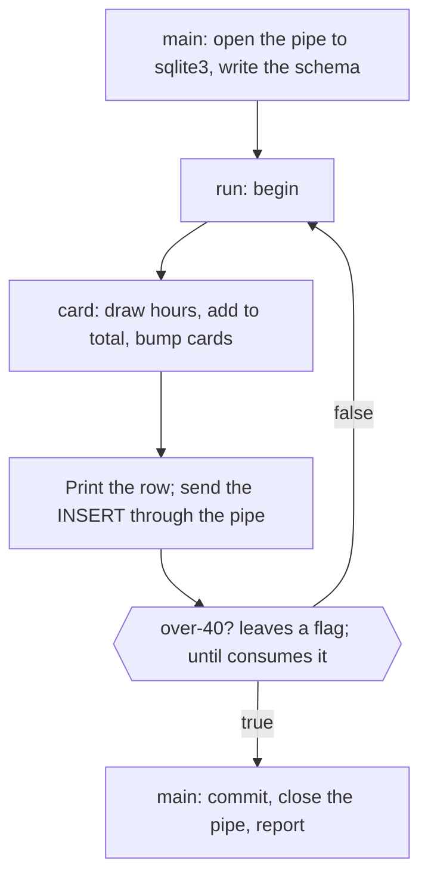

# Forth

**Teaches you:** that a stack language needs one `begin ... until` and a pipe to be a whole program.

> **DEMO ONLY.** Fictional timecards in a scratch SQLite file. No connection to any real time-reporting system.

The challenge ("add 10-19 hour cards until the total passes 40") is one word, `run`, and it is one line: `begin card over-40? until`. Everything else in [`timecards.fs`](timecards.fs) is a small word that does one thing, defined before it is used.

## Run it

You need Gforth (`gforth`, 0.7.3 or later) and `sqlite3`.

```bash
cd src/forth
gforth timecards.fs
./check.sh                  # set GFORTH=/path/to/gforth if it is not on your PATH
```

Records go to `$XDG_DATA_HOME/Forth/demo-timecards.db` (default `~/.local/share/Forth/`). A run looks like this:

```text
# DEMO ONLY run 1794674715672985
Meetings	19	19	2026-W46	DEMO ONLY
Coding	15	34	2026-W46	DEMO ONLY
Debugging	14	48	2026-W46	DEMO ONLY
# committed total=48 entries=3 DEMO ONLY
```

## Program Flow



**What this shows:** Forth has one ordinary loop, `begin ... until`. The loop body runs `card`, and then `over-40?` leaves a flag on the stack for `until` to take. The state lives in two variables, `total` and `cards`, and the data stack carries values between words.

**Why this mechanism matters:** the stop rule is a flag, not a condition in the loop's header. The flag is computed after the card, so the crossing card is kept. The weird sibling [`forth-weird`](../forth-weird/README.md) has no `begin` and no `until`.

## How the stunt works

Forth has almost no syntax: the interpreter reads a space-delimited word, looks it up, and runs it. A `:` definition is a new word; words pass values on a **stack**. Every definition in the file carries a *stack comment* such as `( hours -- )`, meaning "takes one number, leaves nothing". Read those first and most of the file explains itself.

The file is built bottom-up, so each word is made of words above it:

1. **State.** Two `variable`s, `total` and `cards`. `x @` fetches, `n x !` stores, `n x +!` adds.
2. **Categories.** Four one-line words (`meetings`, `coding`, …) each leave a string on the stack as an address and a length (`c-addr u`). `create categories ' meetings , …` builds a table of their *execution tokens* (`'` is "tick": the token of the next word). `category$` picks one with `4 mod` and runs it with `execute`. That is Forth's switch statement: an array of functions.
3. **Printing as plumbing.** `.num`, `tab`, `quoted` and `comma` are tiny output helpers so the SQL and the display rows read as lists of ingredients rather than escaped strings.
4. **SQLite.** `open-sqlite` starts `sqlite3` with `open-pipe` and keeps the handle in `sqlite`. `>sqlite` takes an execution token and runs it with `outfile-execute`, which **redirects all output to that file** for the duration. That is the stunt of the straight version: `.schema`, `.insert` and `.commit` are ordinary words that `cr` and `."` text, and the pipe turns that text into SQL.
5. **One card.** `card` draws hours, adds them to `total`, bumps `cards`, prints the row, and sends the insert. Note `dup .row`: `.row` consumes the hours, so a copy is kept for `.insert`, which runs *inside* `outfile-execute` against the same stack.
6. **The loop.** `: run  begin card over-40? until ;`. `until` consumes a flag from `over-40?` and repeats the body until the flag is true. `begin ... until` is the ordinary Forth loop, and the only control-flow word in the file.
7. **`main`.** Sets up, writes the schema, calls `run`, commits, closes the pipe and reports.

## What `check.sh` enforces

`check.sh` checks that `timecards.fs` carries the `DEMO ONLY` marker and has no network-looking text. Then it runs the program 25 times. Every run must print a sane record set: categories in order, hours from 10 to 19, running totals that add up, a `DEMO ONLY` mark on every row, and a stop exactly when the total passes 40. SQLite must agree with the printed rows. The 25 runs must be 25 different runs, and the hours must show at least six different values, so the "random" draws really look random. Last, it tries to insert a non-demo row and expects SQLite to refuse it, which proves that `CHECK(demo_only=1)` is real.

## Gotchas worth knowing

- **Control words only work inside definitions.** Typing `begin ... until` at the top level is an error in standard Forth. That is why `run` is a word. (The weird version cheats the other way.)
- **`s"` strings are temporary.** In some interpreters, `s"` outside a definition returns a buffer that is overwritten by the next one. The category words are definitions for that reason.
- **`random` is `0..n-1`.** `10 random 10 +` gives 10..19. Gforth seeds it with `seed`; this file seeds it from `utime` (microseconds), which is also the run id.
- **`close-pipe` returns the exit status.** `close-sqlite` turns a non-zero status into an abort, so a failed `sqlite3` is not silently ignored.
- **Gforth-specific words.** `outfile-execute`, `open-pipe`, `utime` and `s\"` are Gforth extensions, not ISO Forth.
- **No formatter exists.** The style is by hand: one stack comment per word, short words, two-space indents for bodies, and a trailing `$` on words that leave a string.
- **SQL by concatenation is a bad habit.** It is safe here only because every value is a number computed by the program or one of four fixed words. Do not copy it.

## Run it in a container

Prerequisite: Docker, set up once as described in [`SANDBOX-SETUP.md`](../../SANDBOX-SETUP.md#docker).

```bash
sandbox/container/run-image.sh src/forth
```

It builds this folder's [`Dockerfile`](Dockerfile) and runs the result with no network, a read-only file system and user `nobody`, then prints the output and a read-only look at the rows it wrote. The image holds Gforth and sqlite3 on a minimal Ubuntu. It has no compiler and no package manager.
