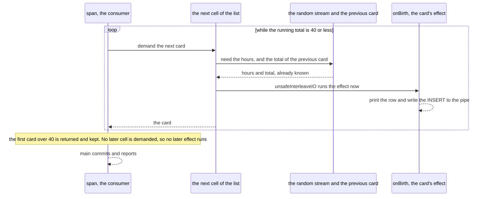

# Haskell on drugs

**Teaches you:** that reading a lazy list can drive a program when forcing each element has a side effect.

> **DEMO ONLY.** Fictional timecards in a scratch SQLite file. No connection to any real time-reporting system.

This is Haskell on drugs.

The program builds an **infinite list of cards**, and *forcing the n-th cell of that list prints card n and sends its `INSERT` to `sqlite3`*. Nothing else in the program writes a row. There is no loop, accumulator, counter or explicit recursion. The stop rule is a consumer, `span`, that stops asking for the next cell, and the `INSERT`s stop with it.

## Run it

You need GHC (`runghc`) and `sqlite3`. Only packages that ship with GHC are used.

```bash
cd src/haskell-weird
runghc timecards.hs
./check.sh                  # set RUNGHC=/path/to/runghc if it is not on your PATH
```

Records go to `$XDG_DATA_HOME/HaskellWeird/demo-timecards.db` (default `~/.local/share/HaskellWeird/`). A run looks like this:

```text
# DEMO ONLY run 1794674995-36735
Meetings	10	10	2026-W46	DEMO ONLY
Coding	11	21	2026-W46	DEMO ONLY
Debugging	13	34	2026-W46	DEMO ONLY
Learning	10	44	2026-W46	DEMO ONLY
# committed total=44 entries=4 DEMO ONLY
# the list of cards is a fixed point of itself, and reading it is what wrote the rows
```

## Program Flow



**What this shows:** the effects are tied to the *reading* of the list. The list is built so that nothing runs when it is made. Each cell holds a promise, and forcing the cell runs that card's `onBirth`. So the number of rows printed equals the number of `INSERT`s, equals the number of cards read.

**Why this mechanism matters:** this is demand-driven control flow with side effects, and it is only safe because of how the cells are linked. `unsafeInterleaveIO` is called *unsafe* for a reason: the order of effects now depends on the order of demand. The same laziness without effects is in the plain [`haskell`](../haskell/README.md) entry.

## How the stunt works

There are three tricks, stacked on each other.

### 1. A list defined in terms of itself (`fix`)

```haskell
rolls seed = map toHours (tail (fix (\xs -> seed : map next xs)))
```

`fix f = f (fix f)`: it hands a function *its own result*. Here `xs` is the list being defined, so `xs = seed : map next xs`: the first element is the seed and every later element is `next` applied to the one before it. It works because `map` only needs one element of `xs` at a time. This is the random stream with no `iterate` and no recursion.

### 2. A knot through the cards themselves (`fixIO`)

```haskell
sheet onBirth seed = fixIO $ \cards ->
  let before = 0 : map runningTotal cards
      born (c, h, t) = let card = Card c h (t + h) in card <$ onBirth card
   in lazily (map born (zip3 (cycle [minBound ..]) (rolls seed) before))
```

`cards` is the list being built, and `before` is `0` followed by the running total of each card in it. So card n's total is its hours plus the total read off card n-1, an element of the very list under construction. `fixIO` is `fix` for IO: it gives the action a handle on its own eventual result.

### 3. Effects that wait to be asked for (`unsafeInterleaveIO`)

```haskell
lazily = fix $ \self actions -> unsafeInterleaveIO $ case actions of ...
```

`sequence` turns a list of IO actions into one action returning a list, but it **runs all of them first**, which never returns on an infinite list. `lazily` does the same job with `unsafeInterleaveIO` around every cell, which means "run this action only when its result is demanded". After `sheet` returns, nothing has run. Each cell is a promise.

`onBirth` is the effect attached to a card: print the row, write the `INSERT` to the pipe. The stop rule in `untilOver40` is then only a `span`, a pure function that reads cards until one is over 40. Reading card n is what runs `onBirth` for card n. Total reads equals total `INSERT`s equals the number of printed rows, by construction.

## Gotchas worth knowing

- **Laziness bites twice.** The first draft counted the cards with `let entries = length cards` and the program printed `# committed total=Meetings 12 12 …` and then crashed with "handle is closed". A `let` binding is itself lazy, so nothing demanded the cards until the summary line was printed, after `COMMIT` and after the pipe had been closed. The cards' effects fired *during* the output of `show`. The fix is `entries <- evaluate (length cards)`, which forces the count *before* committing. With lazy IO, "when is it demanded?" is part of your program's meaning.
- **Why it is `unsafe`.** The order of effects is decided by the evaluator, not the text of the program. Here the order is safe because card n cannot be forced before card n-1 (its total depends on it).
- **`lazily` must defer its own pattern match.** The `case` is *inside* `unsafeInterleaveIO`. If the list of actions were matched when `lazily` was called, forcing it would need `before`, which needs `cards`, which does not exist yet: `<<loop>>`.
- **`take 1 over` fires one more effect.** The crossing card has to be read to see that it crosses, so its row is written. That is why the card is kept rather than dropped.
- **Production code should not do this.** Lazy IO is why `System.IO`'s `hGetContents` has famously surprising behavior; this program turns that surprise into the algorithm.

## What `check.sh` enforces

With comment lines removed: the cards are built with `fixIO $ \cards ->`; there is exactly one use of `unsafeInterleaveIO`; none of `scanl iterate foldr foldl unfoldr until go mapM forM forever replicateM foldM zipWithM sequence` appears; the `sheet` type is `(Card -> IO ()) -> Word64 -> IO [Card]`; and 25 runs each stop when they should, with the database agreeing with the output.

## Format and lint

The source is laid out by hand in [Ormolu](https://github.com/tweag/ormolu)'s style (two-space indent, leading commas, sorted imports) and compiles clean under `ghc -Wall -Wcompat`. It has **not** been run through the `ormolu` or `hlint` binaries; they were not available where this was written, so expect them to find small differences.

## Run it in a container

Prerequisite: Docker, set up once as described in [`SANDBOX-SETUP.md`](../../SANDBOX-SETUP.md#docker).

```bash
sandbox/container/run-image.sh src/haskell-weird
```

It builds this folder's [`Dockerfile`](Dockerfile) and runs the result with no network, a read-only file system and user `nobody`, then prints the output and a read-only look at the rows it wrote. In a build stage, GHC compiles the script to one binary. The image holds only that binary and sqlite3, with no GHC.
