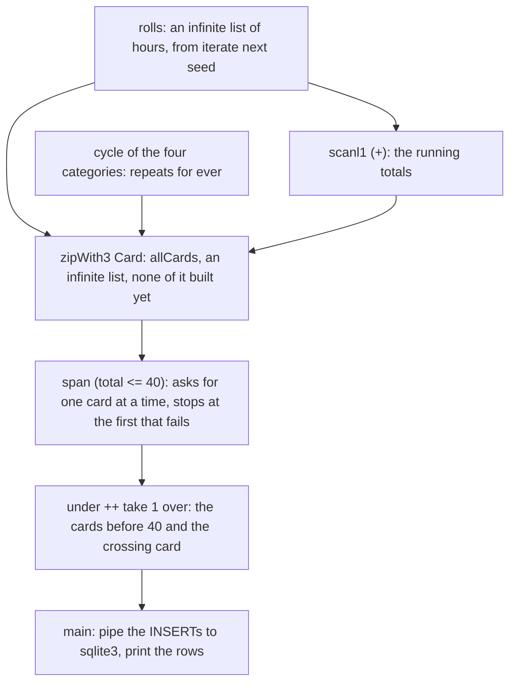

# Haskell

**Teaches you:** that a lazy list and one `span` are the whole stop rule.

> **DEMO ONLY.** Fictional timecards in a scratch SQLite file. No connection to any real time-reporting system.

This is straightforward Haskell: the challenge is one pure function, `timecards`, and `main` is plumbing around it.

## Run it

You need GHC (`runghc`) and `sqlite3`. Only packages that ship with GHC are used (`base`, `time`, `process`, `directory`, `filepath`, `unix`).

```bash
cd src/haskell
runghc timecards.hs
./check.sh                  # set RUNGHC=/path/to/runghc if it is not on your PATH
```

Records go to `$XDG_DATA_HOME/Haskell/demo-timecards.db` (default `~/.local/share/Haskell/`). A run looks like this:

```text
# DEMO ONLY run 1794674911-35631
Meetings	15	15	2026-W46	DEMO ONLY
Coding	12	27	2026-W46	DEMO ONLY
Debugging	10	37	2026-W46	DEMO ONLY
Learning	12	49	2026-W46	DEMO ONLY
# committed total=49 entries=4 DEMO ONLY
# the whole challenge is one pure function, timecards; main is just plumbing
```

## Program Flow



**What this shows:** the lists are descriptions, not data. Nothing is computed until `span` asks for a card, and `span` stops asking at the first card that fails the test. So only a handful of cards are ever built, even though the lists are infinite.

**Why this mechanism matters:** the stop rule is not a loop condition. It is *how much of a list you choose to read*. Demand flows backwards, from `span` to the lists, while the data flows forwards. This is lazy evaluation as a way to write a loop without one.

## How the stunt works

The file reads top to bottom as four steps, each a small function with a type signature.

1. **`rolls :: Word64 -> [Int]`** is an *infinite* list of hours in 10 to 19. GHC ships no random-number package, so this is a 64-bit linear congruential generator. `iterate next seed` produces `seed, next seed, next (next seed), …`; `tail` drops the seed itself; the high bits (`shiftR 33`) are the good ones. Because `Word64` arithmetic wraps on overflow, the "mod 2^64" the algorithm needs is free.
2. **`allCards :: Word64 -> [Card]`** is every card there could ever be, also infinite. `cycle [minBound ..]` repeats `Meetings, Coding, Debugging, Learning` forever (the `Category` type derives `Enum` and `Bounded`, so it can list itself). `scanl1 (+) hs` is a *running sum*: `[10, 11, 12]` becomes `[10, 21, 33]`. `zipWith3 Card` glues the three infinite lists into cards.
3. **`timecards :: Word64 -> [Card]`** is the challenge: `span ((<= 40) . runningTotal) (allCards seed)` splits the list at the first card whose total passes 40, and `under ++ take 1 over` keeps everything before it plus that card.
4. **Output.** `insert` and `row` turn a card into a SQL statement and a terminal line; `main` pipes SQL to `sqlite3` and prints rows.

### Why an infinite list is safe

Haskell is lazy: a value is computed only when something needs it. `span` looks at one card at a time and stops at the first one that fails the test, so only a handful of cards are ever built. The "infinite" lists are *descriptions*, not data. That is the lesson of the file: the stop rule is not a loop condition, it is *how much of a list you choose to read*.

## What `check.sh` enforces

`check.sh` first checks that the challenge really is a pure function: `timecards :: Word64 -> [Card]` must exist, so its type has no `IO`, and no `System.Random`, network or HTTP import may sneak in. The file also needs the `DEMO ONLY` marker. Then it runs the program 25 times. Every run must print a sane record set: categories in order, hours from 10 to 19, running totals that add up, a `DEMO ONLY` mark on every row, and a stop exactly when the total passes 40. SQLite must agree with the printed rows. The 25 runs must be 25 different runs, and the hours must show at least six different values, so the "random" draws really look random. Last, it tries to insert a non-demo row and expects SQLite to refuse it, which proves that `CHECK(demo_only=1)` is real.

## Gotchas worth knowing

- **`takeWhile` is not enough.** `takeWhile (<= 40)` drops the card that crosses the line, and the challenge needs it. `span` hands back both halves.
- **Partial functions.** `head`, `last` and `!!` crash on an empty list. Nothing here uses them: the total is a `sum` and the count is a `length`.
- **`Int` vs `Integer` vs `Word64`.** Hours and totals are small, so `Int`. The generator's state wants exactly 64 unsigned bits, so `Word64`, and its wraparound is a feature. With `Integer` you would have to write `mod 2^64` yourself.
- **`quote` doubles embedded `'`.** The inputs are fixed words and numbers here, so it never fires, but SQL assembled by string concatenation should always go through one escaping function.
- **`getXdgDirectory XdgData`** honors `$XDG_DATA_HOME` and otherwise falls back to `~/.local/share`, which replaces a hand-written `lookupEnv` routine.
- **The generator is for demos.** LCGs are fine for fictional hours and terrible for anything else.

## Format and lint

The source is laid out by hand in [Ormolu](https://github.com/tweag/ormolu)'s style (two-space indent, leading commas, sorted imports) and compiles clean under `ghc -Wall -Wcompat`. It has **not** been run through the `ormolu` or `hlint` binaries; they were not available where this was written, so expect them to find small differences.

## Run it in a container

Prerequisite: Docker, set up once as described in [`SANDBOX-SETUP.md`](../../SANDBOX-SETUP.md#docker).

```bash
sandbox/container/run-image.sh src/haskell
```

It builds this folder's [`Dockerfile`](Dockerfile) and runs the result with no network, a read-only file system and user `nobody`, then prints the output and a read-only look at the rows it wrote. In a build stage, GHC compiles the script to one binary. The image holds only that binary and sqlite3, with no GHC.
