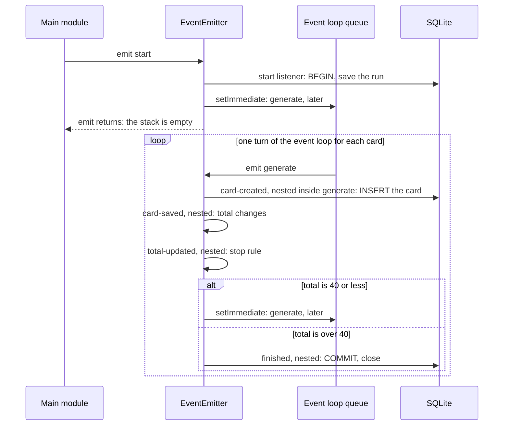

# JavaScript, event-driven: one line of work, an entire program in the listeners

**Teaches you:** that a program can be a set of listeners, each doing one small thing and then emitting the event the next one waits for; and that emit() calls its listeners at once, so only an explicit scheduling boundary gives the event loop a turn.

> **DEMO ONLY.** Fictional time cards, written to a scratch SQLite file under `$XDG_DATA_HOME/JavaScriptEvents/`.
> Nothing here touches real time reporting.

The [conventional entry](../javascript/README.md) is a `for` statement with an empty body. The [closure entry](../javascript-weird/README.md) is three closures pulled by an iterator. This one has **no loop statement and no pipeline**. The visible start-up is one line:

```js
program(realWorld()).emit('start');
```

Everything else is a *listener*: a small function that Node calls when an event arrives. The `start` listener opens the database. The `generate` listener makes a card. The `card-created` listener saves it. And so on, until the `finished` listener closes the program. The program is the set of listeners, and the loop is the way the events chain.

```text
$ node timecards.mjs
# DEMO ONLY run 1
Meetings	12	12	2026-W47	DEMO ONLY
Coding	17	29	2026-W47	DEMO ONLY
Debugging	17	46	2026-W47	DEMO ONLY
# committed total=46 entries=3 DEMO ONLY

Total simulated hours: 46.0
Saved locally for the modernization exercise.
```

With the same seed, all three Node entries print the same cards (`SEED=42`). Read them as a set of three: a [`for` clause](../javascript/README.md), a [lazy pull](../javascript-weird/README.md), and this, a chain of events. The [events lesson](../../lessons/cs/10-events-callbacks-and-reactive-control-flow.md) explains the ideas behind this one.

## Run it

You need **Node.js 24 or newer**: it has `node:sqlite` built in. `node:events` is built in too. There is no `npm install`.

```bash
cd src/javascript-events
node timecards.mjs                       # run the demo (SEED=42 replays one exact run)
node --test check.mjs                    # the event lab: 14 tests that prove what this page says
./check.sh                               # everything below (needs sqlite3 and GNU date, and `script` for the terminal tests)
```

Records go to `$XDG_DATA_HOME/JavaScriptEvents/demo-timecards.db` (default `~/.local/share/JavaScriptEvents/`).

## Run it in a container

Prerequisite: Docker, set up once as described in [`SANDBOX-SETUP.md`](../../SANDBOX-SETUP.md#docker).

```bash
sandbox/container/run-image.sh src/javascript-events          # the plain, CI-style output
sandbox/container/run-image.sh --tty src/javascript-events    # with a terminal: watch the DEMO ONLY line pulse
```

It builds this folder's [`Dockerfile`](Dockerfile) and runs the result with no network, a read-only file system and user `nobody`.

## Program Flow



**What this shows:** two kinds of arrow. An `emit` is a call: the listener runs *inside* it, on top of the caller, and `emit` returns only when the listener has. The `setImmediate` arrows are requests: the next `generate` waits in the event loop's queue until the stack is empty. Each card is one turn of the loop, and four emits nest inside that turn. A throw in any listener emits `failed`, which rolls back, reports once and removes every listener.

**Why this mechanism matters:** the program has no loop statement and no recursion. The cycle is "total-updated asks the event loop for another generate". Without that boundary the same events would nest one level deeper for every card. The database write finishes inside `card-created`, before the total changes in `card-saved`.

## How the stunt works

### The events

[`timecards.mjs`](timecards.mjs) registers ten listeners on one `EventEmitter`. Nine are the steps of the state machine. The tenth turns a stray `error` event into `failed` (see below). Read the table from top to bottom, and the program from top to bottom: they agree.

| Event | The listener does | Then |
|---|---|---|
| `start` | Opens the database, begins a transaction, saves the run | Asks for the first card **on a later turn** (`setImmediate`) |
| `generate` | Draws the hours and picks the category | Emits `card-created` (now) |
| `card-created` | **Saves the card** to SQLite | Emits `card-saved` (now) |
| `card-saved` | Only now: updates the running total, prints the row | Emits `total-updated` (now) |
| `total-updated` | **The stop rule.** Is the total over 40? | If yes, emits `finished` (now). If no, asks for the next card **on a later turn** |
| `finished` | Commits, prints the summary, closes the database | Ends, or starts the pulse timer on a terminal |
| `frame` | One tick of the pulse. Called by the timer | After the last tick, emits `done` |
| `done` | Removes every listener and ends the process normally | |
| `failed` | Rolls back, closes, tells the user once | Removes every listener, ends with status 1 |

### Two kinds of "then"

This is the lesson. The table says *now* in some rows and *on a later turn* in others, and they are not the same.

- **`emit()` is a call.** `events.emit('card-created', card)` calls every listener of `card-created`, in the order they were registered, and *returns only after they have all returned*. The listener runs on top of the caller on the **call stack**. If the listener emits another event, that is one more level. This is documented, and `check.mjs` proves it: a listener's output comes before the line after `emit()`.
- **`setImmediate()` is a request.** It puts a function on the event loop's queue and returns at once. Node runs the function after the current call stack has finished. By then every `emit` of this card has returned, and the stack is empty.

Why does it matter? Suppose `total-updated` called `events.emit('generate')` directly. Then the first card's `generate` would still be on the stack when the second card's `generate` started, and so on. Each card would add a few more frames, and a long enough run would end with `RangeError: Maximum call stack size exceeded`. With 40 hours that is no risk. With a limit of a million it is a crash. `check.mjs` shows both halves: an emitter that calls itself overflows (and it is caught, so the test is safe), and the real program stays at the *same* depth from card 1 to card 2000.

```text
turn 1:  start ................................... asks for generate, returns
turn 2:  generate > card-created > card-saved > total-updated ... asks for generate, unwinds
turn 3:  generate > card-created > card-saved > total-updated ... asks for generate, unwinds
...
turn N:  generate > card-created > card-saved > total-updated > finished > done
```

The `>` is "calls, inside". A turn is everything between two returns to the event loop. The lab also records every `emit` as it starts and returns, so the nesting is a fact you can read, not a story.

### The save happens before the total changes

`node:sqlite` is synchronous. `insert.run()` has written the row when it returns. So `card-created` saves the card first, and only then emits `card-saved`. The running total changes in the `card-saved` listener, never earlier. Nothing downstream can see a card that is not in the database, and a failed save leaves nothing half done. `check.sh` has a mutant that announces the card before saving it, and the lab catches it.

### When a listener throws

A listener that throws sends its exception *up* through `emit()` to whoever called it. Here that would be a callback that nobody waits for, so the exception would kill the process. So every listener is wrapped: the wrapper catches the exception and emits `failed`. The `failed` listener rolls the transaction back, closes the database, stops the timer, prints **one** message and removes **every** listener, itself included. A second failure finds nobody to tell, so a failure is reported exactly once.

Node treats the event name `error` in a special way: `emit('error', e)` with no listener *throws* `e`. This program registers a listener that turns a stray `error` into `failed`, so it has one way to fail. After the program removes all listeners, an unheard `error` throws again, and the lab checks that too.

### No leftovers

A listener, a timer or an immediate that stays registered keeps the process alive or leaks. The program ends by removing every listener, closing the database and (on a terminal) stopping its one timer. The lab compares `process.getActiveResourcesInfo()` before and after a run and finds no difference. A redirected run starts no timer, so Node has nothing left to wait for and exits at once.

| Job | Done by |
|---|---|
| Loop | A chain of events: `total-updated` asks for the next `generate` through the scheduler |
| Random hours | `rng`, a closure over the seed (Park-Miller): the same one as the other two Node entries |
| Running total, card count | One object `s`, touched only by listeners |
| Stop rule | The `total-updated` listener: `total > limit` |
| Persistence | The `card-created` listener, then a commit in `finished` |
| Failure | The `failed` listener, reached from every wrapped listener and from `error` |
| Output | `out()`, `raw()` and `err()` of the world object |

### Where does the program live, and what makes the next step run?

| | JavaScript, bodiless `for` | JavaScript, closures | JavaScript, events |
|---|---|---|---|
| Where the program lives | In the three clauses of a `for` | In three closures and one expression | **In ten small listeners** |
| Where the state lives | Properties of an object literal | Captured variables | **One object that only listeners touch** |
| What makes the next step run | The `for` statement | The consumer's demand: `next()` | **An event, then the scheduler** |
| What stops it | A condition that is false | A closure that says `done` | **A listener that does not ask for the next card** |
| Order of work is visible in | The order of the clauses | The shape of the pipeline | **The event names, and the emit calls** |

### The world is an argument

`program(world)` takes one object: the random numbers, the scheduler, the way to open the database, the output functions and the timer. `realWorld()` makes the real one. A test hands in its own: fixed hours instead of random ones, a scheduler that only queues, a scratch database, a timer it ticks by hand. The program does not change, and so the lab tests the program that runs.

## What `check.sh` enforces

- **The constraints are real.** `check-static.mjs` scans the source with comments and strings blanked out. There is no `for`, `while` or `do`, no `forEach`, `eval`, `async`, `await`, `nextTick` or `setTimeout`, and no import except `node:events`, `node:fs`, `node:os`, `node:path`, `node:sqlite` and `node:url`. The file ends with exactly one `emit('start')`. Exactly ten listeners exist, and `generate` is reached only through the scheduler. Nine mutants (a `for`, a `while`, `forEach`, `eval`, `child_process`, `async`, a direct `emit('generate')`, a second `emit('start')`, `nextTick`) are rejected.
- **The event lab (`check.mjs`).** Fourteen tests. One run saves only demo rows and the report matches them. It stops at exactly the right card (a total of exactly 40 goes on). `emit('start')` returns before any card exists. Events nest inside one turn like a call stack. `emit()` is synchronous and `setImmediate()` is a later turn. The stack stays the same depth over 2000 cards. An emitter that calls itself overflows. A failing insert and a failing commit each report once and roll back. `error` is routed. No listener, timer or immediate is left. The pulse is a timer that stops itself. The seed replays. The ISO week is right at New Year.
- **The lab fails on mutants.** Seven changes to the program (stop at 40 instead of over 40, no `ROLLBACK`, listeners left after a failure and after the end, a card announced before it is saved, no scheduling boundary, another random generator) each make the lab fail.
- **The rules of the challenge.** 25 random runs: categories in order, hours 10 to 19, correct running totals, a stop right after the first total over 40, `DEMO ONLY` everywhere, nothing on stderr, no escape codes in redirected output, and no file in the data folder but `demo-timecards.db`. In SQLite: only demo rows, the current user, and every `running_total` equal to the sum of the hours so far.
- **Seeds.** `SEED=42` twice gives the same cards, and the same cards as the other two Node entries. Twelve seeds match a separate model of the generator in awk, and a seed whose first four cards make exactly 40 must get a fifth.
- **The ISO week** agrees with GNU `date` on ten dates, and **the pulse** behaves on a pseudo-terminal, with `NO_COLOR`, with `TERM=dumb`, and when redirected.
- **Errors and the schema.** An unwritable data folder ends with a non-zero status and exactly one message. SQLite refuses a non-demo row or run, 9 hours and a fifth category.

## Why this is weird

An `EventEmitter` is for a program that *reacts*: a server hears a request, a window hears a click. Here nothing outside the program sends anything. The program emits every event to itself, so the listeners are not reacting. They are *steps*, and the emitter is a switchboard that connects them. The control-flow graph that a `for` statement keeps in one place is spread over ten functions and ten event names, and you have to read the `emit` calls to see it.

## When you should not do this

- **When a plain function call says the same thing.** `card-created` has exactly one listener, and it is always the same one. Replace the event with a call and the program gets shorter, and a debugger can step through it. An event earns its place when *more than one* party may care, or when the sender must not know who.
- **When you need the order to be obvious.** The order of work lives in the names of events, and in the order that listeners were registered. A reader must search for every `emit` to learn what follows what.
- **When errors matter.** A throw in a listener goes to the caller of `emit()`, which may be a callback that nobody awaits. This program needs a wrapper around every listener to avoid it.
- **When the producer is faster than the consumer.** Events have no back pressure: an emitter keeps emitting. This program is safe because each card waits for the previous one. A real event source needs a queue with a limit, or a stream.
- **When listeners can add or remove listeners.** Listeners that change who listens, in the middle of an `emit`, make the order hard to predict. This program removes its listeners only at the very end.

## Gotchas worth knowing

- **What the language promises.** `emit()` calling its listeners synchronously and in registration order is documented Node behavior, and so is `setImmediate()` running after the current operation: we mark the entry **guaranteed**. The *relative order* of `setImmediate` and `setTimeout(fn, 0)` is not promised everywhere, so the program does not depend on it. It uses only `setImmediate`.
- **`node:sqlite` is synchronous.** The save is finished when `run()` returns. With an asynchronous driver the `card-created` listener would have to wait for the write before it emitted `card-saved`, and the whole chain would need `async` and `await`. Events and promises are different tools.
- **`EventEmitter` is not an event loop.** The emitter has no queue and no loop. It is a table of listeners and a function that calls them. The queue and the loop are Node's, and `setImmediate` is how this program uses them.
- **`removeAllListeners()` inside an `emit` is safe.** Node copies the listener list before it calls the listeners, so the ones for the event in flight still run. The lab relies on that for `done`.
- **The pulse timer is the one real asynchronous source.** It exists only on a terminal. It is the only thing that keeps Node alive after the last card, and it stops itself.
- **We tested Node 24.15.** `node:sqlite` needs Node 22.5 or newer, and the other entries need 24. This one needs 24 too, to keep the three entries in step.

---

See the [root README](../../README.md#the-results-so-far) for how this compares to the other entries, and [`CHALLENGE.md`](../../CHALLENGE.md) if you want to write your own.
