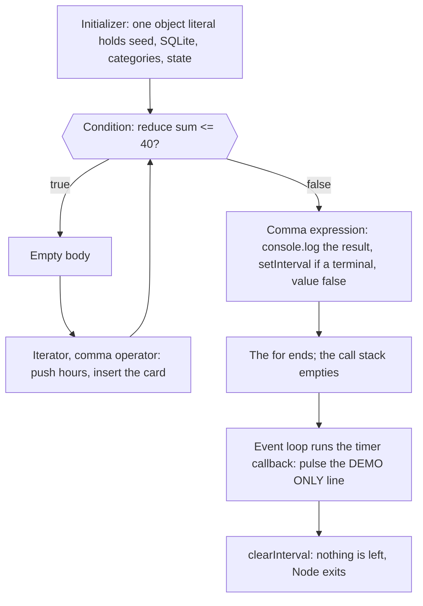

# JavaScript: back to the original, in Node.js

**Teaches you:** that a for statement is three expressions and an empty body, and that JavaScript's own evaluation order, truthiness and comma operator are enough to run a whole program from the three clauses.

> **DEMO ONLY.** Fictional time cards, written to a scratch SQLite file under `$XDG_DATA_HOME/JavaScript/`.
> Nothing here touches real time reporting.

This is the Node.js version of [the original C# challenge](../ModernChallenge1/README.md): a `for` statement with an empty body, and everything else in its three clauses. It stays as close to the C# as the language lets it. There is no window and no XAML. The result is printed on the terminal, and when the terminal is a real one, the **DEMO ONLY** line pulses, as the C# window faded in and out.

```text
$ node timecards.mjs
# DEMO ONLY run 1
Meetings	14	14	2026-W47	DEMO ONLY
Coding	17	31	2026-W47	DEMO ONLY
Debugging	15	46	2026-W47	DEMO ONLY
# committed total=46 entries=3 DEMO ONLY

Total simulated hours: 46.0
Saved locally for the modernization exercise.
```

This is a **port** (the same stunt in another language, like the Java, Kotlin, Python and Go entries). Its partner, [`javascript-weird`](../javascript-weird/README.md), solves the same problem with closures and no loop at all. Read them as a pair: the C# original, then this one, then the weird one.

## Run it

You need **Node.js 24 or newer**. The program uses `node:sqlite`, which is built in, so there is no `npm install` and no package.

```bash
cd src/javascript
node timecards.mjs                       # run the demo
SEED=42 node timecards.mjs               # replay one exact run
NOW=2026-12-31 node timecards.mjs        # pretend it is another day (for the ISO week)
PULSE_CYCLES=1 node timecards.mjs        # on a terminal: a shorter pulse (default 3 cycles of 1.2 seconds)
./check.sh                               # every rule below (needs sqlite3 and GNU date, and `script` for the terminal tests)
```

Records go to `$XDG_DATA_HOME/JavaScript/demo-timecards.db` (default `~/.local/share/JavaScript/`).

## Run it in a container

Prerequisite: Docker, set up once as described in [`SANDBOX-SETUP.md`](../../SANDBOX-SETUP.md#docker).

```bash
sandbox/container/run-image.sh src/javascript          # the plain, CI-style output
sandbox/container/run-image.sh --tty src/javascript    # with a terminal: watch the DEMO ONLY line pulse
```

It builds this folder's [`Dockerfile`](Dockerfile) and runs the result with no network, a read-only file system and user `nobody`. The image holds Node 24 (a pinned upstream build) and sqlite3 on a minimal Ubuntu.

## Program Flow



**What this shows:** the three clauses of a `for`, where the condition is a conditional expression that does the final work when it is false. The only asynchronous part is the pulse. Until the `for` is over, everything runs synchronously on one call stack.

**Why this mechanism matters:** the program has a loop, a stop and a second phase, and the second phase exists only because a timer keeps the event loop alive. Without a terminal there is no timer, and Node exits as soon as the `for` ends. The other two Node entries make this scheduling the point: [`javascript-weird`](../javascript-weird/README.md) (closures) and [`javascript-events`](../javascript-events/README.md) (listeners).

## How the stunt works

Open [`timecards.mjs`](timecards.mjs). After four `import` lines, the file is one statement. Read it as three clauses:

| Clause | Job |
| --- | --- |
| **Initializer** | One `let i = ...` builds all the state as properties of one object literal: the list of hours, the user name, the category names, the seed, the clock, an ISO-week function, the SQLite database, and flags for the terminal. It also creates the tables, starts a run and prepares the `INSERT`. The object literal plays the part of C#'s anonymous object |
| **Condition** | `i.hours.reduce(...) <= 40 ? true : (...)`. While the running total is 40 or under, it is `true` and the loop goes again. Once the total passes 40, the condition prints the result, starts the pulse timer on a terminal, and its value is `false`: the loop ends. The report is built inline, as the C# built its window inline |
| **Iterator** | A comma expression with two parts: draw one random number of hours (10 to 19) and push it, then `INSERT` one card. This is the only place that adds a card |

The body is `{ /* Intentionally empty. */ }`. **Trace one card:** the initializer runs once. The condition runs: the total is 0, so it returns `true`. The body does nothing. The iterator runs: it adds a card. Back to the condition: if the total is still 40 or less, it returns `true` again, and so on. The first time the condition sees a total over 40, the crossing card is already in the database, and the condition prints it and returns `false`. So the card that crosses 40 is included, because the iterator ran *before* that test.

### What the C# did, and what this does

| C# original | JavaScript here | A deliberate difference |
|---|---|---|
| `for (var i = new { ... }; cond; iter) { }` | `for (let i = ...; cond; iter) { }` | None. The empty body is kept |
| The anonymous object is the one declaration | An object literal is the one declaration | A `let` initializer cannot be followed by more expressions: the comma starts the next declarator. So the literal goes through an arrow function that finishes it with the comma operator. C# allows a list of statements instead of a declaration |
| `(from h in i.totalHours select h).Sum() <= 40d` | `i.hours.reduce((sum, h) => sum + h, 0) <= 40` | `reduce` is the closest relative of LINQ's `Sum`. Hours are whole numbers here, as the draw is `Next(10, 20)` |
| `... && i.categories.MoveNext() ? true : new Func<bool>(...)()` | `... <= 40 ? true : (console.log(...), ..., false)` | There is no `MoveNext` and no `Func`. See the next table about the categories |
| `Double.IsNaN(i.app.Run(new Window { ... }))` | `console.log(...)`, then `setInterval` on a terminal | There is no window. See the pulse below |
| `XElement` builds the `DoubleAnimation` | `setInterval` and ANSI codes | A timer plays the storyboard |
| EF Core, `DemoTimeCardContext`, `Database.EnsureCreated()` | `node:sqlite`, `CREATE TABLE IF NOT EXISTS` | No ORM. node:sqlite is part of Node, so it needs no package |
| `i.rnd.Next(10, 20)` (`Random.Shared`) | `10 + i.rnd() % 10` with a seeded Park-Miller closure | `Math.random` cannot be seeded. A closure over the seed can, so `SEED=42` replays a run |
| `Environment.UserName` | `os.userInfo().username` | None |
| `ISOWeek.GetWeekOfYear(DateTime.Now)` | A hand-written arrow, `i.iso` | JavaScript has no ISO week. The Thursday of the week decides the year. `check.sh` compares it with GNU `date` on ten dates |
| `Year = DateTime.Now.Year` | The ISO week-year | C# stores the calendar year next to the ISO week, and the two disagree near New Year (for example 2024-12-30 is in calendar year 2024 but in ISO week 1 of 2025, and 2021-01-03 is in calendar year 2021 but in ISO week 53 of 2020). A year and a week from the same system always agree |
| `Mutex`, a background `Thread`, `MethodInfo.Invoke` | Nothing | Node runs your JavaScript on one thread and `node:sqlite` is synchronous. The thread and the reflection were there to show off a 2008 style. Here the iterator saves the card by calling `insert.run` |
| `IsDemo = true` | `demo_only`, with a `CHECK` constraint | Same idea. The database refuses a row that is not DEMO ONLY |

### What matches the original, and what does not (measured)

| Behavior | C# original | This entry |
|---|---|---|
| Start | Opens the database in the initializer | Same |
| When the loop stops | When the sum is over 40, **or when the categories run out**. The 2008 original had four category names, so four cards of exactly 10 hours ended the run at a total of 40, with no card over 40. `ModernChallenge1` and the Java, Go, Kotlin, Python and Rust ports now have five names (`Meetings` repeats), like this entry | Only when the sum is over 40. The categories repeat (the fifth card is `Meetings`). A total of exactly 40 continues. That is a one-in-ten-thousand case, and `check.sh` has a test for it: it finds a seed that makes four cards total 40 and checks that a fifth card follows |
| The crossing card | Included | Included |
| Recorded fields | `Id`, `Category`, `Hours` (a double), `UserId`, `Year`, `Week`, `IsDemo` | `category`, `hours` (an integer), `user_id`, `year`, `week`, `demo_only`, plus `run_id` and `running_total` for the book's shared checks |
| What you see | A WPF window: **DEMO ONLY - no real time system is involved**, **Total simulated hours: 46.0**, **Saved locally for the modernization exercise.**, fading in and out | The same three texts on the terminal: the report first, always. On a terminal, the first text pulses (bold, then dim) |
| Waiting | The window stays until you close it | The pulse runs 3 cycles (about four seconds), then the program ends. In CI, or when redirected, it ends at once |
| Errors | An unhandled exception ends the process with a non-zero status | The same: an exception (for example, a data folder that cannot be created) prints a message and exits with status 1 |

### The pulse and the event loop

The `for` statement is synchronous. All the cards are drawn, and the report is printed, before the first timer can fire. The pulse is `setInterval`: when the loop is done, Node's **event loop** runs the timer every 600 milliseconds, writes a line (`\r`, then a bold or dim version of the text), and after the last cycle clears the timer. Then there is nothing left to wait for, and Node exits.

- **It never delays the computation.** The timer is only started in the *false* branch of the condition, after everything is saved.
- **It is off when it should be.** The timer starts only when standard output is a terminal and `TERM` is not `dumb`. A pipe or a file gets the plain report and nothing else, and the program ends at once.
- **`NO_COLOR` is respected.** With it set, the line blinks between `*DEMO ONLY ...` and ` DEMO ONLY ...` and there are no escape codes for style. (The `\r` and the erase-line code stay: they are cursor control, not color.)
- **Backpressure** does not matter here. The program writes a few hundred bytes, so it does not wait for the stream to drain.

## What `check.sh` enforces

`check.sh` needs Node 24 or newer, `sqlite3` and GNU `date`.

- **The constraint is real.** `check-structure.mjs` scans the file, with comments and strings blanked out. After the imports it must be **one `for` statement**: exactly two semicolons in the header, an empty body, no other statement, no second `for`, no `while`, no `do`, no `forEach`, no `eval`, no `Function`. Six mutants of the program are rejected: a statement after the loop, a body in the loop, a `runEverything` wrapper, a hidden `while`, a second `for`, and `eval`. The program imports no network, process or thread module.
- **The rules of the challenge.** 25 random runs: categories in order, hours 10 to 19, correct running totals, a stop right after the first total over 40, `DEMO ONLY` everywhere, nothing on stderr, no escape codes in redirected output. In SQLite: only demo rows, the current user, and every `running_total` equal to the sum of the hours so far.
- **A seed replays a run.** `SEED=42` twice gives the same cards. Twelve seeds (totals of 41, 42, 50, 51 and 57, in three to five cards) match a separate model of the generator, written in awk. A seed whose first four cards make exactly 40 is found and must get a fifth card.
- **The ISO week.** The week and year agree with GNU `date +%G-W%V` for ten dates: the first days of January, 53-week years, and the last days of December.
- **The pulse.** On a pseudo-terminal (made with `script`): the report is printed first, then the line pulses bold and dim. With `NO_COLOR`: plain blinking, no style codes. With `TERM=dumb`: no escape codes. Redirected: no timer, and the run ends in under 3 seconds.
- **Errors and the schema.** An unwritable data folder ends with a non-zero status and a message. SQLite refuses a non-demo row or run, 9 hours and a fifth category.

## Gotchas worth knowing

- **Node 24 or newer.** `node:sqlite` came in with Node 22.5. It is not part of any standard, and it is newer than most of Node's API, so read its stability note in the Node documentation for your version (**implementation-permitted**: we tested it only on the versions below). The `for` semantics are **guaranteed** by the ECMAScript specification. The entry also runs on Node 24.15 and 24.22, which are the versions we tested.
- **`let` in a `for` header makes a new binding on each pass.** The specification copies the loop variable for every iteration, so a closure made inside the loop sees its own copy. Here that does not matter, because `i` holds *one object*, and every copy points to it. If `i` had been a number, the iterator could not have updated it for the condition. This is why the state is an object.
- **The comma has two meanings.** In `let a = 1, b = 2` it separates declarators. In `(x, y)` it is an operator that evaluates both and gives `y`. The initializer has to use the second kind after the declaration, which is why the arrow function is there.
- **`this` is not the object.** The pulse callback is a `function` and not an arrow, only because `clearInterval(this)` needs the timer object that Node passes as `this`. Everything else uses arrows, which read `i` from the enclosing scope.
- **Recursive `mkdir` can spin.** On Node 24.15 on Linux, `mkdirSync(path, { recursive: true })` on a path under `/proc` never returned (we stopped it after ten minutes). The check uses a plain file as the parent folder, to get an error at once. That is a Node issue, not part of the program's design.
- **No `Math.random`.** It cannot be seeded, so a closure with Park-Miller (multiplier 48271, modulus 2147483647) draws the hours. The distribution is uniform enough for a demo, and not for anything else.
- **The pulse is a polite lie.** It is a timer that rewrites one line. If your terminal does not support ANSI codes, it prints them as text. Set `NO_COLOR` or `TERM=dumb`, or redirect the output.

---

See the [root README](../../README.md#the-results-so-far) for how this compares to the other entries, and [`CHALLENGE.md`](../../CHALLENGE.md) if you want to write your own.
