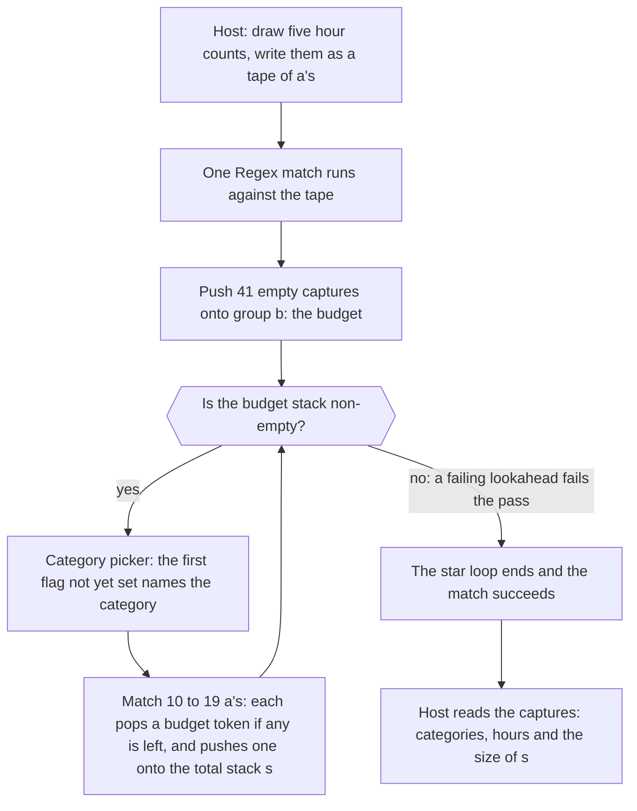

# Regex challenge, Track 3: .NET balancing groups (the purist's attempt)

**Teaches you:** a regex as a stack-based counter.

One `Regex.Match` call, no callouts, no inline code, no `MatchEvaluator`. It follows the regex challenge plan (since removed; it lives in git history as `plans/regex.md`), which expected this track to hit a wall. It did hit some, and they are listed below, but the core got further than the plan predicted. **DEMO ONLY**: the records are fictional and go to a scratch file, with no connection to any real time-reporting system.

## Run it

You need the .NET 10 SDK (cross-platform; nothing here is Windows-specific).

```bash
cd src/regex-dotnet
dotnet run -c Release       # run the demo
./check.sh                  # 25 runs, asserts the rules below
```

Records are appended to `$XDG_DATA_HOME/RegexDotnet/demo-timecards.tsv` (default `~/.local/share/RegexDotnet/`). Delete that directory to start over. A run looks like:

```text
match returned: true
records at ~/.local/share/RegexDotnet/demo-timecards.tsv (latest run below)
# DEMO ONLY 2026-11-13T16:33:06
Meetings	16	2026-W46	DEMO ONLY
Coding	16	2026-W46	DEMO ONLY
Debugging	18	2026-W46	DEMO ONLY
# captured total=50 entries=3 DEMO ONLY
```

## Run it in a container

Prerequisite: Docker, set up once as described in [`SANDBOX-SETUP.md`](../../SANDBOX-SETUP.md#docker).

```bash
sandbox/container/run-image.sh src/regex-dotnet
```

It builds this folder's [`Dockerfile`](Dockerfile) and runs the result with no network, a read-only file system and user `nobody`, then prints the output and a read-only look at the rows it wrote. The .NET SDK builds it in a build stage. The image holds only the compiled dll on the .NET runtime, with no SDK.

## Program Flow



**What this shows:** the regex engine is a machine with stacks. A balancing group pops one stack and pushes another in the same step, so a single `a` can spend one unit of budget and add one hour to the total. The budget stack is the stop rule: when it is empty, the next pass cannot start.

**Why this mechanism matters:** the state is stack *depth*. Nothing counts and nothing adds. The match succeeds, and the program's answer is what the engine captured. An entry may push the total over 40 mid-way, because the budget runs dry partway through its hours and the extra `a`s pop nothing.

## How the stunt works

The host draws five random hour counts and builds a *unary tape*: `Meetings:aaaaaaaaaaaaaaa;Coding:aaaaaaaaaaaa;...;Meetings:aaaaaaaaaaa;` (one `a` per hour; the fifth name is `Meetings` again, so that four 10-hour cards, which total exactly 40, can be followed by a fifth). It fires one match against the tape and reads out what the pattern captured. The pattern does the rest:

| Piece | Job |
| --- | --- |
| `\A(?:(?<b>)){41}` | The **budget**: 41 empty captures pushed on group `b`'s stack. 41 because the stop rule is "total *exceeds* 40" |
| `(?: ... )*` | The loop: each pass is one timecard entry |
| `(?(b) ... \|(?!))` | The **stop rule**. While the budget stack is non-empty, take another entry; once it is empty, `(?!)` fails the pass and the `*` ends |
| `(?(fm)(?(fc)(?(fd)(?(fl)(?!)\|(?<fl>)Learning)\|(?<fd>)Debugging)\|(?<fc>)Coding)\|(?<fm>)Meetings)` | The **category picker**: four flag groups are a little state machine. The first pass finds `fm` unset, so it takes Meetings and sets it; the next sees `fm` and takes Coding; and so on. After the second `Meetings`, the last `(?!)` stops a sixth pass |
| `(?<hrs>(?:(?(b)(?<-b>))(?<s>)a){10,19});` | The entry's hours. Each `a` pops one budget token if any are left (a **balancing group**), pushes one onto the running-total stack `s`, and the `{10,19}` enforces the demo's range |

An entry can push the total over 40 from anywhere in its 10-19 hours; the budget simply runs dry partway through it and the extra `a`s pop nothing. After the entry the stop rule sees an empty stack. The captured state is then: `cat` and `hrs` capture lists (the records), and `s`'s capture count (the total).

I checked the edges with a throwaway prototype (not in the repo, because the real program has no way to inject a fixed draw): totals of exactly 40 (four 10-hour cards, one token left, which now continues to a fifth card), 41 on the fourth entry, and 45 and 57 stopping after three all came out right. `check.sh` verifies the stop rule on every random run (the total before the last card is at most 40 and the total after it is over 40, with three to five cards), and it builds a copy of the host in which every card is worth 10 hours to prove that exactly 40 continues: five rows, the fourth `Learning`, the fifth `Meetings`, total 50.

## What `check.sh` enforces

`check.sh` makes sure the host stays honest. `Program.cs` may have no loop keyword and none of `MatchEvaluator`, `Replace`, `NextMatch` or `Matches`, and it must contain exactly one `Regex.Match` call. Then it runs the program 25 times. Each run must report that the match returned `true` (this track cannot fail on purpose). Each run must print as many rows as it has entries, the hours must sum to the total, and every hour count must be from 10 to 19. The stop rule must be right: the total before the last card is at most 40 (exactly 40 continues) and the total after it is over 40, with three to five entries. The total can never be more than 59. Last, a copy of the host with every card worth 10 hours must deal five rows, the fourth `Learning` and the fifth `Meetings`, with a total of 50.

## Gotchas worth knowing

1. **A regex cannot draw random numbers.** The random 10-19 draws had to be seeded by the host, as five unary strings. The plan allows the host to "seed the initial data", so this is within the rules, but the regex does not choose the hours. It only bounds them (`{10,19}`) and accumulates them.
2. **A regex cannot write anything.** There are no side effects in this track. The pattern's whole output is its captures; the host formats them and does the one `File.AppendAllText`. That makes the "persist as a side effect of matching" idea of the other two tracks impossible here.
3. **The signature move is impossible.** I tested it: append `(?!)` to the pattern and the match fails, and a failed `Match` exposes nothing, so every capture, including the hours already accumulated, is gone (`Success` false, 0 captures). The other tracks do their work in side effects that survive the failure; here the only output is the captures, which die with it. So this track *must* return true.
4. **No pulse.** The terminal pulse needs side effects during the match. This track has none, and a host loop to animate it would break the rules.
5. **Unrolled randomness, not a random loop.** The tape always holds five draws even when only three are needed (any draw left over once the budget runs dry is ignored). The `*` loop is real, but the draws are fixed up front.

### Honest fine print

- The host does one iteration-shaped thing: reporting. `string.Concat(...Zip(...))` walks the captured `cat` and `hrs` lists to format the rows. It only reads the final captured state, which the plan allows ("print/report the final state"), and `check.sh` rejects `MatchEvaluator`, `Replace`, `NextMatch`, `Matches` and any loop keyword in the host, and requires exactly one `Regex.Match`. Still, it is a LINQ pass, and I would rather say so than hide it.
- The total printed is the count of captures on the `s` stack, which the regex built. The per-row hours are the lengths of the `hrs` captures.
- The pattern is unformatted on purpose, as in the other tracks.

---

See the [root README](../../README.md#the-results-so-far) for how this compares to the other regex entries, and [`CHALLENGE.md`](../../CHALLENGE.md) if you want to write your own.
