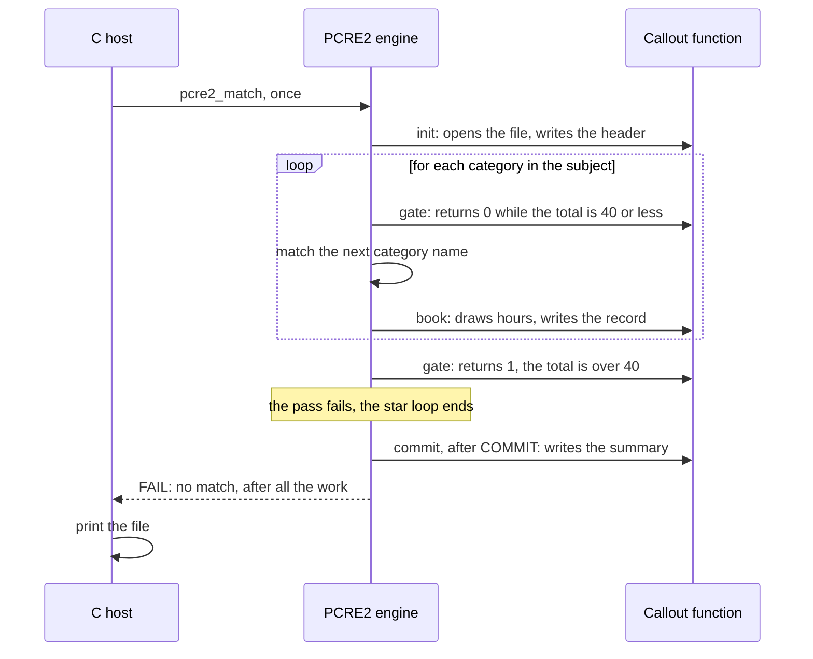

# Regex challenge, Track 2: PCRE2 callouts as a tiny DSL

**Teaches you:** that regex callouts can serve as a tiny instruction set.

One `pcre2_match` call runs the whole timecard demo, then reports **no match**. It follows the regex challenge plan (since removed; it lives in git history as `plans/regex.md`). **DEMO ONLY**: the records are fictional and go to a scratch file, with no connection to any real time-reporting system.

## Run it

```bash
sudo apt install -y build-essential pkg-config libpcre2-dev
cd src/regex-pcre2
make run          # build and run the demo
make check        # 25 runs, asserts the rules below
```

Records are appended to `$XDG_DATA_HOME/RegexPCRE2/demo-timecards.tsv` (default `~/.local/share/RegexPCRE2/`). Delete that directory to start over. A run looks like:

```text
pcre2_match returned -1 (no match)
records at ~/.local/share/RegexPCRE2/demo-timecards.tsv (latest run below)
# DEMO ONLY 1794612149
Meetings	19	19	DEMO ONLY
Coding	10	29	DEMO ONLY
Debugging	15	44	DEMO ONLY
# committed total=44 entries=3 DEMO ONLY
```

## Run it in a container

Prerequisite: Docker, set up once as described in [`SANDBOX-SETUP.md`](../../SANDBOX-SETUP.md#docker).

```bash
sandbox/container/run-image.sh src/regex-pcre2
```

It builds this folder's [`Dockerfile`](Dockerfile) and runs the result with no network, a read-only file system and user `nobody`, then prints the output and a read-only look at the rows it wrote. The C host is compiled in a build stage. The image holds only the binary and the shared libpcre2, with no compiler or headers.

## Program Flow



**What this shows:** the C host has no loop. It calls `pcre2_match` once and the engine calls back into the host at every callout. The callout name is an opcode. The return value is the decision: `0` means continue and `1` means fail this branch.

**Why this mechanism matters:** the stop rule is a callout that returns `1`, so the `*` quantifier ends by backtracking. `(*COMMIT)` makes `commit` run exactly once, and `(*FAIL)` makes the whole match lose. The callouts are synchronous calls from the engine, not queued events.

## How the stunt works

The pattern is the whole program:

```text
^(?C"init")(?:(?C"gate")(Meetings|Coding|Debugging|Learning)(?C"book"))*(*COMMIT)(?C"commit")(*FAIL)
```

The C host (`timecards.c`) compiles it, registers one callout dispatcher, calls `pcre2_match` once against `MeetingsCodingDebuggingLearningMeetings` (five names, so that four 10-hour cards, a total of exactly 40, can be followed by a fifth), and prints the file. It has no `for`, `while`, `do`, `goto`, or recursion (`check.sh` greps for them). The callout strings are opcodes:

| Opcode | Does | Return value to the engine |
| --- | --- | --- |
| `init` | opens the scratch file, writes the header | 0 (continue) |
| `gate` | the stop rule | 1 (fail this branch) once the total is over 40, which ends the `*` loop; else 0 |
| `book` | draws 10 to 19 hours, adds to the total, writes the record for the category that was just matched (read from capture group 1) | 0 |
| `commit` | writes the summary line, closes the file | 0 |

PCRE2 supplies the iteration (`*`), the category walk (the subject string and the alternation), and the backtracking. `(*COMMIT)` keeps a failed match from retrying shorter loops, so `commit` runs exactly once. `(*FAIL)` then makes the whole match lose, after everything was written. That is the signature move.

## The pulse

On a real terminal, the match finishes the records, then pulses a **DEMO ONLY** banner through a gray ramp for about three seconds (60 frames, 50 ms each), then clears it. `pulse` and `settle` are two more opcodes: the host appends 60 `~` characters to the subject, and `[A-Za-z]*(?:~(?C"pulse"))*(*COMMIT)(?C"settle")` draws one frame per tick. The host still has no loop. The second `(*COMMIT)` stops the final `(*FAIL)` from backtracking into shorter tick counts and rerunning `settle`. Nothing is appended when stdout is not a terminal, so pipes and `check.sh` skip it.

## The optimizer caveat, as the plan asks

Callouts only mean something if the engine actually visits them. This program compiles with `PCRE2_NO_AUTO_POSSESS | PCRE2_NO_START_OPTIMIZE | PCRE2_NO_DOTSTAR_ANCHOR`, so the optimizer cannot skip or reorder the callout points. It also does **not** use the PCRE2 JIT, which does not support callouts at all. `check.sh` verifies that every run's committed total and entry count agree with the rows actually written, which is the evidence that no callout was silently skipped. This was tested with the system PCRE2 (10.42 on Ubuntu 24.04); I did not test with those flags removed to see which callouts the optimizer would elide.

## What `check.sh` enforces

`check.sh` checks that the C host has no loop keyword (comments excluded). Then it runs the program 25 times. Each run must exit cleanly and report `pcre2_match returned -1 (no match)`. Each run must print as many rows as it has entries, with at least three entries, hours from 10 to 19, no early stop (the total must end over 40), three to five entries, and a total of at most 59. It also builds a copy of the host in which every card is worth 10 hours and checks that exactly 40 continues: five rows, the fifth `Meetings`, total 50.

## Gotchas worth knowing

- The `*` loop ends because `gate` fails the next iteration (or the five category names run out, which only matters when the total is still 40 or less after four cards: it never is after five), not because anything in C decides to stop. The C only answers the question "is the total over 40?" when the engine asks.
- The state (`total`, `entries`, the file) lives in a C struct that the callouts share, so, unlike Perl's `local`, none of it rewinds on backtracking. That suits this program: nothing is ever undone.
- The dispatcher is a ternary chain, not a table, to keep the host free of loops and function-pointer tricks. Unknown opcodes (and I/O errors) abort the match with `PCRE2_ERROR_CALLOUT`, which is deliberately not the `-1` that means "no match", and the host reports success only if `commit` actually ran.

---

See the [root README](../../README.md#the-results-so-far) for how this compares to the other regex entries, and [`CHALLENGE.md`](../../CHALLENGE.md) if you want to write your own.
