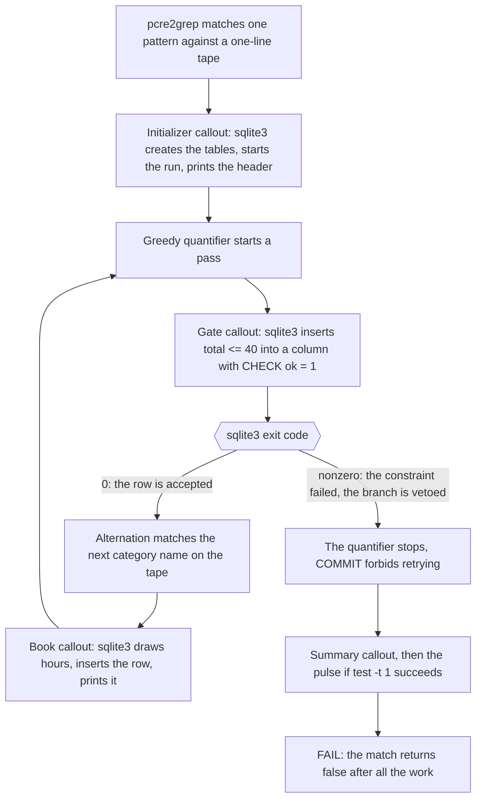

# Regex challenge, Track 2b: `pcre2grep` (no custom code at all)

**Teaches you:** program exit codes as control flow.

The "host" here is a stock `pcre2grep` and one command line. There is no C, no Perl, no dispatcher to write: the pattern's callout strings name the programs to run, and the **exit codes of those programs steer the match**. Then the match **returns false**. It follows the regex challenge plan (since removed; it lives in git history as `plans/regex.md`). **DEMO ONLY**: the records are fictional and go to a scratch SQLite file, with no connection to any real time-reporting system.

## Run it

Ubuntu's own `pcre2grep` is built *without* callout scripts, so it needs an upstream build. In a throwaway shell:

```bash
sudo apt install -y build-essential sqlite3
mkdir -p ~/src/pcre2 && cd ~/src/pcre2
curl -fLO https://github.com/PCRE2Project/pcre2/releases/download/pcre2-10.49/pcre2-10.49.tar.bz2
tar xjf pcre2-10.49.tar.bz2 && cd pcre2-10.49
./configure --prefix="$HOME/.local" --disable-shared \
    --enable-pcre2grep-callout --enable-pcre2grep-callout-fork
make -j"$(nproc)" && make install
~/.local/bin/pcre2grep --help | grep -i callout    # "All callout scripts in patterns are supported."
```

Then:

```bash
cd src/regex-pcre2grep
PCRE2GREP=~/.local/bin/pcre2grep ./timecards.sh    # or put ~/.local/bin first on PATH
PCRE2GREP=~/.local/bin/pcre2grep ./check.sh        # 25 runs, asserts the rules below
```

`timecards.sh` refuses (exit 2, with a message) a `pcre2grep` that lacks callout scripts, so a wrong binary cannot quietly fail. Records go to `$XDG_DATA_HOME/RegexPcre2grep/demo-timecards.db` (default `~/.local/share/RegexPcre2grep/`). Delete that directory to start over. A run looks like this, followed by a three-second pulse on a real terminal:

```text
# DEMO ONLY run 1
Meetings	16	16	2026-W46	DEMO ONLY
Coding	13	29	2026-W46	DEMO ONLY
Debugging	10	39	2026-W46	DEMO ONLY
Learning	18	57	2026-W46	DEMO ONLY
Error: stepping, CHECK constraint failed: stop rule fired: total exceeds 40 (19)
# committed total=57 entries=4 DEMO ONLY
# the match now returns false, on purpose
```

That `Error:` line is on **stderr** and is the stop rule announcing itself (see below), not a failure. It appears exactly once per run that ends over 40; `check.sh` asserts that and that nothing else is ever written to stderr.

## Run it in a container

Prerequisite: Docker, set up once as described in [`SANDBOX-SETUP.md`](../../SANDBOX-SETUP.md#docker).

```bash
sandbox/container/run-image.sh src/regex-pcre2grep
```

It builds this folder's [`Dockerfile`](Dockerfile) and runs the result with no network, a read-only file system and user `nobody`, then prints the output and a read-only look at the rows it wrote. The image holds a callout-enabled `pcre2grep` (built from the pinned PCRE2 release in the toolchain image) and sqlite3 on a minimal Ubuntu.

## Program Flow



**What this shows:** a callout string that starts with a path runs a program. Exit status 0 lets the match go on, and any other status fails that branch. So every decision in the program is an exit code from `sqlite3`. A constraint violation (the total is over 40) is the stop rule.

**Why this mechanism matters:** `pcre2grep` is not a language runtime, but it has a process boundary inside the matcher. The engine asks an external program a question and backtracks on the answer. Compare [`regex-pcre2`](../regex-pcre2/README.md), where the question is a function call in the same process.

## How the stunt works

`pcre2grep` supports two kinds of callout string. `(?C{|text$n})` echoes text. `(?C{/abs/path/prog|arg|arg})` runs a program: **exit 0 lets the match continue; any other exit code, or a program that cannot run, fails that branch and the engine backtracks.** The subject is a one-line "tape": `MeetingsCodingDebuggingLearning` followed by 60 three-digit gray shades.

| Piece | Job |
| --- | --- |
| `^(?C{sqlite3 ...})` | Initializer: creates the tables (with `CHECK(demo_only=1)` and `CHECK(hours BETWEEN 10 AND 19)`), starts a run row, prints the header |
| `(?: ... )*` | The loop. PCRE2's greedy quantifier is the iteration; the tape's category names are what it walks |
| `(?C{sqlite3 ... INSERT INTO stop_rule ...})` | The **gate** (the stop rule). It inserts `(running total <= 40)` into a table whose only column is `CHECK(ok=1)`, named "stop rule fired: total exceeds 40". When the total is over 40 the insert fails, `sqlite3` exits nonzero, and the branch is vetoed, ending the loop. The error message on stderr is that constraint's name |
| `(Meetings\|Coding\|Debugging\|Learning)` | The category: the tape supplies the order (`MeetingsCodingDebuggingLearningMeetings`, five names so that exactly 40 can continue to a fifth card), the alternation matches it |
| `(?C{sqlite3 ... INSERT INTO demo_timecards ...})` | **Book** one entry. SQLite draws the hours with `random()`, computes the running total and the ISO week, inserts the row, and prints it. `$1` in the SQL is the category the pattern just matched |
| `(*COMMIT)(?C{sqlite3 ... SELECT printf(...)})` | Once the loop ends, backtracking may not retry shorter loops; then print the summary |
| `[A-Za-z]*(?:(?C{/usr/bin/test\|-t\|1})(\d{3})(?C{\|$r$e[48;5;$2m ...})(?C{/bin/sleep\|0.05}))*` | The pulse. `test -t 1` is the predicate "is stdout a terminal?" (nonzero on a pipe, so the loop never starts and pipes and `check.sh` skip it). Each frame's shade is read back from the tape through `$2` |
| `(*COMMIT)(?:test -t 1, clear)?+(?C{\|# the match now returns false...})(*FAIL)` | Clear the banner (if there was one), then the signature move. The `?+` is possessive on purpose: without it, `(*FAIL)` backtracks into skipping the optional group and prints the final message twice |

The exit code is the whole trick. SQLite's `random()` and arithmetic live in the helper program, but the *decisions* (go around again, stop, pulse or not) are the pattern consuming exit codes.

## What `check.sh` enforces

`check.sh` checks that `timecards.sh` has no loop keyword and runs exactly one `pcre2grep`. The callouts may run only `/bin/sleep`, `/usr/bin/sqlite3` and `/usr/bin/test`, never a shell or an interpreter. If a `pcre2grep` without callout support is installed, the script must refuse it with exit code 2. Then it runs the program 25 times, and a copy of the script in which every card is worth 10 hours must deal five rows (the fifth `Meetings`, total 50), which proves that exactly 40 continues. Each run must print the "returns false" line, as many rows as it has entries, hours from 10 to 19, and the right stop rule (the total before the last card is at most 40, so exactly 40 continues, and the total after it is over 40; three to five entries). The stop-rule error must appear on stderr exactly once when the total is over 40 and never otherwise, and nothing else may be written to stderr. SQLite must agree with the output, the database must hold 25 runs and no probe rows, and a non-demo row must be refused.

## Gotchas worth knowing

- **State cannot live in the pattern.** `pcre2grep` has no variables, so the running total lives in SQLite and each callout re-reads it. That makes the arithmetic the helper's job, not PCRE2's; the pattern supplies the loop, the order, the branching and the failing.
- **No transaction this time.** Each helper is its own `sqlite3` process, so each statement commits immediately and nothing can be rolled back. Unlike the Perl track's single transaction, here "abandoned branch, side effects stay" is literal: the rows are already in the database before the match fails.
- **Callouts need absolute paths.** `pcre2grep` uses `fork` and `execv`, which do not search `PATH`. A bare `true` or `sleep` is silently a failed callout, indistinguishable from a vetoed branch. `check.sh` therefore pins the program list.
- **Guardrail.** Callouts may only run `/usr/bin/sqlite3`, `/usr/bin/test` and `/bin/sleep`, each with a fixed argument list. `check.sh` fails if any other program (in particular a shell or interpreter) appears. The only value interpolated into SQL is `$1`, one of four fixed category names from the tape.
- **The host is not nothing.** `timecards.sh` finds a callout-capable `pcre2grep`, creates and enters the scratch directory, and pipes the tape into one `pcre2grep` command. It has no loop and decides nothing, but it does contain a literal 60-shade tape (the pulse's brightness ramp, precomputed) and one `if`-like guard. The honest claim is "no custom code", not "no shell".
- **Not concurrency-safe.** A run is identified as `max(id)` in the `runs` table, so two simultaneous runs would tangle. It is a toy.
- **The ISO week is computed with SQLite date arithmetic**, because Ubuntu 24.04's SQLite (3.45) has no `%G`/`%V`. As in the other versions, the ISO year can differ from the calendar year near New Year.
- Only the `10.49` build above was tested. I did not try other PCRE2 versions or configure options.

---

See the [root README](../../README.md#the-results-so-far) for how this compares to the other regex entries, and [`CHALLENGE.md`](../../CHALLENGE.md) if you want to write your own.
