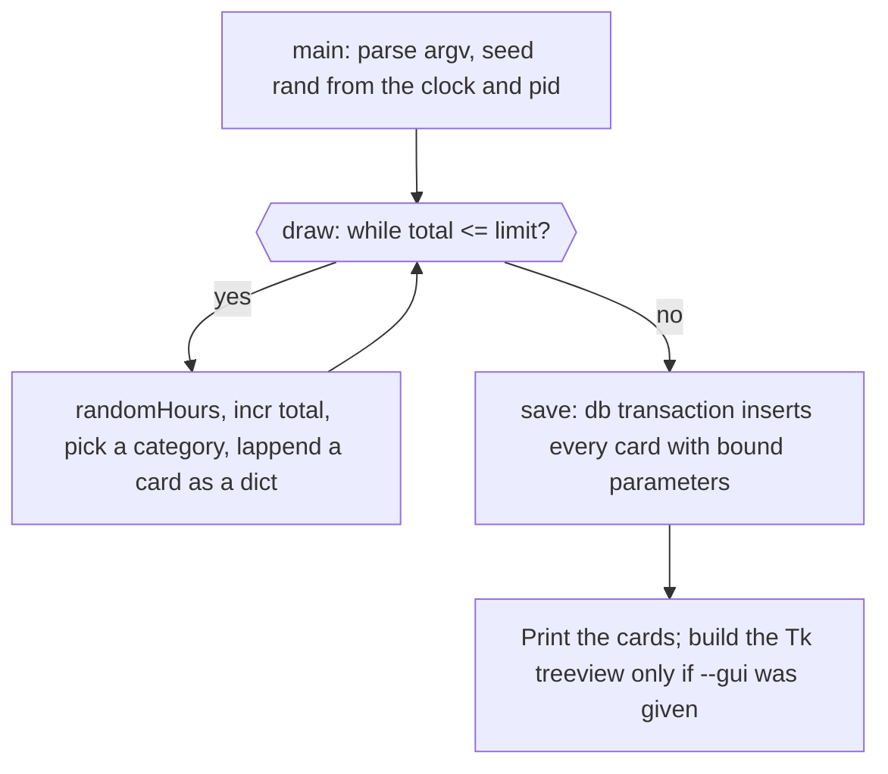

# Tcl

**Teaches you:** that idiomatic Tcl uses procedures in a namespace, dicts for records, braced `expr` and `db eval` to bind Tcl variables into SQL.

> **DEMO ONLY.** Fictional timecards in a scratch SQLite file. No connection to any real time-reporting system.

This is the straight version, the one that shows how Tcl is *meant* to be written. The challenge ("add 10 to 19 hour cards until the total passes 40") is one `while` loop in the proc `timecards::draw`; everything else in [`timecards.tcl`](timecards.tcl) is a small proc that does one job. There is an optional Tk window. The weird version, where the loop is a recursive SQL trigger and the code lives in the database, is [`tcl-weird`](../tcl-weird/README.md).

## Run it

You need Tcl 8.6 (`tclsh`) with the `sqlite3` Tcl package (Ubuntu: `tcl8.6` and `libsqlite3-tcl`). You need Tk (`tk8.6`) only for `--gui`.

```bash
cd src/tcl
tclsh timecards.tcl                      # text
tclsh timecards.tcl --gui                # also open a window; close it to finish
tclsh timecards.tcl --gui --seconds 3    # ...or let it close itself after 3 seconds
./check.sh                               # set TCLSH=/path/to/tclsh if it is not on your PATH
```

Records go to `$XDG_DATA_HOME/Tcl/demo-timecards.db` (default `~/.local/share/Tcl/`). A run looks like this:

```text
# DEMO ONLY run 1794860932-15
Meetings	14	14	2026-W47	DEMO ONLY
Coding	10	24	2026-W47	DEMO ONLY
Debugging	14	38	2026-W47	DEMO ONLY
Learning	16	54	2026-W47	DEMO ONLY
# committed total=54 entries=4 DEMO ONLY
# one while loop, cards as dicts, and db eval binding Tcl variables as SQL parameters
```

With `--gui` a small table window appears, with a "DEMO ONLY" line under it. **Headless:** Tk needs an X display. Without one, run it under `xvfb-run -a tclsh timecards.tcl --gui --seconds 1`; the container image below does exactly that and takes a screenshot. The text version needs no display, and Tk is not even loaded unless you ask.

## What it does

It draws cards of 10 to 19 hours, cycling through Meetings, Coding, Debugging and Learning, until the running total is greater than 40 (the card that crosses the line is kept), prints each card, and saves them to SQLite in one transaction.

## Program Flow



**What this shows:** the conventional Tcl shape. A `while` is the loop, a dict is the card, and `db transaction` makes the save all-or-nothing. A guard around `main` lets the checks `source` the file and test `draw` in the same process.

**Why this mechanism matters:** the program draws first and saves afterwards, so the card list is complete before the database sees it. Tcl's `while` re-evaluates its test each pass, and the test comes before the draw, so the crossing card is kept. The weird sibling [`tcl-weird`](../tcl-weird/README.md) moves the loop into the database.

## How the stunt works

1. **A namespace for the rules.** `namespace eval timecards { variable ... }` holds the categories and limits; every proc is `timecards::name`. That is how a one-file Tcl program avoids polluting the global namespace.
2. **`randomHours`.** `expr {$minHours + int(rand() * ($maxHours - $minHours + 1))}`. Always brace the expression: Tcl would otherwise substitute and then parse it a second time, which is slower (no bytecode) and a classic injection hole.
3. **`draw`, the challenge.**
   ```tcl
   while {$total <= $limit} {
       set hours [randomHours]
       incr total $hours
       set category [lindex $categories [expr {[llength $cards] % [llength $categories]}]]
       lappend cards [dict create category $category hours $hours total $total]
   }
   ```
   The test is made *before* each draw, so the card that pushes the total over 40 is the last one added: that is why it is kept. A card is a **dict** (a key-value list with a real data structure behind it).
4. **`save`.** `sqlite3 [namespace current]::db path` makes a *command* named `db`; everything you do to the database is a subcommand. `db transaction {...}` commits or rolls back for you. In `db eval {INSERT ... VALUES ($runId, $category, ...)}` the `$names` are **bound parameters**: Tcl hands the *values* to SQLite instead of pasting text into the SQL, so there is no quoting problem. `dict with card { ... }` unpacks a card's keys into local variables first, so the names are just there to bind.
5. **`try ... finally`** closes the database even when something fails.
6. **`main`** parses `--gui` and `--seconds` with a `while`/`lassign`/`switch` loop (the standard way to walk `argv`), seeds `rand()` from the microsecond clock and the process id, draws, saves and prints.
7. **The guard.** `if {[info exists argv0] && [file normalize $argv0] eq [file normalize [info script]]}` runs `main` only when the file is the script. That is the Tcl `if __name__ == "__main__"`, and it is what lets `check.sh` `source` the file and unit-test `draw` 2,000 times in one process.
8. **Tk, only if asked.** `package require Tk` happens inside `showWindow`. It builds a `ttk::treeview` with a heading and a row per card.

## Why this is idiomatic

- **Everything is a command**, and the program is a set of procs, namespaced, with comments saying what each returns.
- **Braced everything**: `expr {...}`, `while {...}`, `if {...}`; no unbraced expressions anywhere (`check.sh` greps for them).
- **Dicts for records, lists for sequences**, `lindex`/`lappend`/`llength` rather than index arithmetic on strings.
- **Variables as SQL parameters** instead of string building.
- **Resource safety** with `try ... finally`, and `db transaction` for atomicity.
- **Tk is optional and lazy**, and uses the themed `ttk::` widgets rather than the 1990s ones.

## What you can learn

- Tcl's rule that *everything is a string* and what that costs and buys: why `expr` needs braces, why `{*}` ("expand") exists, why `$` and `[ ]` are the only substitutions.
- `namespace eval`, `variable`, `proc ns::name`, and `namespace current`.
- `dict create`, `dict get`, `dict with`.
- The `sqlite3` package's command-per-database model, `eval`, `transaction`, bound variables.
- The `info script` / `argv0` guard for a file that is both a program and a library.

## Gotchas worth knowing

- **A tclsh that has loaded Tk does not exit when the script ends** while the main window exists. `showWindow` ends with `destroy .` for that reason; without it the process hangs (this showed up under `xvfb-run`).
- **ISO weeks.** `clock format -format %G-W%V` gives the ISO-8601 year and week. `%Y` and `%U` are different things and disagree around New Year.
- **`rand()` is not cryptographic**, and Tcl seeds it per process; `srand` is called explicitly so two programs started in the same second do not share a seed.
- **The `sqlite3` package is not in Tcl itself.** It is a separate package (`libsqlite3-tcl`, or the `sqlite3` Tcl extension built with SQLite).
- **Formatting.** Tcl has no standard formatter or linter here (`nagelfar` was not available); the layout follows the Tcl Style Guide by hand (4 spaces, braces on the same line, procs documented above their definition). `check.sh` confirms the file is a *complete* Tcl script (`info complete`) and that every `expr` is braced.

## What `check.sh` enforces

The `DEMO ONLY` marker is there; no network-looking text; `draw` is a `while` on the limit; no unbraced `expr`; the file is a complete script. It then sources the file and calls `draw` 2,000 times, each deal checked: hours 10 to 19, no card after the total passed 40, correct running totals, categories in order, 3 to 5 cards. If Xvfb (or a `DISPLAY`) is present it runs `--gui --seconds 1`; otherwise it says "gui: SKIPPED". Finally 25 real runs are checked for sane records with SQLite agreeing with the printed output.

## Run it in a container

Prerequisite: Docker, set up once as described in [`SANDBOX-SETUP.md`](../../SANDBOX-SETUP.md#docker). The `cc-rt-tcl` base image comes from `sandbox/container/build-bases.sh`.

```bash
sandbox/container/run-image.sh src/tcl
sandbox/container/run-image.sh --out ./results src/tcl     # copies screenshot.png and the rows there (the folder must be writable by user nobody)
```

It builds this folder's [`Dockerfile`](Dockerfile) and runs `--gui` on a virtual display (Xvfb) with no network, a read-only file system and user `nobody`, takes a screenshot of the window, and prints the output and a read-only look at the rows written. The image holds Tcl/Tk, the Tcl sqlite3 package and sqlite3 on a minimal Ubuntu.
