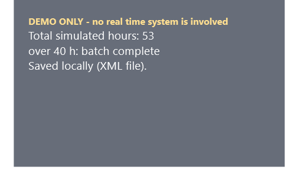

# XAML challenge: the program isn't even C# code

**Teaches you:** how far a markup parser can be pushed before it stops describing a UI and starts *running* a program.

XAML is supposed to describe a user interface: a tree of objects, declared, not executed. This entry treats that promise as a dare. The C# in this folder is a single expression that hands a `.xaml` file to the XAML parser:

```csharp
new Application().Run((Window)XamlReader.Load(File.OpenRead(args[0])));
```

Every piece of behavior - the random draws, the arithmetic, the stop rule, the database writes, a background thread, the fade animation - lives inside the `.xaml` file, and all of it runs **while the file is being parsed**. There is no code-behind and no event handler anywhere in this folder.

## Run it

Needs Windows and the .NET 10 SDK.

```powershell
cd src\xaml
dotnet run -- strict.xaml     # only types that ship with .NET and WPF; saves an XML file
dotnet run -- sqlite.xaml     # talks to SQLite directly from XAML
dotnet run -- efcore.xaml     # EF Core: TimeCards.Add and SaveChanges, from XAML
```

Records land in `src\xaml\data`; delete that folder to start fresh (the stop rule counts rows already saved). The window says **DEMO ONLY**: nothing here touches a real time-reporting system.



## How is that even possible?

A markup language has no `for`, no `if`, and no assignment - on paper. In practice, WPF's XAML parser ships with a few features that, combined, add up to a small interpreter:

- **`XamlReader.Load` is the interpreter.** The `.xaml` file is the program; parsing it *is* running it.
- **`ObjectDataProvider` is the instruction.** It can construct any object and call any method, and it fires the moment it is parsed. Document order becomes the program counter.
- **`Refresh` is the goto.** One provider can re-run another one, smuggled through an `x:Array` so XAML does not try to unwrap it first.
- **"Carrier" arrays are the variables.** One `ObjectDataProvider` call fills a `char[]` or `byte[]` in place; the next one reads it back. That is how a random number travels from `Random.Next` into a SQL parameter, an XML element, or an EF Core entity.
- **Expression engines are the ALU.** `DataTable.Compute("Sum(h)")`, `DataView.RowFilter`, and SQL itself do the arithmetic and the conditionals. A SQL string inside a XAML attribute is still XAML.
- **A `Thread` is built entirely in markup**, using `Delegate.CreateDelegate`, then started and joined - all as `ObjectDataProvider` calls. The window's fade is an ordinary WPF `Storyboard`.

## Honest fine print

Obfuscation is not the same as lying, so here is what the trick actually costs:

- **The loop is unrolled, not looped.** There is no loop construct anywhere in these files - only four copy-pasted passes. "Four categories" is baked into the markup, not computed.
- **Conditional *effects* come from the expression engines**, not from WPF's `Trigger`/`DataTrigger` system. `DataTable.Compute` and SQL branch on data; XAML triggers are not used for program logic here.
- **Three files, three flavors of the same program.** `strict.xaml` uses nothing outside .NET itself, so it saves XML rather than a database. `sqlite.xaml` adds the SQLite package. `efcore.xaml` adds EF Core, through two small model classes copied from the [C# original](../ModernChallenge1/README.md).

## The why

XAML's job is to *describe* a UI tree, declaratively, so a designer tool can read and write it without running any code. This entry shows what happens once you notice the parser does not actually enforce that: given the right combination of built-in types, parsing a file and running a program become the same act. It is not a technique to reuse - it is what happens when you take "XAML is just data" at its word and then push until it stops being true.

The idea is older than this repo. A [2013 blog post](../../docs/stacked-bar-charts.md) did the same thing on ASP.NET Web Forms: it built a stacked bar chart with no code-behind, just a SQL `PIVOT` and markup. That post is where the XAML entry came from. Microsoft never gives up on an idea.

---

See the [root README](../../README.md) for how this compares to the other entries, and [`CHALLENGE.md`](../../CHALLENGE.md) if you want to write your own.
